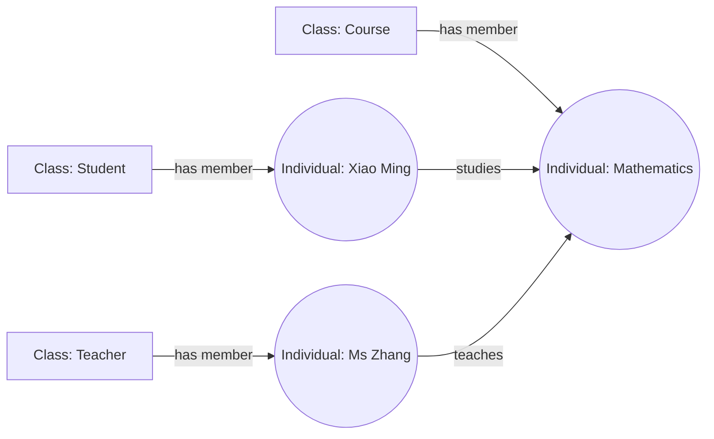
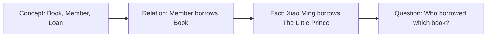
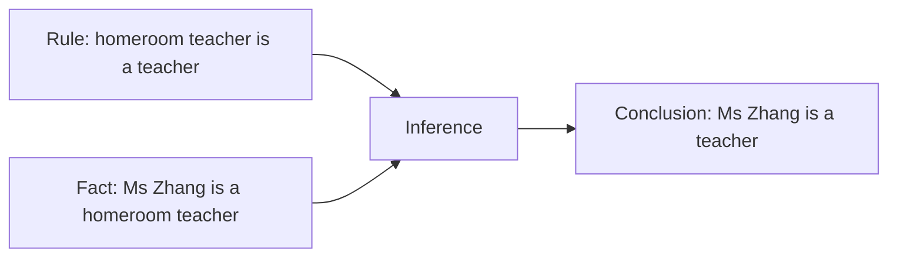
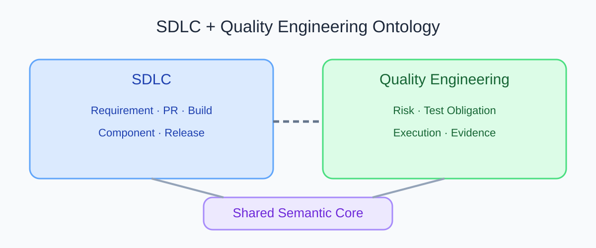
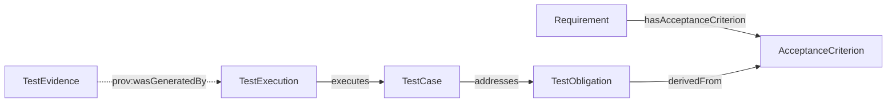

# What Is an Ontology? Understand AI Knowledge Modeling Through Everyday Classification

After a pull request changes a service, a team may ask which requirements, components, and tests could be affected. The answers often sit in requirement documents, source control, test tools, and build records. To connect them, a system needs to know what each item represents and what each relationship means.

An ontology provides an explicit knowledge model for a domain. It defines concepts, relationships, and rules so that people and software can use the same meanings. This article explains the idea in two stages. Stage one uses clear-language principles inspired by ASD-STE100. Stage two gives a beginner explanation and a professional explanation of the same concept.

## Stage One: Explain Ontology with ASD-STE100 Principles

ASD-STE100 Simplified Technical English is a controlled natural language standard for technical documentation. It includes writing rules and a controlled dictionary. This Chinese and English article borrows principles such as short sentences, stable terms, and explicit meaning. It does not claim formal compliance. ASD-STE100 is designed for technical English, so this article is not a certified STE text.

### What is an ontology?

An ontology is a knowledge model.

It describes things in a domain.

It defines types of things.

It defines relationships between things.

It can also define logical rules.

These definitions help people and computers use knowledge consistently.

### What does an ontology contain?

| Content | Term | Library example |
|---|---|---|
| A category | Class | Book, Member, Loan |
| A specific object | Individual | *The Little Prince*, Xiao Ming, one loan record |
| A feature or link | Property | A title, a member borrows a book, an author writes a book |
| A logical statement | Axiom | Each loan record is linked to a member and a book |

A property can describe a feature or connect two objects. In a formal model, a link between objects is often called an Object Property. A link between an object and a value such as text, a number, or a date is often called a Data Property.

### How does an ontology work?

The modeler selects a domain and identifies its main concepts. The modeler then defines relationships and rules, and links specific objects to those concepts. A query can follow the relationships. A reasoner can derive a conclusion when the facts satisfy the model's logic.

### What does an ontology do?

An ontology can align the meaning of terms, describe relationships, support semantic queries and logical reasoning, and help systems share domain knowledge.

The working definition in this article is simple: an ontology is a knowledge model that explicitly describes domain concepts, relationships, and logical rules.

## Stage Two: Two Ways to Understand Ontology

### Level One: Beginner Explanation

#### Think of an ontology as a domain guide

Imagine you are organizing a library. The shelves contain books. Members can borrow books. Authors write books. A new librarian needs to understand a statement such as “Xiao Ming borrowed *The Little Prince*.” A library system needs the same definitions to find the record.

The guide needs to explain a few things:

| Everyday phrase | Ontology concept | Example |
|---|---|---|
| A kind of thing | Class | Book, Member |
| One specific thing | Individual | *The Little Prince*, Xiao Ming |
| A link between things | Relation | Xiao Ming borrows *The Little Prince* |
| A rule in the domain | Axiom | A loan record links a member and a book |

The guide explains what objects exist and how they connect. It is not a list of loans for one day. A list records facts. The guide defines what those facts mean.

#### Use a school example

A school has students, teachers, courses, and classes. Xiao Ming is a student. Mathematics is a course. When we record that Xiao Ming studies Mathematics, a computer can answer “What does Xiao Ming study?”

The diagram uses boxes for classes and circles for individuals.

Figure 1 shows classes, individuals, and relationships. The English labels are term examples. A real domain model still needs to define each relationship's direction, scope, and rules.

The beginner version is this: an ontology classifies things in a domain, explains how they connect, and records important rules.

#### From concepts to answerable questions

Think of modeling as four steps. Define concepts, define relationships between them, use relationships to record facts, then use questions to check whether the knowledge supports a real need.

Figure 2 shows the first three steps as model and instance data. The last step checks whether they can answer a useful question. If they cannot, review whether a concept, relationship, fact, or query definition is missing.

### Level Two: Professional Explanation

#### A formal definition

Knowledge engineering often defines an ontology as an explicit, formal specification of a shared conceptualization. A widely cited definition by Thomas R. Gruber (1993) is “An ontology is an explicit specification of a conceptualization.” “Explicit” means that the concepts and relationships are stated. “Formal” means that software can process them according to defined semantics.

An OWL 2 ontology can contain classes, properties, individuals, and data values. It can express complex knowledge with formal semantics. RDF represents graph statements as subject-predicate-object triples. RDFS and OWL can add type hierarchies and logical semantics. SPARQL queries RDF graphs.

#### A small reasoning example

Assume a model contains two statements:

1. Every homeroom teacher is a teacher.
2. Ms Zhang is a homeroom teacher.

A reasoner can derive that Ms Zhang is a teacher. This conclusion follows from explicit facts and a rule. If the model does not contain the rule, software cannot infer the relationship from similar names alone.

#### OWL reasoning and SHACL validation answer different questions

OWL commonly uses the Open World Assumption. If a source does not record a fact, that absence does not make the fact false and does not automatically make the data invalid.

Suppose a school requires every student record to have a student number. SHACL can check whether the data conforms to a declared shape. OWL reasoning and SHACL validation have different purposes. A result from one should not be presented as a result from the other.

#### Ontology, database, and knowledge graph

A database organizes and stores records. A knowledge graph represents entities and their relationships. An ontology defines the types of those entities, the meaning of relationships, and logical semantics. A knowledge graph can use an ontology, or it can use a lighter schema. “Ontology” also has a philosophical meaning. This article uses the knowledge-engineering meaning.

#### Scope and limits

An ontology can help when teams need shared terms, semantic integration across systems, complex relationship queries, or logical reasoning. A simple CRUD system may need only a database and a clear data model. An ontology does not, by itself, guarantee correct input data, correct AI output, or proof that software meets business requirements.

## From the Library to Software Development

The same modeling approach can organize requirements, code changes, test obligations, and test evidence. The image below preserves the series' original overview. Blue denotes SDLC concepts, green denotes Quality Engineering concepts, and purple denotes the shared semantic core. The connections show that both domains use shared semantics. They do not describe a deployed product architecture.

Figure 3 preserves the original series overview. Use it to see the domain boundaries, then read the traceability relationships below.

In the v0.19 experimental model, a Requirement can have an AcceptanceCriterion. A TestObligation can be derived from that criterion. A TestCase can address the obligation. A TestExecution records which case ran. A TestEvidence resource uses a PROV-O provenance relationship to identify the execution that generated it. This model explains concepts. It does not claim integration with a real team's tools.

Every arrow follows the defined relationship direction, from subject to object. For example, `TestObligation derivedFrom AcceptanceCriterion` points from an obligation to its source criterion. A query that starts at a requirement and follows obligations, cases, executions, and evidence traverses some relationships in reverse. The dashed line shows `TestEvidence prov:wasGeneratedBy TestExecution`: evidence points to the execution that generated it. Missing links can prevent later analysis from answering the original question.

## Common Misunderstandings

| Misunderstanding | More accurate explanation | Example |
|---|---|---|
| An ontology is a knowledge graph | An ontology describes semantic structure. A knowledge graph expresses specific knowledge. They can be used together. | “Student studies Course” is a model relationship. “Xiao Ming studies Mathematics” is a fact. |
| An ontology is a database schema | A schema organizes storage. An ontology also expresses concept meaning and logical relationships. | A `student_id` field does not say which courses a student may select. |
| An ontology makes AI understand every business | An ontology supplies explicit semantic context. The data and conclusions still need checks. | Missing or incorrect links can lead to incorrect queries and AI suggestions. |
| OWL automatically reports every missing value | Under the Open World Assumption, a missing fact is not automatically false. Data completeness usually needs a validation mechanism such as SHACL. | An absent student number does not automatically prove that the record is invalid. |

## Practical Guidance

- Start with a question that a reader needs to answer. Define the model's purpose first.
- Define stable domain terms and relationships before deciding whether OWL reasoning is needed.
- Document each relationship's direction, domain, range, and source. Explain every arrow in a diagram.
- Record reasoning, structural validation, and business quality assessment as separate activities.
- Use an everyday analogy to introduce the concept, then state where the analogy stops being accurate.

## FAQ

### Must an ontology use OWL?

No. A glossary, table, or JSON model can establish shared terms. RDF, RDFS, or OWL may be appropriate when software needs machine-processable semantics.

### Which contains the other, an ontology or a knowledge graph?

There is no single relationship that applies to every system. A knowledge graph can use an ontology for semantics, or it can use a simpler schema. State separately which part is the model and which part is instance data.

### Can an analogy replace a professional definition?

No. An analogy can build intuition. A professional definition must also state machine-readable concepts, relationships, logical assumptions, and limits.

## Three Questions to Check Your Understanding

1. In the school example, what are “Student” and “Xiao Ming”? A. Two classes; B. A class and an individual; C. A property and an axiom.
2. If every homeroom teacher is a teacher and Ms Zhang is a homeroom teacher, what can be inferred? A. Ms Zhang is a teacher; B. She teaches Mathematics; C. She is responsible for the whole school.
3. If a student record has no student number, must OWL report an error? A. Yes; B. Not necessarily; a separate constraint check may be needed; C. It will fill in the number.

Answers: 1-B, 2-A, 3-B. The second answer depends on the model containing the stated rule. The third requires a separately declared data constraint.

## Summary

An ontology explicitly describes concepts, relationships, and rules in a domain. Everyday examples help readers start. A professional model also states its semantic assumptions and limits. The next article returns to software development and asks how teams can share meaning across scattered quality information.

## References

- ASD-STE100 official FAQ: https://www.asd-ste100.org/STE_faq.html
- W3C OWL 2 Primer: https://www.w3.org/TR/owl2-primer/
- W3C RDF 1.1 Concepts: https://www.w3.org/TR/rdf11-concepts/
- W3C SHACL: https://www.w3.org/TR/shacl/
- W3C PROV-O: https://www.w3.org/TR/prov-o/
- Thomas R. Gruber, “A Translation Approach to Portable Ontology Specifications” (1993): https://tomgruber.org/writing/ontolingua-kaj-1993/
- Series model v0.19: `01_project/ontology/baseline.ttl` and `01_project/shapes/baseline.shacl.ttl`
