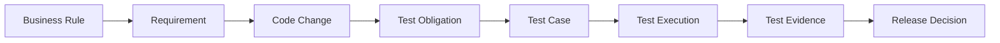

# Why Does Software Development in the AI Era Need an Ontology? Connect Requirements, Code, and Tests

A pull request changes a refund API. Developers know which files changed. The test platform knows which cases passed. The requirement tool contains rules for refund permissions and amounts. A release owner asks, “What quality risks does this change create?” The tools do not answer with one shared view. The team still has to find the relationships and decide whether the evidence is sufficient.

An ontology can provide shared semantic definitions for these objects. It can help people and software answer relationship questions, and it can give an AI agent queryable context. It does not repair incorrect data or replace testing and release judgment.

## A Plain-Language Introduction

A library catalog can record books, members, and loans. A software team also needs a kind of project catalog, but it describes relationships between requirements, code changes, tests, and releases. Once the team makes those relationships clear, it can follow a change to the quality goals it may affect.

Formally, an ontology is a model that explicitly describes domain concepts, relationships, and rules. In software development, it can provide shared vocabulary across tools. Teams still need to confirm how their own fields, identifiers, and relationships map to that vocabulary.

## Why Engineering Knowledge Gets Disconnected

Different tools often store different objects. A requirement system stores business goals. Git stores commits and pull requests. A test tool stores cases and execution records. A release platform stores versions and environments. Even when every tool has data, the links can break:

- The same component is called “refund service” in a requirement and `refund-api` in the code repository.
- A test case links to a requirement ID but does not say which acceptance criterion it checks.
- The latest PR passed CI, but the team cannot confirm that the result belongs to the build being prepared for release.
- A defect says “duplicate refund” but has no link to an idempotency rule or regression test.

Text similarity can find candidates, but it cannot prove that a relationship is correct. Human mapping, stable identifiers, sources, and review still matter.

## Four Domains in This Series

The series separates the model into four domains that can connect to one another. This avoids placing every concept in one model that is difficult to maintain.

| Domain | Main objects | Question it helps answer |
|---|---|---|
| Quality Engineering ontology | Tests, defects, risks, coverage, evidence | Which quality obligation was checked, and does the evidence qualify? |
| SDLC ontology | Requirements, work items, code changes, PRs, builds, releases | Through which engineering activities did a requirement enter a release? |
| Business-domain ontology | Orders, payments, inventory, membership, permissions | What states and rules apply to business objects? |
| AI Agent ontology | Agents, Skills, tools, tasks, executions, evidence | What knowledge and tools did an agent use, and what did it produce? |

The series uses these four domains to organize its topics. The v0.19 experimental baseline defines only some related concepts; articles that discuss model scope identify existing baseline content and proposed extensions.

The domains can connect through explicit relationships. The series uses this path as its main thread:

Figure 1 is a conceptual analysis sequence that connects the questions in this series. It is not a relationship graph from the v0.19 baseline, and its arrows are not defined RDF relationships. Business Rule, Test Obligation, and Release Decision illustrate analysis stages here. A project must still define the relationships, data sources, and evidence criteria before representing them in an ontology, then check that those definitions fit its needs.

## Who Uses This Semantic Layer?

| Role | Common question | Information to inspect | What still needs human judgment |
|---|---|---|---|
| QA / test engineer | Which tests relate to a changed requirement? | Requirements, acceptance criteria, obligations, cases, and runs | Whether links are complete and tests can detect the target problem |
| QA lead | Is there evidence for high-risk requirements? | Cases, executions, and evidence gaps by obligation | Risk acceptance criteria and retest priority |
| Developer | Which features relate to this code change? | PR, code change, component, and target requirement | Whether indirect dependencies are in scope |
| Tech lead | Is a passing CI run enough to merge? | Build, test outcome, provenance, and policy checks | Design risks, unknown data, and exceptions |
| Project manager | What quality risks remain for this release? | Uncovered requirements, open risks, and evidence states | Project priorities and risk treatment |
| Release manager | Does this release meet its conditions? | Release target, claims, gates, and evidence snapshot | The Go / No-Go decision and risk sign-off |
| AI agent developer | How can an agent get relevant context? | Queryable concepts, relationships, sources, and permissions | Whether an agent's output is enough to support an action |

## From a Model to Daily Work

An ontology can support six kinds of work:

1. **Change-impact analysis** follows requirements, components, code changes, and test obligations to find candidate regression scope. Completeness of the relationships affects the result, so candidates are not a final test list.
2. **Coverage-gap analysis** checks whether important requirements have obligations, cases, and execution evidence. The focus is on validation goals, not the total number of tests.
3. **Evidence qualification** checks which build, environment, and time produced evidence, whether its source is complete, and whether it meets the rules.
4. **Release readiness** brings requirement coverage, execution outcomes, qualified evidence, and open risks into a policy review.
5. **Cross-tool traceability** aligns identifiers and meanings across systems and finds broken links, duplicates, and stale references.
6. **AI quality assistance** lets an agent retrieve relevant context through controlled queries and return sources for each suggestion. The output remains analysis for review.

These capabilities can be organized into three layers: Understand shows objects and sources; Analyze follows relationships to find impact and gaps; Decide displays policy results and open risks so an authorized person can make the final decision.

## Scope and a Practical Starting Point

An ontology is more useful when terms differ across systems, relationships are complex, or teams need traceability and reasoning. If one service owns the data, fields are stable, and queries are simple, a database schema may be enough. Model maintenance also has a cost, including mapping updates, relationship review, version compatibility, and data governance.

Start with one question, such as “Which components did PR-128 change, and which test obligations need attention?” List the concepts and relationships, then test whether a small dataset can answer it. Add formal axioms, validation rules, or agent tools only when simple links no longer meet the semantic need.

## Practical Guidance

- Choose a frequent question with an answer that can be checked. Do not begin with a company-wide glossary.
- Ask requirements, development, QA, and release owners to confirm relationship definitions.
- Keep sources and confidence states for relationships. Do not present an inferred link as a confirmed fact.
- Show mapping errors, missing data, and business risks as different conditions.
- Evaluate deterministic queries and rule checks before adding generative AI.

## FAQ

### Does an ontology align data from different tools automatically?

No. The model defines how terms correspond. Import and field mapping still need rules or human confirmation. Ambiguous matches should remain candidates.

### Can an AI agent make a release decision once an ontology exists?

The model can supply context and traceable results. A release decision still depends on evidence checks against team policy and an authorized owner.

### Does a small team need an ontology?

It depends on the problem. A small number of tools, stable terms, and simple relationships may need only a lightweight data model. Consider an ontology when cross-system traceability becomes difficult and the benefit can justify maintenance.

## Three Questions to Check Your Understanding

1. What problem does an ontology address first? A. It runs every test; B. It makes domain concepts and relationships explicit; C. It replaces requirements and source control.
2. Does a test-case link to a requirement prove that the requirement was validated? A. Yes; B. No, the validation target and execution evidence also need review; C. Yes, if the case passed.
3. Who should decide whether to release after an agent suggests tests? A. The model; B. An authorized release owner using policy and evidence; C. Whoever sees the highest test count.

Answers: 1-B, 2-B, 3-B.

## Summary

Engineering teams already have requirement, code, test, and release data. The difficult part is knowing how each record relates to the others. An ontology gives those relationships explicit meanings and makes analysis traceable. The next article compares what a database, knowledge graph, RAG, and ontology each contribute to the same PR question.

## Series Navigation

- Previous draft: `00-what-is-ontology.md`
- Next draft: `02-ontology-graph-rag-database.md`

## References

- Series model and terms: `01_project/ontology/baseline.ttl` in the v0.19 project package
- W3C PROV-O: https://www.w3.org/TR/prov-o/
- W3C OWL 2 Primer: https://www.w3.org/TR/owl2-primer/
