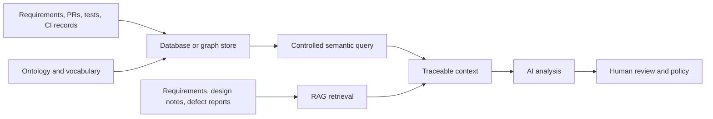
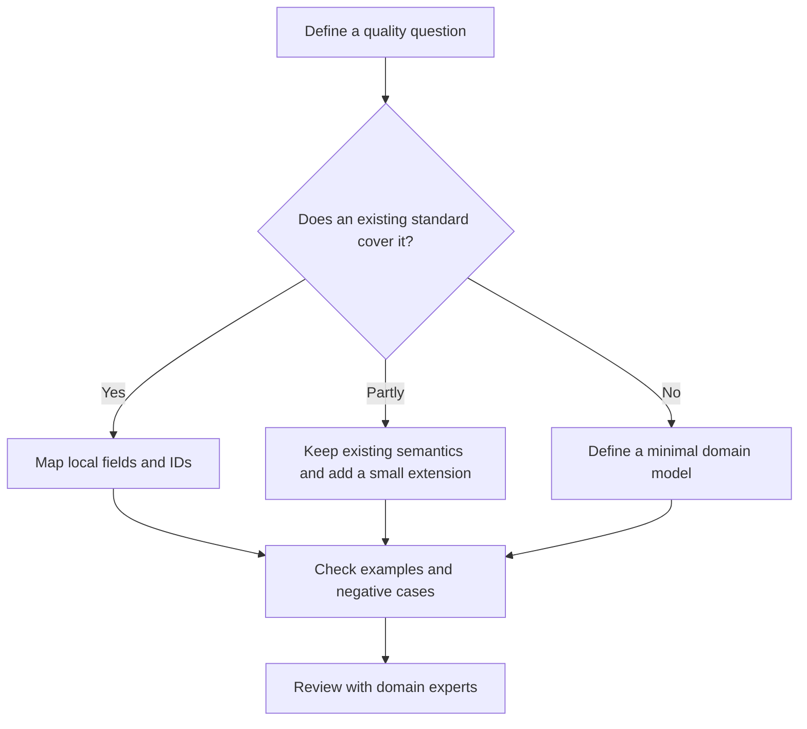

# Ontology vs. Knowledge Graph vs. RAG vs. Database: One Testing Question, Four Roles

A team wants to know which tests pull request PR-128 may affect in a refund API. The names alone do not help choose a solution. Start with the question and the information it requires, then examine what a database, knowledge graph, retrieval-augmented generation (RAG), and ontology each provide.

These terms describe different layers. A database focuses on storing and accessing records. A knowledge graph expresses entities and relationships. RAG retrieves relevant material and provides it to a generative model. An ontology defines the semantics of concepts and relationships. These technologies can work together, so they should not be placed on one universal ranking.

## What the Question Requires

To assess PR-128, a team needs to know which code changes it contains, which components those changes modify, which requirements they target, how acceptance criteria become test obligations, which cases address those obligations, and which tests actually ran.

The v0.19 experimental model uses relationships such as `PullRequest includesChange CodeChange`, `CodeChange modifies Component`, `CodeChange targetsRequirement Requirement`, `Requirement hasAcceptanceCriterion AcceptanceCriterion`, `TestObligation derivedFrom AcceptanceCriterion`, `TestCase addresses TestObligation`, and `TestExecution executes TestCase`. Test evidence uses `prov:wasGeneratedBy` to point to the execution activity that generated it.

## The Four Roles

| Approach | Typical input | Typical output | Strength | Common blind spot |
|---|---|---|---|---|
| Relational database | Records with fields and keys | Filtered or joined records | Transactions, structured reads and writes, explicit joins | Business semantics may live in schema, application logic, or documentation |
| Knowledge graph | Entities, relationships, and properties | Related entities and paths | Multi-hop relationships and traceability | Nodes and edges alone may not explain relationship meaning or inference rules |
| RAG | Documents, code snippets, or indexed material | Retrieved passages and a generated answer | Finding relevant text from unstructured sources | Similar text does not verify a relationship, version, or coverage |
| Ontology | Classes, properties, relationship semantics, and axioms | Shared interpretation, formal queries, or derived conclusions | Shared terms and explicit semantic boundaries | Modeling and maintenance take effort; the model alone contains no project instance data |

For PR-128, a database can retrieve the PR and related test IDs. A graph can follow links to candidate tests. RAG can retrieve the requirement and PR description. An ontology explains what relationships such as `addresses` and `targetsRequirement` mean and how a query should interpret those records. The result still needs checks for source, current build, and test obligation.

## How They Can Work Together

Figure 1 shows one possible composition, not a required product architecture. An ontology can live in documents, source control, or a graph store. A knowledge graph can use a database for storage. The source of RAG passages should remain distinct from structured query results, and generated answers should identify the records they used.

## Compare the Same Task on These Dimensions

| Evaluation dimension | Question to check |
|---|---|
| Relationship coverage | Can the system trace a PR to changes, requirements, obligations, and cases? |
| Version scope | Is the query limited to the target commit, build, or release? |
| Provenance | Can each candidate test be traced to a relationship and source record? |
| Gap handling | Does the system return unknown when a mapping or execution record is missing? |
| Maintenance cost | Who updates mappings and the model when terms and fields change? |
| Generation quality | Does AI cite real sources and avoid presenting a candidate path as confirmed impact? |

Do not compare only whether an answer looks complete. Give each approach the same PR set, the same labeled candidate tests, and the same target version. Then inspect misses, false positives, and human review time. If there are no real run records, do not report performance or accuracy conclusions.

## Existing Standards and Research as Reuse References

The candidates below come from a v0.2 research note dated October 29, 2026. That note did not fully check each project's source, issues, releases, licenses, or maintenance activity. “Not verified” means that the available evidence is incomplete; it does not mean that a project or concept does not exist.

| Candidate | Type and what it can inform | Boundary and checks |
|---|---|---|
| SEON | A network of software-engineering ontologies; its modular concepts can inform domain modeling | Do not assume it covers every modern DevOps activity. Check the relevant sub-ontology, version, and license |
| OSLC Quality Management 2.1 | Interoperability resources and services for quality management, including TestPlan, TestCase, TestScript, TestExecutionRecord, and TestResult, with links to shared resources such as requirements and changes | It does not define a complete QA reasoning system. Map resource definitions and properties instead of assuming equivalence from names |
| Seamless Digital Engineering Ontology | An OWL engineering ontology based on BFO and CCO; its standards references and import structure may inform modeling | BFO and CCO imports add dependencies, learning effort, and license checks. In the research materials, SDE means this ontology; do not confuse it with a generic Software Development Environment |
| W3C PROV-O | Provenance among entities, activities, and agents, including generation, use, and responsibility | Provenance records a source relationship. It does not prove evidence sufficiency or that a conclusion is correct |
| OpenTelemetry Semantic Conventions | Common keys and values for concepts, protocols, and operations; its YAML model and generated documentation can inform vocabulary governance and versioning | These are semantic conventions, not an OWL ontology or a QA domain model |
| RDFLib | Python tooling for RDF graphs, parsing, and SPARQL queries | It is an implementation library, not a business ontology |
| pySHACL | A tool for validating RDF graphs against SHACL shapes | It performs shape validation; it does not replace OWL reasoning |
| OWL-RL | An implementation of OWL 2 RL rule-based reasoning on RDFLib | Its reasoning scope is the selected OWL 2 RL profile; do not treat it as a full OWL 2 DL reasoner |

### Map Reference Models to Local Concepts

OSLC QM provides useful resource references, but names alone do not map v0.19 concepts to OSLC resources. v0.19 uses `TestCase`, `TestExecution`, and `TestEvidence`; OSLC QM also distinguishes `TestExecutionRecord` from `TestResult`. Compare resource definitions, fields, and relationships before mapping them. In particular, check whether the local model keeps an execution record and evidence of its outcome as separate objects.

| OSLC QM 2.1 resource or relationship | OSLC role | Related v0.19 expression | What to check when mapping |
|---|---|---|---|
| `oslc_qm:TestCase`, `validatesRequirement` | A test case can link to the requirement it validates | `TestCase addresses TestObligation`; an obligation links to an acceptance criterion through `derivedFrom` | v0.19 keeps an intermediate path through requirements, acceptance criteria, obligations, and cases. A direct requirement link does not mean the related obligation has been fully verified |
| `oslc_qm:TestExecutionRecord`, `oslc_qm:TestResult`, `producedByTestExecutionRecord` | OSLC QM separates an execution record from a test result and links the result to the record | `TestExecution` is a `prov:Activity`; `TestEvidence` is a `prov:Entity` linked to its execution by `prov:wasGeneratedBy` | Check how the local model stores result status, logs or reports, execution environment, and provenance. Similar names do not guarantee the same object boundaries |

For example, tracing from a v0.19 `TestCase` to a `Requirement` passes through `TestObligation` and `AcceptanceCriterion`, and the query traverses some relationships in reverse. OSLC QM can link a test case to a requirement with `validatesRequirement`. The paths answer questions at different levels of detail. A conversion should preserve the source records and document which semantics it adds, combines, or loses.

In v0.19, `TestEvidence prov:wasGeneratedBy TestExecution` points from evidence to the activity that generated it. PROV-O can express that provenance relationship. It does not determine whether the evidence belongs to the target build or whether it supports a quality claim.

This limited candidate review has not verified direct equivalents for `TestObligation` or `QualityClaim`. That does not prove the concepts are original. Before extending a model, compare relevant assurance-case, GSN, SACM, requirements-verification, and test-obligation work, then define competency questions and checkable examples for each new concept.

SEON, OSLC QM, SDE, and PROV-O have different scopes and should not be ranked with one overall score. The v0.19 model in this series is experimental and does not claim compatibility with these projects. Record the version, evidence, differences, and open questions for every mapping.

## Build or Reuse?

Write down the question before comparing models. If terms and semantics are compatible, map them. If only a few concepts are missing, extend the existing model. Start a new model only when existing options cannot answer the core question. Record compatibility and migration decisions.

| Option | Benefit | Cost | Provisional direction in the v0.2 research note |
|---|---|---|---|
| Build the full semantic model from scratch | Full control over terms and modeling | Duplicates existing vocabularies and requires separate interoperability work | Not recommended as the default |
| Import a large engineering ontology | Reuses a broader set of engineering concepts and axioms | Higher learning, import, license, and maintenance costs | Use as a technical-spike comparison only |
| Minimal core, standards alignment, and independent extensions | Keeps project semantics focused while retaining options for interoperability | Requires ongoing mapping and compatibility work | The current candidate direction, not yet approved |

If the third option is selected, the components and mappings still need validation:

| Component | Provisional choice | Check before adoption |
|---|---|---|
| RDF parsing and SPARQL | Evaluate RDFLib first; Jena is an alternative | Confirm sample data parses and queries produce repeatable results |
| SHACL validation | Evaluate pySHACL first; Jena SHACL is an alternative | Valid samples pass, negative samples fail as expected, and reports locate the issue |
| OWL reasoning | Defer the decision and run an OWL-RL spike first | Define the required semantic fragment, then check intended and unintended inferences and performance |
| Provenance semantics | Prefer reuse of PROV-O | Check Entity and Activity mappings and relationship direction |
| Test-resource semantics | Prefer alignment with OSLC QM | Record resource URIs, property mappings, and unresolved differences |
| Quality obligations, claims, and evidence sufficiency | Add a minimal extension only when needed | Compare assurance-case, GSN, and SACM materials and define competency questions for each extension |
| Graph database | Do not require one at the start | Select one only if data scale or query needs justify it |
| Agent | Optional later | Core parsing, validation, and queries must work without an Agent |

This is a research direction to validate, not an approved ADR or production architecture decision. Freeze a choice only after license review and the relevant technical spikes pass.

## Practical Guidance

- Compare approaches on the same question, not generic product claims.
- Explain the ontology model separately from knowledge-graph instance data.
- Make RAG return document sources and graph queries return relationship paths.
- Keep the rules, input facts, and version scope for each inferred result.
- Map existing standards before extending them. Do not design a large model just to use a particular technology.

## FAQ

### If we have a knowledge graph, do we also need an ontology?

It depends on whether the system needs stable concept definitions, relationship semantics, and formal constraints. A small graph may use a simple schema. Shared semantics become more useful across teams and tools.

### Can RAG replace graph queries?

RAG is useful for retrieving text. Exact multi-hop relationships, version scoping, and constraint checks usually need structured queries or rules. An analyst can use both kinds of results.

### Does an ontology require a graph database?

No. Select storage based on query, scale, transaction, and operations needs. A semantic model and a database product are different design choices.

## Three Questions to Check Your Understanding

1. Which approach mainly defines concept and relationship semantics? A. Ontology; B. RAG index; C. File storage.
2. Does retrieving a requirement document with RAG prove that a test covers the requirement? A. Yes; B. No, the test relationship and execution evidence also need review; C. Similar text is enough.
3. What should a team check before adopting an existing standard? A. Import it all; B. Review version, scope, mapping, and maintenance; C. Replace local terms with its name.

Answers: 1-A, 2-B, 3-B.

## Summary

Databases, graphs, RAG, and ontologies have different roles. A real system can combine them so records are queryable, documents are searchable, and relationships have explicit meanings. The next article follows one refund project from requirement to release.

## Series Navigation

- Previous draft: `01-why-ontology-for-sdlc-qe.md`
- Next draft: `03-sdlc-qe-walkthrough.md`

## References

- OSLC Quality Management 2.1 Specification: https://oslc-op.github.io/oslc-specs/specs/qm/quality-management-spec.html
- OSLC Quality Management 2.1 Vocabulary: https://docs.oasis-open-projects.org/oslc-op/qm/v2.1/os/quality-management-vocab.html
- SEON Software Engineering Ontology Network: https://github.com/fabianoruy/SEON
- Seamless Digital Engineering Ontology: https://github.com/systems-praxis/seamless-digital-engineering-ontology
- W3C PROV-O: https://www.w3.org/TR/prov-o/
- OpenTelemetry Semantic Conventions: https://github.com/open-telemetry/semantic-conventions
- RDFLib: https://github.com/RDFLib/rdflib
- pySHACL: https://github.com/RDFLib/pySHACL
- OWL-RL: https://github.com/RDFLib/OWL-RL
- Apache Jena: https://jena.apache.org/
- OMG Structured Assurance Case Metamodel (SACM): https://www.omg.org/spec/SACM/
- Goal Structuring Notation (GSN) Standard: https://mail.goalstructuringnotation.info/gsn-standard
