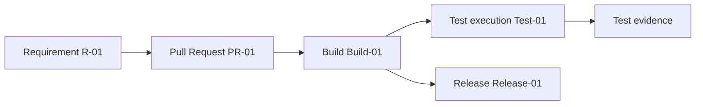
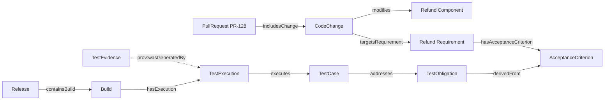
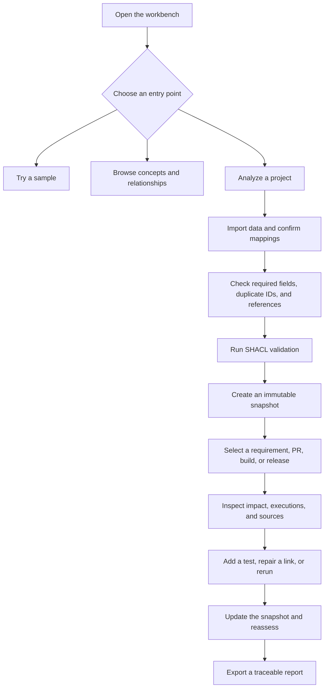

# From Requirement to Release: See How an Ontology Works in a Software Project

This article uses two fictional examples. The first follows work item R-01 through release Release-01 to introduce objects and relationships. The second uses refund API PR-128 to discuss test evidence. Both examples explain a model. Neither represents a real project or a production run.

## Start with a Short Engineering Path

Assume work item R-01 describes a requirement. A developer changes code in PR-01. CI creates Build-01, a test execution is recorded as Test-01, and the team later includes the build in Release-01.

This line helps explain the workflow, but it is not precise enough for an engineering model. It omits code changes, components, acceptance criteria, test obligations, and evidence provenance. A model needs to distinguish these objects and name their relationships.

## Distinguish the Objects

| Object | Meaning in this example | Question to keep visible |
|---|---|---|
| Requirement | A need the team must implement or satisfy | Which acceptance criteria does it have? |
| CodeChange | A set of code-level modifications | Which component does it modify, and which requirement does it target? |
| PullRequest | A set of changes submitted for review | Which code changes does it include? |
| Build | An engineering object or activity record produced for a particular commit or PR | Which PR, commit, and environment does it refer to? |
| TestObligation | A quality obligation to obtain a certain kind of verification evidence | Which acceptance criterion is its source? |
| TestCase | One method for checking an obligation | What does it actually check? |
| TestExecution | A record of one test run | Which case ran, and in what build, environment, and time? |
| TestEvidence | A report, log, or other evidence resource produced by a run | Which execution generated it, and is it usable for the current version? |
| Release | A set of builds or artifacts prepared for delivery | Which build is included in it? |

Keep objects and activities distinct. A TestCase describes a verification method. A TestExecution records one actual run. A Build and a Release are also different. The v0.19 model treats Build as an activity class and Release as a release object. A later model version could refine the distinction between a build activity and its output artifact.

## Follow Refund PR-128

Assume PR-128 changes a refund API and affects refund permissions and refund amounts. The system records that all 20 automated tests passed. However, there is no qualified evidence for the refund-permission obligation. Even with 20 passes, the status for that permission requirement should be Unknown. Unknown means that current data cannot support either a positive or negative conclusion. It does not mean the check failed or that the release is safe.

The diagram shows relationships in the v0.19 experimental model. Every arrow follows the defined relationship direction, from subject to object: `TestObligation derivedFrom AcceptanceCriterion`, `TestCase addresses TestObligation`, `TestExecution executes TestCase`, and `TestEvidence prov:wasGeneratedBy TestExecution`. A query that follows the analysis from the PR to evidence traverses some of these relationships in reverse.

Every edge in Figure 2 uses a model relationship name, and each arrow points from the subject to the object. For example, `CodeChange targetsRequirement Requirement` means the code change points to its target requirement. `TestEvidence prov:wasGeneratedBy TestExecution` means the evidence points to the execution that generated it. The dashed line marks provenance. The figure shows model relationships; a query does not have to follow every arrow in its direction.

## Read the Three Quality States

| State | Conclusion supported by the available data | Refund example |
|---|---|---|
| Qualified | Evidence meets the current policy and can support the quality claim | Evidence matches the current build and satisfies environment, time, and source rules |
| Unqualified | Evidence exists, but at least one policy condition is not met | Evidence belongs to an older build or the execution failed |
| Unknown | Evidence is missing, insufficient, or unconfirmed, so qualification cannot be decided | The refund-permission obligation has no confirmed execution evidence |

The policy must define how each state is calculated. The experimental model says that missing data, unavailable validation, or an unconfirmed source must not produce `verified Qualified`. A report should show the field or relationship that caused the state, not only a color or label.

## How a QA User Can Start

The Workbench design draft offers three entry points: try a sample project, browse ontology concepts, or analyze a project. A QA user can start with a sample or a PR without writing RDF, OWL, or SPARQL.

Figure 3 is a Workbench design workflow, not a shipped feature. The current plan includes user data import in the MVP design. Direct GitHub and CI connections remain a later stage.

## Data Import, Structural Validation, and Quality Assessment

For project data, a user could create or open a workspace, upload CSV, JSON, or controlled RDF, preview records, and select a template or configure mappings. The user confirms which source field corresponds to each concept. The system should not write guessed relationships into the model before confirmation.

| Stage | What it checks | Output | Conclusion it cannot establish |
|---|---|---|---|
| Field mapping | Which concept, property, or identifier matches each source column | A mapping configuration confirmed by the user | That data is true, structurally valid, or evidence is qualified |
| Import precheck | Required values, duplicate identifiers, unresolved references | A readable list of record-level issues | An OWL inference or quality-gate result |
| SHACL validation | Whether data conforms to declared shapes | A structural validation report | That a test result is authentic or a business risk is resolved |
| Snapshot creation | Input data and model version | An immutable analysis input | That later evidence is automatically qualified |
| Quality assessment | Obligations, executions, build, environment, time, source, and policy | Qualified, Unqualified, or Unknown with reasons | A release signature from the responsible owner |

A failed import should leave the current valid snapshot intact. Passing structural validation only means that data satisfies the declared shape constraints. The team still needs to check whether tests ran, whether evidence belongs to the current build, and whether it supports the relevant claim.

## A Beginner's Example Workflow

1. Choose the sample project, or create a workspace and import sanitized PR, requirement, test, and execution data.
2. Preview the field mappings. Map `pull_request_id` to a PullRequest identifier and `component` to a Component reference. Confirm and save the mapping.
3. Check required fields, duplicate IDs, and broken references. Then run SHACL validation.
4. Create a snapshot after structural checks pass. Select PR-128 and inspect related requirements, obligations, cases, executions, and evidence sources.
5. If the permission obligation is Unknown, check the source system for the missing record. Add a test, repair a link, or rerun. Then import a new snapshot and reassess.
6. When exporting a report, retain the snapshot version, model version, and evidence sources so a teammate can review it.

This is a proposed user path. No product run evidence shows that the workbench pages or connectors have been implemented.

## Practical Guidance

- Use sample data to learn the states before importing project data.
- Confirm mappings first, validate the structure second, and assess quality evidence last.
- Bind each analysis to an immutable snapshot and a model version.
- Show the specific reason for Unknown and let users return to the source system.
- Keep the previous valid snapshot when an import fails.

## FAQ

### Why can a project still be Unknown when many tests passed?

The pass count does not show which obligation the tests checked. If the target obligation has no linked case or qualified execution evidence, the system cannot confirm the quality claim.

### Does a successful import mapping make quality data trustworthy?

No. Mapping confirms field correspondence. Prechecks and SHACL validate structure. Quality assessment also checks evidence source, version, environment, time, and policy.

### Can a reader sign in and use this workflow now?

The article does not establish that. The diagram is a product-design example. User data import is planned for the MVP design, while direct GitHub and CI integrations remain later work.

## Three Questions to Check Your Understanding

1. What is the difference between a TestCase and a TestExecution? A. They mean the same thing; B. A case describes a verification method and an execution records one run; C. An execution is a release.
2. PR-128 has 20 passing tests but no refund-permission evidence. Which state is most supportable? A. Qualified; B. Unqualified; C. Unknown.
3. Does passing SHACL validation prove that test results are valid? A. Yes; B. No, it checks declared structural constraints; C. It proves the release is ready.

Answers: 1-B, 2-C, 3-B.

## Summary

These project stories show how an ontology makes objects and relationships inspectable. A QA user can start with a sample or a data-import flow. A release conclusion still depends on actual execution evidence and team policy. The next article focuses on the SDLC ontology in this chain.

## References

- The v0.19 project package contains `01_project/ontology/baseline.ttl`, `01_project/shapes/baseline.shacl.ttl`, and `01_project/examples/delivery-flow.ttl`.
- W3C SHACL: https://www.w3.org/TR/shacl/
- W3C PROV-O: https://www.w3.org/TR/prov-o/
