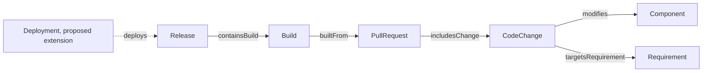

# What Is an SDLC Ontology? Connect Requirements, Changes, and Releases

A requirement moves through discussion, coding, review, build, and release before it reaches users. Teams often have records for these steps but cannot answer “Which code changes carried this requirement into which release?” An SDLC ontology defines the objects and activities in the lifecycle and the relationships between them.

SDLC means Software Development Life Cycle. An SDLC ontology gives requirements, code changes, components, pull requests, builds, deployments, and releases shared semantics. It supports traceability. It does not prove that every change was implemented correctly.

## A Delivery-Record Analogy

Think of a software project as a delivery record. A requirement describes what to deliver. A code change records what changed. A pull request groups changes for review. A Build records a build activity. A Deployment records an activity in an environment. A Release marks a version for delivery. Readers can see how a requirement reached a release only when the relationships are explicit.

## Main SDLC Concepts

| Concept | Purpose | Status in the v0.19 baseline |
|---|---|---|
| Requirement | States a product or engineering need | Defined |
| WorkItem | Represents a task, defect fix, or engineering work | Included in the blog topic; definition is pending in the baseline |
| Component | Identifies a system part affected by a code change | Defined |
| CodeChange | Describes a code-level change | Defined |
| PullRequest | Groups code changes submitted for review | Defined |
| Build | Records a build activity | Defined as a subclass of `prov:Activity` |
| Deployment | Records an activity that deploys to an environment | Included in the blog topic; definition is pending in the baseline |
| Release | Represents a version prepared for delivery | Defined |

“Defined” means that the experimental `baseline.ttl` contains the class or relationship. It does not mean the term is an industry standard. WorkItem and Deployment are reasonable modeling candidates, but the article should label them as proposed extensions until the baseline includes them.

## Read the Direction of Relationships



Figure 1 uses solid relationships from the v0.19 baseline. The dashed `deploys` relationship is a proposed addition, not part of the current baseline. `targetsRequirement` points from CodeChange to Requirement. `containsBuild` points from Release to Build. Do not reverse relationship definitions just to make a diagram read from left to right.

A SPARQL question can be small: which component does `change1` modify? The current CQ-03 query is:

```sparql
PREFIX ex: <https://example.org/sdlc-qe/>
SELECT ?component WHERE {
  ex:change1 ex:modifies ?component .
}
```

It answers only the direct `modifies` relationship. It does not automatically find indirect dependencies, business rules, or test cases. Confirm that those relationships exist before extending the query.

## Objects, Activities, and Outputs

An ontology needs to state what each name represents. A PR is a review resource that groups changes. A build is an activity triggered by an input version. A build output may be an artifact. A deployment places an artifact in a target environment. A Release is a delivery boundary. If every item is called a “version,” a team may not know which build a test result describes.

The v0.19 series model classifies Build as `prov:Activity` and uses `Build builtFrom PullRequest` and `Release containsBuild Build` for part of the lifecycle. This experimental model does not yet define separate build artifacts and deployment records. An implementation should refine those concepts to match its CI/CD data instead of claiming that undefined objects are already supported.

## How It Supports Quality Traceability

The SDLC ontology supplies requirement and change context. The QE ontology describes acceptance criteria, test obligations, cases, executions, and evidence. For example, a CodeChange modifies a Component and targets a Requirement. The Requirement links to an AcceptanceCriterion. A TestObligation is derived from the criterion, and a TestCase addresses the obligation. The team can then assess verification evidence when the relationship path and version provenance are complete.

## Common Misunderstandings

| Misunderstanding | More accurate explanation | Example |
|---|---|---|
| A requirement ID is enough to trace a release | The model also needs relationships to code changes, builds, and releases | A requirement links to a PR, but the Release does not say which Build it contains |
| Build and Release are the same object | A build activity or result differs from a release boundary | One Release may contain several reviewed Builds |
| The same component proves the requirement is affected | A component link is a clue; impact still needs relationship and code review | An unrelated file in a shared component may not affect the feature |
| An SDLC ontology proves the process was correct | It represents process knowledge; tests and evidence need separate checks | The change path is complete, but acceptance tests did not run |

## Practical Guidance

- Use separate concepts for resources, activities, execution results, and artifacts.
- State each relationship's direction and meaning.
- Mark concepts in the current model separately from proposed extensions.
- Bind requirements, commits, builds, and releases to stable identifiers.
- Validate one query question before adding more lifecycle concepts.

## FAQ

### Must an SDLC ontology cover every development process?

No. Start with the requirements, PRs, Builds, and Releases needed for the current question. Add deployments or approvals when the model needs to answer questions about them.

### Are Requirement and WorkItem the same thing?

Not necessarily. A Requirement states what must be satisfied. A WorkItem can represent work to complete. One Requirement may need several work items. The team's process should define the relationship.

### Can an ontology infer a requirement from a Git diff?

A text diff alone usually cannot confirm a semantic link. A PR description, commit message, or human mapping can produce candidates. Stable IDs and review can confirm them.

## Three Questions to Check Your Understanding

1. Which current baseline relationship points from CodeChange to Requirement? A. `targetsRequirement`; B. `containsBuild`; C. `executes`.
2. How do Build and Release differ? A. They are identical; B. A build activity differs from a delivery boundary; C. Release is a test case.
3. What is the dashed Deployment relationship in the figure? A. Implemented in v0.19; B. A proposed extension not yet in the baseline; C. Required by a W3C standard.

Answers: 1-A, 2-B, 3-B.

## Summary

An SDLC ontology makes engineering objects and lifecycle relationships explicit so a requirement can be traced through code changes to builds and releases. Relationship direction, object boundaries, and model version all need to be visible. The next article focuses on quality risks, test obligations, and evidence.

## References

- W3C PROV-O: https://www.w3.org/TR/prov-o/
- W3C RDF 1.1 Concepts: https://www.w3.org/TR/rdf11-concepts/
- SDLC-QE v0.19 model: `01_project/ontology/baseline.ttl` and `02_blog/articles/04.md`
