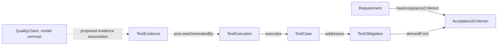

# What Is a Quality Engineering (QE) Ontology? Connect Risks, Tests, and Evidence

“All tests passed. Does that prove the refund permissions are correct?” A pass count cannot answer this question on its own. The team also needs to know which verification obligation addresses the permission risk, which cases check it, whether they ran on the current build, and whether their results support the quality claim.

QE means Quality Engineering. A QE ontology defines the concepts and relationships needed to describe risks, test obligations, cases, executions, evidence, and quality decisions. The team can trace which records support a conclusion and see what is missing.

## Think of Quality Evidence as a Reviewable Check

A library record saying that a loan occurred is not enough to review the event. The record should identify who borrowed what, when, and who recorded it. Testing needs similar context. A test case is a check method. An execution record is one run. Evidence preserves the outcome and its source.

## From Risk to Evidence

| Concept | Question it answers | Refund-permission example |
|---|---|---|
| QualityRisk | What failure could happen, and what would it affect? | An unauthorized user could request a refund |
| TestObligation | What verification evidence is required? | Show that only an authorized role can issue a refund |
| TestCase | What check can verify the obligation? | Request a refund with a regular-user token and expect rejection |
| TestExecution | Which run executed which case? | One API regression run executed the case on a specified build |
| TestEvidence | What reviewable material did the run save? | Request, response, report, build, and environment details |
| QualityClaim | What does the team want to state based on evidence? | The current version meets refund-permission acceptance criteria |
| QualityGate | How does release policy check the conditions? | A high-risk obligation needs qualified evidence on the current build |

QualityRisk and QualityGate are domain concepts in the research plan, but they are not among the core classes in the current v0.19 `baseline.ttl`. The baseline defines TestObligation, TestCase, TestExecution, TestEvidence, and QualityClaim. Risk ratings, gate policies, and approval records should be modeled as versioned extensions. The article should not say that the baseline already implements them.

## Read the Evidence Chain in the v0.19 Model

Figure 1 uses solid lines for relationships in the current model. The evidence source points from TestEvidence to the TestExecution that generated it. The dashed line from QualityClaim to evidence shows a proposed conceptual association. `supportsClaim` is not a relationship defined in the v0.19 baseline. The model extension and gate policy must state how a claim links to its evidence.

Do not treat `TestObligation` and `TestCase` as synonyms. An obligation states what kind of verification is required. A case states how to perform a check. One obligation may need several tests. One case may address several obligations, but the model should state those many-to-many relationships explicitly.

## Coverage Links and Evidence Qualification

Before a test result enters a quality review, distinguish three levels:

| Level | What it checks | Example question |
|---|---|---|
| Link coverage | Whether an obligation links to a test case | Is there a case for refund permissions? |
| Execution coverage | Whether a linked case ran on the target build | Did the PR-128 build execute the permission check? |
| Evidence qualification | Whether source, status, time, environment, and policy conditions are met | Does the evidence belong to the release candidate build? |

“There is a test” answers only the link question. “The test passed” also needs execution context. “The evidence qualifies” requires a declared quality policy. If 20 automated tests pass but none can be confirmed to cover the refund-permission obligation, the requirement remains Unknown.

## Qualified, Unqualified, and Unknown

- **Qualified** means available evidence passes the applicable checks and can support the relevant quality claim.
- **Unqualified** means evidence exists but fails at least one policy condition, such as a failed run or version mismatch.
- **Unknown** means data is missing or the source is unclear, so qualification cannot be decided yet.

The logic should be reviewable. Treating Unknown as a pass creates false confidence. Treating it as a failure also creates a false alarm. The system should identify the missing relationship, field, or execution record.

## Common Misunderstandings

| Misunderstanding | More accurate explanation | Counterexample |
|---|---|---|
| More test cases mean higher quality | Count does not show obligation coverage or assertion quality | One hundred cases cover only the happy path while permission checks are missing |
| A case linked to an obligation proves it is satisfied | Review the case, execution record, and evidence qualification | A case exists but has never run |
| TestExecution and TestEvidence are the same thing | An execution is an activity record; evidence is a reviewable resource | A run says “passed” but the report has no build provenance |
| A quality gate is a fixed score | A gate is a team policy with an exception process | Different risk levels may require different evidence |

## Practical Guidance

- Derive test obligations from risks and acceptance criteria, and preserve their sources.
- Review whether each case's assertions actually check its obligation.
- Record build, environment, time, and outcome for each execution.
- Bind evidence to a specific execution. Do not reuse a stale result for a new version.
- Store risks, evidence states, and gate decisions separately, with review records.

## FAQ

### Does a passing test case establish the quality claim?

Not by itself. Confirm that the case checks the intended obligation, the run belongs to the target build, and the result and source meet policy.

### Should a missing execution record be marked as a failure?

It means execution evidence is not available. A policy can block release or require a rerun, but the model should preserve the difference between Unknown and a failed execution.

### Is QualityGate a standard class in v0.19?

It appears in the series research plan, but the current baseline does not define it as a core class. This article discusses it as a planned extension.

## Three Questions to Check Your Understanding

1. What does a TestObligation mainly state? A. One test run; B. What verification is required; C. A build version.
2. What is the best treatment when an evidence link is missing? A. Mark it Qualified; B. Mark it Unknown and show the gap; C. Infer that the test passed.
3. Which v0.19 relationship expresses evidence provenance? A. `TestEvidence prov:wasGeneratedBy TestExecution`; B. `TestExecution containsBuild Release`; C. `Requirement executes TestCase`.

Answers: 1-B, 2-B, 3-A.

## Summary

A quality-engineering ontology separates risks, verification obligations, test methods, executions, and evidence. This lets a quality conclusion show its basis and expose evidence gaps. The next article connects these QE relationships to SDLC requirements, pull requests, builds, and releases.

## References

- W3C PROV-O: https://www.w3.org/TR/prov-o/
- W3C SHACL: https://www.w3.org/TR/shacl/
- SDLC-QE v0.19 model and constraints: `01_project/ontology/baseline.ttl`, `01_project/shapes/baseline.shacl.ttl`, and `01_project/docs/standards/ontology.md`
