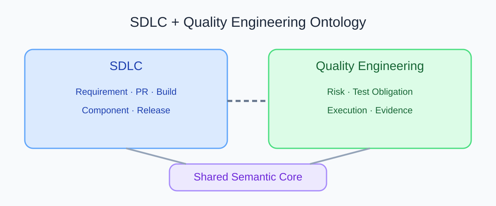
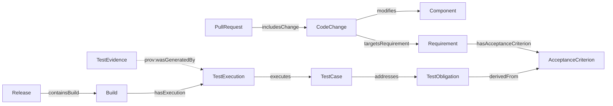

# How Do SDLC and QE Ontologies Work Together? Trace Changes to Quality Evidence

PR-128 changes a component. SDLC data can show which PR, component, and requirement relate to the change. QE data can show which test cases address an obligation and which executions produced evidence. Connecting the two gives a team a way to ask, “What quality evidence is available for this code change?”

SDLC means Software Development Life Cycle. QE means Quality Engineering. The two models can keep their own boundaries and connect through a small set of well-defined cross-domain relationships. A connection makes a question queryable. It does not prove that testing is sufficient or that a code change caused an outcome.

## See the Complete Path

The image below preserves the SDLC and QE overview from the v0.19 blog materials. Blue represents engineering-process concepts, green represents quality-engineering concepts, and purple represents the shared semantic core. The links indicate that both domains need common semantics.

The v0.19 experimental model uses this relationship path for traceability:

Figure 1 uses solid lines for relationships in the v0.19 baseline. Every relationship has a direction. PROV-O provenance points from TestEvidence to the TestExecution that generated it. Arrows do not imply causation unless the model defines a causal relationship.

## Explain Each Cross-Domain Relationship

| Relationship | Direction and meaning | Question it can support | What it does not prove on its own |
|---|---|---|---|
| `CodeChange modifies Component` | A code change points to the component it modifies | Which components relate to changes in the PR? | That every behavior in the component is affected |
| `CodeChange targetsRequirement Requirement` | A code change points to a target requirement | Which requirements relate to the change? | That the requirement was implemented correctly |
| `Requirement hasAcceptanceCriterion AcceptanceCriterion` | A requirement links to its acceptance criteria | Which checkable goals belong to the requirement? | That each goal has a test |
| `TestObligation derivedFrom AcceptanceCriterion` | A test obligation points to its source criterion | Where did the verification obligation come from? | That the obligation is complete or satisfied |
| `TestCase addresses TestObligation` | A case points to the obligation it intends to verify | Which cases attempt to check the obligation? | That the assertion is valid or the run passed |
| `TestExecution executes TestCase` | An execution record points to the case it ran | Which run executed which case? | That the result applies to the current release |
| `TestEvidence prov:wasGeneratedBy TestExecution` | Evidence points to the execution activity that generated it | Which run produced the evidence? | That the source is trusted, the version matches, or the conclusion is true |

An early outline used `Component → TestObligation` as shorthand for the impact path. The v0.19 baseline does not define that direct relationship, so this article does not show it as an existing fact. If a project needs to trace from a component to obligations, it first needs a defined mapping from components to requirements, business capabilities, or obligations, then examples that confirm the semantics.

## Compare a Complete Path with Broken Links

The arrows in the table show the query traversal from a PR to evidence. They do not show every relationship's defined direction. In particular, `derivedFrom`, `addresses`, `executes`, and `prov:wasGeneratedBy` must be traversed in reverse along this query path. See the relationship graph and table above for their actual directions.

| Situation | Known path | What it can answer | What remains unknown |
|---|---|---|---|
| Complete links | PR → CodeChange → Requirement → AcceptanceCriterion → TestObligation → TestCase → TestExecution → TestEvidence | Which obligations have cases and execution records, and where the evidence came from | Whether the evidence meets policy; build, environment, time, and outcome need checks |
| Missing case link | A TestObligation has no incoming `addresses` relationship | No case is recorded for the obligation in the current model | Whether there truly is no test or a mapping was never imported |
| Missing execution | A TestCase exists without a TestExecution | A check method was designed | Whether it ran and what result it produced |
| Missing provenance | A report file exists without a provenance link | An output file is present | Which execution and version it belongs to |

A missing relationship can have several causes. It can be a real gap or an import or mapping failure. The system should report “this relationship is not in the data” before claiming that no real-world test exists.

## Association, Impact, Inference, and Evidence Are Different

- **Association** means the model records a relationship, such as a change targeting a requirement.
- **Candidate impact** means a query path suggests that an object needs review. A shared component does not prove actual impact.
- **Logical inference** means a conclusion follows from facts and model axioms, such as a type inherited through a subclass relationship.
- **Evidence provenance** records which activity generated a result and supports an audit trail.
- **Causation** needs a separate causal definition and evidence. A normal link does not establish it.

In the refund example, a query can find the permission obligation and its linked cases. If there is no execution and evidence link for the current Build, a suitable result is Unknown with the missing records listed.

## Practical Guidance

- Align shared identifiers and mapping rules before joining the two models.
- Maintain a relationship list with source, direction, version, and validation state.
- Return the complete path for cross-domain queries so readers can inspect each source.
- Present “no relationship in the data” as a data state, not proof that something does not exist in the business.
- Use only validated relationships for automated decisions. Have a person review candidate impact.

## FAQ

### Is it better to merge both ontologies into one large ontology?

Not necessarily. Module boundaries help teams maintain their own areas. Align only shared concepts and cross-domain relationships. Excessive merging can make local changes affect the whole model.

### Do complete links mean that tests have sufficient coverage?

No. Links show recorded associations. Review test content, execution status, version, environment, and evidence qualification.

### Can a Component link directly to a TestObligation?

It can be a proposed domain relationship, but the current v0.19 baseline does not define it. State whether it means direct coverage, candidate impact, or risk mapping. Do not mix these meanings in one edge.

## Three Questions to Check Your Understanding

1. What does `TestCase addresses TestObligation` prove in v0.19? A. The case is linked to the obligation; B. The case is certainly valid; C. The release is safe.
2. What is the direction of the evidence provenance relationship? A. TestExecution points to TestEvidence; B. TestEvidence points to the TestExecution that generated it; C. Release points to TestCase.
3. What should the system say when a component-to-obligation link is missing? A. No test exists in reality; B. The model does not currently record the relationship; C. Automatically mark the case passed.

Answers: 1-A, 2-B, 3-B.

## Summary

The SDLC ontology answers what changed and which requirements relate to it. The QE ontology answers what verification was required and what evidence was produced. Shared relationships connect those questions. Direction, provenance, and missing-link states must remain reviewable. The next article turns the concepts into a small RDF, SHACL, and SPARQL example.

## References

- W3C PROV-O: https://www.w3.org/TR/prov-o/
- W3C RDF 1.1 Concepts: https://www.w3.org/TR/rdf11-concepts/
- Project overview and experimental model: v0.19 package files `02_blog/assets/sdlc-qe-overview.svg` and `01_project/ontology/baseline.ttl`
