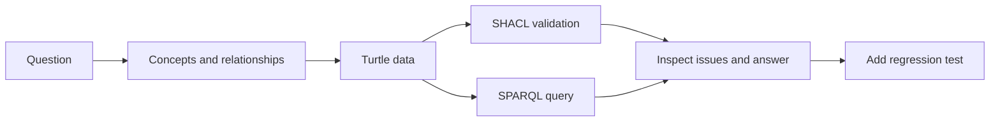

# Build a Runnable SDLC-QE Ontology from Scratch

This article answers one concrete question: “Which test obligations have no linked test case?” With a question in hand, modeling does not need to begin with a complete enterprise glossary. We can express the concepts and relationships as machine-processable data, validate the structure, and query the result.

The article uses Turtle, SHACL, and SPARQL materials from the v0.19 experimental package. It provides a reproduction path but does not claim that the code was rerun or passed an evaluation during this writing round. Execution records, exact output, and version details need review and addition before publication.

## A Beginner's Guide to the Tools

| Tool or language | Role | Use in this article |
|---|---|---|
| RDF | Express graph facts with subject, predicate, and object | Record that a requirement has a criterion or an execution ran a case |
| Turtle | A human-readable RDF syntax | Write example triples |
| OWL | Express classes, properties, and logical semantics | Describe Requirement, TestCase, and their semantics |
| SHACL | Check data against declared shapes | Check that each Requirement has an acceptance criterion |
| SPARQL | Query an RDF graph | Find obligations with no linked test case |
| RDFLib / pySHACL | Python libraries for RDF processing and SHACL validation | Load an example graph and run a structural check |

OWL describes semantics and supports reasoning. SHACL checks declared shapes. SPARQL queries data. Their results should not be treated as interchangeable.

## Three practice levels: from shared language to agent integration

A complete platform is not a starting requirement. First align terminology, then formalize the model, and finally let agents query and analyze it under evidence constraints.

| Level | Goal | Suitable approach | Main deliverables |
|---|---|---|---|
| L1: Semantic modeling | Establish a shared quality vocabulary | Define core concepts, relationships, examples, and names in Markdown, YAML, or JSON | Glossary, relationship list, minimum domain model |
| L2: Formal ontology | Make the model machine-checkable and queryable | Use RDF / OWL for semantics, SHACL for shape validation, and SPARQL for questions | Ontology files, sample data, constraints, and validation tests |
| L3: Agent integration | Let agents use traceable domain knowledge | Connect Git, test execution, defects, and CI data through read-only query and validation tools | PR impact analysis, test-gap reports, quality-evidence reports |

The levels are a staged practice path, not a technology stack that must be completed at once. Teams can review L1 vocabulary and relationships first, add machine constraints at L2 when model boundaries are stable, and connect agents at L3 only when input data, permissions, and validation results are traceable. Validate each level against a small real question.

## A lightweight technology set to validate

The research plan suggests the following set as a starting point for a Spike. It is not a final selection:

| Layer | Suggested choice | What to validate |
|---|---|---|
| Ontology files | Turtle / OWL | Are terms readable, and can current tools parse the model? |
| RDF processing | Python + RDFLib | Do graph loading, queries, and error handling meet sample needs? |
| Shape validation | SHACL + pySHACL | Can constraints distinguish positive, negative, and missing-data examples? |
| Reasoning | Select an OWL reasoner if needed | Confirm that the question requires logical reasoning, then assess complexity and run cost |
| Automation | pytest | Can regression tests preserve queries, constraints, and failure cases? |
| Agent integration | Read-only tool interface | Does the agent cite query results, snapshots, and sources instead of inventing links? |
| CI | GitHub Actions or the team's existing pipeline | Can model and validation changes be reviewed automatically? |

Run a technical Spike before deciding which tools to keep. The project plan also suggests a Python API example; this article does not present it as an implemented service.

## From a Natural-Language Question to Graph Data



Figure 1 shows a small modeling cycle. SHACL reports structural issues. SPARQL returns records that match a query. A regression test fixes expected behavior. A query result does not replace source review or business review.

## Inspect a v0.19 Data Example

The following excerpt follows the relationships in `01_project/examples/delivery-flow.ttl`. It uses `https://example.org/sdlc-qe/` as an experimental IRI. Do not publish it as a stable production namespace.

```turtle
@prefix ex: <https://example.org/sdlc-qe/> .
@prefix prov: <http://www.w3.org/ns/prov#> .

ex:req-checkout a ex:Requirement ;
    ex:hasAcceptanceCriterion ex:ac-checkout .

ex:ac-checkout a ex:AcceptanceCriterion .
ex:obligation-checkout a ex:TestObligation ;
    ex:derivedFrom ex:ac-checkout .

ex:test-checkout a ex:TestCase ;
    ex:addresses ex:obligation-checkout .

ex:execution-checkout a ex:TestExecution ;
    ex:executes ex:test-checkout .

ex:evidence-checkout a ex:TestEvidence ;
    prov:wasGeneratedBy ex:execution-checkout .
```

Each `ex:` name denotes an experimental object or relationship. A semicolon adds another property to the same subject. The final relationship uses PROV-O to identify the execution that generated the evidence. The data graph states specific facts. `baseline.ttl` separately defines the semantics of those terms.

## Check Structure with SHACL

The v0.19 baseline requires each Requirement to have at least one AcceptanceCriterion. It also requires each TestExecution to execute at least one TestCase. One corresponding shape is:

```turtle
@prefix ex: <https://example.org/sdlc-qe/> .
@prefix sh: <http://www.w3.org/ns/shacl#> .

ex:RequirementShape a sh:NodeShape ;
    sh:targetClass ex:Requirement ;
    sh:property [
        sh:path ex:hasAcceptanceCriterion ;
        sh:minCount 1 ;
        sh:class ex:AcceptanceCriterion
    ] .
```

This checks that a Requirement has at least one `hasAcceptanceCriterion` value and that the target is an AcceptanceCriterion. It cannot judge the quality of the criterion or prove that a test ran.

## Use SPARQL to Find Obligations without Cases

```sparql
PREFIX ex: <https://example.org/sdlc-qe/>

SELECT ?obligation WHERE {
  ?obligation a ex:TestObligation .
  FILTER NOT EXISTS {
    ?test a ex:TestCase ;
          ex:addresses ?obligation .
  }
}
ORDER BY ?obligation
```

The query lists every TestObligation and excludes obligations with a matching `TestCase addresses TestObligation` relationship. Each returned row identifies an obligation with no matching test case in the current graph. An empty result means the query found no such obligation in the queried data. Incomplete imports or mappings can affect that result, so it does not prove that no real-world test gap exists.

## Turn the Query into a Maintainable Test

During development, define a small fixture and expected result:

1. Add a TestObligation without a linked case. The query should return it.
2. Add a TestCase that addresses the obligation. The query should stop returning it.
3. Remove an acceptance criterion from a Requirement. SHACL should report a shape violation.
4. Restore the criterion and confirm that the violation is gone.

This checks whether the query and constraints behave as the team expects. TDD fixes expected behavior. It should not change data only to make a test green. Negative examples also matter because an incorrect relationship may cause a missed gap or a false pass.

## Reproduction Entry Point and Known Limits

The v0.19 project materials provide these dependency and test commands:

```bash
python -m pip install -r requirements-validation.txt
python -m unittest discover -s tests -v
```

The requirements file specifies `rdflib>=7,<9` and `pyshacl>=0.30,<1`. Record the Python and dependency versions, test count, pass/fail/skip status, and actual output when running the commands. If pySHACL is not installed, SHACL-related tests may be skipped. A skip is not a pass.

Run record for the supplied v0.19 package snapshot (2026-11-05): Python 3.15.2, rdflib 7.6.0, and pySHACL 0.40.2; 22 tests passed, 0 failed, and 0 skipped. The supplied package has no Git metadata, so this result is tied to the v0.19 snapshot rather than a commit SHA. It confirms only the tests included in that package.

The project notes also say that the current example covers only a simplified subset of CQ-01 through CQ-04. CQ-03 does not yet trace from a component to tests, and CQ-04 does not yet check time and version. These examples do not constitute complete capability acceptance. Before publication, rerun the commands against an immutable source revision and record representative gap-case output.

## Practical Guidance

- Start with one decidable question and a small dataset.
- Maintain the ontology, instance data, SHACL shapes, and SPARQL queries separately.
- Prepare valid examples, missing-link examples, and wrong-type examples.
- Record the snapshot scope for each query so data from other versions does not leak in.
- Record skipped checks, missing dependencies, and validation failures separately.

## FAQ

### Does OWL check required fields?

OWL expresses semantics and supports logical reasoning. Completeness requirements such as a required field usually need SHACL or application rules.

### Does an empty SPARQL result mean that an obligation has no test?

No. Each returned row identifies a TestObligation without a matching TestCase link in the current graph. An empty result means no such obligation was found in the queried data; incomplete imports or mappings may hide gaps. Check the snapshot scope too.

### Can we use the `example.org` namespace in production?

Do not copy it as-is. The project notes define it as a temporary example IRI. A production model needs stable identifiers and a versioning policy under the team's control.

## Three Questions to Check Your Understanding

1. Which tool checks whether data conforms to a declared shape? A. SHACL; B. SPARQL; C. Turtle.
2. If the query finds no case, can we confirm that no real test exists? A. Yes; B. No, the current data may be incomplete; C. It generates a test result automatically.
3. Can a skipped SHACL test count as a pass? A. Yes; B. No; C. Only when the query passes.

Answers: 1-A, 2-B, 3-B.

## Summary

A runnable ontology experiment combines a question, conceptual model, instance data, structural constraints, queries, and regression tests. Each result needs a clear statement of what it supports. The run record above applies to the supplied v0.19 package snapshot. Before publication, rerun it against an immutable source revision and retain a representative gap-case result.

## Series Navigation

- Previous: `06-connect-sdlc-qe.md`
- Next: `08-change-impact.md`

## References

- W3C RDF 1.1 Concepts: https://www.w3.org/TR/rdf11-concepts/
- W3C OWL 2 Primer: https://www.w3.org/TR/owl2-primer/
- W3C SHACL: https://www.w3.org/TR/shacl/
- W3C SPARQL 1.1 Query Language: https://www.w3.org/TR/sparql11-query/
- v0.19 reproduction notes: `01_project/RUN_SPIKE.md` and `01_project/requirements-validation.txt`
