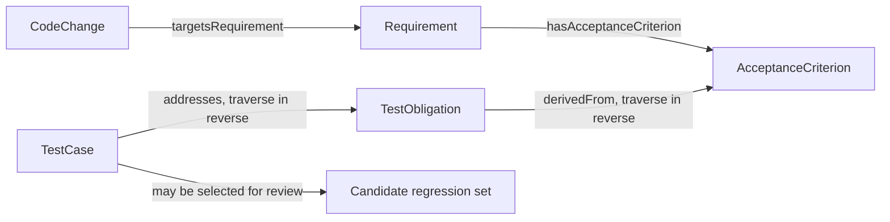

# Which Tests Should a Requirement Change Affect? Ontology-Based Impact Analysis

A refund-permission requirement changes. The team must decide which tests to run again. A full rerun may take time. Searching by file name may miss tests connected through indirect relationships. An ontology can follow changes, requirements, acceptance criteria, and test obligations to find candidates. The team then checks whether the set is complete.

Impact analysis returns candidates. It gives people a place to start. A relationship graph alone cannot reveal every code behavior.

## Find Candidate Tests from a Change

In the v0.19 model, a CodeChange can point to a Requirement through `targetsRequirement`. A Requirement points to its acceptance criteria through `hasAcceptanceCriterion`. A TestObligation points to a criterion through `derivedFrom`. A TestCase points to an obligation through `addresses`. A query follows the last two relationships in reverse to move from the criterion to the obligation and case.

Figure 1 draws `derivedFrom` and `addresses` in the model's actual direction. A query traverses both edges in reverse to find candidate cases. The current baseline has no direct `Component → TestObligation` relationship. A team that needs to trace components to tests must first define a mapping from components to requirements or obligations.

## A Candidate Set Is Not the Final Regression List

Assume the query returns tests T1 and T2 from existing mappings. A developer reviews the code and confirms T1 is related. T2 covers a neighboring function in a shared component and is not affected by the change. The developer also finds that an unmodeled asynchronous notification test T3 needs a rerun. Compare the query set with an impact list that has been reviewed.

| Test | Suggested by query | Confirmed by a person | Explanation |
|---|---|---|---|
| T1 refund permission | Yes | Yes | Directly checks a permission acceptance criterion |
| T2 refund history | Yes | No | A shared component created a false-positive candidate |
| T3 asynchronous notification retry | No | Yes | An unmodeled relationship caused a missed test |

T1–T3 are hypothetical teaching data, not results from the v0.19 experiment. The table shows two error types. A false positive adds review or execution work. A false negative may omit a needed check.

## Check Candidate Quality with Precision and Recall

- A true positive (TP) is suggested by the query and confirmed as affected.
- A false positive (FP) is suggested but confirmed as unaffected.
- A false negative (FN) is not suggested but confirmed as affected.

Precision = TP / (TP + FP). It shows what share of suggestions were confirmed. Recall = TP / (TP + FN). It shows what share of confirmed affected tests were found.

In the teaching table, T1 is the only TP, T2 is an FP, and T3 is an FN. Precision and recall are each 1/2. This example explains the formulas only. It does not measure a tool or project. A real evaluation needs a fixed sample, a blind-labeled impact list from experts, and a record of how disagreements were handled.

## Decide the Actual Regression Scope

An impact path is one input. The team also needs to consider business risk, change scope, environment availability, test cost, and the latest trusted execution. A high-risk obligation may require a full regression. A low-risk candidate may be sampled or checked in another way. The owner should record which tests were included or excluded and why.

| Decision record | Example content |
|---|---|
| Target version | PR commit, Build ID, target Release |
| Candidate source | Relationship paths and rules that found the tests |
| Included tests | Cases to rerun and the risk reason |
| Excluded tests | Candidates not run and the exclusion rationale |
| Human additions | Tests added by a domain expert but missing from the model |
| Outcome and evidence | Execution status, report source, and open gaps |

## Common Misunderstandings

| Misunderstanding | More accurate explanation |
|---|---|
| Every returned case must run | The results are candidates from existing relationships and need review |
| An omitted case is unaffected | Missing links, stale mappings, and unmodeled dependencies can cause misses |
| High recall guarantees quality | Recall is measured against labeled samples; it does not prove assertions, execution, or evidence qualification |
| The same component always affects the same tests | Code content, dependencies, and business rules change the actual scope |

## Practical Guidance

- Fix the change commit, model version, and data snapshot for every sample.
- Have people who know the code and business label impact independently before comparing results.
- Record false positives, false negatives, and undecidable cases separately.
- Return Unknown or a data-completeness warning when a path is missing.
- Save the human reasons for including, excluding, and adding each test.

## FAQ

### Can we run only the cases returned by the ontology?

That is not a safe default. Results depend on relationship coverage and mapping quality. High-risk changes also need code review, architecture dependencies, and team regression policy.

### Which matters more, precision or recall?

It depends on the task. When reducing the test set, a missed impact may be costly, so recall often needs close attention. Precision also matters when unnecessary reruns are expensive. Report both.

### What if there is no human-confirmed reference list?

Then the work is exploratory and should not report accuracy. Build a sample set, record expert disagreements, and use the reviewed labels for later evaluation.

## Three Questions to Check Your Understanding

1. A test is suggested but confirmed unaffected. What is it? A. TP; B. FP; C. FN.
2. A test is not suggested but confirmed for rerun. What is it? A. TP; B. FP; C. FN.
3. What is the direction of `derivedFrom` in v0.19? A. TestObligation points to AcceptanceCriterion; B. AcceptanceCriterion points to TestObligation; C. TestCase points to Build.

Answers: 1-B, 2-C, 3-A.

## Summary

An ontology can turn existing requirement and test relationships into a candidate regression scope. The team still needs a human-confirmed impact list to detect misses and false positives, then uses risk to decide what actually runs. The next article supplies similar quality context to an AI PR review.

## Series Navigation

- Previous: `07-build-runnable-ontology.md`
- Next: `09-ai-pr-review.md`

## References

- W3C SPARQL 1.1 Query Language: https://www.w3.org/TR/sparql11-query/
- v0.19 `targetsRequirement`, `derivedFrom`, and `addresses` relationships: `01_project/ontology/baseline.ttl`
