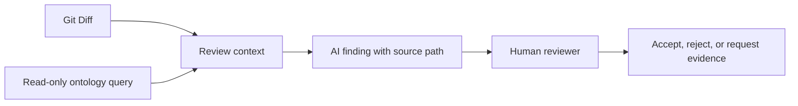

# AI PR Review with Ontology: Add Engineering and Quality Context to a Code Diff

A Git diff shows which lines changed. It usually does not tell a reviewer which refund rule those lines relate to, which test obligations are involved, or whether the current build has enough evidence. An AI model can read the diff without knowing the team's engineering semantics.

An ontology can give the AI queryable relationships among requirements, components, test obligations, and executions. A safer pattern is to let the agent make read-only queries, cite each source, and leave acceptance to a person. PR-128 and the output below are hypothetical examples, not an evaluation of a real model.

## Diff-Only and Semantically Enriched Review

| Review input | What the AI can see | Common blind spot |
|---|---|---|
| Git diff only | Changed lines, surrounding code, and file names | Requirement rules, test obligations, builds, and evidence links |
| Diff plus ontology query | Diff, target requirements, components, criteria, obligations, cases, executions, and provenance | Depends on mapping completeness; incomplete paths must be shown as unknown |

Figure 1 shows an agent that reads data and proposes findings. It does not edit code, change gate state, or sign an approval for the reviewer.

## An Example Review of PR-128

Assume the diff changes a refund-permission check. An AI query returns this context: PR-128 points to a CodeChange that targets a refund-permission requirement; the requirement links to an acceptance criterion; the model contains a TestObligation and TestCase; the snapshot has no qualified execution evidence for the current Build.

A reviewable suggestion should say what was found and what remains unknown:

> Example finding: No qualified evidence was found for the TestObligation linked to the refund-permission requirement in the current snapshot. Check whether the target Build for PR-128 ran the relevant test. The evidence path is PR-128 → CodeChange → Requirement → AcceptanceCriterion → TestObligation. This result shows an evidence gap in the current model data. It does not prove that the code allows an unauthorized refund.

| Output item | Information to show |
|---|---|
| Finding | No qualified evidence was found for the refund-permission obligation |
| Evidence path | Each relationship and source record ID |
| Snapshot scope | Commit, Build, Release, and ontology version |
| Uncertainty | A missing record could mean that the test did not run or the data was not imported |
| Suggested action | Check the source CI report, repair a mapping, or rerun the test |

Without requirement, test-result, or authorized source data, the AI should not make a stronger claim such as “the implementation has a permission vulnerability.” That conclusion goes beyond the available evidence.

## Keep the Agent Read-Only and Traceable

A review workflow can follow these steps:

1. Fix the PR commit, data snapshot, and ontology version.
2. Let the agent query relevant objects with a limited scope. Do not give it permission to modify data or production systems.
3. Return a path, source IDs, and evidence state for each suggestion. If a fact was not found, state Unknown.
4. Open the source records to verify version, mapping, and context.
5. Let the reviewer accept, reject, or request evidence, then record the reason.

The prompt can require the agent to report only facts present in query results. It should identify the rules and input facts behind an inference. Unconfirmed items should be listed as questions to verify. Generated prose is not test evidence.

## How to Compare the Two Review Modes

To evaluate whether an ontology improves PR review, use the same diffs, model version, review criteria, and source data. Record at least:

- Which real gaps each mode found.
- Which conclusions had no supporting source record.
- Whether either mode presented Unknown as pass or fail.
- How long reviewers needed to revise the suggestions.
- Whether suggestions remained stable across repeated runs on the same input.

This article has no such run results, so it does not claim that one mode performed better. The comparison design appears in Article 12.

## Practical Guidance

- Make every AI finding traceable to a relationship path and source record.
- Limit query tools to read-only access, a fixed snapshot, and allowed named graphs.
- Distinguish confirmed facts, rule-based inferences, candidate impact, and unknowns.
- Do not let the AI state that a missing link confirms a code defect.
- Keep reviewer reasons for accepting or rejecting suggestions as improvement data.

## FAQ

### Does an ontology let AI understand any code diff automatically?

No. It supplies domain context that has been mapped. Code semantics and impact still need code analysis, tests, or developer review.

### Should a missing-evidence finding block a PR?

The agent's notice is an input to review. The team's gate policy defines blocking rules, and an implementation must check evidence in the relevant snapshot.

### Can an agent repair relationships automatically?

Relationship mappings affect later analysis. An agent can propose a candidate, but model updates need permission checks, source records, and human confirmation.

## Three Questions to Check Your Understanding

1. What is usually missing from a diff-only review? A. Changed lines; B. Requirement and quality-evidence context; C. File names.
2. How should the AI report that it did not find evidence? A. Say the code defect is confirmed; B. State that the current snapshot has no confirmed evidence and show the scope; C. Mark it passed.
3. Who can decide whether to accept an AI PR suggestion? A. The AI itself; B. Human review under team policy; C. The graph color.

Answers: 1-B, 2-B, 3-B.

## Summary

An ontology lets an AI PR review read explicit engineering relationships and show reviewers the basis for each suggestion. It supplies context; it does not turn missing data into a fact. The next article distinguishes coverage links from evidence that can support a quality claim.

## Series Navigation

- Previous draft: `08-change-impact.md`
- Next draft: `10-quality-evidence.md`

## References

- W3C PROV-O: https://www.w3.org/TR/prov-o/
- AI PR review outline and example source: `02_blog/articles/09.md` and the v0.19 experimental model
