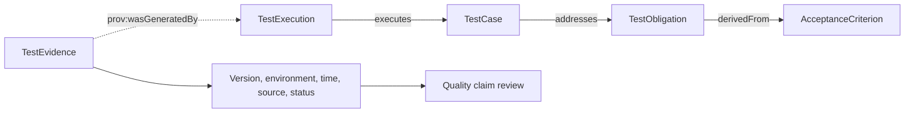

# Is Test Coverage Enough? Trace Test Obligations and Quality Evidence

A dashboard shows that all 20 automated tests passed. A release review may still ask which test checked the refund-permission requirement, which build ran it, and whether the result was saved. Without those answers, a test count alone cannot prove that a quality requirement was met.

This article separates “coverage” into three levels. A link from a test case to an obligation describes a planned check. An execution record shows what actually ran. Evidence qualification determines whether the result can support a quality judgment for the current version.

## From a Requirement to a Quality Claim

The relationship arrows in Figure 1 follow the directions defined in the model. `TestObligation derivedFrom AcceptanceCriterion`, `TestCase addresses TestObligation`, and `TestExecution executes TestCase` come from the v0.19 baseline. Evidence points to the execution activity that generated it through PROV-O. Evidence checks and quality-claim assessment are review steps, not additional ontology relationships.

## Three Coverage Levels Are Not Interchangeable

| Level | What it checks | Refund-permission example | What it misses on its own |
|---|---|---|---|
| Link coverage | Whether an acceptance criterion derives an obligation and the obligation links to a case | The permission obligation links to a test that rejects an unauthorized request | The test may never run, or its assertion may not check permission behavior |
| Execution coverage | Whether a case ran on the target Build and environment | The permission case ran on the PR-128 candidate Build | The result may be untrusted, lack provenance, or be stale |
| Evidence qualification | Whether status, build, environment, time, source, and policy meet requirements | A CI report references the right build and meets the gate policy | Qualified evidence still leaves business risk and exceptions for human review |

Coverage can help find gaps, but it should not be reduced to one percentage. An explainable report lists linked cases, executions, and evidence states for each obligation.

## Check Whether the Assertion Is Meaningful

A link between a test case and an obligation does not mean the case checks the intended behavior. For “a regular user cannot issue a refund,” consider:

| Assertion | What it can check | What to verify as well |
|---|---|---|
| The HTTP response has a rejection status | The request did not receive a success response | Whether the request used a regular-user token and called the refund API |
| The response contains a permission error code | The system rejected the request for a permission-related reason | Whether the code is stable and matches the business contract |
| No refund record was added | The rejected request had no side effect | Whether the data source is complete and the transaction was rolled back |

This table illustrates test design. Confirm status codes, error codes, and side effects against the API contract under test. The article should not present them as behavior of a real API.

## Evidence Must Refer to the Current Build

| Evidence check | Question to answer | Common issue |
|---|---|---|
| Execution status | Did the test pass, fail, cancel, or remain incomplete? | Only a summary is available, without an execution record |
| Build and change | Which commit, PR, and Build does the result describe? | An old build result is attached to a new PR |
| Environment | In which environment and configuration did the test run? | Permissions differ from the target release environment |
| Time | Was the result produced before the release cutoff? | Evidence predates a later code change |
| Source and integrity | Can the report be located and its summary checked? | The file has no source identifier or content digest |
| Validation rule | Which policy applies to this evidence type? | Any report marked “passed” is treated as valid |

The experimental model places some provenance fields on activity or evidence records. A shape check can find missing fields, but a populated field alone does not prove that it is true. Source systems, immutable snapshots, and human review still belong in the evidence chain.

## Assess PR-128

Assume PR-128 has 20 passing automated tests. The refund-amount obligation has valid evidence for the current Build. The refund-permission obligation has no confirmed execution record. The amount obligation can be assessed. The permission obligation should be Unknown. Do not use the total pass count to fill an evidence gap for a specific obligation.

| Test obligation | Case link | Current-build execution | Evidence state | Conclusion |
|---|---|---|---|---|
| Refund amount | Present | Present | Meets the example policy | Qualified, illustrative only |
| Refund permission | Present | Not confirmed | Execution evidence is missing | Unknown, illustrative only |

These states illustrate the decision process. They are not results from a real assessment. Recalculate them from a fixed snapshot, project policy, and source records.

## Practical Guidance

- Review coverage by test obligation, not only by global test count.
- Ask test designers to confirm that assertions match the acceptance criteria.
- Store execution records and evidence resources separately, with provenance links.
- Check evidence freshness against target Build, environment, time, and policy.
- Return Unknown when fields or mappings are missing and identify the exact gap.

## FAQ

### Can code coverage replace obligation coverage?

No. Code coverage usually measures which code ran. Obligation coverage asks whether a requirement or risk has a corresponding verification. They answer different questions.

### Does a TestCase link count as coverage?

It means that the model records a relationship. Review the assertion, actual execution, and evidence for the target version as well.

### Can a passing result from an older build be reused?

It depends on code changes, the evidence cutoff, and release policy. If relevant code changed after the run, the old result usually cannot support a quality claim for the new version without further justification.

## Three Questions to Check Your Understanding

1. Which level shows that a test ran on the target Build? A. Link coverage; B. Execution coverage; C. Term coverage.
2. A case links to a permission obligation but never ran. What should the report show? A. Satisfied; B. Unknown or missing execution evidence; C. Automatically Qualified.
3. Can a “passed” label support a release when the evidence has no build provenance? A. Yes; B. No, check source and policy; C. Yes, if enough tests passed.

Answers: 1-B, 2-B, 3-B.

## Summary

Test count and code coverage cannot replace traceability from an obligation to evidence. A quality report should show links, actual executions, and evidence qualification, with each conclusion tied to a build and source. The next article brings this information into a CI/CD release gate.

## Series Navigation

- Previous: `09-ai-pr-review.md`
- Next: `11-quality-gate.md`

## References

- W3C PROV-O: https://www.w3.org/TR/prov-o/
- v0.19 evidence rules: `01_project/docs/standards/ontology.md` and `01_project/shapes/baseline.shacl.ttl`
