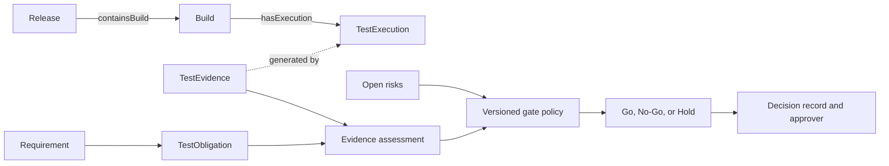

# From CI/CD to Go/No-Go: Use Ontology to Shape a Release Quality Gate

CI reports that tests passed. The team still needs to confirm which build those results describe, which high-risk obligations they cover, and whether evidence gaps remain. A release gate should make its conditions, data sources, and exception approvals clear so participants can review why it recommends Go or No-Go.

An ontology can put Release, Build, TestExecution, TestEvidence, and Requirement objects into queryable paths. Gate policy defines the conditions. People decide whether to release based on policy and evidence. The current v0.19 core model includes some of the object relationships. QualityGate, approval records, and a complete decision policy are planned extensions.

## Information Needed for a Release Review

| Information | What the release owner needs to check |
|---|---|
| Release and Build | Which build does the release contain? Which commit does it represent? |
| Changes and requirements | Which components did the PR change, and which requirements and criteria relate to it? |
| Test obligations | Which obligations are high-risk or release-blocking? |
| Executions and evidence | Did the relevant cases run on the target build, and can evidence be traced? |
| Open risks | Which defects or Unknown states remain? |
| Policy and exceptions | Which gate version applies, and who can accept which risks? |

Figure 1 shows a conceptual gate workflow. `Requirement → TestObligation` is simplified here; the v0.19 baseline connects them through AcceptanceCriterion. Risk, policy, and decision records need explicit data models in a product design. Arrows show the review flow, not necessarily implemented ontology properties.

## Use States to Distinguish Evidence Conditions

| Evidence state | Meaning | Example gate treatment |
|---|---|---|
| Qualified | Evidence meets the current policy for version, source, execution, and freshness | The obligation meets its evidence condition |
| Unqualified | Evidence exists but fails at least one condition | A failed or stale result may block the release |
| Unknown | Evidence is missing or cannot be confirmed | It cannot count as a pass; policy may block or require a formal exception |

In the PR-128 example, 20 automated tests pass, but there is no confirmed current-build evidence for the refund-permission obligation. If policy requires every high-risk obligation to be Qualified, the gate should block or remain on Hold. If the team chooses to release with the risk, it should record who approved it, why, what mitigation applies, and when the approval expires. This is a teaching example, not a real release decision.

## Make an Exception Auditable

An exception should not be implemented by rewriting a test status. Record it separately:

| Exception field | Information to retain |
|---|---|
| Risk item | Related Requirement, TestObligation, or Defect |
| Unmet condition | Missing evidence, failed test, or another blocker |
| Rationale | Why the current version needs to accept the risk |
| Mitigation | Extra monitoring, feature restriction, rollback plan, or added check |
| Approver | A person authorized to accept the risk under the approval matrix |
| Validity | Applicable Release and expiration time |
| Follow-up owner | Who will add evidence or close the risk, and when |

Policy should reject exceptions with no expiration, no owner, or a mismatched target version. Approval records that a risk was accepted. It does not turn missing evidence into Qualified evidence.

## Make the Decision Reviewable

Each Go / No-Go record should retain Release ID, target commit, Build ID, data snapshot, model version, gate-policy version, evidence states, blockers, approved exceptions, and decision owner. Bind the record to immutable inputs. Otherwise the same release record may resolve to different data later, and the original judgment cannot be reproduced.

Automated gate output should include reasons and source paths. The owner needs to know why the system blocked, what information is missing, and which conditions were excepted. A green pass icon alone is not enough for an audit.

## Practical Guidance

- Version the quality gate and save the version used for each decision.
- Record evidence qualification, risk acceptance, and release approval separately.
- Do not treat Unknown as a pass. Define blocking and exception policy explicitly.
- Require an authorized person, mitigation, expiration, and follow-up owner for exceptions.
- Bind each decision to an immutable data snapshot and preserve source paths.

## FAQ

### Does a fully passing CI run mean Go?

Not necessarily. The CI scope may not cover every obligation, and results must refer to the target Build. Release policy also checks risks and evidence states.

### Must Unknown always block a release?

The gate policy decides, but the system must not silently change Unknown to Qualified. If a release is allowed, an authorized exception should record the risk.

### Can AI approve the quality gate automatically?

AI can summarize relationships and evidence states. The organization policy controls approval authority. A decision should trace to an owner and the input snapshot used at the time.

## Three Questions to Check Your Understanding

1. What state applies when a high-risk obligation lacks evidence for the current build? A. Qualified; B. Unknown; C. Automatic pass.
2. How should a risk exception be handled? A. Change the test result to passed; B. Record approver, reason, mitigation, and expiration separately; C. Delete the blocker.
3. What should be retained to review a release decision later? A. Only the Go / No-Go label; B. Snapshot, policy version, evidence, and approval record; C. Test count.

Answers: 1-B, 2-B, 3-B.

## Summary

A release gate needs requirements, builds, test executions, evidence, and risks in one reviewable record. Qualified, Unqualified, and Unknown must be interpreted by a versioned policy. People make Go / No-Go decisions under the authorized process. The next article designs an experiment to check whether an ontology improves this work in practice.

## Series Navigation

- Previous draft: `10-quality-evidence.md`
- Next draft: `12-ontology-effectiveness.md`

## References

- W3C PROV-O: https://www.w3.org/TR/prov-o/
- v0.19 release and evidence design: `01_project/ui-design/v014/01_POLICY_DECISION_CONTRACT.md` and `01_project/ui-design/v015/08_EVAL_KPIS_AND_PILOTS.md`
