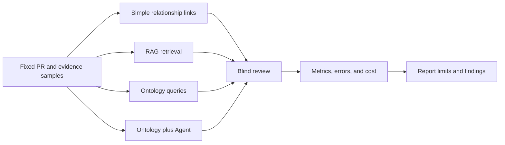

# Can an Ontology Improve AI-Native QA? Compare Benefit and Cost with an Experiment

An ontology may make engineering relationships clearer. That does not prove that it improves quality. To assess its value, give different information approaches the same PRs and quality questions, then compare results, false positives, misses, human review, and maintenance effort.

This article provides a method and a results table. The comparison has not been run, so it does not claim that an ontology is more accurate or saves a measured amount of time. Add those conclusions only after collecting actual results.

## Fix the Experimental Question First

Choose a question that experts can label, such as “Given a PR and target Build, which test obligations have coverage or evidence gaps?” Fix the commit, requirements, test data, evidence snapshot, and human-confirmed reference answer for each PR. Different input versions would make the comparison unfair.

Figure 1 uses four arms to preserve both research plans. A, B, and C compare simple links, RAG, and ontology augmentation. D checks the incremental effect of adding an agent to ontology queries. If the project cannot run D, mark it as future work; this does not prevent the first three arms from being compared.

## Design Fair Comparison Groups

| Group | Context supplied to the analyst or model | Question it tests |
|---|---|---|
| A. Simple relationship links | IDs, link tables, or basic fields | How many real gaps can the current links find? |
| B. RAG | Retrieved passages from the same requirements, PRs, test notes, and execution reports | Can document retrieval find relevant context, and can it miss structured relationships? |
| C. Ontology query | A fixed ontology version, relationship data, and controlled queries | Do explicit relationships and constraints improve traceability and gap discovery? |
| D. Ontology plus Agent | The same model as C, analyzed through read-only agent tools | Does an agent make results easier to use, and what additional errors and costs does it introduce? |

Keep source data, PR samples, model version, task instructions, and output format the same across groups where possible. Record differences in model, prompt, or tool permissions. Do not attribute every difference to ontology. Keep source materials comparable between the RAG and ontology groups so one group does not receive more information.

## Use Metrics That Match the Work

| Metric | Calculation or record | What it measures |
|---|---|---|
| Change-impact analysis time | Record time from receiving the PR to delivering a reviewed test list; report median and range | Whether tools reduce analysis and review work |
| Quality-gap recall | TP / (TP + FN), compared with human-labeled gaps | How many known gaps were found |
| Quality-gap precision | TP / (TP + FP) | How many reported gaps were confirmed |
| Evidence-backed obligation coverage | Obligations with a reviewed case, target-version execution, and valid evidence / all obligations required by the sample | Whether obligations have a complete verification record; report linked but unexecuted cases separately |
| Modeled-constraint accuracy | Agreement between SHACL or programmatic constraint results and labeled positive and negative examples | Whether constraints identify issues within their declared scope; it does not validate every business rule |
| Evidence-traceability completeness | Valid, source-linked required relationships / all relationships required by the sample | Whether a claim traces to requirements, tests, executions, Builds, and sources |
| False Qualified count | Record the count and denominator of items marked Qualified that fail a predefined rule | Whether insufficient evidence was incorrectly treated as a pass; the safety goal is to avoid these errors |
| Unsupported claims | Claims in each response that cannot be traced to input facts or rules | Whether generated content exceeds the evidence |
| Result stability | Compare aligned conclusion categories across repeated runs on the same input | Whether findings vary with generation randomness |
| Human revision time | Record time spent correcting, sourcing, and removing claims | Whether output actually reduces work |
| Run and maintenance cost | Record model/API, infrastructure, data maintenance, and ontology update effort separately | Whether benefits offset ongoing costs |

Report the count and denominator for false Qualified decisions. Seeing no errors in a sample does not prove that a system will never misclassify. Adversarial samples should include stale evidence, wrong Builds, missing sources, failed executions, and incorrectly mapped relationships.

## Define Labels and Review Before the Runs

At minimum, define these labels before execution: Confirmed gap, No gap in sample, Insufficient data, Incorrect relationship, Unsupported claim, and False Qualified. Two reviewers can judge independently, then record disagreements and how they were resolved. If the reference answer is written after seeing system outputs, the evaluation may favor one group.

For each run, save the date, code or source version, sample ID, model and prompt version, query configuration, generation settings such as temperature, input snapshot, raw output, review record, and cost. Get authorization and remove sensitive data from real projects. Do not treat a prompt or model output as test evidence.

## Results Table Template

| Method | Key-gap recall / precision | Evidence-backed obligation coverage | Constraint accuracy | Unsupported claims | Format compliance | Result stability | Human revision time | Run / maintenance cost | Notes |
|---|---|---|---|---|---|---|---|---|---|
| Simple relationship links | To be measured | To be measured | To be measured | To be measured | To be measured | To be measured | To be measured | To be assessed | Baseline group |
| RAG | To be measured | To be measured | To be measured | To be measured | To be measured | To be measured | To be measured | To be assessed | Retrieve from the same source materials |
| Ontology query | To be measured | To be measured | To be measured | To be measured | To be measured | To be measured | To be measured | To be measured | Record model and mapping maintenance effort |
| Ontology plus Agent | To be measured | To be measured | To be measured | To be measured | To be measured | To be measured | To be measured | To be measured | Add a read-only agent to ontology queries |

This table contains pending values, not evaluation results. Judge format compliance against a schema defined in advance. For stability, report differences across repeated runs instead of writing only “stable” or “unstable.”

## Interpret the Results

If the ontology group has higher recall but also needs substantially more maintenance, report both findings. If the agent group is easier to read but produces more unsupported claims, do not report readability alone. If one group works better for some tasks, state the task scope and data conditions.

The experiment can support a comparison only for the selected samples and tasks. It cannot prove that every ontology design, RAG implementation, or agent performs the same way. It also cannot, on its own, prove safer production releases.

## Practical Guidance

- Fix the task, sample, and labels before running each group.
- Change one information-design factor at a time where possible; record uncontrolled differences.
- Have reviewers label results without knowing the group.
- Report errors, human time, run cost, and maintenance cost together.
- Publish failures, sample limitations, and unmeasured items, not only favorable metrics.

## FAQ

### Can we publish before the experiment has results?

Yes, as a methods article, if the text clearly says the experiment has not run. Do not present it as evidence that ontology benefits have been validated.

### Is one model output enough for a comparison?

No. Generative results vary. Repeat runs, record settings, and compare results using fixed conclusion categories.

### Which group should be the baseline?

Use the simple relationship links currently available to the team and state what data they can access. Do not weaken the baseline to create an advantage for the ontology group.

## Three Questions to Check Your Understanding

1. Why should all groups use the same PR samples? A. To reduce bias; B. To make charts look better; C. To avoid labeling.
2. If there are zero false Qualified results in the sample, does that prove the system cannot misclassify? A. Yes; B. No, it only means none were observed in this sample; C. It proves every release is safe.
3. What does “To be measured” mean in the current table? A. It was measured but not published; B. The result is not available yet; C. Fill in the expected value.

Answers: 1-A, 2-B, 3-B.

## Current Conclusion

The available materials support an experiment design, not a performance conclusion. The next step is to fix the samples, labels, and group settings, then run repeated trials, blind-review the outputs, and calculate the metrics. Add charts and observed failure cases after those results exist.

## Series Navigation

- Previous: `11-quality-gate.md`
- Next: `13-defect-risk-analysis.md`

## References

- Evaluation metrics and sample design: `02_blog/articles/12.md` and `02_blog/RESEARCH_BLOG_EXTENSION.md`
- Project experiment and evaluation plan: `01_project/ui-design/v015/08_EVAL_KPIS_AND_PILOTS.md`
