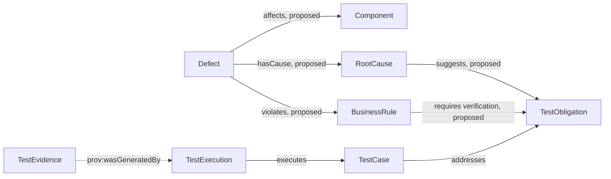

# Ontology-Driven Defect and Quality-Risk Analysis: Turn Past Issues into Regression Leads

A team fixes a payment-timeout issue. Months later, another payment API changes its retry logic. The defect tracker contains the earlier issue, but if it is only a text description, a tester may not connect it to the new change.

A quality ontology can relate a defect to an affected component, business rule, root cause, test obligation, and regression case. A query can find similar historical records and offer them as investigation leads. A similar record does not prove that the new code has the same defect.

## A Payment-Timeout Example

Assume a payment request times out and the client submits it again. The same order then receives two payments. An investigation attributes the issue to missing idempotency control. This hypothetical case contains different information:

| Information type | Example | Modeling distinction |
|---|---|---|
| Symptom | The user sees two charges | An observed outcome |
| Defect record | The payment API creates a duplicate transaction after retry | A traceable issue entry |
| Root cause | The server does not enforce idempotency using the request identifier | An explanation confirmed or revised after investigation |
| Business rule | One payment request can produce at most one successful transaction | A rule the business must satisfy |
| Affected object | Payment component and order-payment flow | Code or business boundary |
| Regression obligation | Repeating the same request must not create a second payment | Verification evidence that should remain available |

The root cause may change during investigation. Initial triage can label “possibly related to idempotency” as unconfirmed. A review can then create a confirmed relationship. Preserve status, source, and reviewer so a guess does not become a permanent fact.

## A Proposed Relationship Model

The first five relationships in Figure 1, along with the RootCause and BusinessRule concepts, are proposed extensions not defined in the v0.19 baseline. `addresses`, `executes`, and the PROV-O provenance relationship reuse the existing model. The `proposed` labels identify proposed relationships; the dashed line separately marks PROV-O provenance.

## Turn Defect Knowledge into a New Test Obligation

1. Record the defect's impact, reproduction conditions, environment, and source issue.
2. After investigation, label the symptom, confirmed root cause, and unresolved causes separately.
3. If the issue violates a business rule, link it to the rule and affected component.
4. Derive one or more test obligations from the rule and state why the defect requires them.
5. Design regression cases and link them to real executions and evidence.
6. When later changes involve the same rule or component, query historical defects and remind reviewers to inspect the related obligations.

One root cause may affect several components. One defect may involve several rules. Relationships should support many-to-many links and allow issue states such as triaged, confirmed, fixed, and regression-verified.

## How to Handle Risk Priority

Risk is not the number of defects. A team can define its own assessment dimensions, such as impact, likelihood, detectability, and business loss. The ontology can store confirmed risk properties or categories. It should not hide an unapproved scoring algorithm.

| Risk question | Information to add |
|---|---|
| What can be affected? | Business capability, component, user group, or data scope |
| How serious is the impact? | A team-defined level and its rationale |
| What can trigger the issue? | Reproduction conditions, inputs, state, and dependencies |
| How can the team detect or block it? | Monitoring, automation, review, or gate |
| Has anyone accepted the risk? | Approver, rationale, expiration, and mitigation |

A related historical defect means “possibly relevant.” The risk owner must still confirm whether the current change shares its conditions.

## Common Misunderstandings

| Misunderstanding | More accurate explanation |
|---|---|
| A similar defect has the same root cause | Similar text only creates a candidate; investigation evidence must confirm the cause |
| A historical defect automatically creates a valid regression test | The test still needs to map to a business rule and verify the expected behavior |
| Defect count represents risk level | Severity, impact, frequency, and detectability can differ |
| Defect relationships predict every failure | The model can use only represented concepts and relationships; unmodeled dependencies remain gaps |

## Practical Guidance

- Store symptoms, root causes, business rules, and affected components separately.
- Distinguish unconfirmed links from reviewed links, and retain sources.
- Trace each regression obligation to a rule or an incident-review finding.
- Treat a later code change as a prompt to review risk, not proof of recurrence.
- Periodically close stale, duplicate, and irrelevant defect relationships.

## FAQ

### Can AI find a root cause from a defect description automatically?

AI can suggest similar records and possible causes. Investigation evidence still needs to confirm a root cause. Unconfirmed causes should remain candidates.

### Can one defect link to several business rules?

Yes. A real incident may involve multiple rules. Each link should show its evidence or review status.

### Is this defect model included in v0.19?

No. Defect, root-cause, and risk relationships come from the series extension plan. Implementing them requires updates to the ontology, constraints, example data, and bilingual terminology.

## Three Questions to Check Your Understanding

1. Does a similar historical defect prove that new code has the same issue? A. Yes; B. No, it is an investigation lead; C. Only if it is in the same component.
2. What confirms a recorded root cause? A. Similarity score; B. Investigation evidence and responsible reviewers; C. Test count.
3. What should a reused test obligation link to? A. A business rule or confirmed risk; B. Only the defect title; C. Any test case.

Answers: 1-B, 2-B, 3-A.

## Summary

A defect ontology makes historical failures searchable through components, rules, and regression obligations. It helps teams reuse investigation leads but does not replace root-cause confirmation. The next article applies semantic modeling to the order and payment business domain.

## References

- Series quality and business ontology plan: user-provided research document “Ontology in AI Native QA.”
- W3C PROV-O: https://www.w3.org/TR/prov-o/
