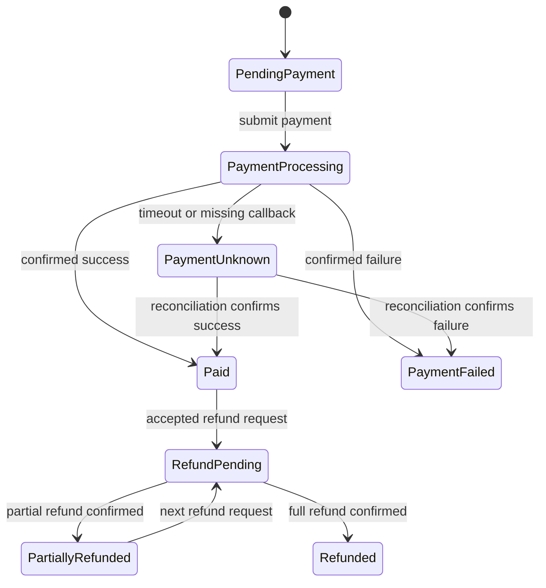
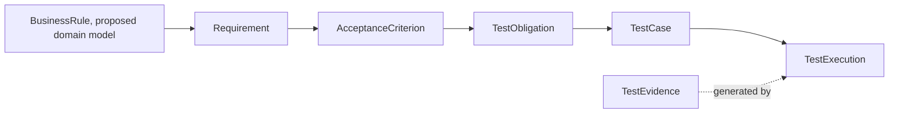

# Design an Order and Payment Business Ontology: Concepts, States, and Rules

“The order is paid” looks like one state. A real system may also need to know whether a payment request was duplicated, whether a gateway timed out, whether a refund already occurred, and whether the refund exceeds the permitted amount. A model that stores only a status string may not explain which event caused the state or which rules must hold.

An order and payment ontology defines business objects and terms, then works with state machines and rule checks. It is not a standard that can be applied unchanged to every commerce system. Each project must confirm its payment channels, split payments, refunds, and reconciliation rules.

## Define the Business Objects First

| Concept | What it records | Common relationships |
|---|---|---|
| Order | A customer's purchase request, amount, currency, and lifecycle | Contains items; settled by one or more payment attempts |
| OrderItem | Product, quantity, unit price, and discount allocation | Belongs to an order |
| Payment | A payment or payment attempt for an order amount | Links to a channel, status, and external transaction ID |
| PaymentAttempt | One request sent to a payment channel | May succeed, fail, time out, or await reconciliation |
| Refund | An operation that returns some or all collected funds | Points to the original payment and refund request |
| Customer / Role | The actor who starts or approves an operation and its permission | Creates an order, pays, or requests a refund |
| BusinessRule | A condition the business requires | Leads to requirements and test obligations |

Payment and PaymentAttempt may be combined in a simple product. If the team needs to distinguish a business payment from retries, asynchronous callbacks, or reconciliation, separate concepts make the history easier to inspect.

## Draw Order and Payment States

The state diagram is a teaching example. It shows one possible basic flow. It does not include every channel, partial payment, or dispute process. A team must add its own states and events before using it.

`PaymentUnknown` is an explicit business state. It means the payment outcome is not yet known. It is different from `Unknown` in quality assessment, which means the available evidence is insufficient to judge a quality claim. A timeout does not always mean a payment failed. The gateway may have charged the customer even though the callback has not arrived. The system needs a status query or reconciliation result. It should not submit a new payment merely because the previous request timed out.

## Write Rules That the Team Can Review

An order and payment model needs to make at least these rules explicit. They are starting points for domain discussion. A project must define their scope, including currency, partial refunds, installments, and external channels.

| Rule | Checkable wording | Boundary to define |
|---|---|---|
| Duplicate successful payment | The same payment obligation for one order cannot be settled twice | Whether installments, repeated charges, or split payments are supported |
| Idempotent request | Repeating a request with the same idempotency key cannot create a duplicate transaction | Key scope, expiration, and conflict response |
| Payment timeout | After a timeout, a defined query or reconciliation strategy determines the final state | Query interval, maximum wait, and handling of a late callback |
| Refund ceiling | Cumulative refunds cannot exceed the amount currently refundable for that payment | Fees, discounts, partial refunds, chargebacks, and currency precision |
| Refund permission | Only an authorized actor can perform a refund operation | Role, order ownership, amount limit, and approval rule |

The model can represent a BusinessRule class and its properties. Rules involving time windows, cumulative amounts, concurrent requests, and state transitions usually need a state machine, rule engine, or program to execute them. OWL describes concepts and logical relationships. It should not be presented as an engine that automatically runs every business condition.

## Connect Business Rules to Testing

Figure 2 shows a target path from business knowledge to quality evidence. The current v0.19 baseline starts with Requirement and does not yet define BusinessRule or business-state models. This cross-domain path is a proposed series extension, not a claim of implementation.

## When to Use an Ontology, State Machine, or Rule Engine

| Question | A suitable expression |
|---|---|
| What are orders, payments, and refunds, and how do they relate? | A domain model or ontology |
| Which states can a payment enter, and can it succeed after timing out? | A state machine or event model |
| Does the cumulative refund exceed the permitted amount? | A programmatic rule or rule engine with amount and currency definitions |
| Which test obligations cover the rules, and what evidence did execution produce? | QE relationships, queries, and provenance |

These forms can work together. An ontology aligns terms and relationships. A state machine describes transitions. A rule implementation checks business constraints. Tests show what happened for specific inputs and environments.

## Practical Guidance

- Start with a narrow scenario and state the order, payment, and refund scope.
- Separate a business payment from attempts sent to a provider, especially for asynchronous outcomes.
- Define explicit rules for amount, currency, rounding, and cumulative refunds.
- Represent timeouts and unknown callbacks as states. Do not equate “no result received” with failure.
- Trace every business rule to an acceptance criterion and test obligation.

## FAQ

### If we express rules in OWL, will the system control payments automatically?

No. OWL expresses semantics and logical relationships. Runtime components or program rules need to enforce state transitions and amount constraints.

### Why model PaymentAttempt separately?

It helps when the system must distinguish a business payment from several requests to a gateway, including retries, timeouts, late callbacks, and reconciliation.

### Does this state diagram apply to every payment product?

No. It omits installments, reversals, chargebacks, disputes, and channel differences. Product rules and payment contracts determine the actual states.

## Three Questions to Check Your Understanding

1. Does a payment-request timeout prove payment failure? A. Yes; B. No, a query or reconciliation may be needed; C. The user should always retry.
2. What is appropriate for checking that cumulative refunds do not exceed the allowed amount? A. A graph alone; B. An explicit rule check and currency definition; C. A status label.
3. Must an ontology, state machine, and rule engine be mutually exclusive? A. Yes; B. They can work together; C. Only OWL can be used.

Answers: 1-B, 2-B, 3-B.

## Summary

An order and payment ontology gives business objects, states, and rules shared definitions. A suitable execution mechanism must still check transitions and numeric constraints. The next article turns these business rules into traceable AI test designs.

## References

- The order and payment rules come from the user-provided ontology research plan and are teaching assumptions that require project review.
- W3C OWL 2 Primer: https://www.w3.org/TR/owl2-primer/
