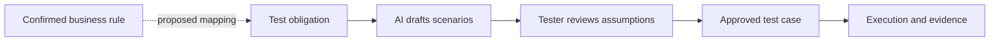
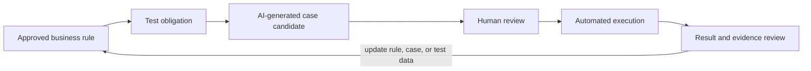

# How Can a Business Ontology Help AI Design Test Cases? Trace Rules to Scenarios

After an AI receives “test the payment timeout,” it may list network loss, repeated clicks, and delayed callbacks. But if the team has not defined whether a timeout should trigger a status query, a retry, or order closure, the AI cannot know which result is correct.

A business ontology can provide rules, states, and objects to the AI. The AI can then propose test obligations and candidate cases from those rules. Each candidate should trace to a source and identify assumptions the team has not resolved. Generated tests are not confirmed-correct tests, and they have not necessarily run.



Figure 1 shows the path from a business rule to test design and execution. The dotted mapping is a cross-domain extension proposed by this series; v0.19 does not currently define a `BusinessRule` class. Human review and actual execution are still required.

## From Rules to Test Obligations

Assume the order and payment domain has confirmed these rules:

- Repeating a request with the same idempotency key must not create a duplicate transaction.
- After a payment timeout, the system uses a defined query or reconciliation strategy to confirm the final state.
- One payment obligation for an order cannot create duplicate successful charges.
- Cumulative refunds cannot exceed the amount currently refundable for the payment.

Map each rule to a TestObligation, then link cases to those obligations. `BusinessRule → TestObligation` is a cross-domain extension proposed in this series. The v0.19 baseline defines `TestCase addresses TestObligation`, but it does not yet define the BusinessRule class.

| Rule ID | Derived test obligation | Source status |
|---|---|---|
| BR-IDEMPOTENCY | Repeating the same idempotency key creates at most one successful transaction | Teaching rule; key scope and expiration need business confirmation |
| BR-TIMEOUT | The final payment state follows the reconciliation strategy after timeout | Query interval, maximum wait, and late-callback handling need definition |
| BR-SINGLE-CHARGE | One payment obligation cannot charge the customer twice | Confirm whether installments or split payments are in scope |
| BR-REFUND-LIMIT | Cumulative refunds stay within the currently refundable amount | Define fees, currency precision, and chargeback treatment |

## Ask AI for Reviewable Test Candidates

A tester can provide business rules, a state diagram, API contracts, and relevant versions, then request output with fixed fields. This prompt template lets a beginner start with one rule:

```text
Goal: Propose candidate test cases for the business rule below.

Rule ID: BR-IDEMPOTENCY
Rule text: Repeating a request with the same idempotency key must not create a duplicate transaction.
Related concepts: Order, Payment, PaymentAttempt
API contract: <paste confirmed request fields, response, and error codes>
Test obligation ID: TO-PAY-IDEMPOTENCY

Return: case ID, preconditions, actions, expected outcome, covered rule ID, and required test data.
Also list assumptions that the rule does not specify. Do not invent API fields, response codes, timeout duration, or database behavior.
If the expected outcome cannot be determined from the input, mark it “Needs business confirmation.” Do not guess.
```

Replace the API contract placeholder with real materials. If the team has not confirmed fields, states, or error codes, fill in that information before requesting more specific cases.

## An Example Candidate Case

This case shows the structure only. Confirm its preconditions and expected outcome against the actual API contract.

| Field | Example |
|---|---|
| Case ID | TC-PAY-IDEMPOTENCY-02 |
| Covered rule | BR-IDEMPOTENCY |
| Test obligation | TO-PAY-IDEMPOTENCY |
| Preconditions | The order is awaiting payment; prepare the same request body and idempotency key |
| Action | Submit the same request twice, concurrently or in sequence |
| Expected outcome | The system creates one payment transaction; both responses follow the confirmed idempotency contract |
| Needs confirmation | Concurrency semantics, whether responses must be identical, and key retention period |

If an AI-generated expectation conflicts with the API contract, use the approved business rule and interface definition. The model should report the conflict instead of deciding for the team.

## Check Whether Scenarios Cover Rule Boundaries

For each rule, review several input and state types:

| Scenario type | Payment example | Review question |
|---|---|---|
| Happy path | Payment succeeds and a confirmation arrives | Do order state and transaction record agree? |
| Negative path | Invalid idempotency key or unauthorized request | Does the system reject the action without side effects? |
| Repeated action | Same-key request or repeated callback | Does it create a duplicate payment or refund? |
| Boundary value | Refund amount equals, falls below, or exceeds the allowed amount | How do precision, currency, and cumulative refunds work? |
| State ordering | A timeout arrives before a success callback | Does the final state converge under the reconciliation policy? |

These scenarios are a test-design checklist, not proof that a product passed them. Connect each one to a rule ID, obligation ID, case, execution result, and evidence source.

## Review AI Output Manually

A test designer should check each item:

1. Does the rule ID exist, and is its version correct?
2. Can the test environment establish the preconditions?
3. Does the action match a real API or user flow?
4. Does the expected outcome come from an approved rule rather than AI invention?
5. Do boundary and exception states match the team's payment policy?
6. Can the case run repeatedly, and is the result observable?

Approved cases can enter test management or automation development. Unreviewed AI output should remain a candidate and should not count as effective coverage.

## Focus: Put AI-Generated Cases into the Quality Cycle

Case generation is one part of quality work. The team must review expected behavior, run the tests, check evidence, and then revise rules, obligations, cases, or data based on the results. Put this cycle into routine testing for each requirement and code change:



If execution shows that an expected outcome is unclear, update the business rule. If evidence points to the wrong build, fix the data link. If a case does not verify the rule, add the necessary assertion. An AI-generated case belongs in the quality evidence chain only after review, execution, and a traceable result.

## Practical Guidance

- Give each rule a stable ID, version, and source.
- Start with one rule, then add states and boundary inputs gradually.
- Ask the AI to separate facts, inferences, and assumptions that need confirmation.
- Use `TestCase addresses TestObligation` for traceability instead of putting a rule name only in a title.
- Review generated cases before execution and evidence capture.

## FAQ

### Can AI generate final tests directly from order rules?

It can propose candidates. A test designer must confirm that the input is complete, expected results come from approved rules, and the environment can run the checks.

### Can we start with rules but no API contract?

Yes, for high-level scenarios and open questions. Concrete requests, responses, and assertions need an API contract or user-flow definition.

### Do AI-generated cases count as coverage?

Cases that have not been reviewed and executed do not prove that an obligation was validated. Coverage assessment needs valid links, execution records, and evidence.

## Three Questions to Check Your Understanding

1. What should AI do when a rule does not define an HTTP error code? A. Invent a common code; B. Mark it for confirmation; C. Omit the source.
2. What does `TestCase addresses TestObligation` state? A. The case is recorded as checking the obligation; B. The test passed; C. The business rule is correct.
3. What can make a candidate case usable for a quality conclusion? A. Generated text; B. Review, execution, and traceable evidence; C. More prompts.

Answers: 1-B, 2-A, 3-B.

## Summary

A business ontology gives AI test design context about rules, objects, and states. Each candidate case should include its source rule and unresolved assumptions, then receive human review and actual execution. The next article uses order states and rules to look for business-testing gaps.

## References

- Order/payment rules and AI-test direction: Topic C in the series research plan.
- W3C SHACL: https://www.w3.org/TR/shacl/
