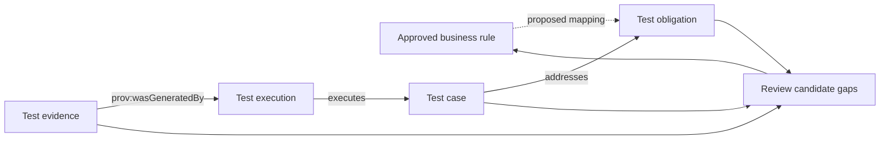

# Find Business Test Gaps with an Ontology: Rules, States, and Scenarios

A report can show that all 20 test cases passed and still fail to answer whether the order and payment rules were validated. The team must also list the rules, state changes, and test obligations, then check whether each obligation has a case, an execution record, and evidence.

This article uses the order and payment teaching example. Idempotency, timeout handling, duplicate charges, and refund limits are illustrative rules from the research plan. They do not describe a real payment product. The v0.19 baseline does not model `BusinessRule`, so the relationship from a business rule to a test obligation is a proposed cross-domain extension.

## Turn “a gap” into questions that can be checked

“Test gap” can mean several different things. A model or report should state which kind it found:

| Gap type | Question | Payment example |
|---|---|---|
| Rule gap | Does an approved rule have a test obligation? | An idempotency rule has no `TestObligation` |
| Case gap | Does an obligation have an executable case? | A timeout-reconciliation obligation has no linked case |
| State gap | Are important states and transitions represented in tests? | `Pending → Succeeded` is tested, but a late success callback after timeout is not reviewed |
| Sequence or timing gap | Are event order, retries, and delays checked? | Repeated submission and out-of-order callbacks have not been discussed |
| Boundary gap | Are rule boundaries and invalid inputs defined? | How should cumulative refunds at or above the allowed amount behave? |
| Evidence gap | Did the case run against the target version, with traceable results? | A case exists, but there is no execution record for the current build |

The model can identify candidate gaps from rules and data that were imported and confirmed. If a rule is unclear or the data is missing, the system should report “needs confirmation” or “insufficient data.” It should not label the situation a product defect by default.

## Expand business rules into a scenario matrix

The scenarios below are derived from four teaching rules. They form a review checklist, not a real coverage report. Questions in the last column need business decisions.

| Rule | Changes or combinations to review | Expected behavior to confirm |
|---|---|---|
| The same idempotency key must not create duplicate transactions | Sequential duplicate, concurrent duplicate, same key with a different request body | Key scope, expiration, and response to a conflicting request |
| A payment timeout follows a defined strategy to confirm final state | Query after timeout, late success callback, duplicate callback, callback before query response | Timeout threshold, query interval, maximum wait, and final-state convergence |
| One payment obligation must not produce duplicate successful charges | Two success responses, network retry, order retry | Whether installments, split orders, or multiple payment channels share one obligation |
| Cumulative refunds must not exceed the currently refundable amount | One refund equal to the limit, cumulative amount at the limit, amount above the limit, concurrent refunds | Currency precision, fees, chargebacks, and whether pending refunds reserve the amount |

For example, a late success callback is worth asking about. But the rule only says that a defined policy determines the final state after a timeout. If the team has not specified how callbacks and reconciliation interact, the article must not invent an expected result. Record the question, then update the rule or acceptance criterion.

## How the gap analysis follows relationships

The flow below shows a review path from rules to quality evidence. `BusinessRule → TestObligation` is a proposed extension. Links from test cases to obligations and from executions to evidence must follow the actual model and data.

The dotted line marks a mapping that is not in the v0.19 baseline. Arrows into the review node represent an analysis flow. Read RDF predicates according to their definitions, such as `TestCase addresses TestObligation` and `TestEvidence prov:wasGeneratedBy TestExecution`.

An ontology and query can answer “Which modeled obligation has no linked case?” or “Which case has no evidence for the target build?” They cannot judge assertion quality from relationship counts or prove that the software implements a rule.

## A beginner’s manual review

1. Choose one workflow, such as order payment, instead of modeling an entire commerce system.
2. Extract each rule from an approved requirement, policy, or API contract. Keep its source and version.
3. For each rule, ask about success, rejection, boundaries, repeated actions, event order, and recovery.
4. Write an expected outcome for each question. Mark outcomes without a source as pending confirmation.
5. Record confirmed verification goals as test obligations and link the test cases.
6. Check whether execution records and evidence belong to the target version. Have a tester review candidate gaps.

| Review item | Record | Example status |
|---|---|---|
| Rule source | Requirement ID, rule version, approver, or document link | Confirmed / pending |
| Test obligation | Required business behavior to verify | Defined / missing |
| Scenario and case | Preconditions, action, expected result, case ID | Linked / missing |
| Execution and evidence | Build, environment, time, outcome, report location | Valid / mismatched / unknown |
| Human conclusion | Defect, model gap, data gap, or rule question | Confirmed / under investigation |

## Review gaps proposed by AI

AI can suggest checks from rules and relationships. A reviewer should ask:

- Which rule, state, or historical defect led to this candidate?
- Can the expected result be found in an approved rule or API contract?
- Is this a confirmed coverage gap, or could the model be missing data?
- Are there several valid business policies, with no decision for this system yet?
- Did the case run against the target version, and where is the evidence?

Separate the results into “confirmed gap,” “rule needs definition,” “data missing,” and “suggested investigation.” Do not log a plausible AI guess as a defect without review.

## Practical guidance

- Use rules and test obligations as the review unit; do not substitute case counts for coverage.
- Review state transitions, repeated requests, event timing, and concurrency as distinct dimensions.
- Keep the source, model version, and query scope for each candidate gap.
- Report product defects, undefined rules, missing trace links, and unimported data separately.
- Ask a domain owner to confirm expected behavior, then add approved scenarios to regression tests.

## FAQ

### Does a query that finds an obligation with no test prove a product defect?

No. It shows that the query found no linked case in its current scope. Confirm that rules and data are complete, and check whether another system stores the test.

### Can AI decide which exceptional states should be tested?

AI can propose states and questions from the rules it receives. A domain or product owner must confirm expected behavior when no policy provides it.

### Do linked cases and evidence prove sufficient coverage?

No. Check whether assertions verify the rules, executions belong to the target version, and evidence meets the team’s qualification policy.

## Three Questions to Check Your Understanding

1. A query finds no case linked to an obligation. What can you conclude first? A. The product has a defect; B. The current data has no matching link; C. The test failed.
2. The expected result for a late callback after timeout is undefined. What should the team do? A. Ask AI to choose the common behavior; B. Mark it for business confirmation; C. Treat it as passed.
3. What is more useful than case count for reviewing rule coverage? A. Traceability from rules to obligations, cases, executions, and evidence; B. Test report page count; C. Model response length.

Answers: 1-B, 2-B, 3-A.

## Summary

Gap analysis starts from confirmed rules, then checks obligations, scenarios, cases, executions, and evidence. When an expected outcome is unclear, return to the business rule and define it. The next article connects reviewed business rules to automated test execution.

## Series Navigation

- Previous draft: `15-ai-business-test-design.md`
- Next draft: `17-business-rules-to-automation.md`

## References

- W3C SHACL: https://www.w3.org/TR/shacl/
- W3C SPARQL 1.1 Query Language: https://www.w3.org/TR/sparql11-query/
- Rule source for this series: the user-provided order and payment research plan; the examples still need confirmation by a real business domain.
