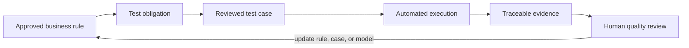

# From Business Rules to Automated Tests: Put the Quality Cycle into Daily Work

A business rule needs executable verification so the team can use run results to check whether the system implements it. Generating a test case does not validate the rule. The case needs review, automated execution, result checks, and retained evidence.

## Focus: Put the quality cycle into every change

The central flow in this article is:



Execution can reveal an ambiguous rule, missing test data, an implementation defect, or an incorrect ontology mapping. The team should feed those findings back into the rule, case, or model, then run the relevant regression checks. This cycle belongs in routine PR and release work.

The arrows from business rules to obligations, cases, executions, and evidence show a work sequence. The v0.19 ontology includes concepts such as `TestCase`, `TestObligation`, `TestExecution`, and `TestEvidence`. It does not define a business-rule-to-obligation relationship in its baseline. That mapping needs a reviewed extension before implementation.

## Make a business rule a verifiable obligation

Consider the rule “Repeating a payment request with the same idempotency key must not create a duplicate transaction.”

| Stage | What must be clear | Example or open question |
|---|---|---|
| Rule | What must hold in the business domain | The same idempotency key must not create duplicate transactions |
| Test obligation | What verification evidence is required | Repeated requests result in one successful transaction |
| Test design | How to trigger and observe the outcome | Submit sequentially and concurrently; inspect the transaction record and response |
| Automation boundary | Which parts are suitable for a script | API requests, read-only database assertions, or controlled test events |
| Evidence | How to review the run | Case version, build, environment, time, status, and report summary |

“Concurrent requests result in one transaction” is an example expectation. The real concurrency contract, response codes, transaction boundaries, and storage checks must come from approved business and API rules. Do not use this example as an executable test without review.

## A beginner’s workflow

1. Choose one approved business rule. Do not ask AI to generate the entire payment test suite at once.
2. Provide its rule ID, text, source version, and related state diagram or API contract.
3. Ask AI to propose test obligations and open questions before it drafts cases.
4. Have a tester and domain owner review preconditions, actions, expected outcomes, and test data.
5. Implement approved cases as API, UI, or component-level automated tests.
6. Run them in CI and retain the build, environment, time, result, and evidence location.
7. Have quality staff review failures, skips, missing evidence, and rule conflicts. Record conclusions in the requirement or test model.

Use stable fields for candidate cases. This makes human review easier and later mapping to a test management tool more reliable:

```text
Case ID:
Source rule ID and version:
Test obligation ID:
Preconditions:
Actions:
Expected outcome:
Test data:
Automation level:
Evidence to retain:
Unresolved assumptions:
```

## Example: express an obligation as a Gherkin scenario

The scenario below is pseudocode for review. Add `@confirmed` only after the business owner confirms concurrency semantics and test data.

```gherkin
@draft @business-rule:BR-IDEMPOTENCY
Scenario: Repeating a payment request does not create a duplicate transaction
  Given an order is awaiting payment
  And the payment request has an approved idempotency key
  When the same request is submitted twice
  Then the payment state follows the approved idempotency contract
  And no duplicate successful transaction is recorded
```

The Gherkin does not specify an HTTP status code or require identical responses because the real contract must define those details. Automation assertions should point to approved rules instead of copying a model-generated sentence.

## Turn execution results into reviewable evidence

| Execution status | What to retain | Effect on a quality assessment |
|---|---|---|
| Passed | Run version, environment, case version, and result summary | Still check whether the case verifies the target obligation |
| Failed | Failed assertion, logs, and reproducible input | Can provide a defect lead; confirm the cause before attribution |
| Skipped | Reason and scope of the skip | Cannot count as passing evidence |
| Not run | Build and cases that were not executed | There is no execution evidence for them |
| Unknown | Missing fields, data, or source | Do not convert it to pass or fail automatically |

In v0.19, `TestExecution executes TestCase` links an execution to a case, and `TestEvidence prov:wasGeneratedBy TestExecution` records the evidence source. A report must also state whether build, environment, and time details satisfy the team’s evidence qualification rules.

## Connect the daily quality cycle to PRs and releases

| Moment | What automation can do | What people need to decide |
|---|---|---|
| Requirement or rule changes | Find linked obligations and candidate tests | Confirm rule meaning and expected outcomes |
| PR creation or update | Select regression scope from change relationships | Check mapping completeness and candidate risk relevance |
| CI execution | Run reviewed tests and collect logs | Handle failures, skips, environment errors, and missing evidence |
| Release preparation | Summarize obligation and evidence status for the target build | Make a Go/No-Go decision under the risk policy |
| Retrospective | Link defects and escapes back to rules, models, and tests | Decide whether to update rules, cases, or verification policy |

The cycle runs in both directions. During a change, rules help select verification. After execution or production feedback, results drive updates to rules, cases, and trace links. The model becomes stale if only the first half happens. The second half alone cannot make accumulated knowledge available during change review.

## Practical guidance

- Start with one rule and one obligation. Complete the end-to-end path first.
- Mark model-generated content as a candidate. Add it to the automation suite only after review.
- Bind each execution to a build, environment, and case version; retain the original result.
- Keep failed, skipped, not-run, and unknown outcomes distinct instead of merging them into a pass rate.
- Update rule, obligation, case, and evidence links during PR and release retrospectives.
- Automation can run assertions. Responsible people still confirm business expectations and release decisions.

## FAQ

### Can AI write automation code for every business rule directly?

Do not skip review. AI can draft scenarios or code scaffolding, but the team must confirm expectations, environments, data, and side effects. Unreviewed code does not mean the business rule has been verified.

### Does an automated test satisfy an obligation?

Not by itself. Check whether its assertions cover the obligation, whether it ran against the target version, and whether its result and source meet evidence policy.

### Should the business rule be changed as soon as a test fails?

First identify the cause. It may be a product defect, test-code error, environment issue, or an ambiguous rule. Update the corresponding record after the cause is confirmed.

## Three Questions to Check Your Understanding

1. Can an AI-generated case count as effective coverage before review? A. Yes; B. No; C. Yes, if its format is correct.
2. How should a CI `Skipped` result be recorded? A. As passed; B. With its reason, without treating it as passing evidence; C. Delete it.
3. What does execution and retrospective work do in the quality cycle? A. Produce more reports only; B. Feed findings back into rules, tests, and models; C. Replace release approval automatically.

Answers: 1-B, 2-B, 3-B.

## Summary

Automation lets reviewed test obligations be checked repeatedly during routine changes. Evidence and failure causes from each run should return to reviews of rules, cases, and models. This keeps business rules from remaining one-time prompts or document entries.

## Series Navigation

- Previous draft: `16-find-business-test-gaps.md`
- Next draft: `18-build-a-domain-aware-qa-agent.md`

## References

- W3C PROV-O: https://www.w3.org/TR/prov-o/
- W3C SHACL: https://www.w3.org/TR/shacl/
- Series model v0.19: `01_project/ontology/baseline.ttl`, `01_project/examples/delivery-flow.ttl`
- The Gherkin scenario is illustrative pseudocode. It has not been connected to or run with a specific automation framework.
