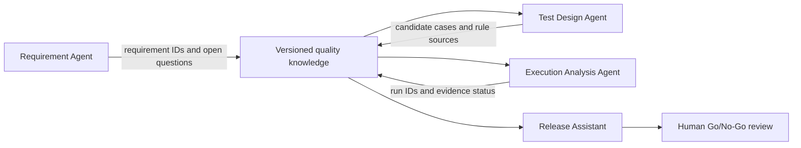
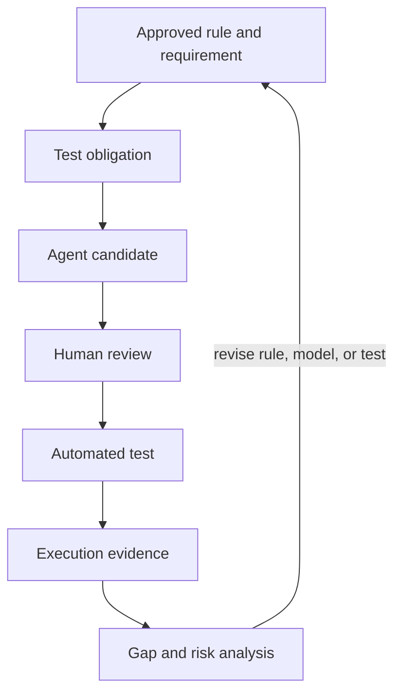

# How Can QA Agents Share Quality Knowledge? Common Semantics, Handoffs, and Audit

One agent finds that a PR changes the payment component. Another derives tests from requirements. A third summarizes CI results. If they interpret “payment success,” “test obligation,” or “valid evidence” differently, the handoff breaks. An ontology can give them shared concepts and relationships, but it cannot replace data versioning, permissions, or accountability.

## What do agents share?

Agents should share reviewable quality context, not an arbitrary chat transcript:

- Definitions and versions of common concepts and relationships.
- IDs for requirements, business rules, components, test obligations, and cases.
- Source records, import snapshots, and query scopes.
- Execution results, evidence locations, and qualification status.
- Agent candidates, their sources, unresolved assumptions, and human-review status.

If a downstream agent receives only a prose summary, it may not know which requirement, data version, or execution supports the conclusion.

## A traceable collaboration chain



Agents exchange object IDs and evidence references through versioned shared knowledge. Results from an execution agent must still point to records in a real test system. A release assistant can summarize the material, but an accountable person still makes the release decision.

## Agent roles and handoffs

| Agent role | Main work | Information to hand off | What it cannot claim alone |
|---|---|---|---|
| Requirement analyst | Find ambiguity in requirements, acceptance criteria, and rules | Source IDs, versions, and open questions | Cannot approve a rule for the domain owner |
| Impact analyst | Find affected scope through component and change links | PR/component/requirement paths and query snapshot | Cannot guarantee trace data is complete |
| Test designer | Map confirmed rules to obligations and candidate scenarios | Rule ID, obligation ID, preconditions, and assertion source | Cannot mark a candidate as verified |
| Execution analyst | Summarize real test runs and evidence status | Run ID, build, environment, time, result, and report | Cannot convert skipped or unknown into passed |
| Release assistant | Summarize risks, obligations, runs, and evidence gaps | Basis for conclusions, exceptions, and open items | Cannot make an authorized Go/No-Go decision |

## Example handoff record

Cross-agent handoffs can use structured records instead of copied chat messages:

```yaml
task_id: PR-128-quality-review
snapshot_id: demo-snapshot-v1
ontology_version: v0.19
source_records:
  - id: REQ-REFUND-04
    version: 3
    role: acceptance-criterion
  - id: TO-REFUND-PERMISSION
    role: test-obligation
candidate_tests:
  - id: TC-REFUND-AUTH-01
    status: needs-human-review
evidence:
  status: unknown
  reason: no execution evidence found in the selected snapshot
open_questions:
  - confirm whether the target build includes the permission change
```

This YAML is a handoff-format example. It is not an agent protocol defined by v0.19, and it does not mean these records exist. Production collaboration still needs reviewed fields, identifiers, validation, permissions, and audit rules.

## Versioning, conflicts, and accountability

1. **Pin context versions.** Record the ontology version, data snapshot, target build, and query scope for each agent task. Otherwise two agents may answer the same question from different data.
2. **Treat model updates as changes.** An agent may propose a new relationship or term mapping. A domain owner should review the candidate, followed by constraint and regression checks.
3. **Preserve conflicts instead of silently merging them.** If requirements, API contracts, and test results conflict, report the sources and wait for an accountable decision.
4. **Record the basis for each conclusion.** Keep input records, query results, agent version, prompt-template version, and human edits.
5. **Separate permissions by task.** Reading requirements, executing tests, changing rules, and approving releases require different permissions. A sequence of tasks should not automatically grant one agent all of them.

An ontology can standardize terms, but it cannot repair contradictory source records. If “refund complete” means different things in requirements, a payment API, and test reports, resolve the terms and business rules before sharing them across agents.

## Put the quality cycle into agent collaboration

Agent outputs should enter the same quality cycle:



Agents can shorten information retrieval, analysis, and drafting. Test execution, evidence qualification, and rule updates still follow engineering processes. Agreement between agents is not independent verification. If they use the same incorrect source, consensus does not prove the conclusion.

## Start with a small pilot

- Choose one PR impact scenario and fix the test data and human-labeled answers.
- Define shared object IDs, source references, and snapshot fields before splitting agent roles.
- Let the first agent query read-only; let the second draft candidate tests; let the automation system execute separately.
- Save sources and status with each handoff. Have a human review important assumptions and quality conclusions.
- Record recall, false positives, evidence traceability, elapsed time, call cost, and model-maintenance effort.
- When a conflict, missed item, or stale link appears, confirm the cause before updating the rule or model version.

## Potential links to existing QA projects

The original research plan lists the following possible integration points. These are proposals, not completed integrations:

| Project | Proposed direction |
|---|---|
| awesome-qa-skills: https://github.com/naodeng/awesome-qa-skills | Explore an ontology-driven-test-analysis Skill |
| ai-test-auditor: https://github.com/naodeng/ai-test-auditor | Check whether AI-generated tests map to confirmed business rules and obligations |
| QCov: https://github.com/AI-Native-QA-Lab/QCov | Explore semantic coverage links and evidence completeness |
| ai-native-qa-agents: https://github.com/naodeng/ai-native-qa-agents | Let agents query the domain ontology through restricted tools |
| AI Native QA Workbench | Evaluate it later as an optional domain-knowledge module |

Before adopting an idea, review each project's interfaces, data boundaries, and maintenance responsibility. Do not treat the number of semantic links as actual coverage.

## A proposed eight-week research path

The schedule below comes from the series research plan. It is a phased suggestion, not a verified delivery commitment:

| Phase | Suggested timing | Main work | Gate |
|---|---|---|---|
| 1. Minimum quality ontology | Weeks 1–2 | Core concepts, relationships, sample data, and SHACL validation | Model parses, constraint tests pass, terms and relations are documented |
| 2. Engineering change impact | Weeks 3–4 | Link Git diffs, requirements, and test obligations; generate PR impact reports | Use labeled samples to check recall, false positives, and traceability |
| 3. Order and payment experiment | Weeks 5–6 | Model business states and rules; connect API automation | Add positive and negative cases for key rules; use fault injection to review gaps |
| 4. Agent integration and comparison | Weeks 7–8 | Compare no ontology, ordinary RAG, and ontology-assisted approaches | Assess accuracy, evidence citations, time, cost, and maintenance complexity |

Calibrate each phase against actual effort and run results. Do not report success to preserve a schedule if the model, constraints, or integration have not passed their gates.

## Practical guidance

- Use a versioned ontology and snapshot for shared context instead of passing only free-text summaries.
- Require every agent output to include source IDs, conclusion status, and open questions.
- Separate generation, review, execution, and release permissions.
- Route conflicts and data gaps to human review instead of letting an agent silently choose one side.
- Evaluate quality, evidence, cost, and maintenance burden together.
- Treat agreement among agents as a lead. Verify it with independent evidence.

## FAQ

### Can we treat an answer as verified when several agents agree?

No. They may share the same incomplete data or incorrect rule. Verification depends on sources and independent evidence.

### Does one shared ontology make every agent use the same semantics?

Not by itself. Agents must use the same version, interpret relationship direction correctly, and follow data-mapping and query contracts.

### Which work should be given to agents first?

Start with read-only retrieval, relationship tracing, and report drafting. Changing business rules, writing to a formal test repository, and approving releases need explicit authorization and human review.

## Three Questions to Check Your Understanding

1. Why should a handoff include ontology and snapshot versions? A. To make the report longer; B. To ensure upstream and downstream agents use the same context; C. To increase accuracy automatically.
2. Several agents say the evidence is sufficient. Can the release be approved immediately? A. Yes; B. No, review independent evidence and authorization; C. Only if there are more than three agents.
3. What should happen when a source rule conflicts with an execution result? A. Let the last agent overwrite the earlier record; B. Preserve both sources and ask an accountable person to decide; C. Delete the old version.

Answers: 1-B, 2-B, 3-B.

## Summary

Multiple QA agents can divide work across requirements, changes, testing, and execution, but they need shared semantics, versioned snapshots, and structured handoffs to preserve context. Quality conclusions still need traceable evidence and a decision from an authorized person.

## Series Navigation

- Previous: `18-build-a-domain-aware-qa-agent.md`
- Series starting point: `00-what-is-ontology.md`

## References

- W3C PROV-O: https://www.w3.org/TR/prov-o/
- W3C RDF 1.1 Concepts: https://www.w3.org/TR/rdf11-concepts/
- Eight-week research plan: the user-provided ontology and AI Native QA research plan; timing needs calibration through a real pilot.
