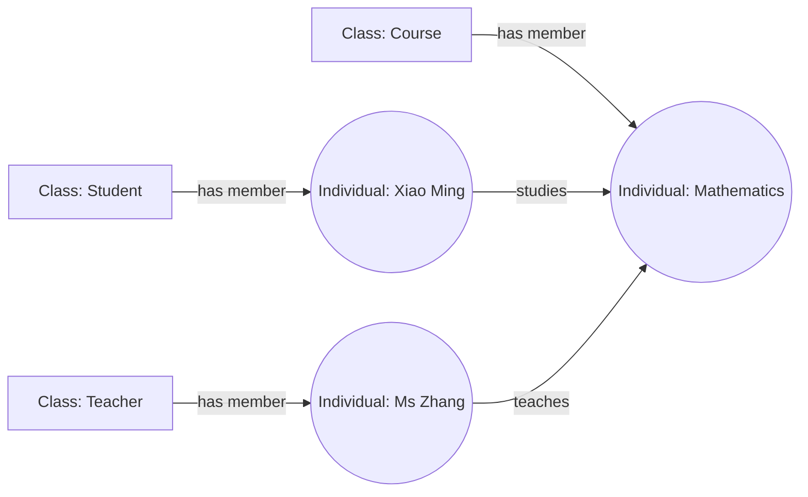
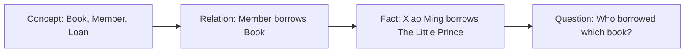
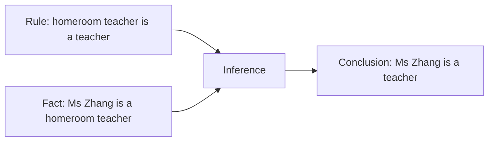
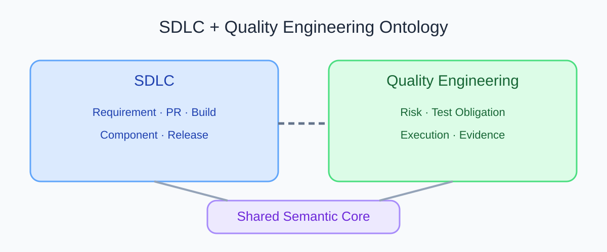
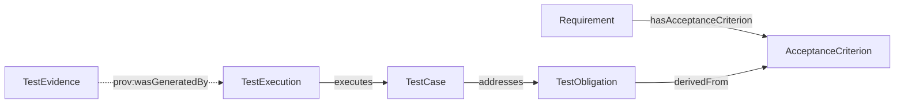

# 什么是本体（Ontology）？从日常分类看懂 AI 知识建模

“这个 PR 改完以后，哪些需求、组件和测试可能受影响？”研发团队经常要回答这类问题。答案散落在需求文档、代码仓库、测试管理工具和构建记录里。要把它们连起来，系统得先知道这些对象分别是什么，以及它们之间的关系代表什么。

本体提供一套明确的领域知识模型。它定义概念、关系和规则，让人和软件能用相同含义谈论一组对象。下面分两个阶段说明。第一阶段借鉴 ASD-STE100 的清晰表达原则解释本体。第二阶段再分别用小白版和专业版讲同一概念。

## 第一阶段：按照 ASD-STE100 原则解释本体

ASD-STE100 Simplified Technical English（简化技术英语）是用于技术文档的受控自然语言标准，包含写作规则和受控词典。本文的中文表达借鉴短句、固定术语和明确句意等原则，不声称符合完整标准。ASD-STE100 面向英文技术文档，不能把中文写作称为标准认证文本。

### 什么是本体？

本体是一种知识模型。

它描述一个领域中的事物。

它定义事物的类型。

它定义事物之间的关系。

它也可以定义逻辑规则。

这些定义帮助人和计算机用一致的方式理解知识。

### 本体包含哪些内容？

| 内容 | 英文术语 | 图书馆例子 |
|---|---|---|
| 类别 | Class | Book、Member、Loan |
| 具体对象 | Individual | 《小王子》、小明、一次借阅记录 |
| 属性或关系 | Property | 书名、读者借阅图书、作者编写图书 |
| 逻辑陈述 | Axiom | 每条借阅记录都关联一位读者和一本书 |

属性可以描述对象的特征，也可以连接两个对象。正式建模时，常把连接对象的关系称为对象属性（Object Property），把对象与字符串、数字、日期等值连接的属性称为数据属性（Data Property）。

### 本体如何工作？

建模者先确定要描述的领域，再识别主要概念。接着，建模者定义关系和规则，并把具体对象连接到这些概念。查询程序可以沿着关系查找知识。符合逻辑条件时，推理程序还可以推出新的结论。

### 本体有什么作用？

本体可以统一术语的含义，描述事物之间的关系，支持语义查询和逻辑推理，也可以帮助系统交换领域知识。

本文使用的核心定义是：本体是一种明确描述领域概念、关系和逻辑规则的知识模型。

## 第二阶段：分两层理解本体

### 第一层：小白版

#### 把本体想成领域说明书

想象你在整理一间图书馆。书架上有书，读者可以借书，作者会写书。你希望新来的管理员知道「小明借了《小王子》」这句话说的是什么，也希望图书管理软件能按同样的规则查找记录。

你需要先说明几件事：

| 日常说法 | 本体中的概念 | 示例 |
|---|---|---|
| 一类东西 | 类（Class） | Book、Member |
| 一个具体对象 | 个体（Individual） | 《小王子》、小明 |
| 两个对象的联系 | 关系（Relation） | 小明借阅《小王子》 |
| 领域里成立的规则 | 公理（Axiom） | 借阅记录要关联读者和书 |

这份说明书告诉人和软件有哪些对象，以及它们怎样连接。它不是某一天的借书名单。名单记录具体事实，说明书定义这些事实的含义。

#### 用学校例子再看一次

学校里有学生、老师、课程和班级。小明是一个学生，数学是一门课程。我们记录「小明学习数学」后，计算机可以根据定义回答「小明学习什么？」

关系图如下。圆括号中的名称是具体对象，方框中的名称是类别。

图 1 展示类别、个体和关系。图中的英文标签是术语示例。具体领域还需要定义关系的方向、范围和规则。

小白版记忆方法是：本体给领域中的事物分类，说明它们如何联系，再把重要规则写清楚。

#### 从概念到可回答的问题

读者可以把建模过程看成四步：先定义概念，再定义概念之间的关系，用关系记录具体事实，最后用问题检验这些知识是否能回答实际需求。

图 2 中的前三步描述模型和实例数据，最后一步检查它们能否支持一个有用的问题。问题答不出来时，要回头检查缺少概念、关系、事实，还是查询定义。

### 第二层：专业版

#### 正式定义

知识工程中常引用 Thomas R. Gruber 在 1993 年提出的定义：「An ontology is an explicit specification of a conceptualization.」这里的「明确」表示概念和关系被写出来；「形式化」表示机器能够按语言定义处理它们。

OWL 2 本体可以包含类、属性、个体和数据值，并用形式语义表达复杂知识。RDF 用主语、谓语和宾语构成图数据陈述；RDFS 和 OWL 可以进一步描述类型层级和逻辑语义。SPARQL 用于查询 RDF 图。

#### 一个小型推理例子

假设领域模型中有以下两条陈述：

1. 每位班主任都属于教师类。
2. 张老师属于班主任类。

推理器可以据此推出「张老师属于教师类」。这是从显式事实和规则得出的逻辑结论。若模型没有表达该规则，软件就不能仅靠名称相似推导这条关系。

#### OWL 推理和 SHACL 验证处理不同问题

OWL 常按开放世界假设（Open World Assumption）解释知识。资料中没有记录某个事实，并不表示该事实为假，也不必然表示数据错误。

如果学校规定每个学生记录必须有学号，这属于数据完整性要求。SHACL 可以按预先定义的形状检查数据是否满足此类结构条件。OWL 推理和 SHACL 验证各有用途，不能把一方的结果当成另一方的结论。

#### 本体、数据库和知识图谱

数据库主要组织和保存记录。知识图谱表示具体实体及其关系。本体定义这些实体类型、关系含义和逻辑语义。知识图谱可以使用本体，也可以只采用较轻的类型和关系定义。「本体」也用于哲学讨论存在和存在物的本体论。本文讨论知识工程中的本体。

#### 适用边界

本体适合需要共享术语、跨系统语义整合、复杂关系查询或逻辑推理的领域。简单的 CRUD 系统可能只需要数据库和清楚的数据模型。本体也不能单独保证输入数据正确，不能保证 AI 输出正确，更不能自动证明软件满足业务要求。

## 从图书馆回到软件研发

同一套建模方法可以用来组织需求、代码变更、测试义务和测试证据。下面的图保留系列原有总览图，蓝色区域表示 SDLC 概念，绿色区域表示 QE 概念，紫色区域表示共享语义核心。图中连线表达两个领域都依赖共享语义，不代表某个已部署产品的架构。

图 3 保留了原系列总览示意图。读者可以先用它观察领域划分，再看下方的具体追溯关系。

在 v0.19 实验模型中，需求（Requirement）可以有验收标准（AcceptanceCriterion）；测试义务（TestObligation）可以来源于验收标准；测试用例（TestCase）可以覆盖测试义务；测试执行（TestExecution）记录实际执行的用例；测试证据（TestEvidence）通过 PROV-O 来源关系指向生成它的执行活动。这个模型用于说明概念关系，不代表它已经连接到真实团队的工具。

图中所有箭头都按关系定义的方向，从主语指向宾语。比如，`TestObligation derivedFrom AcceptanceCriterion` 表示测试义务指向它所依据的验收标准。若从需求开始查询测试义务、用例、执行记录和证据，查询会反向遍历其中几条关系。虚线表示 `TestEvidence prov:wasGeneratedBy TestExecution`，即证据指向生成它的执行活动。缺少关联时，后续分析可能无法回答原问题。

## 常见误解

| 误解 | 更准确的理解 | 例子 |
|---|---|---|
| 本体就是知识图谱 | 本体描述语义结构；知识图谱表达具体知识，两者可以一起使用 | 「学生学习课程」是模型关系；「小明学习数学」是具体事实 |
| 本体就是数据库表结构 | 表结构组织存储；本体还表达概念含义和逻辑关系 | `student_id` 字段本身不说明学生能选哪些课程 |
| 建立本体以后 AI 就能理解业务 | 本体提供明确的语义上下文，数据和结论仍要验证 | 关系缺失或错误时，查询与 AI 建议也可能有误 |
| OWL 会自动报告每条缺失数据 | 开放世界假设下，缺少事实不等于事实为假；完整性检查通常需要 SHACL 等验证机制 | 没有学号陈述不自动证明学生记录无效 |

## 最佳实践

- 从一个读者真正要回答的问题开始，先定义模型服务什么用途。
- 先用稳定的领域词汇定义类、个体和关系，再决定是否需要 OWL 推理。
- 为关系写清方向、定义域、值域和来源，避免只画箭头不解释。
- 把推理、结构验证和业务质量判断分开记录。
- 用生活比喻开门，再明确它在哪些地方不再准确。

## FAQ

### 本体必须用 OWL 编写吗？

不必。可以先用术语表、表格或 JSON 建立领域共识。需要机器可处理的形式语义时，再选 RDF、RDFS 或 OWL 等表达方式。

### 本体和知识图谱谁包含谁？

没有适用于所有系统的固定关系。知识图谱可以引用本体描述语义，也可以使用更简单的数据模式。设计时要分别说明模式和实例数据。

### 生活比喻可以替代专业定义吗？

不可以。比喻帮助建立直觉。专业定义还要说明机器可读的概念、关系、逻辑假设和使用边界。

## 三个理解检查题

1. 在学校例子中，「学生」和「小明」分别是什么？A. 两个类；B. 类和个体；C. 属性和公理。
2. 如果所有班主任都是教师，张老师是班主任，能推出什么？A. 张老师是教师；B. 张老师教数学；C. 张老师负责全校。
3. 学生记录缺少学号时，OWL 是否必然报告数据错误？A. 必然；B. 不一定，需按约束验证；C. 自动补出学号。

答案：1-B，2-A，3-B。第二题依赖模型中确实定义了「班主任属于教师」这条规则。第三题中的结构检查需要单独声明约束。

## 小结

本体明确描述领域里的概念、关系和规则。生活例子能帮人入门，专业模型还要说明语义假设和适用边界。下一篇会回到软件研发现场，讨论分散在不同工具中的质量信息如何共享语义。

## 参考资料

- ASD-STE100 官方 FAQ: https://www.asd-ste100.org/STE_faq.html
- W3C OWL 2 Primer: https://www.w3.org/TR/owl2-primer/
- W3C RDF 1.1 Concepts: https://www.w3.org/TR/rdf11-concepts/
- W3C SHACL: https://www.w3.org/TR/shacl/
- W3C PROV-O: https://www.w3.org/TR/prov-o/
- Thomas R. Gruber, “A Translation Approach to Portable Ontology Specifications” (1993): https://tomgruber.org/writing/ontolingua-kaj-1993/
- 系列实验模型 v0.19: `01_project/ontology/baseline.ttl` 与 `01_project/shapes/baseline.shacl.ttl`
