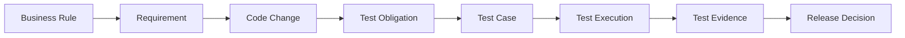

# 为什么 AI 时代的软件研发需要本体？连接需求、代码与测试

一个 PR 修改了退款接口。开发者知道改了哪些文件，测试平台知道哪些用例通过，需求工具里还有退款权限和金额规则。发布负责人问「这次改动的质量风险是什么」，这些工具不会自动给出同一个答案。团队仍要找出数据之间的关系，再判断证据够不够。

本体可以给这些对象一套共享的语义定义。它能帮助人和软件回答关系问题，也能给 AI Agent 提供可查询的上下文。它本身不会补齐错误数据，也不会代替测试或发布负责人作结论。

## 先用简单说法理解

图书馆的目录能记录书、读者和借阅。研发团队也有一份「项目目录」，只是它要描述需求、代码改动、测试和版本之间的关系。团队把关系写清楚以后，才能沿着关系查出某次改动可能影响哪些质量目标。

专业上，本体是明确描述领域概念、关系和规则的模型。在软件研发中，它可以提供跨工具的共同词汇。不同团队仍要确认自己的字段、ID 和关系如何映射到这些词汇。

## 研发知识为什么容易断开

常见工具分别保存不同对象。需求工具保存业务目标，Git 保存提交和 PR，测试工具保存用例与执行记录，发布平台保存版本和环境。即使每个工具都有数据，系统间仍可能出现这些问题：

- 同一个组件在需求里叫「退款服务」，在代码库里叫 `refund-api`。
- 测试用例链接到需求 ID，但没有说明它验证哪一条验收标准。
- 最新 PR 的 CI 通过了，却无法确认结果属于准备发布的构建。
- 缺陷写了「重复退款」，但没有关联幂等规则和回归测试。

如果只用文本相似度连接这些记录，系统可能找到候选项，却不能证明关系正确。人工映射、稳定标识、来源和审核仍然重要。

## 本体在四个领域中的位置

这个系列把模型拆成四个可以互相连接的领域，避免把所有对象都塞进一份难以维护的模型。

| 领域 | 主要对象 | 要回答的问题 |
|---|---|---|
| 质量工程本体 | 测试、缺陷、风险、覆盖、证据 | 哪项质量义务经过什么验证，证据是否合格？ |
| 研发过程本体 | 需求、任务、代码变更、PR、构建、发布 | 某个需求通过哪些工程活动进入哪个版本？ |
| 业务领域本体 | 订单、支付、库存、会员、权限 | 业务对象有哪些状态和规则？ |
| AI Agent 本体 | Agent、Skill、工具、任务、执行、证据 | Agent 使用了什么知识和工具，产出了什么结果？ |

本系列按这四个领域组织内容。v0.19 实验基线只定义了部分相关概念；涉及模型范围的篇章会标出基线已有内容和拟议扩展。

四个领域可通过明确关系相连。系列主线是：

图 1 是把系列问题串起来的概念性分析顺序，不是 v0.19 基线的关系图，箭头也不表示已经定义好的 RDF 关系。Business Rule、Test Obligation 和 Release Decision 在这里用于说明分析环节；项目要把它们落到本体中，仍需定义关系、数据来源和证据标准，并验证这些定义是否适用。

## 谁会用到这层语义

| 角色 | 常见问题 | 可查看的信息 | 仍需人判断的部分 |
|---|---|---|---|
| QA / 测试工程师 | 需求变更后哪些测试相关？ | 需求、验收标准、测试义务、用例和执行 | 关联是否完整，测试是否真能发现目标问题 |
| QA Lead | 高风险要求有验证证据吗？ | 按义务查看用例、执行和证据缺口 | 风险接受标准和补测优先级 |
| 开发工程师 | 代码修改关联哪些功能？ | PR、代码变更、组件和目标需求 | 影响边界是否包含间接依赖 |
| Tech Lead | CI 通过是否足以合并？ | 构建、测试结果、来源和策略检查 | 设计风险、未知数据和例外情况 |
| PM / 项目经理 | 当前版本还有什么质量风险？ | 未覆盖需求、未关闭风险和证据状态 | 项目优先级与风险处置方案 |
| Release Manager | 是否满足发布条件？ | 发布目标、质量声明、门禁和证据快照 | Go / No-Go 决策及风险签署 |
| AI Agent 开发者 | Agent 不理解工程对象关系怎么办？ | 共享语义、查询契约、数据来源和权限 | Agent 输出是否足以支持行动 |

## 从模型到日常工作

本体可以帮助六类工作。

1. **变更影响分析**：沿需求、组件、代码变更和测试义务寻找候选回归范围。结果受关系完整度影响，不能把候选范围当成最终测试清单。
2. **覆盖缺口分析**：查看重要需求是否有测试义务、用例和执行证据。重点是验证目标有没有被覆盖，不是简单比较测试总数。
3. **证据资格判断**：检查证据来自哪个构建、环境和时间，来源是否完整，以及规则是否满足。
4. **发布准备度**：把需求覆盖、执行结果、有效证据和未关闭风险放到同一套政策下审阅。
5. **跨工具追溯**：统一不同系统的标识和语义映射，找出断链、重复和失效引用。
6. **AI 质量辅助**：让 Agent 通过受限查询取得相关上下文，并为每条建议返回来源。AI 输出仍是待审核的分析结果。

这些能力可以组织成 Understand、Analyze、Decide 三层。Understand 显示对象及来源；Analyze 沿关系筛选影响与缺口；Decide 展示策略结果和待处理风险，由有权限的人作最后决定。

## 适用边界和推进方式

本体在跨系统术语不一、关系复杂、需要追溯或推理时更有用。如果项目数据只来自一个服务、字段固定且查询简单，数据库模式可能更省事。模型维护成本也要算进去，包括映射更新、关系审核、版本兼容和数据治理。

可以从一个问题开始，例如「PR-128 修改了什么组件，哪些测试义务需要关注？」先列出概念和关系，再用少量数据验证查询是否有用。只有当简单关联无法满足语义要求时，再增加形式化公理、验证规则或 Agent 工具。

## 最佳实践

- 先挑一个高频、能核对答案的问题，不从全公司术语大全开始。
- 让需求、开发、QA 和发布负责人一起确认关系定义。
- 给每条关系保留来源和置信状态，推测关联不要伪装成确认事实。
- 把映射错误、数据缺失和业务风险分开呈现。
- 先评估确定性查询和规则检查，再决定是否加入生成式 AI。

## FAQ

### 本体会自动把不同工具的数据对齐吗？

不会。模型说明术语如何对应。数据导入和字段映射仍需规则或人工确认，模糊匹配结果应保留为候选。

### 有本体以后，AI Agent 可以直接给发布结论吗？

模型能提供上下文和可追溯结果。发布结论还要按团队的门禁政策检查证据，并由授权负责人决定。

### 小团队也需要本体吗？

看问题复杂度。若工具少、术语稳定、关系简单，轻量数据模型就够用。出现跨系统追溯困难时，再评估本体带来的收益是否覆盖维护成本。

## 三个理解检查题

1. 本体首先解决什么问题？A. 自动执行所有测试；B. 明确领域概念和关系；C. 替代需求与代码仓库。
2. 测试用例链接到需求，能否直接证明需求已验证？A. 能；B. 不能，还要检查验证目标和执行证据；C. 只要用例通过就能。
3. AI Agent 给出测试建议后，谁应决定是否发布？A. 模型本身；B. 有授权的发布负责人，依据门禁和证据决定；C. 只看测试数量。

答案：1-B，2-B，3-B。

## 小结

研发团队已经有需求、代码、测试和发布数据，难点常在于各条记录如何对应。本体让这些关系有明确含义，也让分析过程可以追溯。下一篇会用同一个 PR 问题比较数据库、知识图谱、RAG 和本体各自能做什么。

## 系列导航

- 上一篇：`00-what-is-ontology.md`
- 下一篇：`02-ontology-graph-rag-database.md`

## 参考资料

- 本系列实验模型与术语见 v0.19 项目资料包中的 `01_project/ontology/baseline.ttl`
- W3C PROV-O: https://www.w3.org/TR/prov-o/
- W3C OWL 2 Primer: https://www.w3.org/TR/owl2-primer/
