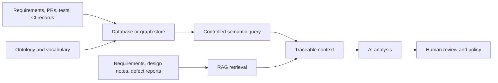
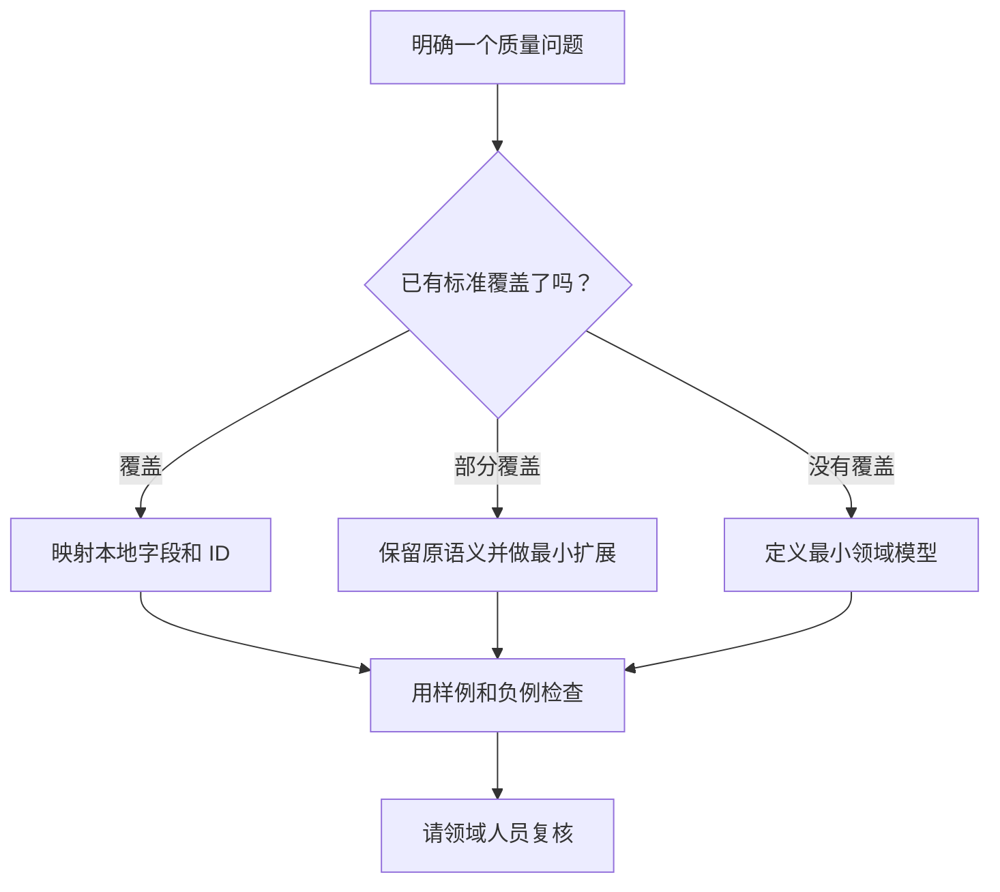

# 本体、知识图谱、RAG、数据库有什么区别？用一个测试问题讲清楚

团队想知道「退款接口的 PR-128 影响哪些测试」。只问技术名称很难选方案。先固定问题和所需信息，再看数据库、知识图谱、检索增强生成（RAG）和本体分别提供什么。

这四个词属于不同层次。数据库偏重保存和访问记录，知识图谱表达实体关系，RAG 检索相关材料并把材料交给生成模型，本体定义概念与关系的语义。它们可以组合使用，不能按一个统一排行榜比较。

## 同一个问题需要哪些信息

回答 PR-128 的影响范围，至少要知道 PR 包含哪些代码变更、变更修改哪些组件、代码变更关联哪些需求、验收标准如何转成测试义务、哪些测试用例覆盖这些义务，以及哪些测试实际运行过。

在 v0.19 实验模型中，关系包括 `PullRequest includesChange CodeChange`、`CodeChange modifies Component`、`CodeChange targetsRequirement Requirement`、`Requirement hasAcceptanceCriterion AcceptanceCriterion`、`TestObligation derivedFrom AcceptanceCriterion`、`TestCase addresses TestObligation`、`TestExecution executes TestCase`。测试证据通过 `prov:wasGeneratedBy` 指向生成证据的执行活动。

## 四种技术各自负责什么

| 方法 | 主要输入 | 典型输出 | 擅长之处 | 常见盲区 |
|---|---|---|---|---|
| 关系数据库 | 有字段和键的记录 | 按条件筛选、连接后的记录 | 事务、结构化读写、明确的连接 | 业务语义需由 schema、应用逻辑或文档补充 |
| 知识图谱 | 实体、关系和属性 | 沿边查到的相关实体与路径 | 表达多跳关系，便于追踪 | 只有节点和边时，关系含义和推理规则可能不清楚 |
| RAG | 文档、代码片段或索引材料 | 检索片段和基于材料生成的回答 | 找到相关文本，适合非结构化来源 | 检索到相似文字不等于验证关系、版本和覆盖 |
| 本体 | 类、属性、关系语义和逻辑公理 | 统一解释、形式查询或可推导结论 | 共享术语和明确语义边界 | 建模与维护要投入，模型本身不提供业务实例数据 |

对 PR-128 来说，数据库可以查出 PR 记录和相关测试 ID；图数据可以沿关系找出候选测试；RAG 可以检索需求文档和 PR 描述；本体说明 `addresses`、`targetsRequirement` 等关系的含义，并约束查询如何解释这些记录。最终结果仍要核对来源、当前构建和测试义务。

## 它们怎样配合

图 1 是一种组合方式，不是唯一产品架构。本体可以保存在文档、代码库或图存储中；知识图谱也可以使用数据库保存。RAG 的检索来源和结构化查询来源需要区分，生成回答应指出用了哪些记录。

## 同题比较时看这些维度

| 评估维度 | 要检查的问题 |
|---|---|
| 关系覆盖 | 系统能否从 PR 追到变更、需求、测试义务和测试用例？ |
| 版本范围 | 查询是否限定到目标 commit、build 或 release？ |
| 来源 | 每个候选测试是否能回到具体关系和源记录？ |
| 缺口处理 | 没有映射或没有执行记录时，系统是否如实返回未知？ |
| 维护成本 | 关系、术语和字段变化时，谁维护映射与模型？ |
| 生成质量 | AI 是否引用真实来源，是否把候选路径说成确定影响？ |

不要只比较答案看起来是否完整。建议给每种方法同一批 PR、同一套候选测试标注和同一目标版本，再检查漏报、误报和人工复核时间。若没有真实运行记录，不能填入性能或准确率结论。

## 已有规范和研究如何帮助复用

下面的候选清单来自 2026-10-29 的 v0.2 研究笔记。那份笔记尚未完整核查各项目的源码、Issue、Release、许可证和维护活跃度。表中的「未核实」表示当前没有足够证据，不表示相关项目或概念不存在。

| 候选 | 类型与可借鉴内容 | 边界和核对事项 |
|---|---|---|
| SEON | 软件工程本体网络，可参考其模块划分和工程概念组织 | 不能据此断言它覆盖所有现代 DevOps 活动；采用前要检查具体子本体、版本和许可 |
| OSLC Quality Management 2.1 | 面向工具互操作的质量管理资源与服务，包括 TestPlan、TestCase、TestScript、TestExecutionRecord 和 TestResult，也提供与需求、变更等资源的链接 | 它不试图定义完整的 QA 推理体系。应按资源定义和属性逐项映射，不要只凭名称认定等价 |
| Seamless Digital Engineering Ontology | 基于 BFO、CCO 的 OWL 工程本体，可参考标准来源注释和导入本体的组织方式 | 引入 BFO、CCO 会带来依赖、学习和许可核对工作。本文研究材料中的 SDE 指这个本体；不要把它与一般意义上的 Software Development Environment 混为一谈 |
| W3C PROV-O | 用 Entity、Activity、Agent 及相关属性表示来源、生成、使用和责任信息 | 来源关系只能说明记录之间的来源联系，不能单独证明证据充分或结论正确 |
| OpenTelemetry Semantic Conventions | 用统一的键和值描述常见概念、协议和操作；YAML 模型与生成文档可供术语治理和版本管理参考 | 它是语义约定，不是 OWL 本体，也不是 QA 业务模型 |
| RDFLib | Python RDF 图处理、解析和 SPARQL 查询工具 | 它是实现工具，不定义业务本体 |
| pySHACL | SHACL 数据图校验工具 | 它执行形状约束检查，不替代 OWL 推理 |
| OWL-RL | 在 RDFLib 上实现 OWL 2 RL 规则推理 | 只覆盖选定的 OWL 2 RL 语义范围；不要把它当成完整的 OWL 2 DL 推理器 |

### 把参考模型映射到本地概念

OSLC QM 提供了有用的资源参照，但不能只按名称把 v0.19 的概念与 OSLC 资源一一对应。v0.19 使用 `TestCase`、`TestExecution` 和 `TestEvidence`；OSLC QM 还区分 `TestExecutionRecord` 与 `TestResult`。映射前要对照资源定义、字段和关系，尤其要确认本地模型是否把「一次执行记录」和「执行结果证据」作为不同对象。

| OSLC QM 2.1 资源或关系 | OSLC 中的作用 | v0.19 中的相关表达 | 映射时要确认 |
|---|---|---|---|
| `oslc_qm:TestCase`、`validatesRequirement` | 测试用例可以关联它验证的需求 | `TestCase addresses TestObligation`；测试义务再通过 `derivedFrom` 关联验收标准 | v0.19 保留了「需求—验收标准—测试义务—用例」的中间层。不能因为存在需求链接，就认定相应测试义务已经完整验证 |
| `oslc_qm:TestExecutionRecord`、`oslc_qm:TestResult`、`producedByTestExecutionRecord` | OSLC QM 将执行记录与测试结果分成不同资源，并用关系把它们连接起来 | `TestExecution` 是 `prov:Activity`；`TestEvidence` 是 `prov:Entity`，并通过 `prov:wasGeneratedBy` 指向执行 | 映射时要检查本地模型如何保存结果状态、日志或报告、执行环境和来源。名称相似不等于对象边界相同 |

例如，从 v0.19 的 `TestCase` 查到 `Requirement`，需要经过 `TestObligation` 和 `AcceptanceCriterion`，查询时也要按关系定义反向遍历。OSLC QM 允许用 `validatesRequirement` 连接测试用例和需求。两种路径回答的问题粒度不同；转换时应保留来源数据，并记录新增、合并或丢失了哪些语义。

v0.19 用 `TestEvidence prov:wasGeneratedBy TestExecution` 表示证据指向生成它的执行活动。PROV-O 可以表达这个来源关系；它不判断证据是否属于目标构建，也不决定证据能否支持某条质量声明。

当前有限的候选审查尚未验证 `TestObligation` 或 `QualityClaim` 的直接等价概念。这不能证明它们是原创。正式扩展前，还要对照 assurance case、GSN、SACM、requirements verification 和 test obligation 相关研究，并为新增概念写出能力问题和可检查的例子。

SEON、OSLC QM、SDE 和 PROV-O 的范围不同，不宜按一个总分排名。当前 v0.19 模型是实验模型，尚未声明与这些项目兼容；每个映射都应记录采用的版本、依据、差异和未解决问题。

## 从零开发还是复用

先写出要回答的问题，再对照已有模型。术语和语义相容时，可以做字段映射。只缺少少量概念时，可以保留原模型并加扩展。只有已有模型无法回答关键问题时，才从头建最小模型。每种选择都要保留兼容和迁移说明。

| 方案 | 好处 | 代价 | v0.2 研究笔记中的暂定方向 |
|---|---|---|---|
| 完全自研语义体系 | 命名和建模完全由项目控制 | 容易重复已有词汇，互操作要另行建设 | 不建议直接采用 |
| 全量引入大型工程本体 | 可复用更广泛的工程概念和公理 | 学习、导入依赖、许可与维护成本较高 | 只作为技术 Spike 的对照项 |
| 最小核心、对齐标准、独立扩展 | 保留项目所需语义，同时控制模型范围 | 仍需逐项维护映射和兼容关系 | 当前较合适的候选方向，尚未批准 |

如果采用第三种方向，也要先验证具体工具和关系：

| 组件 | 暂定选择 | 采用前的检查 |
|---|---|---|
| RDF 解析与 SPARQL | 先评估 RDFLib，Jena 可作为备选 | 固定样例能否稳定解析、查询并得到可重复结果 |
| SHACL 验证 | 先评估 pySHACL，Jena SHACL 可作为备选 | 合法样例通过、负样例按预期失败，报告能定位问题 |
| OWL 推理 | 暂缓决定，先做 OWL-RL Spike | 先确定需要的语义片段，再检查推论、错误推论和性能 |
| 溯源语义 | 优先复用 PROV-O | 检查 Entity、Activity 的映射及关系方向 |
| 测试资源语义 | 优先对齐 OSLC QM | 记录 URI、属性映射和无法直接对应的差异 |
| 质量义务、声明和证据充分性 | 必要时增加最小扩展 | 先对照 assurance case、GSN、SACM 等材料，并为每项扩展定义能力问题 |
| 图数据库 | 初期不强制引入 | 只有数据规模或查询需求证明必要时再选型 |
| Agent | 后续可选 | 核心模型解析、校验和查询必须能在不调用 Agent 时运行 |

这是一份待验证的技术方向，不是已批准的 ADR，也不是生产系统选型结论。许可兼容性和关键 Spike 通过后，团队才能决定是否冻结方案。

## 最佳实践

- 用同一个问题比较方案，不比较脱离任务的产品口号。
- 把本体模式与知识图谱实例数据分开说明。
- 让 RAG 返回文档来源，让图查询返回关系路径。
- 对每条推断保留规则、输入事实和版本范围。
- 先映射现有规范，再决定扩展；不要因为想用某种技术就先设计大模型。

## FAQ

### 有知识图谱，还需要本体吗？

取决于是否需要稳定的概念定义、关系语义和形式约束。小型图数据可以使用简单 schema；跨团队或跨工具时，明确语义会更有价值。

### RAG 能替代图查询吗？

RAG 适合检索文字材料。精确的多跳关系、版本限定和约束检查通常需要结构化查询或规则。两类结果可以一起提供给分析者。

### 本体一定要配图数据库吗？

不必。存储技术应由查询、规模、事务和运维需求决定。语义模型和数据库产品是不同层面的选择。

## 三个理解检查题

1. 哪项主要定义概念和关系语义？A. 本体；B. RAG 索引；C. 普通文件存储。
2. RAG 检索到需求文档，是否证明测试已覆盖该需求？A. 是；B. 否，还需核对测试关系与执行证据；C. 文档相似就算。
3. 采用已有标准前要做什么？A. 直接全量导入；B. 核对版本、范围、映射和维护状态；C. 用标准名称替代本地术语。

答案：1-A，2-B，3-B。

## 小结

数据库、图谱、RAG 和本体各有职责。实际系统可以把它们放在一起，让记录可查询、文档可检索、关系有明确含义。下一篇会把这些概念放进一个从需求到发布的项目故事里。

## 系列导航

- 上一篇：`01-why-ontology-for-sdlc-qe.md`
- 下一篇：`03-sdlc-qe-walkthrough.md`

## 参考资料

- OSLC Quality Management 2.1 Specification: https://oslc-op.github.io/oslc-specs/specs/qm/quality-management-spec.html
- OSLC Quality Management 2.1 Vocabulary: https://docs.oasis-open-projects.org/oslc-op/qm/v2.1/os/quality-management-vocab.html
- SEON Software Engineering Ontology Network: https://github.com/fabianoruy/SEON
- Seamless Digital Engineering Ontology: https://github.com/systems-praxis/seamless-digital-engineering-ontology
- W3C PROV-O: https://www.w3.org/TR/prov-o/
- OpenTelemetry Semantic Conventions: https://github.com/open-telemetry/semantic-conventions
- RDFLib: https://github.com/RDFLib/rdflib
- pySHACL: https://github.com/RDFLib/pySHACL
- OWL-RL: https://github.com/RDFLib/OWL-RL
- Apache Jena: https://jena.apache.org/
- OMG Structured Assurance Case Metamodel (SACM): https://www.omg.org/spec/SACM/
- Goal Structuring Notation (GSN) Standard: https://mail.goalstructuringnotation.info/gsn-standard
