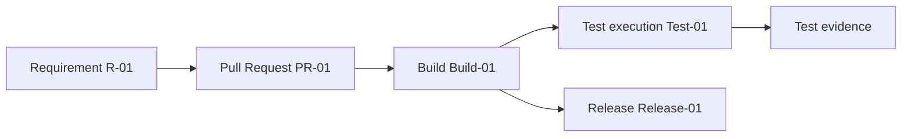
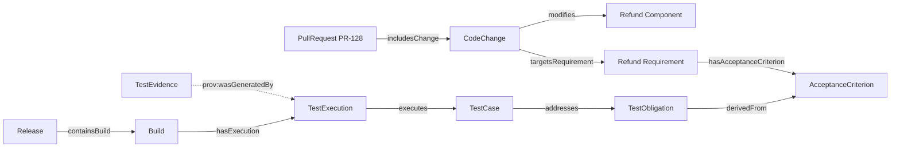
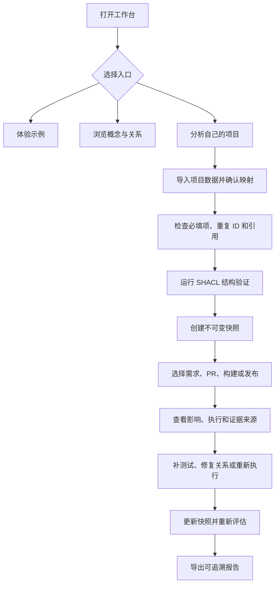

# 从需求到发布：用一个软件项目看懂本体如何工作

本篇使用两个虚构例子。第一个从工单 R-01 走到发布 Release-01，帮助第一次接触本体的读者看懂对象和关系。第二个使用退款接口 PR-128，展示如何判断测试证据。两个例子都用于解释模型，不代表真实项目或线上运行结果。

## 先看最短的一条研发链

假设工单 R-01 描述了一个需求。开发者通过 PR-01 修改代码。CI 创建 Build-01，测试执行记录 Test-01，团队最后把构建放进 Release-01。

这条线能帮人理解流程，但还不够精确。它省略了代码变更、组件、验收标准、测试义务和证据来源。工程模型要把这些对象区分开，也要给关系命名。

## 把流程中的东西分清楚

| 对象 | 在这个例子里的含义 | 需要保留的问题 |
|---|---|---|
| Requirement | 团队需要实现或满足的要求 | 它有哪些验收标准？ |
| CodeChange | 一组代码层面的改动 | 它修改哪个组件，关联哪个需求？ |
| PullRequest | 提交审查的一组变更 | 它包含哪些代码改动？ |
| Build | 对特定提交或 PR 执行构建后得到的工程对象或活动记录 | 结果对应哪个 PR、commit 和环境？ |
| TestObligation | 必须获得某类验证证据的质量义务 | 它来自哪个验收标准？ |
| TestCase | 验证义务的一种方法 | 它实际检查了什么？ |
| TestExecution | 一次测试运行记录 | 哪个用例在什么构建、环境和时间运行？ |
| TestEvidence | 运行产生的结果、日志或报告等证据资源 | 它由哪次执行生成，能否用于当前版本？ |
| Release | 准备交付的一组构建或制品 | 哪个构建进入了这个发布？ |

对象和活动需要分开记录。例如，TestCase 描述验证方法；TestExecution 记录一次实际运行。Build 和 Release 也不是同一件事。v0.19 模型把 Build 作为活动类，Release 作为发布对象；具体产品可在后续模型版本中细化构建活动与构建产物的区分。

## 走一遍退款 PR-128

假设 PR-128 修改退款接口，影响退款权限和退款金额。系统记录了 20 条自动化测试全部通过。可是，退款权限测试义务没有对应的合格证据。此时，即使通过数量是 20，权限要求的状态仍应显示 Unknown。这里的 Unknown 表示当前数据不能支持肯定或否定结论；它不等于已失败，也不等于已经安全。

下图展示 v0.19 实验模型中的关系。每条箭头都按关系定义方向，从主语指向宾语：`TestObligation derivedFrom AcceptanceCriterion`、`TestCase addresses TestObligation`、`TestExecution executes TestCase`，以及 `TestEvidence prov:wasGeneratedBy TestExecution`。从 PR 顺着分析到证据时，查询会反向遍历其中几条关系。

图 2 中所有边名都是模型里的关系名，箭头从关系主语指向宾语。比如 `CodeChange targetsRequirement Requirement` 表示代码变更指向目标需求；`TestEvidence prov:wasGeneratedBy TestExecution` 表示证据指向生成它的执行活动。虚线强调来源关系。图用于呈现模型关系，并不意味着查询必须沿所有箭头方向前进。

## 看懂三种质量状态

| 状态 | 读者可以得出的结论 | 退款例子 |
|---|---|---|
| Qualified | 已有证据通过当前策略要求，能够支持相应质量声明 | 证据对应当前构建，环境、时间和来源都满足规则 |
| Unqualified | 已有证据，但至少一项不满足策略 | 证据来自旧构建，或执行结果失败 |
| Unknown | 证据缺失、不足或无法确认，暂时无法作出资格判断 | 退款权限义务没有可确认的执行证据 |

状态需要由清楚的政策计算。实验模型的规范说明，数据缺失、验证不可用或来源不明确时不能返回 `verified Qualified`。页面或报告还应列出导致状态的具体字段和关系，不只显示颜色或标签。

## 普通用户怎样开始

产品设计草案提供三个入口：体验示例项目、浏览本体知识、分析自己的项目。QA 用户可以从示例或 PR 开始，不需要先写 RDF、OWL 或 SPARQL。

图 3 是 Workbench 的设计流程，不是已上线功能。当前规划把用户自己的数据导入列入 MVP 设计；直接连接 GitHub 和 CI 仍属于后续阶段。

## 数据导入、结构验证和质量评估各做什么

导入项目数据时，系统可以让用户创建或打开工作区，上传 CSV、JSON 或受控 RDF，预览记录，再选择模板或配置字段映射。用户需要确认来源字段对应哪个概念。系统不应在确认前把猜测关系写入正式模型。

| 阶段 | 检查内容 | 输出 | 不能据此得出的结论 |
|---|---|---|---|
| 字段映射 | 来源列对应哪个概念、属性或标识 | 用户确认的映射配置 | 数据真实、结构合规或证据有效 |
| 导入预检 | 必填值、重复标识、无法解析的引用 | 可读的记录级问题清单 | OWL 推理结论或质量门禁结果 |
| SHACL 验证 | 数据是否符合已声明的形状约束 | 符合或不符合的结构验证报告 | 测试结果真实，或业务风险已消除 |
| 快照创建 | 输入数据和模型版本 | 不可变分析输入快照 | 后续证据自动合格 |
| 质量评估 | 测试义务、执行、构建、环境、时间、来源和规则 | Qualified、Unqualified 或 Unknown 及原因 | 由系统代替负责人签署发布 |

失败导入应保留当前有效快照，不得用不完整数据覆盖它。结构验证通过，只表示数据满足已声明的结构约束；仍要独立检查测试是否运行、证据是否来自当前构建，以及证据能否支持对应的质量声明。

## 一个新手用户的操作示例

1. 选择示例项目，或者创建工作区后导入一份脱敏 PR、需求、测试和执行数据。
2. 预览字段映射，把 `pull_request_id` 映射到 PullRequest 标识，把 `component` 映射到 Component 引用。确认后保存映射。
3. 先检查必填字段、重复 ID 和断开的引用，再运行 SHACL 形状验证。
4. 结构检查通过后创建快照。选择 PR-128，查看相关需求、测试义务、用例、执行记录和证据来源。
5. 若权限义务显示 Unknown，回到原始系统确认缺少的记录。补测试、修复链接或重新执行后，再导入新数据并重新评估。
6. 导出报告时保留快照版本、模型版本和证据来源，方便同事复核。

这是一条建议的用户路径。当前没有产品运行证据证明工作台已经实现这些页面或连接器。

## 最佳实践

- 先用样例理解状态，再导入真实项目数据。
- 先确认字段映射，再运行结构验证，最后判断质量证据。
- 把每次分析绑定到不可变快照和模型版本。
- 让报告显示 Unknown 的具体原因，并允许用户回到来源系统检查。
- 导入失败时保留上一份有效快照。

## FAQ

### 测试通过数量很多，为什么还是 Unknown？

通过数量没有说明这些测试验证了哪项义务。若目标义务没有关联用例或没有合格执行证据，系统就不能据此确认质量声明。

### 导入映射成功是否代表质量数据可信？

不代表。映射确认字段对应关系。预检和 SHACL 检查结构。质量评估还要检查证据来源、版本、环境、时间和规则。

### 读者现在能登录并按这个流程操作吗？

不能从本文得出这个结论。图示是产品设计示例。自有数据导入属于规划中的 MVP 设计，GitHub 和 CI 自动集成仍在后续阶段。

## 三个理解检查题

1. TestCase 和 TestExecution 有什么区别？A. 同义词；B. 用例描述验证方法，执行记录描述一次运行；C. 执行记录是发布版本。
2. PR-128 的 20 条测试通过，但退款权限证据缺失，最稳妥的状态是什么？A. Qualified；B. Unqualified；C. Unknown。
3. SHACL 验证通过能证明测试结果有效吗？A. 能；B. 不能，它检查声明的结构约束；C. 能证明可以发布。

答案：1-B，2-C，3-B。

## 小结

这两个项目故事说明，本体把对象和关系变成可以检查的结构。普通用户可以从示例和数据导入流程理解它的作用；发布结论仍依赖实际运行证据和团队政策。下一篇将从这条链中单独抽出 SDLC 本体。

## 系列导航

- 上一篇草稿：`02-ontology-graph-rag-database.md`
- 下一篇草稿：`04-sdlc-ontology.md`

## 参考资料

- 本体、关系和 SHACL 示例模型见项目资料包 v0.19 中的 `01_project/ontology/baseline.ttl`、`01_project/shapes/baseline.shacl.ttl` 和 `01_project/examples/delivery-flow.ttl`。
- W3C SHACL: https://www.w3.org/TR/shacl/
- W3C PROV-O: https://www.w3.org/TR/prov-o/
