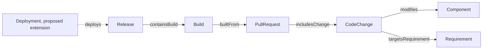

# 什么是 SDLC 本体？把需求、代码变更和发布连起来

一项需求经过讨论、编码、审查、构建和发布，最后进入用户使用的版本。团队常有这些记录，却不一定能回答「这条需求通过哪些代码变更进入了哪个 Release？」SDLC 本体要把生命周期中的对象和活动定义清楚，并描述它们之间的关系。

SDLC 是 Software Development Life Cycle，即软件开发生命周期。SDLC 本体给需求、代码变更、组件、PR、构建、部署和发布提供共同语义。它帮助追踪过程，不能单独保证每个变更都正确实现。

## 先用交付记录来理解

把软件项目想成一份交付记录。需求描述要交付什么，代码变更记录改了什么，PR 是提交审查的集合，Build 记录某次构建，Deployment 记录一次部署活动，Release 标记准备交付的一版。只有给这些项目写出明确关系，读者才知道一条需求怎样走到某个版本。

## SDLC 中的主要对象

| 概念 | 作用 | v0.19 基线中的情况 |
|---|---|---|
| Requirement | 表达产品或工程要求 | 已定义 |
| WorkItem | 表达任务、缺陷修复或工程工作 | 当前博客选题中的概念，基线待补定义 |
| Component | 标识受代码变更影响的系统部分 | 已定义 |
| CodeChange | 描述一项代码级变更 | 已定义 |
| PullRequest | 聚合提交审查的代码变更 | 已定义 |
| Build | 记录构建活动 | 已定义为 `prov:Activity` 子类 |
| Deployment | 记录向环境部署的活动 | 当前博客选题中的概念，基线待补定义 |
| Release | 表达准备交付的版本 | 已定义 |

表中的「已定义」指实验包 `baseline.ttl` 当前确实包含该类或关系，不表示它已成为行业标准。WorkItem 和 Deployment 是合理的建模候选项，但在基线正式加入前，文章应把它们标成扩展提案。

## 读懂关系方向



图 1 中的实线关系取自 v0.19 基线。虚线 `deploys` 仅表示建议新增的关系，不属于当前基线。`targetsRequirement` 的方向是 CodeChange 指向 Requirement；`containsBuild` 的方向是 Release 指向 Build。读图时不能仅按视觉上的「从需求往发布走」反转关系定义。

一个 SPARQL 问题可以很简单：`change1` 修改了哪个组件？当前资料中的 CQ-03 查询如下：

```sparql
PREFIX ex: <https://example.org/sdlc-qe/>
SELECT ?component WHERE {
  ex:change1 ex:modifies ?component .
}
```

它只回答直接的 `modifies` 关系。它不会自动找到间接依赖、业务规则或测试用例。扩展查询前，要先确认模型里存在这些关系。

## 对象、活动和产物

本体建模要说明一个名称代表什么。PR 是一组变更的审查资源；构建是由输入版本触发的活动；构建输出可以是制品；部署是把制品放入目标环境的活动；Release 是交付的版本边界。若把它们都叫「版本」，之后就难以核对测试证据究竟对应哪次构建。

本系列 v0.19 把 Build 归为 `prov:Activity`，并用 `Build builtFrom PullRequest` 和 `Release containsBuild Build` 表达部分链路。这个实验模型尚未明确建模独立的构建产物和部署记录。项目实施时应按现有 CI/CD 数据细化，而不是把未定义对象写成已完成能力。

## 它怎样支持质量追踪

SDLC 本体提供需求和变更上下文。QE 本体则描述验收标准、测试义务、用例、执行和证据。比如 CodeChange 修改 Component，同时关联 Requirement；Requirement 再连接 AcceptanceCriterion。测试义务从验收标准派生，TestCase 覆盖义务。只有关联路径和版本来源都完整时，团队才可以继续判断这次变更有哪些验证证据。

## 常见误解

| 误解 | 更准确的理解 | 例子 |
|---|---|---|
| 有需求 ID 就能追踪到发布 | 还要记录代码变更、构建和 Release 的关系 | 需求链接到 PR，但 Release 未记录包含哪个 Build |
| Build 和 Release 是同一对象 | Build 对应构建活动或结果，Release 对应交付边界 | 同一 Release 可以包含多个经过审核的 Build |
| 组件相同就证明需求受影响 | 组件关系提供线索，影响范围还需要关系和代码审查确认 | 共享组件中的无关文件变化不一定影响目标功能 |
| SDLC 本体能证明开发过程正确 | 它表示过程知识，测试与证据仍需要单独检查 | 变更链完整，但验收测试没有运行 |

## 最佳实践

- 给资源、活动、执行结果和制品使用不同概念。
- 为每个关系写清方向和实际含义。
- 将当前模型中已存在的词汇与拟议扩展分开标记。
- 把需求、commit、构建和发布范围都绑定到稳定标识。
- 先验证一个查询问题，再增加更多生命周期概念。

## FAQ

### SDLC 本体需要覆盖所有开发流程吗？

不需要。先选当前要追踪的需求、PR、Build 和 Release。若要回答部署或审批问题，再添加这些概念和关系。

### Requirement 与 WorkItem 是同一个东西吗？

不一定。Requirement 表达要满足的要求；WorkItem 可以表达执行任务。一个 Requirement 可能需要多个工作项完成，具体关系应由团队的流程定义。

### 本体能从 Git Diff 自动知道需求吗？

仅凭文本差异通常不能确认语义关联。可以用 PR 描述、提交信息或人工映射生成候选，再通过稳定 ID 和审核确认。

## 三个理解检查题

1. 在当前基线中，哪个关系从 CodeChange 指向 Requirement？A. `targetsRequirement`；B. `containsBuild`；C. `executes`。
2. Build 与 Release 的区别是什么？A. 完全相同；B. 构建活动与交付版本边界不同；C. Release 是测试用例。
3. 图中的虚线 Deployment 关系是什么状态？A. v0.19 已实现；B. 建议扩展，尚未进入基线；C. W3C 标准要求。

答案：1-A，2-B，3-B。

## 小结

SDLC 本体把工程对象和生命周期关系写清楚，让需求能沿着代码变更追到构建和发布。关系的方向、对象的边界和模型版本都要可查。下一篇会把质量风险、测试义务和证据链单独展开。

## 系列导航

- 上一篇：`03-sdlc-qe-walkthrough.md`
- 下一篇：`05-qe-ontology.md`

## 参考资料

- W3C PROV-O: https://www.w3.org/TR/prov-o/
- W3C RDF 1.1 Concepts: https://www.w3.org/TR/rdf11-concepts/
- SDLC-QE v0.19 实验模型中的 `01_project/ontology/baseline.ttl` 与 `02_blog/articles/04.md`
