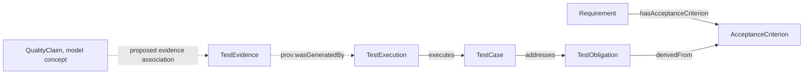

# 什么是质量工程（QE）本体？从质量风险到测试证据

「这次测试都通过了，能证明退款权限没问题吗？」回答这个问题不能只看测试通过数。团队还要知道权限风险对应哪项验证义务、哪些测试用例检查它、这些用例是否在当前构建中运行，以及结果能否支持要作出的质量声明。

QE 是 Quality Engineering，即质量工程。QE 本体把风险、测试义务、用例、执行、证据和质量决策所需的概念与关系定义清楚。这样团队可以追踪结论依赖哪些记录，也能看到还缺什么。

## 把质量证据想成一次可复核的检查

借书时，图书馆记录「借阅发生过」还不够。要复核这笔借阅，需要知道谁借了什么、何时借出、由谁登记。测试也是一样。测试用例是检查方法，执行记录是一次检查，证据保存执行结果和来源。

## 从风险到证据链

| 概念 | 回答的问题 | 退款权限示例 |
|---|---|---|
| QualityRisk | 哪种失败会造成什么影响？ | 未授权用户可能发起退款 |
| TestObligation | 必须取得什么验证证据？ | 证明只有有权限的角色能退款 |
| TestCase | 用什么检查方式验证义务？ | 用普通用户令牌请求退款，期望返回拒绝结果 |
| TestExecution | 哪次运行执行了哪个用例？ | 某次 API 回归运行在指定构建上执行该用例 |
| TestEvidence | 运行保存了哪些可复核材料？ | 请求、响应、报告、构建和环境信息 |
| QualityClaim | 团队想基于证据陈述什么？ | 当前版本符合退款权限验收要求 |
| QualityGate | 发布政策如何检查相关条件？ | 高风险义务必须有当前构建上的合格证据 |

QualityRisk 和 QualityGate 是原研究规划中的领域概念，但它们不在当前 v0.19 `baseline.ttl` 的核心类列表中。v0.19 基线定义了 TestObligation、TestCase、TestExecution、TestEvidence、QualityClaim 等。新增风险评分、门禁策略和审批记录时，应作为有版本的扩展建模，不应声称已经由基线实现。

## 用 v0.19 关系读证据链

图 1 的实线表达当前模型里的关系。证据来源方向从 TestEvidence 指向生成它的 TestExecution。QualityClaim 到证据的虚线只表示本文提出的概念性关联；`supportsClaim` 不是 v0.19 基线中已定义的关系。质量声明需要怎样绑定证据，必须由模型扩展和门禁规则明确规定。

`TestObligation` 和 `TestCase` 不能混为一谈。义务描述必须获得哪类验证。用例描述怎样进行验证。同一义务可能需要多种测试；一个用例也可能覆盖多项义务，但这样的多对多关系要明确记录。

## 覆盖关系和证据有效性

测试结果进入质量审查前，至少要区分三层：

| 层次 | 判断内容 | 示例问题 |
|---|---|---|
| 关联覆盖 | 义务是否关联到测试用例 | 退款权限义务有没有对应测试？ |
| 执行覆盖 | 关联的用例是否在目标构建中运行 | PR-128 对应构建是否执行了权限测试？ |
| 证据资格 | 结果是否满足来源、状态、时间、环境和策略要求 | 证据是否来自准备发布的构建？ |

「有测试」只回答了关联问题。「测试通过」还需要执行上下文。「证据合格」要求结果符合事先声明的质量政策。若 20 条自动化测试通过，但没有一条可确认覆盖退款权限义务，权限要求仍是 Unknown。

## Qualified、Unqualified 和 Unknown

- **Qualified** 表示已有证据通过当前适用的检查，可以支持相关质量声明。
- **Unqualified** 表示证据存在，但没有达到至少一项策略要求，例如运行失败或版本不匹配。
- **Unknown** 表示数据不足或来源不清楚，当前无法判断是否合格。

判断逻辑应当可审查。把 Unknown 当成通过会制造错误安全感；把 Unknown 当成失败也会误报。系统应说明缺少哪条关系、哪个字段或哪项运行证据。

## 常见误解

| 误解 | 更准确的理解 | 反例 |
|---|---|---|
| 测试用例数量越多，质量越高 | 数量不说明义务覆盖或断言质量 | 一百条用例只验证成功路径，权限义务仍无覆盖 |
| 用例链接到义务就代表义务满足 | 还要检查用例内容、运行记录和证据资格 | 用例存在却从未执行 |
| TestExecution 和 TestEvidence 是一回事 | 执行是活动记录，证据是可复核的资源 | 执行状态显示通过，但报告缺少构建来源 |
| 质量门禁是固定分数 | 门禁是团队定义的政策和例外流程 | 不同风险等级可以要求不同证据 |

## 最佳实践

- 从风险和验收标准推导测试义务，并保留来源。
- 在用例层检查断言是否真正验证义务。
- 每次执行都记录构建、环境、时间和结果。
- 证据绑定到具体执行，避免把旧结果复用于新版本。
- 将风险、证据状态和门禁决定分开存储并保留审核记录。

## FAQ

### 测试用例通过后，质量声明就成立了吗？

不一定。还要确认用例检查了目标义务，执行属于目标构建，结果和来源符合策略。

### 缺少测试执行记录应判失败吗？

这表示目前没有足够执行证据。策略可以阻止发布或要求补测，但模型应保留 Unknown 与执行失败的区别。

### QualityGate 是否已经是 v0.19 的标准类？

它出现在系列研究规划中，但当前基线核心文件没有定义该类。本文把它作为计划扩展讨论。

## 三个理解检查题

1. TestObligation 主要说明什么？A. 一次测试运行；B. 必须取得哪种验证；C. 一个构建版本。
2. Evidence 关系缺失时，最合适的处理是什么？A. 自动 Qualified；B. Unknown 并说明缺失；C. 自动推断测试通过。
3. v0.19 通过什么关系表达证据来源？A. `TestEvidence prov:wasGeneratedBy TestExecution`；B. `TestExecution containsBuild Release`；C. `Requirement executes TestCase`。

答案：1-B，2-B，3-A。

## 小结

质量工程本体把风险、验证义务、测试方法、执行和证据分开建模。质量结论才能说明依据，也能暴露证据缺口。下一篇将说明如何把这些质量关系接到 SDLC 的需求、PR、构建和发布对象上。

## 系列导航

- 上一篇草稿：`04-sdlc-ontology.md`
- 下一篇草稿：`06-connect-sdlc-qe.md`

## 参考资料

- W3C PROV-O: https://www.w3.org/TR/prov-o/
- W3C SHACL: https://www.w3.org/TR/shacl/
- SDLC-QE v0.19 模型与约束: `01_project/ontology/baseline.ttl`、`01_project/shapes/baseline.shacl.ttl`、`01_project/docs/standards/ontology.md`
