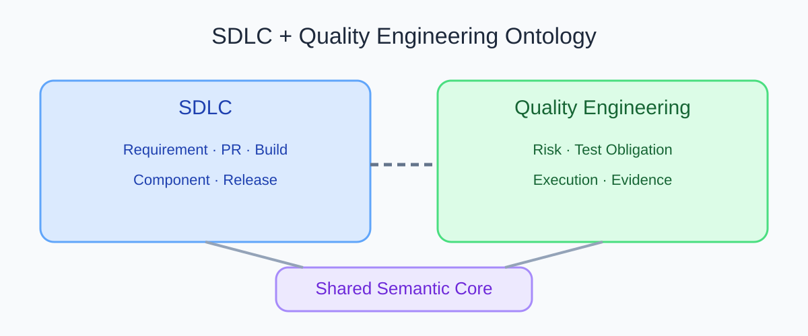
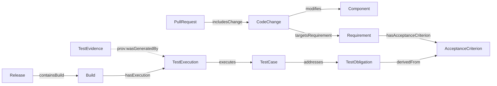

# SDLC 本体与 QE 本体如何连接？把变更追踪到质量证据

PR-128 修改了一个组件。只看 SDLC 数据，可以知道变更涉及哪个 PR、组件和需求。只看 QE 数据，可以知道某项测试义务关联哪些用例、哪些执行留下了证据。把两边连接起来，团队才有机会回答「这次代码变更有哪些质量验证依据？」

SDLC 是软件开发生命周期；QE 是质量工程。两种模型可以保持模块边界，再通过少量、定义清楚的跨域关系连接。连接让问题可查，不会自动证明测试充分，也不会自动证明代码改动造成了某个结果。

## 用一个关系图看完整链路

下方总览图保留了 v0.19 博客资料中的 SDLC 与 QE 分区。蓝色表示研发过程对象，绿色表示质量工程对象，紫色表示共享语义核心。连接线表示两个领域需要共享的语义基础。

对应到可追溯问题，v0.19 实验模型使用下面的关系路径：

图 1 的实线关系来自 v0.19 基线。每条关系都有方向。证据关系使用 PROV-O 的方向，从 TestEvidence 指向生成它的 TestExecution。图中的箭头不表示因果关系，除非模型另有因果定义。

## 逐条解释跨域关系

| 关系 | 方向和含义 | 能支持什么问题 | 不能单独证明什么 |
|---|---|---|---|
| `CodeChange modifies Component` | 代码变更指向修改的组件 | PR 中的变更涉及哪些组件？ | 所有组件行为都受影响 |
| `CodeChange targetsRequirement Requirement` | 代码变更指向目标需求 | 这次改动关联哪些需求？ | 需求实现已经正确 |
| `Requirement hasAcceptanceCriterion AcceptanceCriterion` | 需求包含验收标准 | 需求拆成哪些可检查目标？ | 每个目标已有测试 |
| `TestObligation derivedFrom AcceptanceCriterion` | 测试义务指向其来源标准 | 某项验证义务从哪里来？ | 义务表达完整或被满足 |
| `TestCase addresses TestObligation` | 用例指向它要验证的义务 | 哪些用例尝试检查这项义务？ | 断言有效或运行成功 |
| `TestExecution executes TestCase` | 执行记录指向实际运行的用例 | 哪次执行运行了什么？ | 执行结果能用于当前发布 |
| `TestEvidence prov:wasGeneratedBy TestExecution` | 证据指向生成它的执行活动 | 证据来自哪次运行？ | 来源可信、版本匹配或结论为真 |

原始提纲示意图曾用 `Component → TestObligation` 简写影响链。当前 v0.19 基线没有这条直接关系，所以本文不把它画成既有事实。若项目确实要从组件追到测试义务，需要先增加并定义组件到需求、业务能力或测试义务的映射，再用样例确认语义。

## 完整路径与断链路径

下表中的箭头表示查询从 PR 追到证据时的阅读顺序，不是每条关系在模型中的定义方向。尤其是 `derivedFrom`、`addresses`、`executes` 和 `prov:wasGeneratedBy`，沿这条查询路径时需要反向遍历；实际关系方向见上方的关系图和表格。

| 情况 | 已知路径 | 可以回答 | 仍然未知 |
|---|---|---|---|
| 关系完整 | PR → CodeChange → Requirement → AcceptanceCriterion → TestObligation → TestCase → TestExecution → TestEvidence | 哪些义务有用例和执行记录，证据来源是什么 | 证据是否满足政策，仍需检查构建、环境、时间和结果 |
| 缺少用例链接 | TestObligation 没有 `addresses` 入边 | 当前模型找不到关联用例 | 是确实没有测试，还是映射尚未导入 |
| 缺少执行记录 | 有 TestCase，无对应 TestExecution | 有设计好的检查方法 | 检查是否真正运行、结果如何 |
| 缺少来源关系 | 有报告文件，无 PROV-O 来源 | 有一个结果文件 | 它属于哪个执行和版本 |

关系缺失有多种原因。它可能代表真实缺口，也可能是导入或映射失败。系统应先报告「数据里没有这条关系」，不要擅自断言现实中没有测试。

## 关联、影响、推理和证据是不同判断

- **关联**表示模型记录了两个对象之间的关系，例如变更 targets 某个需求。
- **影响候选**表示查询路径提示某些对象值得复核。共享组件关系不等于实际受影响。
- **逻辑推理**表示按照模型公理从事实推出结论，例如子类关系带来的类型结论。
- **证据来源**表示结果由哪次活动生成，支持审计来源。
- **因果关系**需要额外的因果定义和证据，不能从一条普通链接推断。

在退款示例里，系统可以沿路径找到退款权限义务和关联用例。若没有当前 Build 的执行和证据关系，合适结果是 Unknown，并列出缺少的记录。

## 最佳实践

- 先固定共享标识和映射规则，再连接两份模型。
- 维护关系列表，写明来源、方向、版本和验证状态。
- 对跨域查询返回完整路径，允许读者逐条查看源数据。
- 把「没有关系」显示为数据状态，不直接解释成业务不存在。
- 只把经验证的关系纳入自动决策，候选影响要由人复核。

## FAQ

### 把两份本体合成一个大本体会更好吗？

不一定。模块边界有助于各自维护。只有共享概念和跨域关系需要对齐。过度合并会让局部变化影响整个模型。

### 关系完整就代表测试覆盖充分吗？

不代表。链接只能说明模型记录了关联。还要查看测试内容、执行状态、版本、环境和证据资格。

### Component 可以直接关联 TestObligation 吗？

可以作为一个待设计的领域关系，但当前 v0.19 基线没有定义。团队要说明它表示直接覆盖、影响候选还是风险映射，避免把几种语义混成一条边。

## 三个理解检查题

1. v0.19 中 `TestCase addresses TestObligation` 能证明什么？A. 用例关联该义务；B. 用例一定有效；C. 发布一定安全。
2. 证据到执行的来源关系方向是什么？A. TestExecution 指向 TestEvidence；B. TestEvidence 指向生成它的 TestExecution；C. Release 指向 TestCase。
3. 组件关联义务缺失时系统应如何表述？A. 现实中没有测试；B. 模型当前没有记录该关系；C. 自动补成通过。

答案：1-A，2-B，3-B。

## 小结

SDLC 本体回答「改了什么、关联哪个需求」，QE 本体回答「需要什么验证、留下了什么证据」。共享关系把两类问题接起来。关系方向、来源和缺口状态要能复核。下一篇会把这些概念做成一个小型 RDF、SHACL 和 SPARQL 示例。

## 参考资料

- W3C PROV-O: https://www.w3.org/TR/prov-o/
- W3C RDF 1.1 Concepts: https://www.w3.org/TR/rdf11-concepts/
- 项目总览图和实验关系见 v0.19 资料包 `02_blog/assets/sdlc-qe-overview.svg` 与 `01_project/ontology/baseline.ttl`
