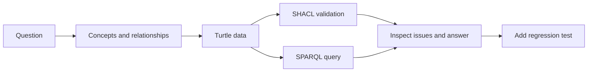

# 从零搭建一个可运行的 SDLC-QE 本体

本篇回答一个具体问题：「哪些测试义务还没有关联测试用例？」有了这个问题，建模就不需要从完整企业词汇表开始。我们先把概念和关系写成机器可处理的数据，再验证结构并查询结果。

文章以 v0.19 实验包中的 Turtle、SHACL 和 SPARQL 材料为例。它说明如何复现，不在本次写作中宣称代码已经重新运行或评估通过。执行记录、精确输出和版本信息应在发布前复核并补入。

## 新手先记住这三个工具的分工

| 工具或语言 | 做什么 | 本篇用法 |
|---|---|---|
| RDF | 用主语、谓语、宾语表达图数据事实 | 记录某个需求有验收标准、某次执行运行了哪个用例 |
| Turtle | 一种便于人阅读的 RDF 文本语法 | 编写示例三元组 |
| OWL | 表达类、属性和逻辑语义 | 描述 Requirement、TestCase 等概念和它们的语义 |
| SHACL | 按已声明的形状检查数据 | 检查每个 Requirement 是否有关联验收标准 |
| SPARQL | 查询 RDF 图 | 找出没有关联测试用例的测试义务 |
| RDFLib / pySHACL | Python RDF 处理与 SHACL 验证库 | 载入样例图并运行结构检查 |

OWL 负责描述语义和推理；SHACL 负责检查声明的形状约束；SPARQL 负责查询。它们的结果不能混为一谈。

## 三个实践层级：从统一语言到 Agent 集成

完整平台不是起步条件。可以先统一团队用词，再将模型形式化，最后让 Agent 在证据约束下查询和分析。

| 层级 | 目标 | 适合采用的方式 | 主要交付物 |
|---|---|---|---|
| L1：语义建模 | 建立质量领域的共同语言 | Markdown、YAML 或 JSON 定义核心概念、关系、示例和命名 | 概念词典、关系清单、最小领域模型 |
| L2：形式化本体 | 让模型可被机器检查和查询 | RDF / OWL 表达语义，SHACL 验证结构，SPARQL 查询问题 | 本体文件、示例数据、约束和验证测试 |
| L3：Agent 集成 | 让 Agent 使用可追溯的领域知识 | 连接 Git、测试执行、缺陷和 CI 数据，使用只读查询与验证工具 | PR 影响分析、测试缺口报告、质量证据报告 |

三个层级是逐步加深的实践路线，不是必须一次做完的完整技术栈。L1 的词汇和关系可以先被团队审阅；L2 在模型边界稳定后加入机器约束；L3 只有在输入数据、权限和验证结果可追踪时才值得接入 Agent。每一层都应通过小型真实问题验证是否带来价值。

## 一套可验证的轻量技术组合

研究规划提出的技术组合可以作为 Spike 起点，不等于已经完成最终选型：

| 层面 | 建议选择 | 需要验证什么 |
|---|---|---|
| 本体文件 | Turtle / OWL | 术语是否可读、模型能否被现有工具解析 |
| RDF 处理 | Python + RDFLib | 图加载、查询和错误处理是否满足样例需求 |
| 结构验证 | SHACL + pySHACL | 约束是否能识别正例、负例和缺失数据 |
| 推理 | 按需选择 OWL 推理器 | 先确认问题需要逻辑推理，再评估复杂度和运行成本 |
| 自动化 | pytest | 查询、约束和失败案例能否通过回归测试固定下来 |
| Agent 集成 | 只读工具接口 | Agent 是否引用查询结果、快照和来源，而非自由编造关系 |
| CI | GitHub Actions 或团队现有流水线 | 模型和验证变更是否能自动复核 |

先运行一个技术 Spike，再决定是否保留每项工具。项目规划还建议提供 Python API 示例；这篇文章没有将其写成已经实现的服务。

## 从自然语言问题到图数据



图 1 展示一次小型建模循环。SHACL 报告结构问题；SPARQL 返回符合查询条件的记录；回归测试固定预期行为。查询结果不能替代来源和业务审核。

## 查看 v0.19 的一段数据

以下片段对应 `01_project/examples/delivery-flow.ttl` 中的关系。它使用 `https://example.org/sdlc-qe/` 作为实验 URI。该地址是样例命名空间，不应当作对外稳定命名空间发布。

```turtle
@prefix ex: <https://example.org/sdlc-qe/> .
@prefix prov: <http://www.w3.org/ns/prov#> .

ex:req-checkout a ex:Requirement ;
    ex:hasAcceptanceCriterion ex:ac-checkout .

ex:ac-checkout a ex:AcceptanceCriterion .
ex:obligation-checkout a ex:TestObligation ;
    ex:derivedFrom ex:ac-checkout .

ex:test-checkout a ex:TestCase ;
    ex:addresses ex:obligation-checkout .

ex:execution-checkout a ex:TestExecution ;
    ex:executes ex:test-checkout .

ex:evidence-checkout a ex:TestEvidence ;
    prov:wasGeneratedBy ex:execution-checkout .
```

每个 `ex:` 名称代表一个实验对象或关系。分号让同一个对象继续声明其他属性。最后一条关系按 PROV-O 表达证据由哪次执行生成。数据图表达具体事实，`baseline.ttl` 另行定义这些名称的语义。

## 用 SHACL 检查结构

v0.19 基线要求每个 Requirement 至少有一个 AcceptanceCriterion，也要求每个 TestExecution 至少执行一个 TestCase。对应形状可以写成：

```turtle
@prefix ex: <https://example.org/sdlc-qe/> .
@prefix sh: <http://www.w3.org/ns/shacl#> .

ex:RequirementShape a sh:NodeShape ;
    sh:targetClass ex:Requirement ;
    sh:property [
        sh:path ex:hasAcceptanceCriterion ;
        sh:minCount 1 ;
        sh:class ex:AcceptanceCriterion
    ] .
```

它检查 Requirement 的 `hasAcceptanceCriterion` 至少有一个值，而且目标属于 AcceptanceCriterion 类。它不能判断验收标准是否写得好，也不能证明测试已运行。

## 用 SPARQL 找没有用例的义务

```sparql
PREFIX ex: <https://example.org/sdlc-qe/>

SELECT ?obligation WHERE {
  ?obligation a ex:TestObligation .
  FILTER NOT EXISTS {
    ?test a ex:TestCase ;
          ex:addresses ?obligation .
  }
}
ORDER BY ?obligation
```

查询先列出所有 TestObligation，再排除已经关联 `TestCase addresses TestObligation` 的义务。每条返回记录都表示当前数据图中有一项义务未找到匹配用例。结果为空，表示当前查询数据里没有查到这类义务。导入或映射不完整会影响结果，因此不能据此断言现实中不存在测试缺口。

## 把查询变成可维护的测试

开发时可以先固定一个小样例和预期结果：

1. 添加一个没有关联用例的 TestObligation，测试查询应返回它。
2. 添加一个通过 `addresses` 关联它的 TestCase，测试查询不应再返回该义务。
3. 删除 Requirement 的验收标准，SHACL 检查应报告形状不符合。
4. 恢复验收标准，再确认该问题消失。

这样可以检查查询与约束是否按团队预期工作。TDD 的重点是把预期行为固定下来，不是只为让测试变绿而改变数据。负例同样重要，因为错误的关系可能导致漏报或假通过。

## 复现入口与已知限制

在 v0.19 项目目录中，资料给出的依赖和测试命令是：

```bash
python -m pip install -r requirements-validation.txt
python -m unittest discover -s tests -v
```

依赖文件要求 `rdflib>=7,<9` 和 `pyshacl>=0.30,<1`。执行时需要记录 Python 与依赖版本、用例数量、通过/失败/跳过结果和实际输出。如果环境未安装 pySHACL，SHACL 相关测试可能被跳过；跳过不等于通过。

运行记录（提供的 v0.19 资料包，2026-11-05）：在 Python 3.15.2、rdflib 7.6.0、pySHACL 0.40.2 环境下运行完整单测，22 项通过、0 项失败、0 项跳过。该资料包不是 Git 仓库，因此结果对应 v0.19 快照，没有可引用的 commit SHA。这只说明资料包中的测试通过。

项目说明还指出，当前示例只覆盖 CQ-01 到 CQ-04 的简化子集。CQ-03 尚未从组件追踪到测试，CQ-04 尚未校验时间和版本。这些示例不是完整的能力验收。发布本文前，应在不可变的源码版本上重新运行命令，并记录有代表性的缺口案例输出。

## 最佳实践

- 从一个可判定的问题和小数据集开始。
- 分别维护本体、实例数据、SHACL 形状和 SPARQL 查询。
- 同时准备正常样例、缺失关系样例和错误类型样例。
- 记录查询快照范围，避免把其他版本的数据混入结果。
- 把跳过、缺依赖和验证失败分别记录。

## FAQ

### OWL 会帮我检查必填字段吗？

OWL 用于表达语义并支持逻辑推理。缺少字段等完整性要求通常由 SHACL 或应用程序规则检查。

### SPARQL 返回空结果表示义务没有测试吗？

不能。该查询每返回一条记录，就表示当前数据图中有一项 TestObligation 未找到匹配的 TestCase 关联。结果为空，表示当前数据中没有查到这类义务；如果导入或映射不完整，缺口也可能被漏掉。还要检查快照范围。

### 可以把 `example.org` 命名空间放到生产模型吗？

不应照搬。项目说明明确把它作为临时示例 URI。正式模型需要自己控制稳定标识与版本策略。

## 三个理解检查题

1. 哪项检查数据是否符合声明的形状？A. SHACL；B. SPARQL；C. Turtle。
2. 查询没有找到用例时，能确认现实中没有测试吗？A. 能；B. 不能，当前数据也可能不完整；C. 能自动生成测试结果。
3. SHACL 测试被跳过，是否可以计为通过？A. 可以；B. 不可以；C. 只有查询通过时可以。

答案：1-A，2-B，3-B。

## 小结

一个可运行的本体实验由问题、概念模型、实例数据、结构约束、查询和回归测试组成。任何结果都要说明它能支持什么判断。上面的运行记录对应提供的 v0.19 资料包。正式发布前，应在不可变的源码版本上复跑，并保留一个缺口案例的输出。

## 系列导航

- 上一篇草稿：`06-connect-sdlc-qe.md`
- 下一篇草稿：`08-change-impact.md`

## 参考资料

- W3C RDF 1.1 Concepts: https://www.w3.org/TR/rdf11-concepts/
- W3C OWL 2 Primer: https://www.w3.org/TR/owl2-primer/
- W3C SHACL: https://www.w3.org/TR/shacl/
- W3C SPARQL 1.1 Query Language: https://www.w3.org/TR/sparql11-query/
- v0.19 复现说明: `01_project/RUN_SPIKE.md` 与 `01_project/requirements-validation.txt`
