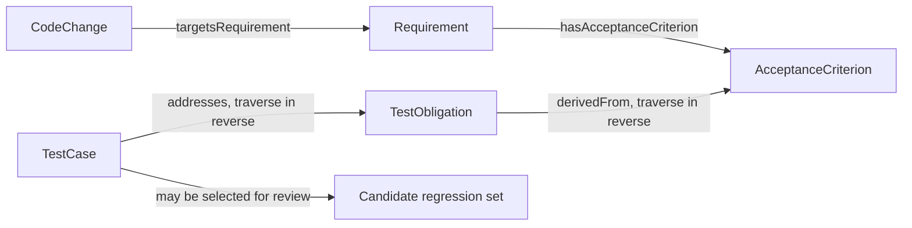

# 需求变更后，哪些测试需要重跑？用本体做影响分析

退款权限需求变了。团队要决定回归哪些测试。全量重跑可能耗时，按文件名搜索又可能漏掉间接关联的测试。本体可以沿变更、需求、验收标准和测试义务找出候选范围，再由团队核对是否完整。

影响分析输出的是候选集。它给人复核的起点，不会只凭关系图就知道所有代码行为。

## 从变更定位候选测试

在 v0.19 模型中，CodeChange 可以通过 `targetsRequirement` 指向需求。需求通过 `hasAcceptanceCriterion` 指向验收标准。TestObligation 通过 `derivedFrom` 指向标准，TestCase 通过 `addresses` 指向义务。查询从需求走到义务和用例时，需要反向遍历后两条关系。

图 1 的 `derivedFrom` 和 `addresses` 箭头按模型实际方向绘制。查候选用例时，查询沿这两条边反向遍历。当前基线没有直接的 `Component → TestObligation` 关系。若团队希望从改动组件直接追到测试，需先定义组件到需求或义务的映射。

## 候选不等于最终回归清单

假设查询根据映射返回测试 T1 和 T2。开发人员检查代码后确认 T1 确实相关，T2 是共享组件里的相邻功能而不受本次变更影响，另外还发现未建模的异步通知测试 T3 也要重跑。查询结果需要和经过审核的影响清单比较。

| 测试项 | 查询建议 | 人工确认 | 说明 |
|---|---|---|---|
| T1 退款权限 | 是 | 是 | 直接验证权限验收标准 |
| T2 退款历史记录 | 是 | 否 | 共享组件使其成为误报候选 |
| T3 异步通知重试 | 否 | 是 | 关系未建模导致漏报 |

这里的 T1–T3 是教学用假设数据，不是 v0.19 实验结果。它展示了需要记录的两类错误。误报会增加复核或执行工作；漏报可能让相关验证被遗漏。

## 用精确率和召回率检查候选质量

- 真阳性（TP）是查询建议且经人工确认受影响的测试。
- 假阳性（FP）是查询建议但人工确认不受影响的测试。
- 假阴性（FN）是查询没有建议但人工确认受影响的测试。

精确率 = TP / (TP + FP)，表示建议中有多少比例经过确认。召回率 = TP / (TP + FN)，表示已确认受影响的测试中有多少被找到。

上面的教学表只有 T1 是 TP，T2 是 FP，T3 是 FN。因此精确率和召回率各为 1/2。这个算例只解释公式，不能当作工具效果或项目测量结果。真实评估需要固定样本、由专家盲标影响清单，并记录分歧如何处理。

## 决定实际回归范围

影响路径只是输入之一。团队还要考虑业务风险、改动范围、环境可用性、测试成本和最近一次可信执行。高风险义务可能需要完整回归；低风险候选可以抽查或使用其他验证方式。负责人应记录纳入和排除哪些测试及理由。

| 决策记录 | 示例内容 |
|---|---|
| 目标版本 | PR commit、Build ID、目标 Release |
| 候选来源 | 从哪些关系路径和规则找到测试 |
| 纳入项 | 必须重跑的用例与风险理由 |
| 排除项 | 未执行的候选及排除依据 |
| 人工补充 | 模型未覆盖但领域人员确认的测试 |
| 结果与证据 | 执行状态、报告来源和待处理缺口 |

## 常见误解

| 误解 | 更准确的理解 |
|---|---|
| 查询返回的都是必跑测试 | 它们是基于现有关系的候选项，还要复核 |
| 没返回就表示不受影响 | 关系缺失、映射过期或间接依赖未建模都可能造成漏报 |
| 高召回能保证质量 | 召回只比较已标注样本，不证明断言有效、执行成功或证据合格 |
| 同一个组件总是影响相同测试 | 代码变更内容、依赖和业务规则都会影响实际范围 |

## 最佳实践

- 为每个样本固定变更 commit、模型版本和数据快照。
- 由熟悉代码和业务的人员先独立标注，再对照查询结果。
- 单独记录误报、漏报和无法判断项。
- 关系路径缺失时返回 Unknown 或提示数据不完整。
- 每次回归范围都保存人工纳入、排除和补充理由。

## FAQ

### 可以只运行本体返回的用例吗？

不建议。查询会受关系覆盖和映射质量影响。高风险变更还要结合代码审查、架构依赖和团队的回归政策。

### 精确率和召回率哪个更重要？

看用途。缩小测试集合时，漏报代价高，通常要重点关注召回；为减少大量无效重跑时，精确率也重要。两项都应报告。

### 如果没有人工确认的标准答案怎么办？

只能做探索性分析，不能报告准确率。先建立样本、记录专家分歧，再把标注集用于后续评估。

## 三个理解检查题

1. 查询建议但人工确认无影响属于什么？A. TP；B. FP；C. FN。
2. 查询没找到但人工确认要重跑属于什么？A. TP；B. FP；C. FN。
3. v0.19 的 `derivedFrom` 关系方向是什么？A. TestObligation 指向 AcceptanceCriterion；B. AcceptanceCriterion 指向 TestObligation；C. TestCase 指向 Build。

答案：1-B，2-C，3-A。

## 小结

本体能把现有需求和测试关系转成候选回归范围。团队还要用人工确认的影响清单检查漏报和误报，并结合风险决定实际测试。下一篇会把同一类质量上下文提供给 AI PR Review。

## 系列导航

- 上一篇：`07-build-runnable-ontology.md`
- 下一篇：`09-ai-pr-review.md`

## 参考资料

- W3C SPARQL 1.1 Query Language: https://www.w3.org/TR/sparql11-query/
- v0.19 `targetsRequirement`、`derivedFrom` 与 `addresses` 关系见 `01_project/ontology/baseline.ttl`
