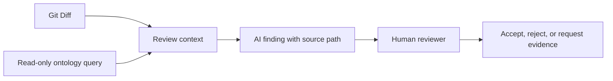

# 让 AI 做 PR Review：本体如何补充研发与质量上下文

Git Diff 展示代码改了哪些行。它通常不会告诉审查者，这些行对应哪条退款规则，关联哪些测试义务，当前构建是否有足够证据。AI 看得到差异文本，不代表它知道团队的工程语义。

本体可以给 AI 提供可查询的需求、组件、测试义务和执行关系。比较稳妥的做法是让 Agent 只读查询，逐条引用来源，再由人决定是否接受建议。下面的 PR-128 和输出都是假设示例，不是实际模型评估。

## Diff-only 和语义增强审查

| 审查输入 | AI 能看到什么 | 常见盲区 |
|---|---|---|
| 只有 Git Diff | 修改的代码行、上下文和文件名 | 看不到需求规则、测试义务、构建和证据关系 |
| Diff 加本体查询 | Diff、目标需求、组件、验收标准、义务、用例、执行和来源 | 依赖映射完整度；不完整路径要显示为未知 |

图 1 的 Agent 只查询数据并提出发现，不修改代码、不更改门禁状态，也不替审批人签字。

## PR-128 的示例审查

假设 Diff 修改退款权限校验。AI 查询得到以下上下文：PR-128 指向 `CodeChange`，变更目标是退款权限需求；该需求连接一条验收标准；模型有对应 TestObligation 和 TestCase，但快照没有找到当前 Build 下的合格执行证据。

一条可审核的建议应说明「我查到什么」和「我仍不知道什么」：

> 示例发现：退款权限需求对应的 TestObligation 在当前快照中没有可确认的合格证据。请核对 PR-128 的目标 Build 是否运行了对应测试。证据路径为 PR-128 → CodeChange → Requirement → AcceptanceCriterion → TestObligation。该结果说明当前模型数据存在证据缺口，不能据此断言代码允许未授权退款。

| 输出内容 | 应展示的信息 |
|---|---|
| 发现 | 退款权限义务未找到合格证据 |
| 证据路径 | 每个关系和源记录 ID |
| 快照范围 | commit、Build、Release 和模型版本 |
| 不确定性 | 缺少记录可能源于未运行，也可能是数据未导入 |
| 建议动作 | 查原始 CI 报告、补映射或重新运行测试 |

如果没有需求、测试结果或授权数据，AI 不应生成「权限实现存在漏洞」这类更强结论。这超出了当前证据。

## 让 Agent 只读并可追溯

一种安全的工作流程是：

1. 固定 PR commit、数据快照和本体版本。
2. 让 Agent 用有访问范围限制的查询获取相关对象，不给它修改数据或生产系统的权限。
3. 对每条建议返回路径、源 ID 和证据状态；未查到时明确写 Unknown。
4. 人工打开源记录，确认版本、语义映射和上下文。
5. 审查者接受、驳回或要求补证，并保留处理原因。

Agent 提示词可以要求它只报告查询结果中出现的事实。推论要标出规则和输入事实；无法确认的内容要列为待核实问题。模型生成的解释不是测试证据。

## 如何比较两种审查方式

若要评估本体是否改善 PR Review，需要用同一批 diff、相同模型版本、相同审查标准和相同来源数据。至少记录：

- 两种方式各自发现了哪些真实缺口。
- 哪些结论没有源记录支持。
- 是否把 Unknown 说成通过或失败。
- 审查者需要多久修订建议。
- 同一输入重复运行时，建议是否稳定。

本篇没有这些运行结果，所以不评定哪种方式表现更好。对照实验设计见第 12 篇。

## 最佳实践

- 每条 AI 发现都要能回到关系路径和原始记录。
- 查询工具限制为只读、固定快照和允许的命名图。
- 区分确认事实、规则推导、候选影响和未知项。
- 不让 AI 把链接缺失写成代码缺陷已确认。
- 保留人工接受或拒绝建议的理由，作为后续改进材料。

## FAQ

### 本体能让 AI 直接看懂任意代码 Diff 吗？

不能。它可以提供已映射的领域上下文。Diff 的代码语义和影响仍需代码分析、测试或开发人员复核。

### Agent 说证据缺失，是不是就应该阻止 PR？

Agent 的提醒是审查输入。阻断规则应由团队的门禁政策定义，并由实现检查对应快照中的证据。

### 可以让 Agent 自动修复关系吗？

关系映射会影响后续分析。自动建议可以作为候选，但写入模型前应有权限检查、来源记录和人工确认。

## 三个理解检查题

1. Diff-only 审查一般缺少什么？A. 修改行；B. 需求和质量证据上下文；C. 文件名。
2. 找不到证据时，AI 应怎样表述？A. 已确认代码有漏洞；B. 当前快照没有可确认的证据，并给出范围；C. 自动标记通过。
3. 什么可以决定是否接受 AI 的 PR 建议？A. AI 自身；B. 人工审查和团队政策；C. 关系图颜色。

答案：1-B，2-B，3-B。

## 小结

本体让 AI PR Review 能读取明确的工程关系，并让审查者看到每条建议的依据。它提供上下文，不会把缺失数据变成事实。下一篇会继续区分覆盖关系和可用于质量声明的证据。

## 系列导航

- 上一篇：`08-change-impact.md`
- 下一篇：`10-quality-evidence.md`

## 参考资料

- W3C PROV-O: https://www.w3.org/TR/prov-o/
- AI PR Review 提纲与示例源: `02_blog/articles/09.md` 与 v0.19 实验模型
