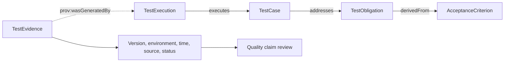

# 测试覆盖率够吗？用本体追踪测试义务和质量证据

仪表盘显示 20 条自动化测试全部通过。发布审查仍可能要问：退款权限要求由哪条测试验证？它在哪个构建上运行？结果有没有保存？如果没有这些答案，测试数量不能单独证明质量要求已满足。

本篇把「覆盖」拆成三层。测试用例与义务的关联说明计划怎样检查；执行记录说明实际跑了什么；证据资格说明结果能否用于当前版本的质量判断。

## 从要求到质量声明

图 1 中的关系箭头按模型定义方向绘制。`TestObligation derivedFrom AcceptanceCriterion`、`TestCase addresses TestObligation` 和 `TestExecution executes TestCase` 取自 v0.19 基线。证据通过 PROV-O 指向生成它的执行活动。证据检查和质量声明评估是审查流程，不是额外的本体关系。

## 三层覆盖不能互相替代

| 层次 | 检查什么 | 退款权限示例 | 只看这一层会漏掉什么 |
|---|---|---|---|
| 关联覆盖 | 验收标准是否派生义务，义务是否关联用例 | 权限义务链接到拒绝未授权请求的测试 | 测试可能没运行，或断言不检查权限结果 |
| 执行覆盖 | 用例是否在目标 Build 和环境实际运行 | 权限测试在 PR-128 的候选 Build 上运行 | 结果可能不可信、来源缺失或版本过期 |
| 证据资格 | 结果状态、构建、环境、时间、来源和策略是否符合要求 | CI 报告引用正确构建并满足门禁策略 | 证据合格仍需人判断业务风险和例外 |

覆盖可以用来找缺口，但不能简化为一个百分比。可解释的报告应按义务列出关联用例、执行记录和证据状态。

## 用断言内容检查测试是否有意义

测试用例和义务之间有链接，不代表测试检查了目标行为。以「普通用户不能退款」为例：

| 断言内容 | 能检查的内容 | 还应核对 |
|---|---|---|
| HTTP 响应是拒绝状态 | 请求没有获得成功响应 | 是否用普通用户令牌，是否访问退款接口 |
| 响应包含权限错误码 | 系统给出了与权限有关的拒绝原因 | 错误码是否稳定，是否与业务契约一致 |
| 退款记录没有新增 | 拒绝请求没有产生副作用 | 检查的数据源是否完整，事务是否已回滚 |

这张表是测试设计示意。具体状态码、错误码和数据副作用要按被测 API 契约确认。文章不应把示例写成某个真实接口的行为。

## 证据要能回到当前构建

| 证据检查项 | 需要回答的问题 | 常见问题 |
|---|---|---|
| 执行状态 | 测试通过、失败、取消还是未完成？ | 只有摘要，没有原始执行记录 |
| 构建与变更 | 结果对应哪个 commit、PR 和 Build？ | 旧构建结果被挂到新 PR |
| 环境 | 测试运行在哪个环境和配置？ | 权限配置与目标发布环境不同 |
| 时间 | 结果在发布截止时间前产生吗？ | 证据早于后续关键代码改动 |
| 来源与完整性 | 报告是否可定位，摘要是否可核对？ | 文件没有来源标识或内容摘要 |
| 验证规则 | 这类证据需满足哪些策略？ | 把任意通过报告都视为有效 |

实验模型把部分来源字段放在活动或证据记录上。模式检查可以发现字段缺失，但不能只凭字段有值就证明它真实。来源系统、不可变快照和人工审核仍然要纳入证据链。

## PR-128 的状态判断

假设 PR-128 有 20 条自动化测试通过。退款金额义务有当前 Build 的有效证据，退款权限义务却没有可确认的执行记录。此时可以对金额义务进行资格判断；权限义务应显示 Unknown。不要用总通过数填补某项义务的证据缺口。

| 测试义务 | 用例关联 | 当前构建执行 | 证据状态 | 结论 |
|---|---|---|---|---|
| 退款金额 | 有 | 有 | 满足示例策略 | Qualified（假设示例） |
| 退款权限 | 有 | 无法确认 | 缺少执行证据 | Unknown（假设示例） |

表中状态仅用于解释判断方式，不是实际评估结果。实际状态要依据固定快照、项目策略和来源材料重新计算。

## 最佳实践

- 按测试义务查看覆盖，不只看全局测试数量。
- 由测试设计人员确认断言与验收标准之间的语义对应。
- 将执行记录和证据资源分开存储并关联来源。
- 按目标 Build、环境、时间和规则检查证据新鲜度。
- 缺少字段或映射时输出 Unknown，并指出具体缺口。

## FAQ

### 代码覆盖率高，可以代替义务覆盖吗？

不可以。代码覆盖率通常衡量执行过哪些代码；义务覆盖衡量需求或风险是否有对应验证。两者关注的问题不同。

### 有 TestCase 关系就算覆盖了吗？

它表示模型记录了关联。还要检查用例断言、实际执行和证据是否适用于目标版本。

### 旧构建的通过结果能否复用？

需要根据代码变化、证据截止时间和发布政策判断。若关键代码在运行后发生变化，旧结果通常不能直接支持新版本的质量声明。

## 三个理解检查题

1. 哪一层说明用例实际在目标 Build 上运行？A. 关联覆盖；B. 执行覆盖；C. 术语覆盖。
2. 用例链接到权限义务但从未运行，应显示什么？A. 已满足；B. Unknown 或缺少执行证据；C. 自动 Qualified。
3. 测试证据缺少构建来源，能否仅凭「passed」用于发布判断？A. 能；B. 不能，需检查来源与策略；C. 能，测试数量足够即可。

答案：1-B，2-B，3-B。

## 小结

测试数量和代码覆盖率都不能替代从义务到证据的追踪。质量报告要显示关联、实际执行和证据资格，并说明每个结论对应的构建和来源。下一篇会把这些信息带进 CI/CD 发布门禁。

## 参考资料

- W3C PROV-O: https://www.w3.org/TR/prov-o/
- v0.19 证据规则: `01_project/docs/standards/ontology.md`、`01_project/shapes/baseline.shacl.ttl`
