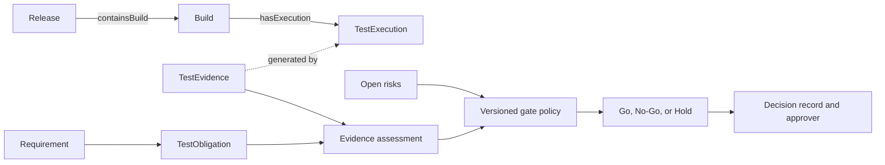

# 从 CI/CD 到 Go/No-Go：用本体整理发布质量门禁

CI 显示测试通过，团队还要确认这些结果属于哪个构建、覆盖了哪些高风险义务，以及有没有证据缺口。发布门禁应把检查条件、数据来源和例外审批写清楚，让参与者能复核为什么建议 Go 或 No-Go。

本体可以把 Release、Build、TestExecution、TestEvidence、Requirement 等对象放进一条可查路径。门禁政策负责定义通过条件。人在政策和证据基础上决定是否发布。当前 v0.19 的核心模型提供了部分对象关系；QualityGate、批准记录和完整决策策略属于待扩展内容。

## 发布审查需要哪些信息

| 信息 | 发布负责人要核对什么 |
|---|---|
| Release 与 Build | 当前发布包含哪个构建？构建对应什么提交？ |
| 变更和需求 | PR 修改了哪些组件，关联哪些需求和验收标准？ |
| 测试义务 | 哪些义务属于高风险或发布阻断范围？ |
| 执行与证据 | 相关用例是否在目标构建运行，证据能否追溯？ |
| 开放风险 | 哪些缺陷或 Unknown 状态仍未处理？ |
| 政策与例外 | 依据哪个版本门禁，谁有权接受哪些风险？ |

图 1 表达门禁审查的概念流程。`Requirement → TestObligation` 在这张图中是简化读法；v0.19 基线实际通过 AcceptanceCriterion 间接连接。风险、门禁政策和决策记录也需要按产品设计增加明确的数据模型。图中的箭头展示审查流，不代表每条都是已实现的本体属性。

## 用状态区分证据情况

| 证据状态 | 含义 | 门禁示例处理 |
|---|---|---|
| Qualified | 证据满足当前政策的版本、来源、执行和时效要求 | 对应义务满足证据条件 |
| Unqualified | 证据存在，但未达到至少一项要求 | 失败或过期证据可能阻断发布 |
| Unknown | 证据缺失或无法确认 | 不能当作通过；按政策保持阻断或进入正式例外流程 |

退款 PR-128 的示例中，20 条自动化测试通过，但退款权限义务没有可确认的当前构建证据。策略若要求所有高风险义务都必须 Qualified，发布门禁应阻断或保持 Hold。团队如果决定带着风险发布，要记录谁批准、依据什么、缓解措施是什么以及批准何时失效。这个案例是教学示例，不是实际发布决策。

## 把例外变成可审计记录

例外不应通过改写测试状态来实现。可以单独记录：

| 例外字段 | 需要保留的内容 |
|---|---|
| 风险项 | 关联的 Requirement、TestObligation 或 Defect |
| 未满足条件 | 缺少证据、测试失败或其他阻断项 |
| 理由 | 为什么当前版本需要接受这项风险 |
| 缓解措施 | 额外监控、限制功能、回滚方案或补充检查 |
| 批准人 | 按权限矩阵有权接受该风险的人 |
| 有效期 | 适用的 Release 和截止时间 |
| 后续责任 | 谁在何时补证或关闭风险 |

策略应阻止无期限、无负责人或与目标版本不匹配的例外。例外审批只记录风险接受，不会把缺少的测试证据变成 Qualified。

## 决策如何复核

每次 Go / No-Go 记录建议保留 Release ID、目标 commit、Build ID、数据快照、模型版本、门禁政策版本、证据状态、阻断项、例外审批和决策人。记录必须绑定不可变输入。否则同一发布记录以后可能查到不同数据，无法重现当时的判断。

门禁的自动化结果应包含理由和源路径。负责人需要知道系统为什么阻断、哪些信息尚缺，以及哪些条件被例外处理。单独显示一个绿色通过标志不足以支持审计。

## 最佳实践

- 把质量门禁做成有版本的规则，并在决定时保存对应版本。
- 将证据资格、风险接受和发布审批分开记录。
- Unknown 不自动视为通过；阻断或例外策略必须显式定义。
- 例外要有授权人、缓解措施、截止时间和后续责任人。
- 每个决策绑定不可变数据快照，保留来源路径。

## FAQ

### CI 全部通过是否等于 Go？

不一定。CI 的范围可能没有覆盖所有测试义务，执行结果也要对应目标 Build。发布政策还要检查风险和证据状态。

### Unknown 一定阻止发布吗？

由门禁政策决定，但系统不能把 Unknown 偷换成 Qualified。若允许发布，必须经过授权的例外审批并记录风险。

### 质量门禁可以由 AI 自动批准吗？

AI 可以汇总关系和证据状态。批准权限应由组织政策控制，决策要能追溯到责任人和当时的输入快照。

## 三个理解检查题

1. 当前构建缺少高风险义务证据时，正确状态是什么？A. Qualified；B. Unknown；C. 自动通过。
2. 风险例外可以怎样处理？A. 把测试结果改成通过；B. 单独记录授权、理由、缓解措施和期限；C. 删除阻断规则。
3. 为了以后复核发布决定，要保留什么？A. 只有 Go / No-Go 标签；B. 快照、政策版本、证据和批准记录；C. 测试数量。

答案：1-B，2-B，3-B。

## 小结

发布门禁需要把需求、Build、测试执行、证据和风险放到同一份可复核记录中。Qualified、Unqualified 和 Unknown 要按版本化政策解释。人依据证据和授权流程作 Go / No-Go 决定。下一篇将设计实验，检查本体是否实际改善这类质量工作。

## 参考资料

- W3C PROV-O: https://www.w3.org/TR/prov-o/
- v0.19 发布和证据设计材料: `01_project/ui-design/v014/01_POLICY_DECISION_CONTRACT.md`、`01_project/ui-design/v015/08_EVAL_KPIS_AND_PILOTS.md`
