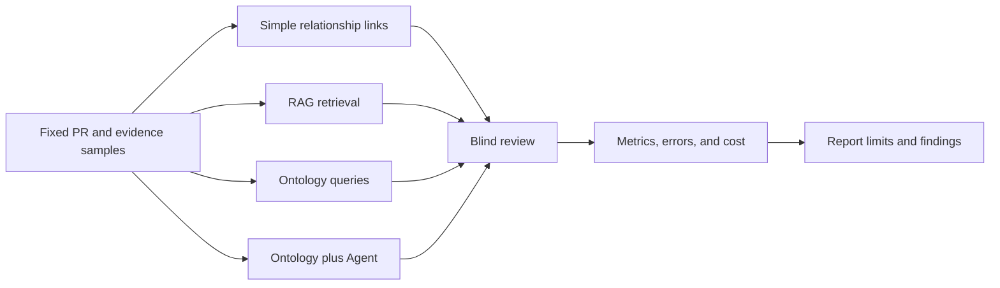

# 本体能提升 AI Native QA 吗？用对照实验看收益和成本

本体看起来能让研发关系更清楚，但这还不能证明它提高了质量。要判断价值，需要让不同信息方式处理同一批 PR 和质量问题，再比较结果、误报、漏报、人工复核和维护投入。

本篇提供实验方法和结果表。当前没有完成这组对照实验，所以不写「本体更准确」或「节省了多少时间」之类结论。真实运行后再填入结果。

## 先固定实验问题

选择一个可以由专家标注的问题，例如：「给定 PR 和目标 Build，哪些测试义务存在覆盖或证据缺口？」固定每个 PR 的 commit、需求、测试数据、证据快照和人工确认的标准答案。若输入版本不同，结果就无法公平比较。

图 1 用四组设计兼顾两份规划。A、B、C 比较简单关联、RAG 和本体增强；D 额外检查在本体查询上加入 Agent 后的增量。若项目无法实现 D，应将它标为后续实验，不影响前三组的对照。

## 设计公平的对照组

| 组别 | 提供给分析者或模型的上下文 | 要回答的问题 |
|---|---|---|
| A 简单关系链接 | ID 链接、关联表或基础字段 | 仅靠现有链接能找到多少真实缺口？ |
| B RAG | 同一份需求、PR、测试说明和执行报告的检索片段 | 文档检索能否找到相关上下文，是否会漏掉结构关系？ |
| C 本体查询 | 固定版本的概念模型、关系数据和受限查询 | 明确关系和约束能否改善追溯与缺口识别？ |
| D 本体 + Agent | 与 C 相同的模型，通过只读工具交给 Agent 分析 | Agent 是否让结果更易用，是否引入额外错误和成本？ |

四组尽量共享相同的源数据、PR 样本、模型版本、任务说明和输出格式。若模型、提示词或工具权限不同，要记录差异；不要把差异全部归因于本体。RAG 组和本体组的来源材料应可比较，避免一组拿到更多信息。

## 指标要能对应实际问题

| 指标 | 计算或记录方法 | 它反映什么 |
|---|---|---|
| 变更影响分析时间 | 记录从拿到 PR 到交付审核清单的用时，并报告中位数和范围 | 工具是否减少分析和复核工作 |
| 质量缺口召回率 | TP / (TP + FN)，与人工标注缺口比较 | 已知缺口中找到多少 |
| 质量缺口精确率 | TP / (TP + FP) | 系统报告的缺口中有多少得到确认 |
| 测试义务证据覆盖率 | 有审核用例、目标版本执行和有效证据的义务数 / 样本要求的义务总数 | 义务是否形成了完整验证记录；另行报告只有关联用例但未执行的情况 |
| 已建模约束识别正确率 | SHACL 或程序化约束结果与已标注正例、负例的匹配比例 | 约束能否识别当前定义范围内的数据问题，不代表验证了所有业务规则 |
| 证据追溯完整度 | 有效且可回源的必需关系数 / 样本要求的关系总数 | 质量结论是否能追到需求、测试、执行、Build 和来源 |
| 错误 Qualified 次数 | 记录被标成 Qualified、但不满足预设规则的样本数和分母 | 是否把不充分证据误判为通过；安全目标是避免此类误判 |
| 无依据结论 | 每份输出中无法回到输入事实或规则的断言 | 生成内容是否超出材料 |
| 结果稳定性 | 同一输入重复运行后，对齐标准结论类别并比较差异 | 结论是否依赖随机生成波动 |
| 人工修订时间 | 记录审阅者改正、补来源和删结论所用时间 | 输出是否真正减少工作 |
| 运行与维护成本 | 分别记录模型/API、基础设施、数据维护和本体更新投入 | 收益是否抵消长期成本 |

「错误 Qualified」要同时报告数量和分母。样本中没有观察到错误，不代表系统在所有情形都不会误判。对抗性样本应包含过期证据、错误 Build、缺失来源、失败执行和被错误映射的关系。

## 预先定义标签和复核过程

在运行前，至少明确这些标签：Confirmed gap、No gap in sample、Insufficient data、Incorrect relationship、Unsupported claim、False Qualified。两名审阅者可以独立判断，再记录分歧和裁决理由。若标准答案在看过系统输出后才制定，评估容易偏向某一组。

每次运行要保存实验日期、代码或资料版本、样本 ID、模型和提示词版本、查询配置、温度等生成设置、输入快照、原始输出、审阅记录和费用。涉及真实项目的数据要先授权并脱敏。不得把提示词或模型输出本身当成测试证据。

## 结果表模板

| 方法 | 关键缺口召回 / 精确率 | 义务证据覆盖率 | 约束识别正确率 | 无依据结论 | 格式合规 | 结果稳定性 | 人工修订时间 | 运行 / 维护成本 | 说明 |
|---|---|---|---|---|---|---|---|---|---|
| 简单关系链接 | 待实测 | 待实测 | 待实测 | 待实测 | 待实测 | 待实测 | 待实测 | 待评估 | 基线组 |
| RAG | 待实测 | 待实测 | 待实测 | 待实测 | 待实测 | 待实测 | 待实测 | 待评估 | 检索同一来源材料 |
| 本体查询 | 待实测 | 待实测 | 待实测 | 待实测 | 待实测 | 待实测 | 待实测 | 待实测 | 记录模型与映射维护投入 |
| 本体 + Agent | 待实测 | 待实测 | 待实测 | 待实测 | 待实测 | 待实测 | 待实测 | 待实测 | 在本体查询基础上加入只读 Agent |

这张表目前是空结果模板，不是评测结论。格式合规应按预先定义的输出 schema 判断。结果稳定性应报告重复运行分歧，不能只写「稳定」或「不稳定」而不说明判定方法。

## 如何解释实验结果

如果本体组召回更高，但维护时间也明显增加，结论要同时写出两点。若 Agent 组表达更易读，但产生更多无依据结论，也不能只报告易读性。某一组在某些任务上更合适时，应注明任务范围和数据条件。

这个实验只能支持所选样本和任务下的比较。它不能证明所有本体设计、RAG 实现或 Agent 都有相同表现，也不能单独证明生产发布更安全。

## 最佳实践

- 先固定任务、样本和标签，再运行各组。
- 尽量一次只改变信息组织方式；无法控制的差异要记录。
- 让审阅者在不知道组别的情况下标注结果。
- 同时报告错误、人工时间、运行成本和维护成本。
- 公开失败案例、样本限制和未测量项，不只挑有利指标。

## FAQ

### 没有真实运行结果时，文章能先发布吗？

可以作为方法文章发布，但标题和正文必须说明实验尚未执行。不能写成已经验证了本体收益的结论。

### 只比较一次模型输出够吗？

不够。生成结果会波动。应重复运行并记录设置，再按固定的结论类别比较差异。

### 哪一组应该是基线？

使用团队当前可用的简单关系链接作为基线，明确它实际能访问的数据。不能故意削弱基线，制造本体组的优势。

## 三个理解检查题

1. 为什么所有组要使用相同 PR 样本？A. 减少偏差；B. 让图表更漂亮；C. 省去标注。
2. 错误 Qualified 次数为零，能否证明不会误判？A. 能；B. 不能，只能说明当前样本没有观察到；C. 能证明所有发布安全。
3. 当前结果表中的「待实测」是什么？A. 已经测过但未公布；B. 结果尚未获得；C. 可以按预期填值。

答案：1-A，2-B，3-B。

## 当前结论

现有材料能支持实验设计，不能支持效果结论。下一步需要固定样本、标注标准和组别配置，再执行多次运行、盲审输出并计算指标。结果出来以后，再补图表和观察到的失败案例。

## 系列导航

- 上一篇草稿：`11-quality-gate.md`
- 下一篇草稿：`13-defect-risk-analysis.md`

## 参考资料

- 评测指标与样本设计来源: `02_blog/articles/12.md`、`02_blog/RESEARCH_BLOG_EXTENSION.md`
- 项目实验与评估计划: `01_project/ui-design/v015/08_EVAL_KPIS_AND_PILOTS.md`
