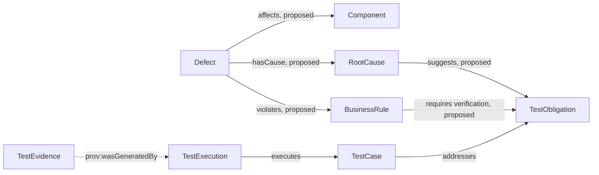

# 本体驱动的缺陷与质量风险分析：从历史问题找到回归线索

团队修复了一次支付超时问题。几个月后，另一个支付接口也改了重试逻辑。缺陷库里有旧问题，但如果它只是一段描述，测试人员不一定能把它和新变更联系起来。

质量本体可以把缺陷记录与受影响组件、业务规则、根因、测试义务和回归测试建立关系。查询找到相似历史记录后，团队可以拿它作调查线索。相似记录不等于新代码存在相同缺陷。

## 一个支付超时例子

假设一次支付请求超时后，客户端重新提交。同一订单最后产生两笔支付。调查结果把问题归因到幂等性控制缺失。这个假设案例包含不同信息：

| 信息类型 | 示例内容 | 建模时的区别 |
|---|---|---|
| 症状 | 用户看到两笔扣款 | 用户观察到的结果 |
| 缺陷记录 | 支付接口在重试后创建重复交易 | 可追溯的问题条目 |
| 根因 | 服务端没有按请求标识执行幂等控制 | 调查后确认或修订的解释 |
| 业务规则 | 同一支付请求只能产生一次成功交易 | 业务应满足的规则 |
| 受影响对象 | 支付组件和订单支付流程 | 代码或业务边界 |
| 回归义务 | 重复提交相同请求时不得生成第二笔支付 | 需要持续获得的验证证据 |

根因可能变化。初步分诊可以把「可能与幂等有关」标成待确认，复盘之后再建立已确认关系。模型应保留状态、来源和确认人，不能把猜测变成永久事实。

## 建议的关系模型

图 1 中从 Defect、RootCause 和 BusinessRule 出发的前五条关系，以及 RootCause、BusinessRule 两个概念，都是建议扩展，v0.19 基线没有定义。`addresses`、`executes` 和 PROV-O 来源关系沿用现有模型。`proposed` 标签标出建议关系；虚线单独用于表示 PROV-O 来源关系。

## 缺陷知识如何变成新的测试义务

1. 记录缺陷的影响、复现条件、环境和来源工单。
2. 调查后分别标注症状、已确认根因和仍未确定的原因。
3. 如果问题违反业务规则，将缺陷关联到规则和受影响组件。
4. 将规则转为一项或多项测试义务，并注明缺陷为何需要这项验证。
5. 设计回归用例，连接实际执行和证据。
6. 后续改动涉及相关规则或组件时，查询历史缺陷，提醒审查者检查对应义务。

同一个根因可能影响多个组件；一个缺陷也可能涉及多个规则。关系应支持多对多，并允许缺陷状态从待调查、已确认、已修复到回归验证等阶段变化。

## 风险优先级怎么处理

风险不是缺陷数量。团队可以使用影响范围、发生可能性、可检测性和业务损失等维度制定自己的评估方法。但本体只保存经过确认的风险属性或分类，不应隐含一套没有经过团队批准的评分算法。

| 风险问题 | 需要补充的信息 |
|---|---|
| 影响对象是谁？ | 业务能力、组件、用户群或数据范围 |
| 影响多严重？ | 团队定义的等级和评估依据 |
| 哪些情况会触发？ | 复现条件、输入、状态和依赖 |
| 如何发现或拦截？ | 监控、自动化测试、人工审核或门禁 |
| 风险是否已接受？ | 批准人、理由、有效期和缓解措施 |

关联历史缺陷只能提示「可能相关」。风险负责人仍需确认当前变更是否具备相同条件。

## 常见误解

| 误解 | 更准确的理解 |
|---|---|
| 相似缺陷意味着同一根因 | 描述相似只能提出候选，根因要依据调查证据确认 |
| 历史缺陷自动生成了有效回归测试 | 测试仍需对应业务规则，并验证正确行为 |
| 缺陷数量可以代表风险高低 | 严重程度、影响范围、出现频率和发现能力都可能不同 |
| 建立缺陷关系就能预测所有故障 | 模型只能处理已有概念和关系，未建模的依赖会造成遗漏 |

## 最佳实践

- 把症状、根因、业务规则和受影响组件分开记录。
- 区分待确认关联和经复核关联，并保留来源。
- 让每条回归义务追溯到规则或事故复盘结论。
- 后续代码变化触发的是风险复核建议，不是缺陷复现结论。
- 定期关闭过期、重复和不再适用的缺陷关系。

## FAQ

### AI 能从缺陷描述自动找根因吗？

AI 可以提出相似记录和可能原因。根因仍需要调查证据。未经确认的原因应保留为候选。

### 一个缺陷可以关联多个业务规则吗？

可以。真实故障可能触及多条规则。每条关联都应说明证据或复核状态。

### 这套缺陷模型已经包含在 v0.19 中吗？

没有。缺陷、根因和风险关系来自系列扩展规划。要实现它们，需要更新本体、约束、样例数据和双语术语说明。

## 三个理解检查题

1. 描述相似的历史缺陷能证明新代码有同一问题吗？A. 能；B. 不能，只能作为调查线索；C. 只要同组件就能。
2. 谁确认已记录的根因？A. 模型名称相似度；B. 调查证据和负责人员；C. 测试数量。
3. 从缺陷复用的测试义务应连接到什么？A. 业务规则或已确认风险；B. 仅连接缺陷标题；C. 任意测试用例。

答案：1-B，2-B，3-A。

## 小结

缺陷本体让历史故障可以沿组件、规则和回归义务被检索。它帮助团队复用调查线索，不能替代根因确认。下一篇会把这种语义建模放进订单与支付业务本身。

## 参考资料

- 本系列质量与业务本体规划见用户提供的《本体在 AI Native QA 中的应用》研究材料。
- W3C PROV-O: https://www.w3.org/TR/prov-o/
