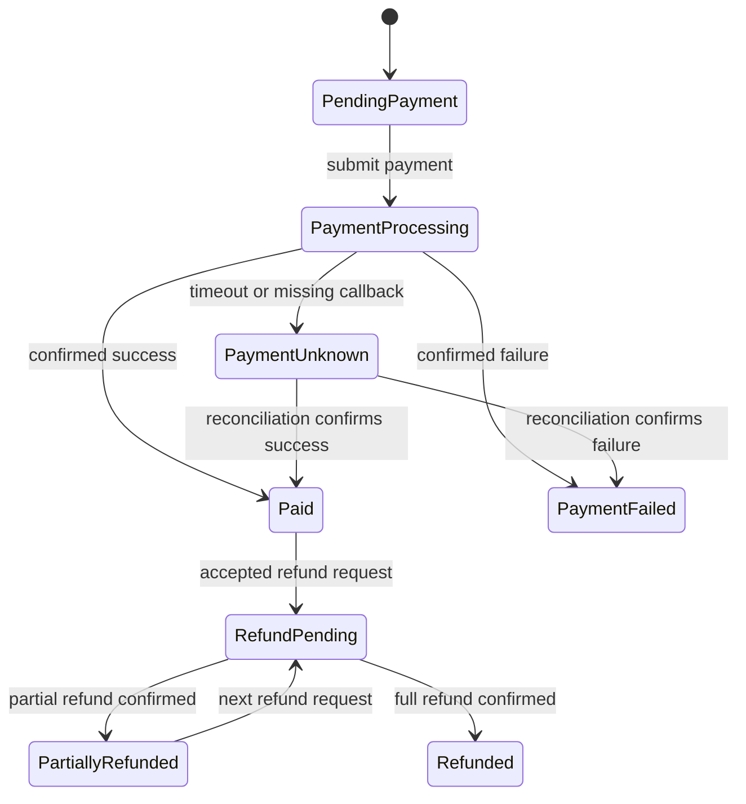
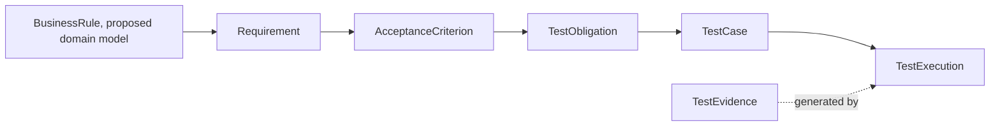

# 从零设计订单与支付业务本体：概念、状态和规则

「订单已支付」看起来只有一个状态，实际系统还要判断支付请求是否重复、网关是否超时、是否已经退款，以及退款金额是否超过允许范围。模型如果只保存一个状态字符串，就很难说明这些状态由什么事件触发、哪些规则必须成立。

订单与支付本体把业务对象和术语定义清楚，再与状态机和规则检查配合。它不是一套可以直接套用到所有电商系统的标准。每个项目要确认自己的支付渠道、分账、退款和对账规则。

## 先定义业务对象

| 概念 | 记录什么 | 常见关系 |
|---|---|---|
| Order | 用户购买的业务请求及其金额、币种和生命周期 | 包含订单项；由一次或多次支付尝试结算 |
| OrderItem | 商品、数量、单价和优惠分摊 | 属于某个订单 |
| Payment | 对订单金额的一次付款或付款尝试 | 关联支付渠道、状态和外部交易号 |
| PaymentAttempt | 一次向支付渠道发送的请求 | 可能成功、失败、超时或待对账 |
| Refund | 退还全部或部分已收金额的操作 | 指向原支付和退款请求 |
| Customer / Role | 发起或审批业务操作的主体及其权限 | 创建订单、付款或申请退款 |
| BusinessRule | 业务必须遵守的条件 | 产生需求和测试义务 |

Payment 和 PaymentAttempt 在简单产品中可能合并。若外部网关重试、异步回调或对账需要区分「业务付款」和「一次请求」，分开建模更容易查清楚。

## 画出订单与支付状态

下面的状态图是教学示例。它展示一条可能的基本流程，不包含所有渠道、部分付款和争议处理。团队在使用前要按业务合同补全状态和事件。

`PaymentUnknown` 是故意保留的支付业务状态，表示支付结果暂时无法确认。它不同于质量评估中的 `Unknown`；后者表示现有证据不足以判断某项质量声明是否成立。调用超时并不一定表示支付失败，网关可能已经扣款，只是回调未到。系统需要通过状态查询或对账确认结果，不能仅凭超时再发起一笔新支付。

## 把规则写成可以讨论的句子

订单支付场景至少需要明确下列规则。这里的表述是领域讨论起点，项目仍需补全币种、部分退款、分期和外部支付渠道等适用范围。

| 规则 | 可检查的表达 | 需要明确的边界 |
|---|---|---|
| 重复成功支付 | 同一订单的同一付款义务不能被重复结算 | 是否支持分期、多次扣款或拆单支付 |
| 幂等请求 | 相同幂等键的重复请求不能创建重复交易 | 幂等键范围、有效期和冲突响应 |
| 支付超时 | 超时后按明确的查询或对账策略确定最终状态 | 查询间隔、最大等待时间、迟到回调如何处理 |
| 退款上限 | 累计退款金额不能超过该支付当前允许退款的金额 | 手续费、优惠券、部分退款、拒付和币种精度 |
| 退款权限 | 只有授权主体可以执行对应退款操作 | 角色、订单归属、金额上限和审批规则 |

核心业务规则可以表示成 BusinessRule 类和相关属性。但涉及时间窗口、累计金额、并发请求和状态转换的规则，通常要交给状态机、规则引擎或程序代码执行。OWL 可以描述概念和逻辑关系，不应被误写成会自动运行所有业务条件的执行器。

## 连接业务规则和测试

图 2 表达业务知识到质量证据的目标链。当前 v0.19 基线从 Requirement 开始，尚未定义 BusinessRule 和业务状态模型。跨域链是系列提出的扩展方向，不代表项目已经实现。

## 什么时候该用本体、状态机和规则引擎

| 需要解决的问题 | 更合适的表达方式 |
|---|---|
| 订单、支付和退款分别是什么，它们如何关联？ | 领域概念模型或本体 |
| 支付处理中可以进入哪些状态？超时后能否直接成功？ | 状态机或事件模型 |
| 累计退款金额是否超过允许额度？ | 程序化规则或规则引擎，配合金额和币种定义 |
| 规则覆盖了哪些测试义务，执行留下什么证据？ | QE 关系模型、查询与来源追踪 |

这些形式可以一起使用。本体统一概念和关系；状态机表达状态转换；规则实现检查业务约束；测试证明特定输入和环境下实际观察到什么。

## 最佳实践

- 先选一个窄场景，写清订单、支付、退款的范围。
- 区分付款业务对象和对外请求尝试，尤其要处理异步结果。
- 对金额、币种、舍入和累计退款定义明确规则。
- 把超时和未知回调作为显式状态，不把「未收到结果」写成失败。
- 每条业务规则都要能追到验收标准和测试义务。

## FAQ

### 用 OWL 表示规则后，系统就会自动控制支付吗？

不会。OWL 用于表达语义和逻辑关系。状态转换和金额约束需要运行时组件或程序检查。

### PaymentAttempt 为什么要独立建模？

当系统需要区分业务付款与对网关的多次请求时，这样才能记录重试、超时、迟到回调和对账结果。

### 这个状态图适用于所有支付产品吗？

不适用。它省略了分期、撤销、拒付、争议和渠道差异。实际状态要由产品规则和支付合同确定。

## 三个理解检查题

1. 支付请求超时是否能直接判定支付失败？A. 能；B. 不能，可能需要查询或对账；C. 只要用户重试即可。
2. 哪项更适合执行「累计退款不超过允许退款金额」？A. 只靠关系图；B. 明确的规则检查和币种定义；C. 只改状态标签。
3. 本体、状态机和规则引擎是否必须三选一？A. 是；B. 可以分工协作；C. 只有 OWL 能使用。

答案：1-B，2-B，3-B。

## 小结

订单与支付本体让对象、状态和规则有一致定义。状态转换和数值约束仍要由适合的执行机制检查。下一篇会从这些业务规则生成可追溯的 AI 测试设计。

## 参考资料

- 订单与支付规则示例源自用户提供的本体研究规划，本文将它们标成待项目确认的教学假设。
- W3C OWL 2 Primer: https://www.w3.org/TR/owl2-primer/
