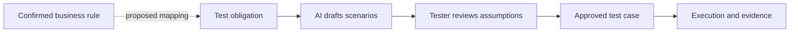
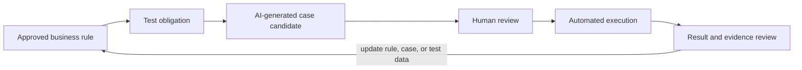

# 业务本体如何帮助 AI 设计测试用例？从规则走到可追溯场景

AI 收到「测试一下支付超时」这句话后，可能会列出网络中断、重复点击、回调延迟等场景。但如果团队没有说清楚超时后应该查询状态、重试还是关闭订单，AI 无法知道哪种结果才是正确的。

业务本体可以把规则、状态和对象提供给 AI。AI 再按规则提出测试义务和用例候选。每个候选都要回到规则来源，并标明尚未给出的业务假设。生成测试不等于确认测试正确，更不等于测试已经执行。



图 1 展示业务规则进入测试设计和执行的路径。虚线映射是本系列提出的跨域扩展；v0.19 目前没有 `BusinessRule` 类。人工审核和实际执行也不能省略。

## 从规则到测试义务

假设订单支付领域已确认以下业务规则：

- 相同幂等键的重复请求不得创建重复交易。
- 支付超时后，系统按定义的查询或对账策略确认最终状态。
- 同一订单付款义务不能产生重复成功扣款。
- 累计退款金额不能超过该支付当前允许退款的金额。

将每条规则映射成 TestObligation，再由用例覆盖义务。`BusinessRule → TestObligation` 是本系列提出的跨域扩展；v0.19 基线定义了 `TestCase addresses TestObligation`，但尚未定义 BusinessRule 类。

| 规则 ID | 派生的测试义务 | 来源状态 |
|---|---|---|
| BR-IDEMPOTENCY | 重复提交相同幂等键时，最多产生一笔成功交易 | 教学规则，等待业务方确认键范围和有效期 |
| BR-TIMEOUT | 超时后根据对账策略得到一致的最终支付状态 | 需要补充重试间隔、等待上限和迟到回调处理 |
| BR-SINGLE-CHARGE | 同一付款义务不能重复扣款 | 需要明确订单分期或拆单支付是否适用 |
| BR-REFUND-LIMIT | 累计退款不超过当前允许退款金额 | 需要明确手续费、币种精度和拒付规则 |

## 让 AI 生成可审核的测试候选

测试人员可以把业务规则、状态图、接口契约和相关版本作为输入，要求 AI 按固定字段输出。下面的提示词模板能让新手从一条规则开始试用：

```text
目标：为下面的业务规则提出测试用例候选。

规则 ID：BR-IDEMPOTENCY
规则文本：相同幂等键的重复请求不得创建重复交易。
相关对象：Order、Payment、PaymentAttempt
接口契约：<粘贴已经确认的请求字段、响应和错误码>
测试义务 ID：TO-PAY-IDEMPOTENCY

请输出：用例 ID、前置条件、操作、预期结果、覆盖的规则 ID、需要的测试数据。
同时列出规则中没有说明的假设。不要编造接口字段、响应码、超时时长或数据库行为。
如果无法从输入确定预期结果，请标为“待业务确认”，不要猜测。
```

将模板里的接口契约替换为实际材料。若团队没有确认字段、状态或错误码，就先补齐资料，再让模型生成更具体的用例。

## 一个候选用例示例

以下用例只展示结构。前置条件和预期结果需按真实接口契约确认。

| 字段 | 示例 |
|---|---|
| 用例 ID | TC-PAY-IDEMPOTENCY-02 |
| 覆盖规则 | BR-IDEMPOTENCY |
| 测试义务 | TO-PAY-IDEMPOTENCY |
| 前置条件 | 订单处于待支付状态；准备同一请求体和幂等键 |
| 操作 | 并发或连续提交两次相同请求 |
| 预期结果 | 系统只创建一笔支付交易；两次响应按已确认的幂等契约返回 |
| 需要确认 | 并发语义、重复请求响应是否完全相同、幂等键保存期限 |

AI 给出的预期结果如果与接口契约冲突，要以已批准的业务规则和接口定义为准。模型应当指出冲突，而不是替团队自行决定。

## 检查场景是否覆盖规则边界

对每条规则，可以检查不同类型的输入和状态：

| 场景类型 | 支付示例 | 审查问题 |
|---|---|---|
| 正常路径 | 支付成功并收到确认 | 订单状态和交易记录是否一致？ |
| 负向路径 | 无效幂等键或无权限请求 | 系统是否拒绝操作并避免副作用？ |
| 重复操作 | 同键重复请求、重复回调 | 是否产生重复交易或重复退款？ |
| 边界值 | 退款金额等于、低于或高于允许值 | 金额精度、币种和累计退款如何计算？ |
| 状态顺序 | 先收到超时，再收到成功回调 | 最终状态是否按对账策略收敛？ |

这些场景是测试设计检查表，不表示某个产品已经通过了这些验证。应将每个场景连接到规则 ID、义务 ID、用例、执行结果和证据来源。

## 人工审核 AI 输出

测试设计人员逐项检查：

1. 规则 ID 是否存在且版本正确。
2. 前置条件是否能在测试环境建立。
3. 操作是否对应真实接口或用户流程。
4. 预期结果是否来自已确认的规则，而非模型补写。
5. 边界和异常状态是否符合团队的支付政策。
6. 用例是否能被重复执行，结果是否可观察。

审核通过的用例可以进入测试管理或自动化开发。未经审核的 AI 输出应标为候选，不能计入有效覆盖。

## 重点：把 AI 生成用例放进质量循环

用例生成只是质量工作的一个环节。团队还要审核业务预期，运行测试，核对证据，再根据结果修订规则、义务、用例或数据。以下循环要进入每次需求和代码变更的日常测试：



如果执行发现预期结果不明确，团队应补充业务规则；如果证据对应错了构建，应修复数据关联；如果用例没有验证规则，应补充断言。AI 生成的用例只有经过审核、执行并得到可追溯结果，才进入有效质量证据链。

## 最佳实践

- 先给规则稳定 ID，并保存版本和来源。
- 一次聚焦一条规则，逐步增加状态和边界输入。
- 要求 AI 把事实、推导和待确认假设分开。
- 用 `TestCase addresses TestObligation` 建立追溯，而不是只在用例标题里写规则名称。
- 生成后进行人工审核，再进入执行和证据记录。

## FAQ

### AI 可以直接从订单规则生成最终测试吗？

它可以提出候选。测试设计人员要确认输入完整、预期结果来自已批准规则，并检查环境是否能执行。

### 只有业务规则，没有 API 契约，可以开始吗？

可以先生成高层场景和待确认问题。要生成具体请求、响应和断言，还需要接口契约或用户流程定义。

### AI 生成的用例可以算覆盖吗？

未经审核和执行的用例不能证明义务已验证。覆盖评估要查看有效关联、执行记录和证据。

## 三个理解检查题

1. AI 无法从规则确定 HTTP 错误码时应怎样做？A. 编一个常见码；B. 标为待确认；C. 省略来源。
2. `TestCase addresses TestObligation` 表示什么？A. 用例记录了要验证的义务；B. 测试已经通过；C. 业务规则已经正确。
3. 哪项可以把候选用例变成可用于质量结论的材料？A. 生成文本；B. 审核、执行和可追溯证据；C. 更多提示词。

答案：1-B，2-A，3-B。

## 小结

业务本体为 AI 测试设计提供规则、对象和状态上下文。每条用例候选都应带上规则来源和未决假设，再经过人工审核和实际执行。下一篇会沿着订单状态和规则清单寻找业务测试遗漏。

## 系列导航

- 上一篇：`14-order-payment-ontology.md`
- 下一篇：`16-find-business-test-gaps.md`

## 参考资料

- 订单支付规则与 AI 测试方向见系列研究规划中的专题 C。
- W3C SHACL: https://www.w3.org/TR/shacl/
