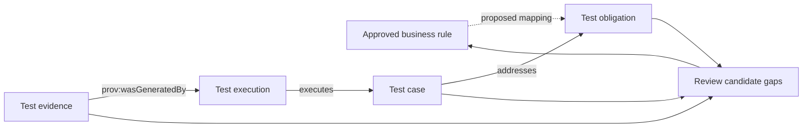

# 用本体发现业务测试遗漏：从支付状态和规则找缺口

测试报告显示 20 个用例全部通过，仍不能回答「订单支付规则是否都经过验证」。要回答这个问题，团队还要列出业务规则、状态变化和测试义务，再核对每项义务有没有对应的用例、执行记录和证据。

本文沿用订单与支付的教学案例。幂等、超时、重复扣款和退款上限是规划中的示例规则，不是对某个真实支付产品的描述。当前 v0.19 基线没有建模 `BusinessRule`，因此文中的业务规则到测试义务关系属于待实施的跨域扩展。

## 先把「遗漏」拆成可以核对的问题

「测试遗漏」可能指不同问题。模型和报告应说明自己发现的是哪一种：

| 缺口类型 | 要核对的问题 | 支付示例 |
|---|---|---|
| 规则缺口 | 一条已批准的规则有没有测试义务？ | 幂等规则尚未对应 `TestObligation` |
| 用例缺口 | 义务有没有可以执行的测试用例？ | 超时对账义务没有关联用例 |
| 状态缺口 | 状态机中的关键状态或转换是否进入测试？ | `Pending → Succeeded` 有测试，超时后迟到成功回调未覆盖 |
| 顺序与时序缺口 | 事件先后、重试和延迟是否验证？ | 重复提交与回调乱序的组合尚未讨论 |
| 边界缺口 | 规则边界和异常输入是否有明确预期？ | 累计退款等于或高于允许金额时如何处理 |
| 证据缺口 | 用例是否在目标版本执行，结果是否可追溯？ | 用例存在，但没有当前构建的执行记录 |

模型只能基于已导入且已确认的规则和数据找出候选缺口。规则本身没有写清、或数据没有导入时，系统应报告「待确认」或「数据不足」，不能把它直接当作产品缺陷。

## 从业务规则走到场景矩阵

下面的场景由四条教学规则展开。它是审查清单，不是实际覆盖报告。问号处需要业务方补充定义。

| 规则 | 建议检查的变化或组合 | 需要业务确认的预期 |
|---|---|---|
| 相同幂等键不得产生重复交易 | 顺序重复、并发重复、同键不同请求体 | 幂等键作用范围、有效期、冲突请求的返回方式 |
| 支付超时后按策略确认最终状态 | 超时后查单、迟到成功回调、重复回调、回调先于查询响应 | 超时阈值、查询间隔、最长等待时间、最终状态收敛方式 |
| 同一付款义务不得重复成功扣款 | 两次成功响应、网络重试、订单重试 | 拆单、分期或多支付渠道是否属于同一付款义务 |
| 累计退款不得超过可退金额 | 单笔等于上限、累计达到上限、累计超出上限、并发退款 | 金额精度、手续费、拒付、退款处理中金额是否占用额度 |

例如，「迟到成功回调」是值得询问的场景，但规则只说超时后按已定义策略确认最终状态。若团队尚未定义回调和对账先后冲突的处理方式，就不能替它编造预期结果。应先把问题记入待确认清单，再补规则或验收标准。

## 缺口分析如何沿关系工作

以下流程展示从规则到质量证据的审查路径。`BusinessRule → TestObligation` 是拟议扩展；从测试用例到测试义务，以及执行到证据的关系要以当前模型和数据为准。

图中虚线表示尚未纳入 v0.19 基线的业务规则映射。图里的审查箭头表示分析过程；实际 RDF 方向仍应按谓词定义读取，例如 `TestCase addresses TestObligation` 和 `TestEvidence prov:wasGeneratedBy TestExecution`。

本体与查询可以回答「哪条已建模的义务没有关联用例」或「哪个用例没有目标构建的证据」。它不能单凭关系数量判断测试断言是否正确，也不能证明系统实现了规则。

## 新手可以怎样做一次人工盘点

1. 选一个具体业务流程，例如订单支付，不要一次纳入整个电商系统。
2. 从已批准的需求、规则或接口契约中摘出每条规则，并保留来源和版本。
3. 为规则列出成功、拒绝、边界、重复操作、状态顺序和恢复路径等问题。
4. 对每个问题写出预期结果；没有依据的结果标为待确认。
5. 将确认后的验证目标登记为测试义务，再关联测试用例。
6. 检查执行记录和证据是否对应目标版本，最后由测试人员复核候选遗漏。

| 盘点项 | 记录内容 | 状态示例 |
|---|---|---|
| 规则来源 | 需求 ID、规则版本、批准人或文档链接 | 已确认 / 待确认 |
| 测试义务 | 必须验证的业务结果 | 已定义 / 缺失 |
| 场景与用例 | 前置条件、动作、预期结果、用例 ID | 已关联 / 缺失 |
| 执行和证据 | 构建、环境、时间、结果、报告位置 | 有效 / 不匹配 / 未知 |
| 人工结论 | 缺陷、模型缺口、数据缺口或规则问题 | 已确认 / 待调查 |

## 如何判断 AI 找出的遗漏

AI 可以根据规则和关系提出检查建议。审查者应逐项追问：

- 候选场景来自哪条规则、状态或历史缺陷？
- 预期结果能否在批准的规则或接口契约中找到依据？
- 这是已确认的覆盖缺口，还是模型缺数据？
- 是否存在多个合法业务策略，尚未确定本系统采用哪一个？
- 候选用例在目标版本执行过吗，证据来自哪里？

把结果分成「已证实缺口」「待补规则」「数据缺失」「建议进一步检查」更容易复核。不要把 AI 的合理猜测直接登记为缺陷。

## 最佳实践

- 以规则和测试义务为盘点单位，不以用例总数代替覆盖。
- 把状态转换、重复请求、事件时序和并发作为独立审查维度。
- 每个候选缺口保留来源、模型版本和查询范围。
- 将产品缺陷、规则未定义、追踪关系缺失和数据未导入分开报告。
- 让领域负责人确认业务预期，再把已确认场景加入回归测试。

## FAQ

### 查询发现某项义务没有测试，就能说产品有缺陷吗？

不能。它说明当前查询范围里没有发现关联用例。还需要确认规则和数据是否完整，也要检查测试是否记录在其他系统。

### AI 能自动判断应该覆盖哪些异常状态吗？

AI 可以根据给定规则提出候选状态和问题。没有业务策略依据的预期结果必须留给业务或产品负责人确认。

### 关系图里有用例和证据，就代表覆盖充分吗？

不代表。还要检查断言是否验证规则、执行是否属于目标版本、证据是否符合团队的资格策略。

## 三个理解检查题

1. 查询发现义务没有关联用例，首先能得出什么？A. 产品有缺陷；B. 当前数据没有找到关联；C. 测试一定失败。
2. 超时后迟到回调的预期结果未定义，应怎样处理？A. 让 AI 选择最常见结果；B. 标记待业务确认；C. 当作测试通过。
3. 哪项比「用例数量」更适合检查业务规则覆盖？A. 规则到义务、用例、执行和证据的追溯；B. 测试报告页数；C. 模型输出长度。

答案：1-B，2-B，3-A。

## 小结

测试遗漏分析从已确认的规则开始，逐项核对义务、场景、用例、执行和证据。对预期结果不明确的地方，应返回业务规则补充定义。下一篇会把审核后的业务规则接到自动化测试执行。

## 系列导航

- 上一篇草稿：`15-ai-business-test-design.md`
- 下一篇草稿：`17-business-rules-to-automation.md`

## 参考资料

- W3C SHACL: https://www.w3.org/TR/shacl/
- W3C SPARQL 1.1 Query Language: https://www.w3.org/TR/sparql11-query/
- 系列规则来源：用户提供的订单与支付领域研究规划；示例规则仍需实际业务确认。
