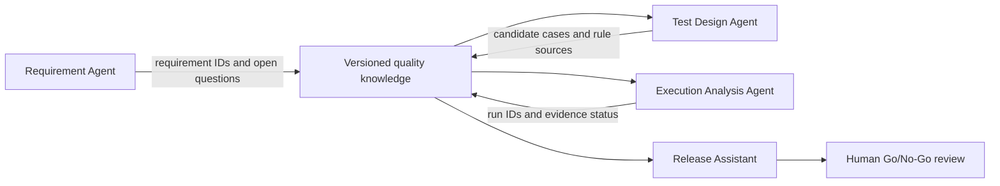
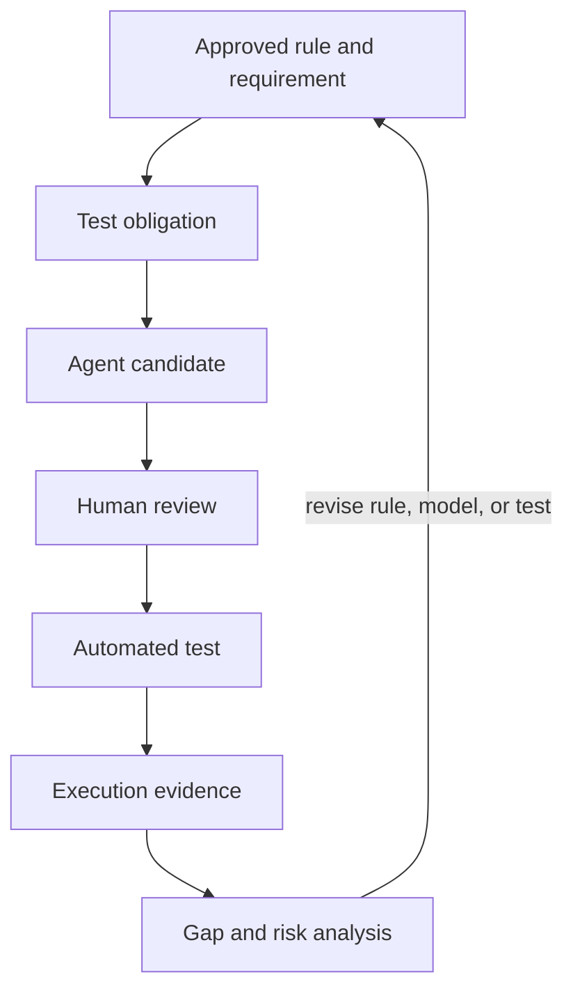

# 多个 QA Agent 如何共享质量知识：统一语义、交接与审计

一个 Agent 发现 PR 修改了支付组件，另一个 Agent 根据需求生成测试，第三个 Agent 汇总 CI 结果。如果它们对「支付成功」「测试义务」或「证据有效」的理解不同，交接报告会出现断层。本体可以为多个 Agent 提供共同的概念和关系，但不能替代数据版本、权限和责任管理。

## 共享的是什么

多 Agent 协作需要共享可定位、可复核的质量上下文，包括：

- 统一概念和关系的定义及版本。
- 需求、业务规则、组件、测试义务和用例的标识。
- 数据来源、导入快照和查询范围。
- 执行结果、证据位置及资格状态。
- Agent 提出的候选、依据、未决假设和人工审核状态。

如果下游 Agent 只收到上游的一段自然语言总结，它很难判断结论来自哪条需求、哪版数据或哪次执行。

## 一条可追踪的 Agent 协作链



图中 Agent 通过版本化共享知识交换对象 ID 和证据引用。执行 Agent 的结果仍须指向真实测试系统记录；Release Assistant 汇总材料后仍由有责任的人作出发布决定。

## 不同 Agent 的职责与交接

| Agent 角色 | 主要工作 | 必须交给下游的信息 | 不能单独声称什么 |
|---|---|---|---|
| 需求分析 Agent | 找出需求、验收标准和规则中的歧义 | 来源 ID、版本、待确认问题 | 不能替业务负责人批准规则 |
| 影响分析 Agent | 沿组件和变更关系提出受影响范围 | PR/组件/需求路径、查询快照 | 不能保证追踪数据完整 |
| 测试设计 Agent | 将确认的规则映射到义务和候选场景 | 规则 ID、义务 ID、前置条件、断言来源 | 不能把候选用例标成已验证 |
| 执行分析 Agent | 汇总真实测试运行和证据状态 | 执行 ID、构建、环境、时间、结果、报告 | 不能把跳过或未知转换成通过 |
| 发布辅助 Agent | 汇总风险、义务、执行和证据缺口 | 结论依据、例外、未决项 | 不能代替授权人作 Go/No-Go 决定 |

## 交接记录示例

跨 Agent 交接可以用结构化对象保存，而不是靠复制对话：

```yaml
task_id: PR-128-quality-review
snapshot_id: demo-snapshot-v1
ontology_version: v0.19
source_records:
  - id: REQ-REFUND-04
    version: 3
    role: acceptance-criterion
  - id: TO-REFUND-PERMISSION
    role: test-obligation
candidate_tests:
  - id: TC-REFUND-AUTH-01
    status: needs-human-review
evidence:
  status: unknown
  reason: no execution evidence found in the selected snapshot
open_questions:
  - confirm whether the target build includes the permission change
```

这份 YAML 是交接格式示例，不是 v0.19 已定义的 Agent 协议，也不表示这些记录真实存在。生产协作还需要定义字段、标识、校验、权限和审计规则。

## 版本、冲突和责任边界

1. **固定上下文版本。** 每次 Agent 任务都记录本体版本、数据快照、目标构建和查询范围。否则两个 Agent 可能基于不同数据回答同一个问题。
2. **将模型更新作为变更。** Agent 可以提议新关系或术语映射，但应创建候选变更，由领域负责人 review，再经过约束与回归检查。
3. **保留冲突，不让模型静默合并。** 需求、接口契约和测试结果冲突时，报告冲突来源，等待责任方裁决。
4. **记录每个结论的责任来源。** 保存输入记录、查询结果、Agent 版本、提示模板版本和人工修改。
5. **用权限隔离工作范围。** 读取需求、执行测试、修改规则和批准发布是不同权限，不应因为任务串联就自动授予一个 Agent 全部权限。

本体可以统一术语，却不能修复互相矛盾的源记录。若「退款完成」在需求、支付接口和测试报告中含义不同，首先要解决术语和业务规则的冲突，再让多个 Agent 共用它。

## 把质量循环带进 Agent 协作

多 Agent 的输出应进入同一条质量循环：



Agent 负责缩短信息查找、分析和草拟时间。测试执行、证据资格和规则更新仍要按工程流程处理。不能用「多个 Agent 都同意」替代独立验证；如果它们使用了同一错误来源，意见一致也不能证明结论正确。

## 如何从小规模试点开始

- 选择一个 PR 变更分析场景，固定测试数据与人工标注答案。
- 先定义共享对象 ID、来源引用和快照字段，再拆 Agent 职责。
- 让第一个 Agent 只读查询；第二个 Agent 生成候选用例；自动化系统单独执行。
- 为每次交接保存来源与状态，并让人工 review 关键假设和质量结论。
- 记录召回率、误报、证据可追溯率、耗时、调用成本和模型维护工作量。
- 发现冲突、漏报或过期链接时，先确认原因，再更新规则和模型版本。

## 与现有 QA 项目的协同方向

原研究规划把以下项目列为可探索的连接点。它们是建议方向，不表示已经完成集成：

| 项目 | 规划中的协同方向 |
|---|---|
| awesome-qa-skills: https://github.com/naodeng/awesome-qa-skills | 探索增加 ontology-driven-test-analysis Skill |
| ai-test-auditor: https://github.com/naodeng/ai-test-auditor | 检查 AI 生成的测试是否对应已确认的业务规则和测试义务 |
| QCov: https://github.com/AI-Native-QA-Lab/QCov | 探索语义化覆盖关系与证据完整性 |
| ai-native-qa-agents: https://github.com/naodeng/ai-native-qa-agents | 让 Agent 通过受限工具查询领域本体 |
| AI Native QA Workbench | 后续评估为可选的领域知识模块 |

采用这些方向前仍需检查各项目的接口、数据边界和维护责任。不能把语义关联数量直接当成真实覆盖率。

## 建议的八周研究路线

以下周期来自系列研究规划，是分阶段建议，不是已经验证的交付承诺：

| 阶段 | 建议周期 | 主要工作 | 阶段门禁 |
|---|---|---|---|
| 1. 最小质量本体 | 第 1–2 周 | 核心概念、关系、样例数据、SHACL 验证 | 模型可解析，约束测试通过，术语和关系有文档 |
| 2. 研发变更影响分析 | 第 3–4 周 | 关联 Git Diff、需求和测试义务，生成 PR 影响报告 | 用人工标注样本检查召回率、误报和追溯性 |
| 3. 订单支付实验 | 第 5–6 周 | 建立业务状态与规则，接入 API 自动化测试 | 关键规则有正反场景，并通过故障注入检查缺口 |
| 4. Agent 集成与对照实验 | 第 7–8 周 | 比较无本体、普通 RAG、本体增强方案 | 评估准确性、证据引用、耗时、成本和维护复杂度 |

每个阶段都应根据实际工作量和运行结果校准。若模型、约束或集成未通过门禁，不应为了保持时间表而把结果写成成功。

## 最佳实践

- 用版本化本体和快照建立共享上下文，避免只传自由文本摘要。
- 每个 Agent 输出必须包含来源 ID、结论状态和未决问题。
- 将生成、审核、执行和发布权限分开。
- 冲突与数据缺口要进入人工处理流程，不能让 Agent 静默选择一方。
- 评价协作效果时同时记录质量、证据、成本和维护负担。
- 把多 Agent 的一致意见视为线索，仍需用独立证据验证。

## FAQ

### 多个 Agent 都给出相同判断，可以当作验证吗？

不能。如果它们共用同一份不完整数据或错误规则，一致结论仍可能错误。验证要看来源和独立证据。

### 共享一个本体就能让所有 Agent 使用相同语义吗？

不一定。Agent 还要使用同一版本，正确理解关系方向，并遵守数据映射与查询契约。

### 哪个工作适合优先交给 Agent？

可先尝试只读检索、关系追踪和报告草拟。修改业务规则、写入正式测试库和批准发布应保留明确授权和人工 review。

## 三个理解检查题

1. 为何 Agent 交接要保存本体版本和数据快照？A. 让报告更长；B. 保证上下游引用相同上下文；C. 自动提升准确率。
2. 多个 Agent 都认为证据充分，能否直接判定发布通过？A. 能；B. 不能，需按独立证据和授权流程审查；C. 只要 Agent 数量超过三个。
3. 源规则与执行结果冲突时应该怎样做？A. 让最后一个 Agent 覆盖前面的记录；B. 保留冲突来源并交给责任人裁决；C. 删除旧版本。

答案：1-B，2-B，3-B。

## 小结

多个 QA Agent 可以分工处理需求、变更、测试和执行信息，但需要通过统一语义、版本快照和结构化交接保持上下文。质量结论仍要依据可追溯证据，并由有权限的人作出决定。

## 系列导航

- 上一篇：`18-build-a-domain-aware-qa-agent.md`
- 系列起点：`00-what-is-ontology.md`

## 参考资料

- W3C PROV-O: https://www.w3.org/TR/prov-o/
- W3C RDF 1.1 Concepts: https://www.w3.org/TR/rdf11-concepts/
- 八周研究计划：用户提供的《本体在 AI Native QA 中的应用》研究规划；周期需经实际试点校准。
