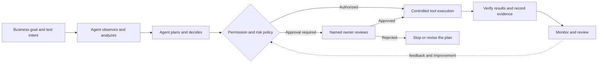
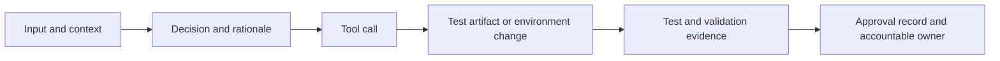
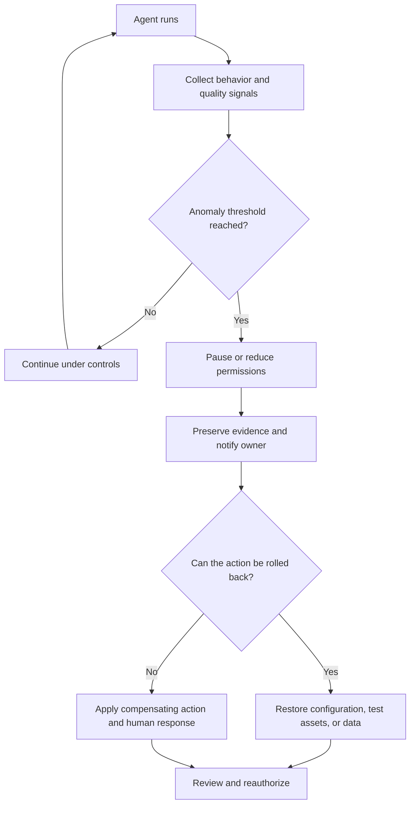
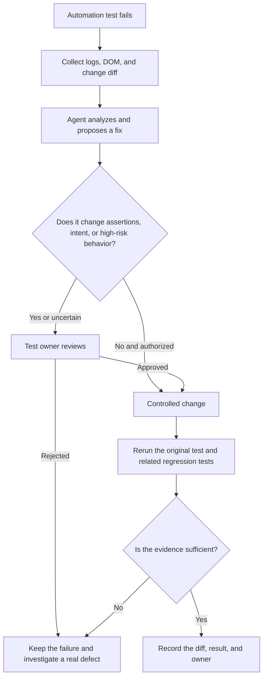
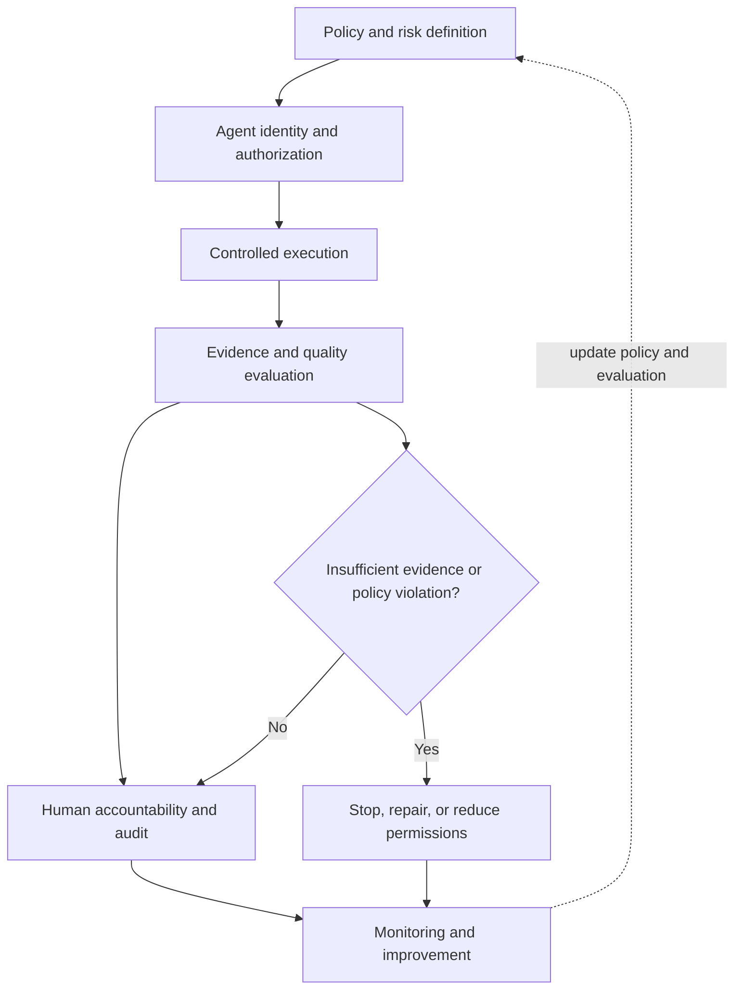

> Source: Nishan Joseph, ACCELQ, October 14, 2026

> Original article: https://www.accelq.com/blog/agentic-ai-governance-framework/

> Scope: A vendor blog on governance for testing agents. This article distinguishes the author's points, external sources, and engineering extensions.

As agents take part in requirements analysis, test generation, execution, and maintenance, teams need to answer a basic question: how far may an agent act on its own, and who is accountable for what it does?

In his ACCELQ article, Nishan Joseph describes governance as a set of policies, roles, and technical controls that define what an agent may do, who is responsible for its actions, and how those actions are recorded for later review. For a testing team, the governance target is not just the generated answer. It also includes the data an agent reads, the tools it calls, the test assets it changes, the environments it touches, and the decisions it makes.

Governance does not mean pausing every step for a human approval click. The goal is to match autonomy to risk and ensure consequential actions have a named owner, verifiable evidence, and a way to stop or recover.

## Advice and action need different governance boundaries

A conventional generative AI assistant usually offers a suggestion and waits for a person to decide whether to use it. An agent may plan, call tools, act, and then continue to its next task. Their governance boundaries are therefore different.

| Dimension | Generative AI assistant / Copilot | Agentic AI |
|---|---|---|
| Behavior | Generates a suggestion and waits for a person to use it | Plans, calls tools, and continues with follow-up actions |
| Testing example | Generates a test script for an engineer to review | Detects a schema change, edits regression tests, and advances a pipeline |
| Governance scope | Output, privacy, and compliance | Output, permissions, tool calls, environment changes, and the decision chain |
| Human involvement | Often reviews each suggestion | Adds checkpoints according to the risk of an action |
| Typical failure | A person accepts incorrect test code | Incorrect test code is executed or merged automatically and may affect a release |

Many existing QA processes were designed for a tool that makes suggestions for an engineer to review. When an agent can write to a test repository or trigger a pipeline, governance must extend to the resources it can access and change.

The diagram below is an engineering view of the governance loop, not ACCELQ's internal product architecture:

## Why testing needs its own governance layer

Testing agents work with production-like data and complex test environments. Environment isolation and data masking therefore belong in the governance design. A more subtle risk is that all tests can pass while validating the wrong business rule. A suite may report 100% requirements coverage and still miss a rule that determines whether a release is safe.

That is why AI-generated tests need suitable review gates. The controls below are engineering extensions based on the risks in the source article:

| Risk area | Possible failure | Control to consider |
|---|---|---|
| Test data | The agent reads unmasked customer data | Minimize data, mask it, and restrict access |
| Test environment | The agent changes a shared database or external service | Use a sandbox, environment allowlists, and restricted credentials |
| Test generation | Assertions do not match business intent | Trace tests to requirements, review them independently, and retain execution evidence |
| Test selection | A critical regression scenario is incorrectly excluded | Require impact-analysis evidence, risk thresholds, and human review |
| Test self-healing | A locator fix masks a real regression | Review the diff, preserve test intent, and rerun validation |
| Release pipeline | The agent bypasses a quality gate | Separate duties, enforce approvals, and prevent policy bypass |

## The six governance pillars

### Agent inventory and identity

The source recommends treating each testing agent like a new service account: record what it can access, who owns it, and which environment it runs in. Agents can enter an organization through a platform update, a new integration, or an engineer's experiment. Without an up-to-date inventory, shadow AI can go unnoticed.

The following fields are engineering examples, not a fixed format specified by the source:

| Inventory field | Example |
|---|---|
| Agent ID | regression-agent-01 |
| Owner | QA Automation Lead |
| Purpose | Select and run regression tests |
| Environment | Staging |
| Available tools | Read-only repository access, test runner |
| Prohibited actions | Production writes, bypassing release gates |
| Credentials and audit | Short-lived credentials, task ID, action log |

### Scope autonomy according to risk

An agent that only proposes test cases should not have the same permissions as one that can push a regenerated regression suite into CI/CD. The source recommends autonomy tiers but does not define a universal scale. The L0–L4 levels below are engineering examples to illustrate increasing control; they are not a formal standard.

| Level | Possible actions | Typical controls |
|---|---|---|
| L0: Read-only | Read requirements, code, and logs | Read-only permissions |
| L1: Suggest | Generate tests or repair suggestions | Changes take effect only after human acceptance |
| L2: Controlled execution | Run authorized tests in an isolated environment | Environment and tool allowlists |
| L3: Restricted modification | Edit test scripts and open a PR | Diff validation and code review |
| L4: High-impact action | Change a critical gate or touch a high-risk environment | Explicit authorization, mandatory approval, and audit |

Permissions should bind to specific tools, data, environments, and actions—not just an agent name or level. L4 means stronger authorization and audit requirements; it does not authorize an agent to approve a production release on its own.

### Risk-based human checkpoints

Requiring a person to review every agent action defeats much of the value of using agents. The source proposes a “name-on-the-line” rule: a specific person is accountable for each consequential decision. The exact roles vary by organization; the table gives one example.

| Decision point | Example owner |
|---|---|
| Define test intent | QA engineer |
| Approve generated tests before merge | QA lead or test owner |
| Review a self-healed test | Original test owner |
| Authorize a high-risk environment action | Environment or system owner |
| Sign off on release risk | Designated release decision-maker |

An approver needs enough context and evidence to make a real decision. A checkpoint should not degrade into an uninformed “approve” button.

### Traceability and audit

Every agent action should leave a result and evidence: what it saw, what it decided, what it changed, and why. That lets a team reconstruct a test change months later instead of seeing only “the agent updated the regression suite.”

As an engineering extension, teams can link the agent, model, and policy versions with tool-parameter summaries, code diffs, execution logs, approval records, and task IDs. Logs also need redaction and access controls. “Complete auditability” does not mean indiscriminately storing every sensitive prompt, customer record, or credential.

### Explainability

When an agent flags a defect, lowers a scenario's priority, or decides that a change needs no revalidation, reviewers need to understand why. An explanation should point to requirements, code, test results, or permission rules. Fluent language alone is not evidence.

| Not enough to review | A more reviewable explanation |
|---|---|
| “No regression needed” | “The diff changes static assets only; no direct call dependency was found, but runtime configuration impact has not been checked.” |
| “Test self-healed” | “The locator changed from A to B; assertions were unchanged, the target element retains the original meaning, and the test was rerun.” |
| “Low-priority defect” | “The issue affects a non-critical presentation path; no data error has been found so far, and business impact still needs confirmation.” |

These are engineering examples. Explainability still requires independent validation; a team should not rely only on an agent's account of its own behavior.

### Continuous monitoring and rollback

Agent behavior can drift as the application, data, or environment changes. Good performance last quarter does not guarantee reliable behavior after several major releases. Governance should monitor anomalies and allow a single agent to be paused or rolled back without stopping the entire pipeline.

External notifications, real payments, and irreversible data operations may not be reversible. Such actions should be blocked or gated before execution.

## The 2026 standards and regulatory context

The ACCELQ article uses policy and industry developments as context for governance. They show that the discussion is advancing, but they do not establish one universal standard for all testing agents.

| Source | Developments described in or checked against the article | Relevance to testing agents |
|---|---|---|
| Singapore IMDA | Launched a voluntary governance framework for agentic AI in January 2026; updated version 1.5 in May with more than ten case studies | Risk boundaries, human accountability, technical controls, and user understanding |
| US NIST | Started the AI Agent Standards Initiative in February 2026; comments on an identity and authorization concept paper closed on April 2 | Agent identity, authentication, authorization, audit, and interoperability |
| EU AI Act | The Digital Omnibus changed application dates for some high-risk obligations | Determine obligations from intended use, risk classification, and the applicable rules |
| Gartner | Forecast that about 40% of enterprise applications would include task-specific agents by the end of 2026 | A market forecast, not an adoption rate already observed |
| IDC | Reported that enterprises planned to allocate an average of 16.7% of AI spending to AI agent security and governance | Indicates budget attention, not a measured norm across testing teams |

IMDA's May 2026 update incorporated industry feedback from more than 60 organizations and added more than ten real-world deployment case studies. The organizations providing feedback and those contributing case studies are not the same list; the official material names Google and PwC among case-study contributors. ACCELQ says these examples were not specifically about software testing at the time of publication.

NIST's work on agent identity and authorization was still part of an active concept-paper project; its public comment period closed on April 2, 2026. At the time the ACCELQ article was published, it said no finalized standard had been issued. Teams can use these materials to inform control design, but should not describe them as an already-effective, testing-agent-specific standard.

The Digital Omnibus changed the application date for obligations concerning high-risk systems under Annex III to December 2, 2027, and for product-related systems under Annex I to August 2, 2028. ACCELQ says the Article 50 transparency obligations remain on their original 2026 timeline. Specific duties are also subject to the wording of each provision and transitional arrangements, so check the current official text. The AI Act's risk classification depends on the system's use context, not only on how autonomous an agent is.

## AI-generated test artifacts need governance too

Managing only agent accounts and permissions is not enough. Test cases, scripts, regression suites, and defect reports also need quality rules because they affect test conclusions and release decisions.

### Map tests to requirements instead of relying on one coverage number

Do not record only a coverage percentage. Show which requirement or acceptance criterion each test protects. These examples come from the study notes:

| Test artifact | Acceptance criterion | Risk objective | Governance state |
|---|---|---|---|
| Successful payment | AC-PAY-01 | Transaction correctness | Traceable |
| Duplicate payment | AC-PAY-03 | Idempotency | Traceable |
| Discount and tax | AC-PRICE-02 | Amount consistency | Needs review |
| Refund rule inferred by the agent | No explicit source | Requirement assumption | Needs clarification |

A test with no explicit source is not necessarily useless; it may expose a requirements gap. But it must be labeled as an assumption rather than presented as a confirmed business rule.

### Review duplication, ownership, and self-healing

An agent optimizing for “completeness” may create near-identical scenarios across different flows. More tests do not prove that important risks are covered. An agent can author a test, but a named person should own whether it stays, changes, or leaves the suite.

Self-healed tests need the same scrutiny as newly generated tests. Fixing a broken locator can also conceal a real UI or business regression. The flow below is an engineering example:

### Read research results within the study's limits

ACCELQ cites a June 2026 study by Dimple Bajaj and Deepak Khetan, *Governance Controls for AI-Generated Test Artifacts in Autonomous Software Testing*. It identifies hallucinated logic, compliance violations, security risks, and weak explainability as common problems in unchecked AI-generated test artifacts. The abstract reports an evaluation of the Governance-Aware Autonomous Testing Framework (GATF) on the Defects4J and PROMISE datasets. Compared with the study baseline, it reports an 89.6% reduction in governance-related risk, along with 94.3% governance accuracy, 96.5% artifact reliability, 94.2% compliance accuracy, and 90.8% explainability performance.

These are reported results from a specific study setup, not general production benefits. They do not show that adding a governance layer to any agent will reduce risk by 89.6%. Read them alongside the paper's methods, datasets, and metric definitions.

## Governance is shared across functions

ACCELQ assigns governance to three primary functions:

| Role | Main responsibilities |
|---|---|
| QA leadership | Risk-tier testing agents, define review scope, and own testing and release quality |
| Platform / DevOps | Establish identity, access control, audit logging, and human checkpoints in CI/CD |
| Security / compliance | Handle regulated data, third-party audits, and alignment with NIST AI RMF or sector rules |

The article's rationale for involving QA leadership is that testing teams are best placed to distinguish noisy failures from real quality signals. In practice, product, architecture, system, and release owners may also need to participate. A QA lead should not be assumed to hold sole approval authority for every business release risk.

## Governance through an AI Native Quality Engineering lens

The following is an engineering extension that separates the questions of agent capability, quality engineering, and governance:

| Layer | Key question | Typical mechanisms |
|---|---|---|
| Agent Capability | Can the agent perform the testing task? | Requirements analysis, test generation, execution, and self-healing |
| Agent Quality Engineering | Are its results and behavior reliable? | Evaluation, regression, evidence checks, and failure analysis |
| Agent Governance | What is it allowed to do, who is accountable, and can its actions be traced? | Authorization, approvals, audit, monitoring, and rollback |

These layers do not replace one another. An apparently correct result cannot replace permission controls; a complete audit trail cannot prove that a test assertion itself is correct.

## What this means for Agent Skills

Governance applies to Agent Skills as well. Teams can review them through three lenses:

- **Skill Quality:** Does the output meet the task's goal?
- **Skill Safety:** Do tool calls and data handling respect the boundaries?
- **Skill Governance:** Who can install, authorize, update, disable, and audit the Skill?

A read-only requirements-analysis Skill should not use the same permission template as a Skill that changes a database. Evaluation should test not only activation conditions and output quality, but also tool boundaries and behavior under exceptional conditions.

## Keep vendor architecture separate from general governance principles

The final section of the ACCELQ article describes its own platform architecture in four layers: Perception, Reasoning, Action, and Governance. It also lists four guardrail categories: Test Data Handling, Execution Safety, Decision Verification, and Reporting Transparency.

The article names Discovery, Automation Generation, Change Analyzer, and Execution Agent roles for its platform, covering application discovery, test generation, self-healing analysis, and execution decisions. These are vendor product descriptions that illustrate one implementation. They are not independently validated industry standards, and governance does not require a particular platform.

The original article also notes that independently documented governance cases specific to testing remain limited. Keep vendor descriptions, research findings, and industry standards distinct when evaluating the claims.

## Conclusion

Agentic QA governance is not about requiring human approval for every action. It is about matching autonomy to risk and giving consequential actions clear ownership, verifiable evidence, ongoing monitoring, and a recovery path.

- **Capability** determines what an agent can do.
- **Quality engineering** checks whether it does the work reliably.
- **Governance** determines what it is allowed to do and who is responsible when something goes wrong.

**Mature Agentic QA is not unlimited autonomy. It lets agents take on more quality work while keeping permissions controlled, evidence trustworthy, and accountability traceable.**

## References

- ACCELQ original article: https://www.accelq.com/blog/agentic-ai-governance-framework/
- arXiv research paper: https://arxiv.org/abs/2606.08806
- Singapore IMDA framework update: https://www.imda.gov.sg/resources/press-releases-factsheets-and-speeches/factsheets/2026/updated-model-ai-governance-framework-for-agentic-ai
- NIST AI Agent Standards Initiative: https://www.nist.gov/artificial-intelligence/ai-agent-standards-initiative
- NIST concept paper on agent identity and authorization: https://csrc.nist.gov/pubs/other/2026/02/05/accelerating-the-adoption-of-software-and-ai-agent/ipd
- EU AI Act amendment, Regulation (EU) 2026/1744: https://eur-lex.europa.eu/legal-content/EN/TXT/?uri=CELEX%3A32026R1744
- Gartner forecast for task-specific agents in enterprise applications: https://www.gartner.com/en/newsroom/press-releases/2025-08-26-gartner-predicts-40-percent-of-enterprise-apps-will-feature-task-specific-ai-agents-by-2026-up-from-less-than-5-percent-in-2025
- IDC survey on agent security and governance spending: https://www.idc.com/resource-center/blog/ai-agent-governance-enterprise-investment/
- NIST AI Risk Management Framework: https://www.nist.gov/itl/ai-risk-management-framework
