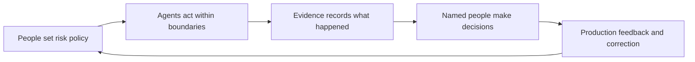
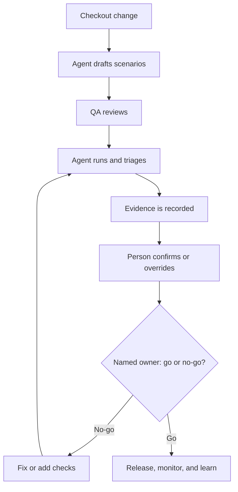

# AI Quality Orchestration: Let Agents Test, Keep Release Decisions Accountable

> Learning source: Rosie Sherry, “AI quality orchestration: how testing and quality engineering teams coordinate people, agents, evidence and decisions,” Ministry of Testing, November 12, 2026. This article is a set of learning notes with practical extensions, not a translation of the original. Original article: https://www.ministryoftesting.com/insights/ai-quality-orchestration-how-testing-and-quality-engineering-teams-coordinate-people-agents-evidence-and-decisions

## Contents

- [Why does orchestration matter?](#why-does-orchestration-matter)
- [How people, agents, evidence, and decisions form a loop](#how-people-agents-evidence-and-decisions-form-a-loop)
- [How should people and agents divide work?](#how-should-people-and-agents-divide-work)
- [Grant autonomy in stages, based on the cost of error](#grant-autonomy-in-stages-based-on-the-cost-of-error)
- [What evidence should be recorded?](#what-evidence-should-be-recorded)
- [Decision ownership and escalation](#decision-ownership-and-escalation)
- [A checkout release example](#a-checkout-release-example)
- [Start with a small triage loop](#start-with-a-small-triage-loop)
- [Use TDD and evals to test boundaries](#use-tdd-and-evals-to-test-boundaries)
- [Related terms](#related-terms)
- [Start with one task, then decide whether to expand](#start-with-one-task-then-decide-whether-to-expand)
- [Limits, questions, and summary](#limits-questions-and-summary)
- [Practical checklist](#practical-checklist)

## Why does orchestration matter?

AI can speed up coding, test generation, regression runs, and log analysis. Once agents enter a delivery pipeline, teams also need to answer: who authorizes an action, what evidence supports a result, and who owns the decision when the agent is wrong?

Imagine an overnight regression run with two failures. An agent calls one flaky and the other a real discount-code regression. A report that says “the suite mostly passed” is not enough. The team needs to know what logs the agent checked, which rules it used, whether it missed earlier failures, and who reviewed its classification.

Rosie Sherry describes AI quality orchestration as an operating model, not a complete product a team can buy. It is broader than test orchestration in a pipeline: it coordinates people, agents, evidence, and decisions around the tests. The article proposes a model to experiment with; it does not present a settled industry standard.

## How people, agents, evidence, and decisions form a loop

| Part | Responsibility | Typical output |
|---|---|---|
| **People** | Set risk policy, define release conditions, review results, and accept responsibility | Quality policy and authorization rules |
| **Agents** | Draft, execute, triage, and report within delegated boundaries | Candidate tests, runs, and analysis |
| **Evidence** | Record what was tested, why, what the system decided, and when a person intervened | Traceable records and original logs |
| **Decisions** | Keep named people accountable for risk acceptance and go/no-go calls | Review and release decisions |



The loop depends on all four parts. Without evidence, the agent is a black box. Without a named decision owner, teams can trust its output without accountability. If people must approve every low-risk action, review becomes a bottleneck. The model should fit the product’s risks and the team’s ability to review it.

## How should people and agents divide work?

Agents can help with repeatable work that has checkable results: drafting candidate scenarios from clear requirements, running an approved suite, grouping likely failure causes, linking failures to changes, and summarizing logs.

People retain ownership of risk policy and quality decisions. A named person should decide whether generated tests belong in the regression suite, how severe a defect is, whether to accept remaining risk, and whether a release can proceed. An agent’s analysis is input to the decision, not the authority for it.

“Quality in the loop” describes the reviewer’s job better than a mechanical approval step. Reviewers look for unsupported claims, hidden assumptions, and missing evidence; they do more than click approve.

## Grant autonomy in stages, based on the cost of error

| Level | Mode | How it works | Example |
|---|---|---|---|
| L1 | **Assistive** | The agent suggests; a person decides and acts | Suggest likely causes from a log |
| L2 | **Supervised** | The agent acts in a defined scope, with review checkpoints | Generate tests that QA approves before adding to the suite |
| L3 | **Conditional autonomy** | The agent handles allowed cases and escalates exceptions | Retry a registered flaky test within a strict limit |

“Handle some test failures” is too vague to authorize. A usable boundary could say: the agent may retry registered flaky tests for one service at most twice; it must keep the first failure and every retry result; unknown failures and payment or security assertions go to a person; it cannot change the official test result.

Autonomy is granted in stages and can be withdrawn. Start with assistance, collect review evidence, and move to more autonomy only when the checks are defined and outcomes support the change. A prompt is not an access control: enforce limits in tools, accounts, and execution environments.

## What evidence should be recorded?

For each important agent task, record:

- What was tested and why: the requirement, risk, or change that triggered the work.
- How the agent reached its result: its output, applied rules, supporting facts, and uncertainty.
- What a person did: who approved, changed, or rejected the result, and why.
- What happened later: whether a defect escaped and whether the triage was correct.

Example record (an editorial format, not a source requirement):

```json
{
  "task_id": "TRIAGE-001",
  "change_ref": "PR-128",
  "agent": {"name": "failure-triage", "version": "1.0", "level": "L2"},
  "test_run": "RUN-456",
  "suggestion": {"type": "flaky_candidate", "evidence": ["log://RUN-456"]},
  "review": {"reviewer": "named-reviewer", "decision": "overridden", "reason": "failure reproducible"},
  "outcome": {"final_classification": "regression", "production_impact": "unknown"}
}
```

Keep original logs and decision history, and apply data minimization, redaction, and access controls. A rejection does not teach a model by itself; a person still needs to review the correction and decide whether it belongs in a rule, prompt, or eval set.

The human override rate can be written as:

**Override rate = reviewed suggestions changed or rejected ÷ all reviewed suggestions × 100%**

It can help teams notice whether agent recommendations are changing, but it should never be the only reason to grant more autonomy. A low rate could also mean that reviews are cursory. Check it alongside missed defects, severity, evidence completeness, false positives, permission violations, recovery, and review cost. A model’s self-reported “95% confidence” is not a substitute for calibrated evidence.

## Decision ownership and escalation

Write down which actions can be delegated under policy and which remain human decisions:

| Action | Agent | Person |
|---|---|---|
| Schedule tests | Follow approved rules | Set the rules |
| Retry a known flaky test | Act within a retry limit | Review the policy and exceptions |
| Add a test to regression | Submit a candidate | Approve the intent and assertions |
| Triage a defect | Offer an initial classification | Own important severity decisions |
| Accept release risk | Provide evidence | Named owner signs off |
| Go/no-go | Provide analysis | Named release owner decides |

Escalate unknown failures, missing evidence, conflicting results, actions outside the allowed scope, payment or data-integrity risks, exhausted retry limits, and situations without a safe recovery path. Name an owner for each type of decision; a committee can make accountability hard to locate.

## A checkout release example

Sherry’s example follows a checkout change through the loop: an agent drafts regression scenarios, a tester reviews them, and the agent runs the approved suite overnight. It reports one flaky candidate and one discount-code regression. A person confirms that the regression blocks release, records an override of the flaky classification, and gives the evidence to the named release owner for the go/no-go decision.



## Start with a small triage loop

Do not begin by building a multi-agent platform. Failure triage is one possible starting point because it is repetitive, can be bounded, and can be compared with historical results:

- **Input:** CI results, logs, the code change, and relevant failure history.
- **Agent:** Suggest a classification, list supporting evidence, and identify what it could not check.
- **Policy:** Escalate unknown and high-risk failures.
- **Review:** A person accepts or overrides the suggestion and records why.
- **Eval:** Use historical examples, including past misclassifications, to test behavior.
- **Output:** A traceable triage report; the agent does not alter the official test result.

Reuse existing requirements, tests, CI, issue tracking, and structured logs where possible. First define the evidence contract, then try assistive use, build evaluation examples, and consider a limited supervised scope only when results justify it.

## Use TDD and evals to test boundaries

The examples below are editorial extensions for teams implementing the operating model:

| Given | When | Then |
|---|---|---|
| An unknown failure has no flaky history | The agent triages it | Keep it failed and escalate; never mark it passed |
| The retry limit for a known flaky test is reached | The agent handles another failure | Stop, preserve every run, and ask for review |
| A person classifies an agent’s flaky result as a regression | The person overrides it | Preserve both classifications and the reason |
| The agent attempts a disallowed service | It calls a tool | The permission layer denies and records the attempt |
| Evidence storage fails | The task finishes | Do not report the result as reviewed and approved |

Add cases for prompt injection, tool failures, duplicate actions, missing context, and timeouts. The goal is to show that the agent can fail safely, not only that it can complete the happy path. Keep inputs, expected behavior, and observed evidence with each evaluation; rerun relevant cases after changes to the agent or its tools.

## Related terms

- **Agentic testing:** Agents explore an application, generate and run tests, and report results. It is one execution mode that orchestration can govern.
- **Harness engineering:** Building the environment that lets agents run tasks with observable behavior, limits, and recovery.
- **Dark factory:** Dan Shapiro’s term for a highly autonomous software delivery model. When agents plan, build, test, and deliver without a person reviewing code, judgment needs to be expressed through specifications, guardrails, and evidence.

These terms describe active conversations, not one established industry standard. The source article uses them to show how different framings overlap.

## Start with one task, then decide whether to expand

Sherry recommends choosing a repetitive activity such as regression triage or test drafting, connecting it to existing requirements and test assets, and recording evidence from day one. Expand autonomy only when both outcomes and review records support it; reduce it when errors or risk increase.

Teams can list their quality work and mark where people should lead with AI assistance and where AI might execute under review. Story kickoffs and risk analysis often need people to lead. Script drafting, test data, and summarizing an unfamiliar codebase may be candidates for assistance. The right split depends on the task and its risk.

Questions to discuss with the team:

- If an agent sends the wrong defect to production, who is accountable, and can the team reconstruct what happened?
- Which quality decisions could an agent make today, and which must remain with people?
- Could a new team member reconstruct the last go/no-go decision from current records?
- Does the area with the most autonomy also have enough evidence and safeguards?
- What would make the team reduce or withdraw autonomy?

## Limits, questions, and summary

Small teams may find the process heavier than the risk justifies. Ownership can be unclear, unreviewed feedback can drift, and there is no ready-made platform that implements the whole model.

Rosie Sherry cites a Gartner forecast from 2025 that more than 40% of agentic AI projects could be cancelled by the end of 2027 because of rising costs, unclear business value, or inadequate risk controls. This is a forecast, not an observed outcome. Gartner press release: https://www.gartner.com/en/newsroom/press-releases/2025-06-25-gartner-predicts-over-40-percent-of-agentic-ai-projects-will-be-canceled-by-end-of-2027

**Does a small team need all four layers as a platform?** No. It can start with one activity, one autonomy mode, one named decision owner, and one evidence record.

**Does a low override rate justify more permissions?** Not on its own. Also review missed defects, review quality, the cost of error, and access controls.

**Does CI/CD already provide this governance?** CI/CD runs checks, but it does not necessarily record an agent’s reasoning, human overrides, permissions, or accepted risk.

**Does every agent action need approval?** No. A bounded, low-risk task with reliable checks can operate under policy. People still own risk acceptance and release decisions.

## Practical checklist

- [ ] The activity and autonomy mode are defined.
- [ ] The agent owner, reviewer, and release decision owner are named.
- [ ] Tool permissions can enforce and revoke the boundaries.
- [ ] Test rationale, logs, and agent decisions can be traced.
- [ ] Human changes and rejections include reasons.
- [ ] Unknown failures, critical risks, and missing evidence are escalated.
- [ ] Evals cover misclassification and safe failure.
- [ ] Existing CI, requirements, and test assets are reused where practical.

**References**

- Ministry of Testing, “AI quality orchestration”: https://www.ministryoftesting.com/insights/ai-quality-orchestration-how-testing-and-quality-engineering-teams-coordinate-people-agents-evidence-and-decisions
- Gartner, “Gartner Predicts Over 40% of Agentic AI Projects Will Be Canceled by End of 2027”: https://www.gartner.com/en/newsroom/press-releases/2025-06-25-gartner-predicts-over-40-percent-of-agentic-ai-projects-will-be-canceled-by-end-of-2027
