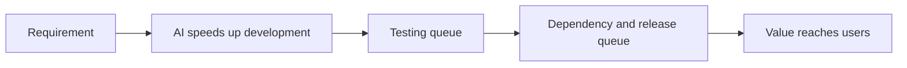
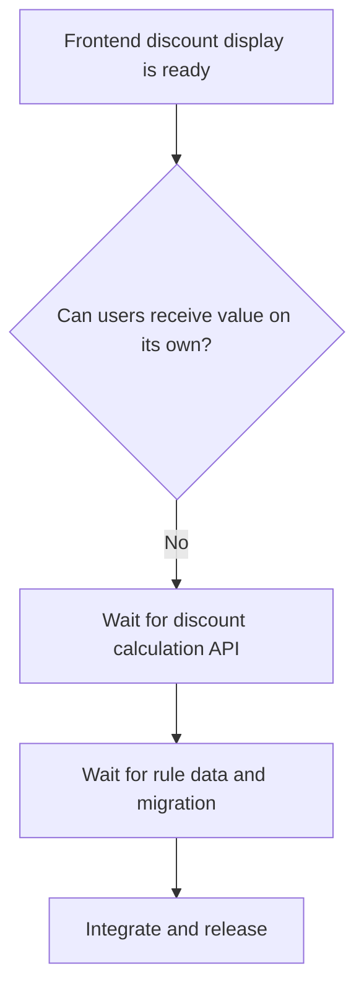
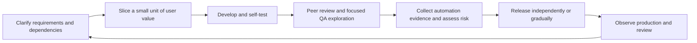

# Why Faster AI-Assisted Development Can Leave Testing Teams Busier

## Contents

- [Why faster development does not always speed up delivery](#why-faster-development-does-not-always-speed-up-delivery)
- [Where the testing backlog comes from](#where-the-testing-backlog-comes-from)
- [Shared quality does not remove QA](#shared-quality-does-not-remove-qa)
- [Why dependencies surface near release](#why-dependencies-surface-near-release)
- [Where AI can help](#where-ai-can-help)
- [How to run a four-week pilot](#how-to-run-a-four-week-pilot)
- [Frequently asked questions](#frequently-asked-questions)

## Faster coding does not mean users receive value sooner

AI can speed up coding without shortening the time from a requirement to usable software. If testing remains a handoff after development, or work items depend on one another in ways the team has not addressed, AI may make the queue longer. First identify the bottleneck, then change collaboration and work slicing, and finally decide where AI can reduce cost.

## Why faster development does not always speed up delivery

Cassandra H. Leung describes two kinds of feedback from teams: developers are submitting more merge requests than testers can keep up with, and product teams have a “Ready for Deployment” column full of work waiting on other items. People begin asking whether more AI can speed things up.

It helps to distinguish two kinds of speed:

- **Local output speed**: writing code, submitting PRs or MRs, generating tests, or completing an individual technical task.
- **End-to-end delivery speed**: the time from understanding a user need to making usable value available to that user.

If downstream capacity and collaboration stay the same, more upstream output can create a longer queue. The diagram is illustrative; it is not data from the original article:

## Where the testing backlog comes from

A common pattern is to hand work to QA after development: a developer marks a ticket Ready for QA, QA owns all verification, failures go back for a fix, and QA tests again. When AI increases the volume of changes, this handoff can create a queue. QA may not have become slower; the existing workflow may simply be unable to absorb more change.

Possible causes include limited testing experience among developers, automation frameworks only QA can use, a Definition of Done without the required checks, no self-test evidence when work is handed over, and an assumption that QA alone owns quality risk.

The question is not whether QA should test less. It is why basic verification starts only after the feature is complete and why it falls almost entirely to QA.

## Shared quality does not remove QA

Leung spends about half her time embedded with a product team and the other half on the company’s AI enablement team. She says she could keep up with testing at that half-time capacity because developers also tested their work. She paired with and coached developers on testing and the automation framework. Developers self-tested and usually asked another developer to review; they brought in QA for higher-risk work or deeper review. Automation was maintained as part of feature work instead of being deferred to a separate ticket.

| Practice | Waiting it can reduce | What to confirm |
| --- | --- | --- |
| Developer self-testing | Sending basic problems to QA | Checks correspond to behavior and have execution evidence |
| Pairing and coaching | Testing knowledge concentrated in a few people | Practice with real requirements, not only tool commands |
| Shared automation framework | Only QA can write and debug tests | Developers can run, debug, and maintain it too |
| Risk-based QA involvement | Every task waiting for QA | Clear review rules for security, permissions, and critical data |
| Automation maintained with the feature | Test debt deferred indefinitely | Choose unit, API, integration, or E2E checks based on risk |

Shared quality does not eliminate QA or require every role to do the same work. Developers should verify their changes. QA can spend more time on test strategy, deeper exploration, cross-module risks, coaching, and quality evidence. Product and technical leaders still need to clarify business rules, architecture choices, and release risks.

## Why dependencies surface near release

Another queue appears at “Ready for Deployment.” Task A is complete but cannot ship until B is ready; B in turn depends on C. These blockers often originate in how work is split during discovery and refinement.

For example, a team might split “order discounts” into database, backend API, and frontend display tasks. Each can be developed separately, but none may deliver a usable discount feature on its own. AI can finish one task earlier without removing its dependencies on the others.

Teams can slice work vertically by user value: deliver one basic discount first, expand to more rules next, and add combinations later. Each slice should include the front-end, back-end, and data work needed for that value. Infrastructure, migrations, or external dependencies cannot always be split away. In those cases, make them explicit prerequisites with owners, integration order, and coordination time.

Feature flags can separate deployment from enabling a feature and help control release risk. They cannot replace dependency discovery, refinement, or cross-team communication.

### Dependency questions for refinement

- What independent, testable value will users receive when this work is complete?
- Does release have to wait for another task? If so, is that recorded as a prerequisite?
- Which APIs, databases, teams, and version compatibility requirements are involved?
- Can technical tasks be combined into smaller end-to-end value slices?
- If they cannot be split, are integration order, joint testing time, and release constraints clear?

## Where AI can help

AI can lower the cost of addressing root causes, but it should not just automate a handoff that is already creating a queue:

| Difficulty | How AI can assist | What the team still needs to confirm |
| --- | --- | --- |
| Developers are unfamiliar with test design | Suggest boundary conditions and draft test scaffolds | Business expectations and assertion quality |
| Automation is expensive to maintain | Help diagnose and update stale tests | Repeatability and false positives |
| PR impact is unclear | Find callers and possible side effects | Actual code, configuration, and dependencies |
| Task splitting hides blockers | Suggest vertical slices and dependency order | Whether each slice can deliver value independently |
| Testing backlog is growing | Summarize wait time and rework patterns | Whether the bottleneck is skill, handoff, or another dependency |

In a comment on the original article, Lisa Crispin also observed that AI can amplify good and bad team practices. That is a useful reminder: tools can help find dependencies and prepare checks, but they cannot replace trust, shared ownership, and reliable engineering practices.

## How to run a four-week pilot

The following is a suggested pilot, not a requirement from the original author or a promise that team culture will change in four weeks:

| Week | Try | What to inspect |
| --- | --- | --- |
| 1 | Review recent work and distinguish testing waits from dependency waits | Baseline for queue time, rework, and blockers |
| 2 | Choose one small feature for developer self-testing and pairing | Self-test notes, execution evidence, and defects found |
| 3 | Review dependencies and value slices for new work | Prerequisites and whether slices can ship |
| 4 | Compare the pilot and review the results | Changes in waiting and rework, risks, and team feedback |

Measure end-to-end delivery time, testing queue time, dependency wait time, rework and retesting, and production quality. Do not use PR count or self-test checkboxes as the only success measure. If speed improves while production issues get worse, revisit the controls.

## Frequently asked questions

**If developers test, do we still need QA?**

Yes. QA does not need to be a repeated acceptance gate for every item, but still contributes test strategy, deeper exploration, coaching, and cross-system risk analysis. High-risk changes may still need independent verification.

**Must every task be independently releasable?**

No. Aim for smaller, complete units of user value. Dependencies that cannot be split should be recorded and coordinated in advance.

**Are feature flags useless?**

No. They can keep a deployed feature disabled, but they do not resolve hidden dependencies or poor task decomposition.

**Can we start with AI testing tools?**

AI can reduce clear sources of repetitive work, but first identify the cause of the backlog. Otherwise it may simply move work into a longer queue faster.

The article’s point is not that AI suddenly created team backlogs; it made existing handoff and dependency problems more visible. Testing queues call for shared quality work. Release waits call for better discovery, slicing, and coordination. AI can support those changes but cannot make the organizational decisions for a team.

This is the third article in the “Rethinking Software Quality in the AI Era” series. It looks at how quality ownership and delivery dependencies shape everyday collaboration.

## References and further reading

- Cassandra H. Leung, “Drowning in a Testing Backlog? Your Problem Isn’t AI, It’s Culture,” November 11, 2026: https://www.cassandrahl.com/blog/drowning-in-a-testing-backlog-your-problem-isnt-ai-its-culture/
- Lisa Crispin’s comment on the original article: https://www.cassandrahl.com/blog/drowning-in-a-testing-backlog-your-problem-isnt-ai-its-culture/
- Martin Fowler, “Feature Toggles (aka Feature Flags)”: https://martinfowler.com/articles/feature-toggles.html
- Agile Manifesto, “Principles behind the Agile Manifesto”: https://agilemanifesto.org/principles.html

## More Resources

- Personal website: [https://inaodeng.com/en/](https://inaodeng.com/en/)
- AI-generated test detection project: [https://github.com/AI-Native-QA-Lab/ai-test-auditor](https://github.com/AI-Native-QA-Lab/ai-test-auditor)
- DeepSeek QA Workbench: [https://github.com/naodeng/dsh-qa](https://github.com/naodeng/dsh-qa)
- More AI testing skills: [https://inaodeng.com/en/qaskills/](https://inaodeng.com/en/qaskills/)
- More testing wiki: [https://inaodeng.com/en/wiki/](https://inaodeng.com/en/wiki/)
- More AI Wiki: [https://inaodeng.com/en/AIWiki/](https://inaodeng.com/en/AIWiki/)
