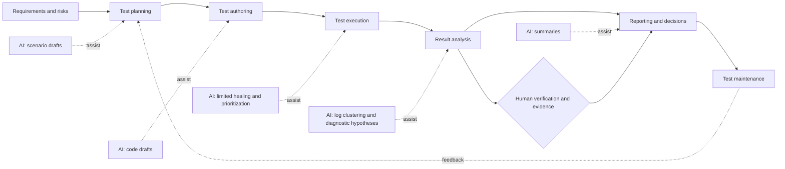
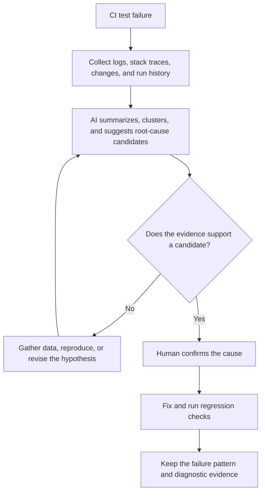
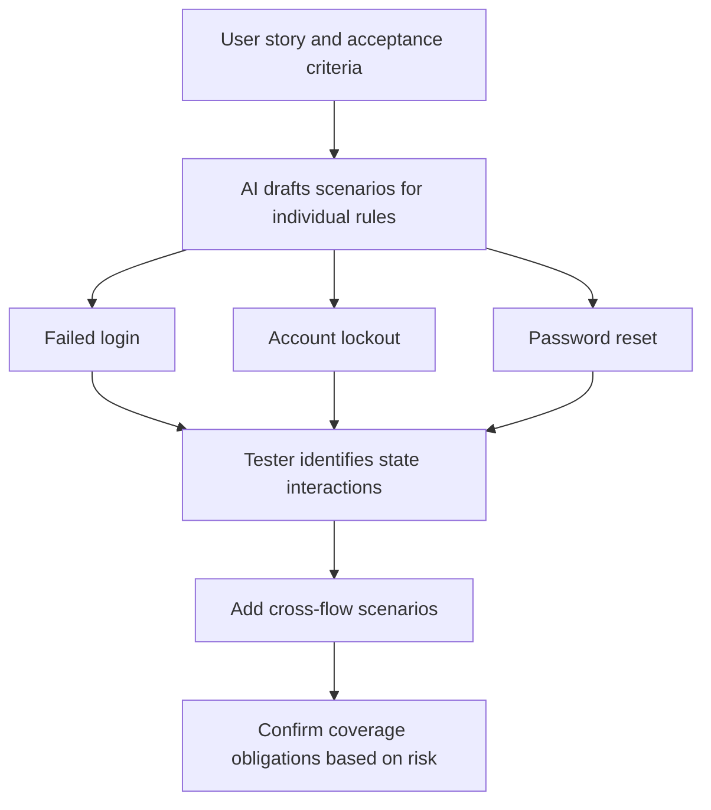
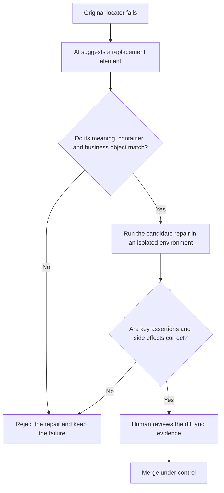
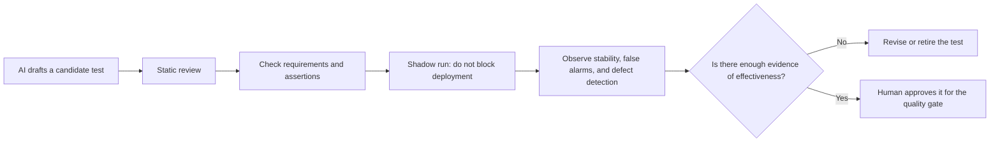
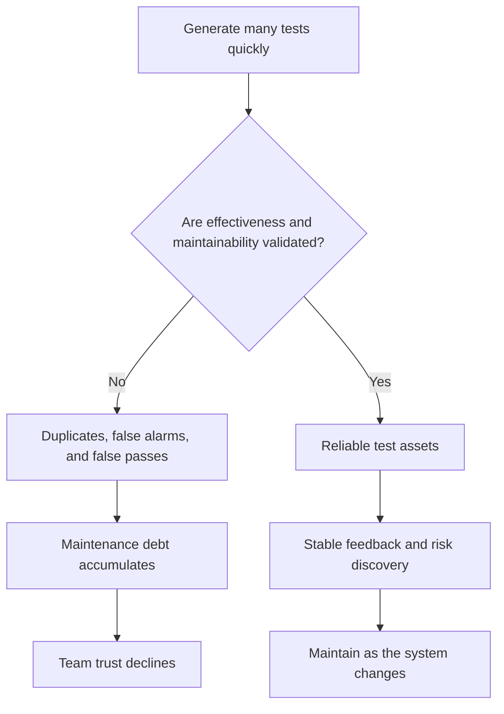
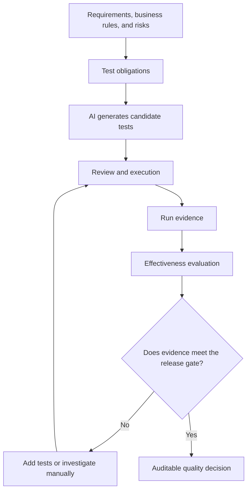

## The central point: AI helps, but a polished demo is not evidence of value

Atulpriya Sharma examines AI across the software testing lifecycle (STLC)—planning, authoring, execution, analysis, reporting, and maintenance. Lucio Daza's commentary emphasizes that failure analysis has the strongest case and scenario drafting can help in practice, while self-healing locators and unreviewed test generation are easy to oversell.

To judge AI in testing, look at the specific stage, the input it receives, the evidence its output provides, and who remains accountable for the final decision.



## Where AI helps across the six stages—and where it falls short

| STLC stage | Useful AI work | Common failure or overclaim | Judgment to retain |
|---|---|---|---|
| Planning | Draft positive, negative, and boundary scenarios from a PRD, user story, or acceptance criteria | Interacting conditions and risk prioritization; “AI can create a complete test strategy” | People confirm business risk, coverage, and priority |
| Authoring | Draft test code and boilerplate | Meaningless assertions, duplicates, or unstable generated output | Review assertions and maintainability; validate test effectiveness |
| Execution | Narrow repairs after selector changes, test prioritization, visual-difference assistance | Failures caused by timing, data, environment, or concurrency; “fully autonomous execution” | Check behavioral consistency before and after a repair, and verify failure causes |
| Analysis | Summarize logs, cluster failures, classify flaky tests, suggest root-cause candidates | Treating a possible cause as a proven root cause | Validate hypotheses against run evidence |
| Reporting | Turn test results and trends into readable summaries | Packaging upstream errors as confident conclusions | Check sources, denominators, time range, and conclusions |
| Maintenance | Reviewed and validated tests may reduce later rework | Bulk generation without review can create maintenance debt | Retain ownership, change review, and a retirement process |

The source article says AI is more likely to help with unit and integration tests when scope and expected results are clear. End-to-end tests are more affected by environment and timing; performance testing also depends on baselines and load conditions. The same effectiveness assumptions do not fit every test type.

## Failure analysis: the strongest place to start

After a CI failure, a person often has to switch between long logs, earlier runs, recent changes, and environment details. AI can first compress the information and organize clues; it should not declare the root cause on its own.

The source article cites Google's Auto-Diagnose research: **the correct root cause was identified in about 90% of 71 manually reviewed integration-test failures**. That is a result from a specific research sample. It does not mean every team will achieve 90% accuracy after adding a model, or that human confirmation is unnecessary.



**Engineering extension:** Evaluate failure analysis by time to diagnosis, human verification effort, misleading suggestions, reproduction success, and differences across languages and frameworks—not just by whether an explanation sounds plausible.

## Scenario drafting: good at expanding a checklist, not guaranteeing completeness

Given a PRD or user story, AI can quickly list common happy paths, error paths, and boundary conditions. A polished list can still miss important combinations when several business rules interact.

For example, login, failed-attempt lockout, and password reset may each look reasonable in isolation, yet the combined flow—resetting a password after repeated login failures and then trying to sign in—can be missed.



| Testing one feature at a time | Interactions that still need checking |
|---|---|
| Show an error after failed login | Do repeated failures trigger lockout or rate limiting? |
| Complete a password reset | Can a user sign in after resetting a password while locked out? |
| Sign in with the new password | Are old sessions and credentials invalidated? |
| Accept an email or SMS verification code | Are reuse, expiration, and replay handled? |

**Engineering extension:** Treat AI output as candidate scenarios. Use state transitions, decision tables, boundary-value analysis, risk modeling, and requirements traceability to check it; do not use the number of scenarios as a proxy for complete coverage.

## Self-healing locators: fixing a selector does not mean the test is fixed

The source article limits self-healing to a narrow case: **the element's selector changes, but the element's business meaning stays the same**. It is not a general solution to flaky tests.

In one study of **161 flaky-test fixes** cited by the source article, about **45%** involved asynchronous waits and about **20%** involved concurrency. Those percentages classify fixes in that study's sample; they should not be generalized to every project's flaky-test causes.

The more serious risk is a **false pass**: an automatic repair points the locator to an element that looks similar but has a different meaning, allowing a test that should fail to pass.



**Engineering extension:** Record the old and new locators, page snapshot, element meaning, reason for the change, run evidence, and approver for each automatic repair. “The test passed after the repair” is not enough to approve it.

## AI-generated tests: passing does not mean effective

The source article warns that an AI-generated test may **compile, run, and pass while asserting nothing important about behavior**. That is a different question from whether the test code is neatly written.

For example, this test checks only that the API returned a success status; it does not verify that an order was created or that its amount is correct:

```javascript
// Counterexample: a green check does not prove the business behavior
const response = await request.post('/orders', { data: order });
expect(response.status()).toBe(200);
```

A stronger test checks the important outcomes against a confirmed business contract and uses independent evidence to verify side effects. The exact assertions must come from the project's real requirements; AI should not invent them.



A **shadow run** executes a new test alongside the production suite and records its results, but does not yet affect the deployment decision. It helps reveal stability, but cannot by itself prove that a test finds real defects. Assertion review, fault injection, mutation testing, or replaying known defects may provide additional evidence.

## Reporting and maintenance: downstream costs are easy to miss

AI can turn complex test data into a readable team summary, but if the analysis upstream is wrong, the report can make the wrong conclusion sound more authoritative. Quality reports should distinguish **observed facts, AI inferences, and conclusions confirmed by a person**.

Test maintenance is not a matter of “generate as much as possible.” If bulk-generated tests are repetitive, have weak assertions, or rely on fragile data, a short-term rise in test count can become long-term maintenance debt.



## How to tell whether it is really helping

The following is an **engineering extension**, not a standard industry scorecard from Testkube. Treat an AI adoption as an engineering change to evaluate, not as a tool purchase that is assumed to have worked.

| Dimension | Signals to observe | Misreading to avoid |
|---|---|---|
| Efficiency | Total time for work of comparable quality, including human review | Counting generation time but not rework |
| Effectiveness | Real defect detection, assertion quality, and risk coverage | Treating test count or pass rate as quality |
| Reliability | False-positive and false-negative rates; stability across environments | Showing only one successful demo |
| Explainability | Whether logs, sources, inferences, and verification evidence are traceable | Treating a model explanation as fact |
| Security and compliance | Whether sensitive data is permitted in a third-party model | Ignoring exposure of code, logs, or credentials |
| Maintenance cost | Later change, diagnosis, and retirement effort | Counting only the initial generation benefit |

AI-native QE can be organized into three responsibilities: **AI proposes candidates, quality engineering validates them, and delivery governance decides whether to rely on them**. This keeps the efficiency gains while avoiding unverified model output becoming a release decision.

## How to read the cited numbers and research

| Figure or claim | What the source actually supports | What it does not establish |
|---|---|---|
| Auto-Diagnose: about 90% correct localization among 71 failures | Manually reviewed integration-test failures in one specific study | That every AI root-cause tool is 90% accurate |
| Of 161 flaky-test fixes, 45% involved async waits and 20% concurrency | Classification of fixes in the cited study's sample | That every team's flaky tests have the same cause distribution |
| 89% of organizations piloting or deploying GenAI, 15% at enterprise-wide implementation | World Quality Report 2025 figures quoted by Testkube | That 89% have scaled GenAI or achieved a confirmed ROI |
| AI works better for failure analysis and scenario drafting | A stage-by-stage synthesis in the two articles | That AI performs equally across all test types, projects, and stacks |

These figures can inform research questions and pilot hypotheses, but they do not replace measurement against a team's own baseline.

## Further thought: from test automation to test-evidence automation

Discussions often focus on how many tests AI can generate or how many steps it can execute. The two articles point to a more useful question: **do those tests check the right behavior, and can someone review the evidence behind the conclusion?**



From this perspective, AI is most useful for reducing the cost of **information processing, candidate generation, and failure triage**. Requirements, acceptable risk, meaningful assertions, and release safety still need traceable evidence and a clearly accountable decision-maker.

## Conclusion

**AI has real value in testing, but not every stage deserves the same investment.** Failure analysis and scenario drafting are better candidates for early adoption. Self-healing, test generation, and autonomous execution require stricter validation, especially to prevent false passes from creating false confidence in quality.

The useful shift is to free testers from repetitive work so they can focus on risk, evidence, and sound quality decisions.

## References

- Lucio Daza, “Where AI actually helps in testing, and where it just looks like it does,” Ministry of Testing, 2026-11-06: https://www.ministryoftesting.com/moments/where-ai-actually-helps-in-testing-and-where-it-just-looks-like-it-does
- Atulpriya Sharma, “Using AI in the Software Testing Lifecycle,” Testkube, 2026-10-26: https://testkube.io/blog/ai-across-software-testing-lifecycle
- Google Auto-Diagnose, the flaky-test repair study, and World Quality Report 2025 are cited secondhand by the Testkube article. This post has not independently reviewed their original research methods or data.
