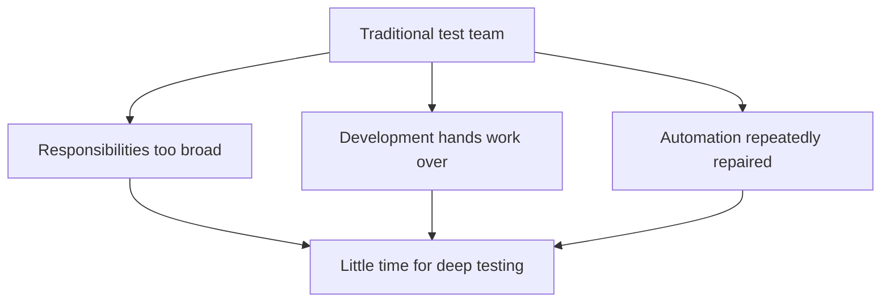
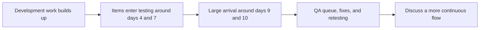

# Quality Engineering at the DVSA: Build Depth and Share Quality Ownership

> Interview: Sam Webb, hosted by Rosie Sherry, Into the MoTaverse, November 11, 2026. These notes draw on the user-provided transcript, Chinese notes, and the official summary, with additional practical suggestions. They are not an official DVSA policy. Official interview: https://www.ministryoftesting.com/media-sessions/quality-engineering-at-the-dvsa-rebuilding-a-test-team-for-depth

## Contents

- [From outsourced delivery to in-house capability](#from-outsourced-delivery-to-in-house-capability)
- [Problems in the team Sam inherited](#problems-in-the-team-sam-inherited)
- [How SDETs and test engineers complement each other](#how-sdets-and-test-engineers-complement-each-other)
- [Quality reaches beyond the test team](#quality-reaches-beyond-the-test-team)
- [Estimate and deliver as one team](#estimate-and-deliver-as-one-team)
- [Build a team that can release safely](#build-a-team-that-can-release-safely)
- [Use flow data to find the delivery bottleneck](#use-flow-data-to-find-the-delivery-bottleneck)
- [Test count is not test value](#test-count-is-not-test-value)
- [Build support and show the value of quality](#build-support-and-show-the-value-of-quality)
- [A staged path for improvement](#a-staged-path-for-improvement)
- [Quality engineering in an AI-heavy workflow](#quality-engineering-in-an-ai-heavy-workflow)
- [Summary](#summary)

## From outsourced delivery to in-house capability

The Driver and Vehicle Standards Agency (DVSA) is responsible for services such as vehicle MOT testing and driving tests. Sam Webb, its Lead Test Engineer, describes a shift from years of relying on vendors and contractors toward building more software engineering capability in-house. He had about 18 years of testing experience when he joined the agency. In roughly two years, the quality engineering team had grown to nearly twice its size and was expected to keep growing.

Sam observed that some contractor work is strongly shaped by delivery deadlines and sprint commitments. An in-house team also has to live with the maintenance cost of the systems it builds. That does not mean every contractor delivers poor quality; incentives and long-term ownership can affect which engineering work receives attention.

He also sees an unfinished sprint as a possible learning opportunity. Protecting a sprint’s appearance of success at the cost of long-term engineering work can create more problems later.

## Problems in the team Sam inherited

**A flat reporting structure left little time for hands-on work.** About 12 test engineers reported to one test manager, who spent most of the time coordinating rather than testing.

**Testing sat outside the delivery work.** When a code change broke automation, test engineers were expected to repair it. One person had refactored the automation pack for the fifth time in seven or eight months.

**The job description expected one person to do everything.** Sam called this the “ninja unicorn” role: analysis, exploration, frameworks, scripts, test data, and tooling all on one person. That breadth leaves little room to build depth.

## How SDETs and test engineers complement each other

| Role | Focus | Contribution |
|---|---|---|
| **SDET** | Test engineering with software development depth | Build shared integration, contract, API, and end-to-end test tooling |
| **Test Engineer** | Technical testing with business and risk judgment | Explore behavior, assess risk, choose what to test, and define tool needs |

Sam resists calling test engineers “manual testers.” They use technical tools such as Postman, Bruno, DataGrip, and automation frameworks. He compares them to product owners for the test framework: they explain what the team needs to verify, and SDETs build tools that the whole delivery team can use.

The team was concerned that this split might create separate “automation” and “manual” camps. To avoid that, tooling should serve the whole delivery team, not only QA. SDETs need to understand test intent, and test engineers can still write code; the roles describe a focus, not a boundary on what someone is allowed to learn.

Cucumber and Gherkin help when product owners and business analysts can read and comment on the scenarios. If the wording circulates only inside the development team, the shared-understanding benefit is lost. Test specialists still need to check that examples and assertions reflect the product behavior.

## Quality reaches beyond the test team

Sam uses these working definitions in the interview:

| Term | Focus |
|---|---|
| Testing | Checking behavior and executing tests |
| Quality control (QC) | Inspecting something already built, such as reviewing code |
| Quality assurance (QA) | Using strategy and process to prevent problems, such as Three Amigos or refinement |
| Quality engineering (QE) | A wider approach to quality across the delivery system |

These are useful distinctions, not the only industry-wide definitions. Product owners contribute business intent and acceptance feedback; business analysts break work into valuable slices; user-centred design considers the user before implementation; developers maintain code and tests; quality engineers guide the quality approach. Shared responsibility still needs clear ownership.

Sam compares quality work with building a garden wall: the builder checks alignment while placing each brick instead of waiting until the wall is finished and hiring someone else to inspect it. Software teams can validate work as they build it too.

## Estimate and deliver as one team

Sam does not want development and testing points treated as isolated estimates. If development is estimated at one or two points but testing at ten, developers can help improve automation. If development is complex but the relevant tests already exist, test engineers can focus on other risks.

Shared estimates keep specialist skills intact while letting the team respond to the work as a whole instead of optimizing for separate role checklists.

## Build a team that can release safely

Sam describes a challenging goal: a small delivery team should still be able to release safely under its agreed risk policy when a test engineer is away. With QA still involved, self-testing, tools, automation, and release controls are part of the team’s normal work. Regulated or high-risk changes may still need independent review.

He also emphasizes shifting right. Teams should ask whether a feature works as specified and whether it is producing the business result people need. That calls for monitoring, business measures, and production feedback as well as early requirement discussions. He warns that too much questioning at the wrong time can slow work down. At the time of the interview, the SDET model was in about half of DVSA delivery teams and the rollout was still gradual.

## Use flow data to find the delivery bottleneck

Teams often say they do not have enough QA capacity. Sam used Jira cumulative flow diagrams across several sprints. He saw very little work enter testing in the first few days, then spikes on days four and seven, followed by a much larger rise on days nine and ten.

That pattern raises questions beyond how quickly QA can test. If many items arrive at the end of a sprint, is there still time to fix and retest defects? Adding capacity may relieve a peak, but it does not automatically remove batch handoffs.

Teams can use cumulative flow data to discuss work in progress, queue size, arrival time, retesting, and end-to-end lead time. One chart cannot prove that a team will never need to hire; it can help replace “we need more people” with a discussion about where work is waiting.

## Test count is not test value

Sam challenges statements such as “we have ten thousand automated tests.” More useful questions are how much those tests cost to maintain, how quickly they identify a problem, and whether they provide useful feedback.

Putting user journeys, database assertions, and API checks into a large end-to-end suite can make it slow and flaky, and can make failures hard to locate. A practical test portfolio might place checks like this:

| Test level | Useful checks |
|---|---|
| Unit or component | Calculations, branches, and local behavior |
| API or contract | Requests, responses, error handling, and compatibility |
| Integration or database | Real dependencies and data consistency |
| Critical end-to-end | A small set of high-value user journeys |

Fast, lower-level feedback should handle checks that do not need a full user journey. End-to-end tests should add distinct business value. Cucumber can support shared understanding; it should not become a reason to put every assertion into one 120-step script. For more on the test pyramid, see Martin Fowler’s practical guide: https://martinfowler.com/articles/practical-test-pyramid.html

Sam recalls a community speaker suggesting that a test which has passed for six months could be “thrown in the bin.” He thought that was too extreme, but saw value in asking whether a test still gives useful feedback. A long-passing test may still protect a critical permission rule. Before deleting or archiving one, check its unique risk value, replacement coverage, maintenance cost, and run frequency.

## Build support and show the value of quality

Sam says a quality leader sometimes has to tell a story and show data. The garden-wall analogy explains quality built into work; the cumulative flow chart helps people see when work is arriving. Defects can also reveal gaps in acceptance criteria, shared understanding, or development assumptions.

He has seen companies remove test engineers and invest heavily in automation without maintaining a quality feedback loop; other organizations later hired test engineers again. This is his industry observation, not a statistic about every company. Automation can repeat checks, but it does not replace deep exploration and quality judgment.

Leaders who control budgets need to see what a quality team contributes. Show evidence such as useful feedback, less rework, healthier test assets, and more reliable delivery instead of relying on test counts alone. External communities can also help teams compare their practices and learn from other organizations.

## A staged path for improvement

The steps below are an editorial extension of the interview, not a DVSA rollout plan:

- **Diagnose:** Review flow data, QA queues, automation maintenance, production defects, and rework across several sprints.
- **Clarify responsibility:** Agree on developer self-testing, shared SDET tooling, deep test engineering, and PO/BA acceptance feedback.
- **Choose a pilot team:** Improve test levels, shared tooling, refinement, and risk review together.
- **Make room for depth:** Reduce repeated confirmation work so QA can explore complex behavior and cross-service risks.
- **Review outcomes:** Track delivery time, waiting, useful feedback, flaky tests, maintenance, and production impact.
- **Decide whether to expand:** Use evidence, not job titles or automation totals.

### Team checklist

- [ ] Developers help maintain tests affected by their code changes.
- [ ] SDET tools are available to the whole delivery team.
- [ ] QA has protected time for exploration and risk analysis.
- [ ] Product owners and business analysts discuss behavior and acceptance.
- [ ] Cumulative flow data is used to spot testing queues and batch arrivals.
- [ ] API, contract, database, and critical end-to-end checks have clear roles.
- [ ] The team reviews low-value tests instead of only adding more.
- [ ] Production feedback informs the test strategy.

## Quality engineering in an AI-heavy workflow

Sam’s closing point is that people who understand good software and quality principles will be well placed as agents write more code. That is his perspective on the direction of the industry, not a forecast with a measured timeline.

For QA teams, the practical extension is to apply the same principles to AI-generated work: know the product and intended behavior, review what was generated, choose the right test layer, and keep evidence of what was checked. More generated code and tests do not automatically mean better coverage or faster feedback.

**Do SDETs and test engineers have to be separate job titles?** Not always. A small team may combine the skills; the goal is to reduce role blind spots and give people time to build depth.

**If developers test their own work, does QA become unnecessary?** No. The team still needs risk analysis, exploration of unexpected cases, and feedback across the system.

**Should every test that passed for six months be deleted?** No. Review whether it protects a unique risk before deleting or archiving it.

**Should AI generate as many tests as possible?** No. Without product understanding, adding tests can increase maintenance without improving feedback.

## Summary

The DVSA interview describes a shift toward specialist depth and shared quality work: SDETs build tools for the delivery team, test engineers focus on risk and exploration, and flow data helps people discuss how work moves. Testing efficiency depends on the value of its feedback, not the size of the test suite.

The material is a case study, not a blueprint every organization should copy. Teams can adapt the role split, test levels, and measures to their product, risks, and delivery model.

**References**

- Ministry of Testing, “Quality engineering at the DVSA: rebuilding a test team for depth”: https://www.ministryoftesting.com/media-sessions/quality-engineering-at-the-dvsa-rebuilding-a-test-team-for-depth
- Martin Fowler, “The Practical Test Pyramid”: https://martinfowler.com/articles/practical-test-pyramid.html
