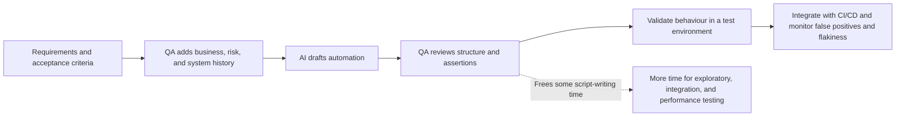
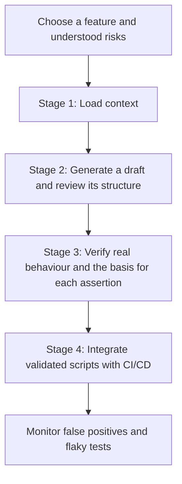
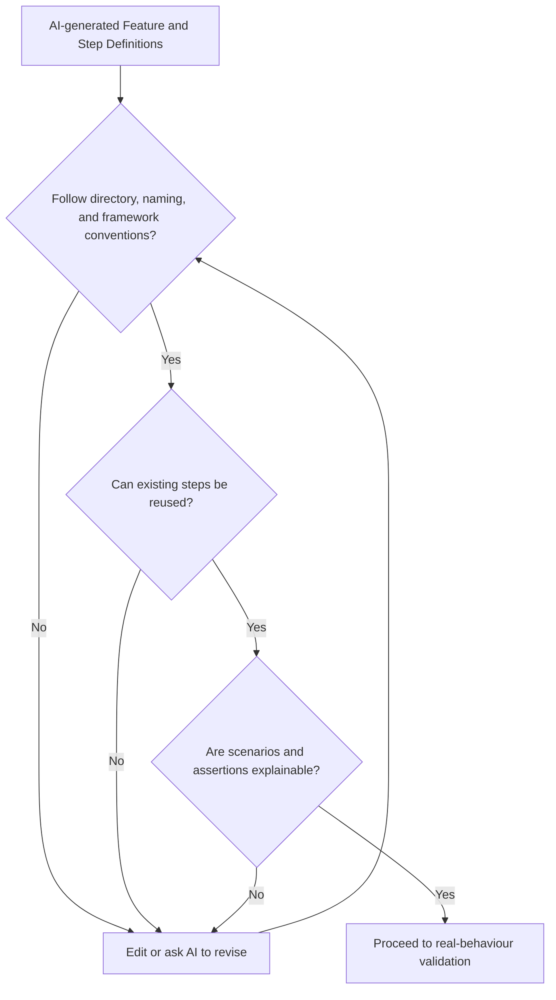
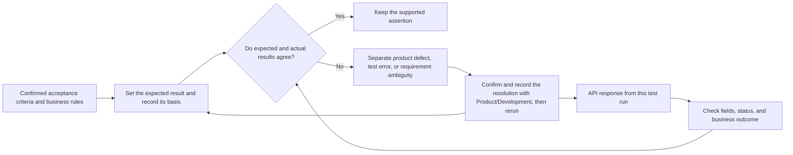
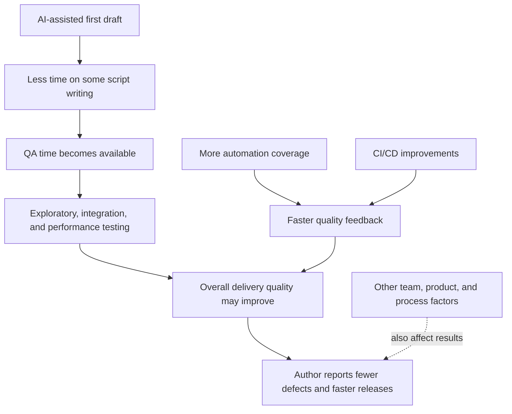
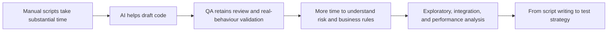
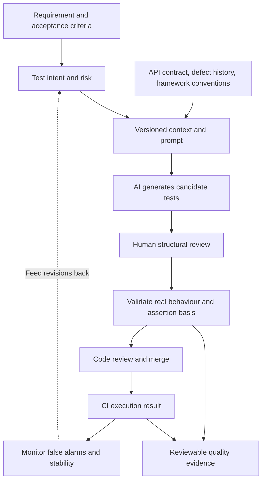

On a high-traffic B2B platform releasing several times a month, QA can spend a large share of its time turning acceptance criteria into automation scripts. By the time testing starts, script writing may already have taken time away from exploratory and integration testing.

In an article for Ministry of Testing, Amna Zafar describes an approach she began exploring in mid-2023. AI works inside a four-stage process with explicit context, human review, validation in a real test environment, and ongoing monitoring. AI drafts the repetitive code; QA decides whether it checks the right behaviour.

Original article: From Script Writer to Test Strategist: https://www.ministryoftesting.com/moments/from-script-writer-to-test-strategist

Zafar is a Senior QA Engineer and ISTQB-certified professional. Her case comes from a core retail application on a high-traffic B2B platform using RestAssured, Cucumber BDD, and Jenkins. This article separates the author's reported experience from engineering suggestions added for teams adapting the approach.

## The shift is from writing faster to testing the right thing

Giving AI a user story and asking for a complete test suite often produces generic scripts. With too little context, AI may guess an endpoint, miss an edge case, or make an assertion that looks plausible but conflicts with a business rule. QA then has to rewrite the output, which can erase much of the time saved.

Zafar treats AI as a first-draft partner in a structured workflow:



Generation speed tells us that code was written faster. It does not prove that the tests cover important risks or that their assertions represent the right business expectations.

## The four-stage workflow



### Stage 1: Load context

Before generating a script, Zafar provides the API contract or endpoint specification, data models, edge cases from previous releases, and the team's RestAssured and Cucumber BDD syntax. Existing Step Definition examples also help the AI follow the team's conventions for organising and naming steps.

| Context for the AI | Question it helps answer |
| --- | --- |
| API contract and endpoint specification | What are the path, parameters, status codes, and response shape? |
| Data model | What are the field types, required rules, and data relationships? |
| Acceptance criteria | Which business behaviours have been confirmed? |
| Historical edge cases | Which past defects or special rules need regression coverage? |
| Framework syntax and existing steps | How should code follow team conventions and reuse? |

The following prompt is rewritten from the structure described in the article; it is not a verbatim prompt from Zafar:

```text
Draft automated tests for an order lookup API using
Java, RestAssured, and Cucumber BDD.

API contract: <paste the confirmed API definition>
Data model: <list fields, types, and constraints>
Acceptance criteria: <list confirmed business rules>
Historical edge cases: <list known defects and regression cases>
Existing Step Definitions: <provide examples used by the team>

Cover the normal path and failure cases. Prefer reusing existing steps.
List each scenario, assertion, and its basis before writing code.
Mark unsupported expectations as “needs confirmation”; do not guess.
```

Accurate context makes a useful first draft more likely. More context still cannot resolve an ambiguous requirement; QA has to get the right people to clarify conflicting acceptance criteria.

### Stage 2: Generate a draft, then review its structure

Zafar does not run the generated tests immediately. She first reads the code like a code reviewer: Does it follow framework conventions? Can it reuse existing Step Definitions? Is the naming consistent? Can a teammate understand the scenarios?

She reports that this structural review usually takes **15–20 minutes**, compared with **2–3 hours** to write an initial draft from scratch. The comparison is between two ways of producing a draft; it does not mean the full test lifecycle shrank by the same amount.

The diagram turns her structural checks into a review path. Repeating review after a revision is an engineering aid, not a fixed step prescribed by the source article.



This review catches code organisation problems, but it cannot prove that expected outcomes are correct. A tidy script can still check the wrong rule every time.

### Stage 3: Validate behaviour and the basis for each assertion

This is the step the workflow must keep. Zafar found that AI can produce assertions that look right but are wrong. For example, it may assume wholesale and retail buyers have the same discount, or insert a fixed value for a dynamically generated order ID.

Do not copy the API's current response into the expected value without checking. The system under test may be defective. Expected results should come from confirmed business rules, the interface contract, or independently prepared test data. If an expected value and a response differ, determine whether the cause is a product defect, a test implementation error, or an unresolved requirement.

| An assertion AI might generate | Why it needs scrutiny | A stronger basis for checking it |
| --- | --- | --- |
| `discountRate` is `0` for every buyer | Retail promotions and wholesale pricing may differ | Approved customer-type rules and independent test data |
| The order ID equals `ORD-10001` | Order IDs are often generated at runtime | The ID returned by creation, its format, and its relationship to the request |
| An HTTP 200 is enough to validate the amount | A status code says nothing about price correctness | Confirmed tax, discount, and rounding rules in the contract |
| An invalid request also returns HTTP 200 | AI may generalise from the successful path | The error contract for the failure scenario |

This engineering example is not the author's actual interface or test code. It checks a dynamic order ID and a rule-based expected amount. The fixture assumes a confirmed wholesale price of 125.00 for `SKU-42`, a quantity of four, and no tax or discount. Map `fixture`, `requestSpec`, and the route to the project's test data and API; keep the expected amount independent of the response:

```java
String orderId = fixture.createWholesaleOrder("SKU-42", 4);
BigDecimal expectedTotal = new BigDecimal("500.00"); // confirmed test rule: 125.00 × 4

Response response = given()
        .spec(requestSpec)
        .pathParam("id", orderId)
    .when()
        .get("/orders/{id}");

response.then().statusCode(200);
assertThat(response.jsonPath().getString("id")).isEqualTo(orderId);
assertThat(response.jsonPath().getBigDecimal("total"))
        .isEqualByComparingTo(expectedTotal);
```

The fixed amount applies only to this fixture's stated rule; a production test must include the applicable discounts, taxes, and rounding conditions. The point is that the order ID comes from this creation request, while the expected amount comes from an independently confirmed rule.

The diagram expands the checks against real behaviour and assertion evidence. Fixing or clarifying a mismatch and rerunning is an engineering path; the source does not prescribe a specific return step.



Change an assertion only when the rule and evidence support the change. Treating the current response as the answer can make a test endorse a defect in the system.

### Stage 4: Integrate and observe

Zafar integrates the validated scripts into Jenkins and watches for false alarms and flaky tests during the first three release cycles. That was the monitoring window in her project, not a universal industry standard.

She also observed that AI drafts can be more fragile with dynamic data because they tend to assert fixed values. For order IDs, timestamps, and asynchronous work, tests should check the relevant business invariant, data relationship, or bounded completion condition. Pattern matching may be more stable than a fixed value, but the business rule should determine the assertion. Do not weaken a check just to remove failures.

| A fragile check | A possible approach (engineering suggestion) |
| --- | --- |
| Order ID equals a fixed string | Check its format and match it to the ID returned by this creation request |
| Timestamp equals fixed text | Check the timezone and allowed time window defined by the contract |
| Wait a fixed number of seconds | Wait for an observable completion condition with a time bound |
| Tests share an account balance that changes | Isolate data and establish repeatable starting state |
| Retry failures until they pass | Keep the failure record and distinguish environment, data, and product causes |

## What the case metrics tell us

Zafar reports that script-writing time per feature fell by about **60%–70%**. This is her observation about writing time in the project, not an independently measured industry result. It does not establish the same reduction in total QA effort.

| Reported outcome | More precise interpretation |
| --- | --- |
| About **60%–70%** less script-writing time per feature | This refers to script writing, not the same reduction in end-to-end test duration |
| Structural review takes **15–20 minutes**, versus **2–3 hours** to write a draft from scratch | The comparison is between different ways to produce a draft and excludes later validation |
| The core retail application had zero post-release defects in the reported Sprint deliveries | A reported result for that period; it does not prove that no defects went undetected or that future releases will be defect-free |
| Production defects across the platform fell by up to **90%**, and release cycles became **50% faster** | Zafar connects these results to increased automation coverage and faster CI/CD feedback as well as AI; they cannot all be attributed to AI |
| More time went to exploratory, integration, and performance analysis | A reported change in work focus, with no specific time-allocation figures |

The article does not provide a full baseline, measurement method, control group, or independent audit. These figures are useful as case observations; they should not be presented as universal causal benefits of AI.



## QA moves from script writer to test strategist

The role change Zafar describes comes from changing how QA spends its time. AI drafts repeatable code; QA puts more effort into understanding risk, checking assertions, and choosing what to test next.

| Focus | Script-writing centred | Strategy work with AI assistance |
| --- | --- | --- |
| Main output | Automation scripts | Risk coverage, supported assertions, and explainable quality evidence |
| Time spent | Hand-writing repeated steps | Business understanding, test design, and result validation |
| AI's role | Mistaken for an automatic generator | A first-draft partner bounded by context and human judgement |
| Definition of done | The script runs and turns green | Assertions have a basis, important risks are checked, and results can be explained |



AI can suggest candidate scenarios, but it cannot decide which risks the team most needs to control. It may miss incorrect acceptance criteria, system history, and rules held only in team experience. Test design and judgement about business expectations remain QA responsibilities.

## The method can travel; domain risks need a fresh review

Zafar considers the four-stage method independent of a particular automation framework. Teams can adapt the workflow to Selenium, Cypress, or Playwright by supplying the relevant syntax examples and team conventions, then reviewing each generated test against that framework's conventions and real behaviour.

Zafar is also exploring how to apply the method in medical technology. She mentions GDPR, NHS data standards, the patient-safety impact of missed issues, and regulatory audit trails. The article describes an area of exploration; it does not report a successful or validated medical-technology deployment. A high-risk setting needs its context, review, and evidence standards assessed against the applicable regulation, data governance, and patient-safety requirements.

## Engineering extension: keep a traceable evidence chain

The following is an engineering suggestion for teams adapting the four-stage method. It is not an architecture that Zafar says she implemented. A critical test can be linked to its requirement and risk, test intent, generation version, human review, assertion basis, and execution result:



That record helps distinguish “how many tests were generated” from “what the tests actually prove.” Teams evaluating AI-assisted testing could also track wrong assertions, review effort, requirement gaps, and run stability. Define those measures for the project's risks; do not derive them from this author's case metrics.

AI can reduce mechanical first-draft work. The code becomes a trustworthy test only when QA validates the requirement, assertions, and real behaviour. Giving the saved time back to test strategy and quality evidence is the practical shift from script writer to test strategist.

Source: Amna Zafar, “From Script Writer to Test Strategist,” Ministry of Testing / MoTaverse, October 30, 2026. https://www.ministryoftesting.com/moments/from-script-writer-to-test-strategist
