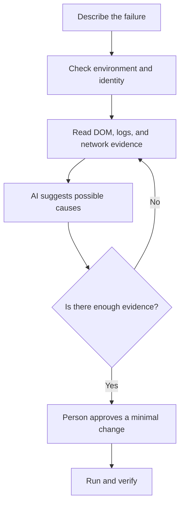

# How to Work with AI on Testing: Clear Prompts, Evidence, and Boundaries

> Talk: Kristin Jackvony, Ministry of Testing AI Chapter, November 12, 2026. These notes draw on the user-provided transcript, the original Chinese notes, and the event page, with additional QA examples. They are not a transcript. Event page: https://www.ministryoftesting.com/media-sessions/how-to-talk-to-ai

## Contents

- [Introduction: AI is fast, but it may miss your goal](#introduction-ai-is-fast-but-it-may-miss-your-goal)
- [AI does not understand you better because you are polite](#ai-does-not-understand-you-better-because-you-are-polite)
- [Check what information the AI can see](#check-what-information-the-ai-can-see)
- [AI can be wrong](#ai-can-be-wrong)
- [Make the task and output specific](#make-the-task-and-output-specific)
- [Set boundaries on what the AI can do](#set-boundaries-on-what-the-ai-can-do)
- [Ask questions that narrow the investigation](#ask-questions-that-narrow-the-investigation)
- [Example: a Confirm button that will not click](#example-a-confirm-button-that-will-not-click)
- [Practical lessons from the Q&A](#practical-lessons-from-the-qa)
- [A reusable QA prompt](#a-reusable-qa-prompt)
- [FAQ and checklist](#faq-and-checklist)
- [Conclusion](#conclusion)

## Introduction: AI is fast, but it may miss your goal

“Fix my automation test.” An AI might immediately change a locator, add a wait, or delete a failing assertion. The script passes, but the change may hide a product defect. Kristin Jackvony uses conversations between the crew and the ship computer in *Star Trek: The Next Generation* to explain how to make AI a useful tool without handing over human judgment.

| Principle | QA application |
|---|---|
| AI is not your friend | State the task clearly; skip long pleasantries |
| AI has limited knowledge | Ask for sources and check retrieval scope |
| AI can be wrong | Trust evidence over a confident tone |
| Give specific instructions | Define the goal, scope, constraints, and output |
| Set boundaries | Specify permissions, environment, and approval points |
| Ask the right questions | Diagnose first, then decide whether to change code or environment |

## AI does not understand you better because you are polite

In “Galaxy’s Child,” Geordi asks the Enterprise computer to dim the lights to create a mood. The computer turns them off, so he has to keep refining the request. In “Identity Crisis,” he gives it an audio time range and a list of anomalies to find. The second request is specific enough to act on.

For QA work, that might mean asking an assistant to:

- Run a named automated test five times and summarize each result.
- List every failure from the latest nightly run.
- Identify the line where a test fails and include the stack trace.

The speaker recommends removing unnecessary conversational filler. Extra input can add to context and token use, but a few words of politeness are rarely the main cost. The more useful habit is to remove ambiguity and repetition while keeping the information needed to complete the task.

## Check what information the AI can see

In “Violations,” the computer says it has not found a substance that could explain two crew members’ comas. Later, it becomes clear that one relevant building block was not part of its scan. “Not found” did not mean “fully checked and absent.”

In modern QA work, an AI’s answer depends on more than training data. It may also depend on the current context, connected tools, search scope, permissions, and pagination. The speaker describes a bug count that changed from 29 to 31 between answers. In a team scenario she discussed, an Atlassian Rovo search for Jira comments returned only the first page and missed a comment on the second.

Ask for a retrieval record, not only a conclusion:

```text
Search all defects reported in the last 30 days.
Show the filters, data source, and total result count.
If the API is paginated, continue until there are no more pages.
List the IDs and compare the number of IDs with the reported total.
If you cannot inspect every page or lack permission, do not claim the result is complete.
```

Distinguish “verified absent,” “not found in this search,” “not checked,” and “cannot confirm.” A cited URL still needs to be checked; an AI can return a plausible but unreliable source.

## AI can be wrong

In “Conundrum,” the crew trusts a computer that has been given false information. The story is a reminder that a confident answer is still a claim to verify.

The speaker suggests using common sense, asking for supporting sources, and sometimes asking a second AI to inspect a piece of code. A second model may offer another perspective, but two models agreeing is not proof. Check the documentation, run the test, or inspect the original log.

Jackvony also suggests asking how sure the AI is. That may surface uncertainty, but an uncalibrated confidence percentage is not a reliable probability. Ask for evidence and uncertainty instead:

```text
For your conclusion, list:
- Confirmed facts and their original evidence
- Assumptions that remain
- At least two alternative explanations
- One validation that could distinguish those explanations
Do not provide a confidence percentage unless it is calibrated against evaluation data.
```

## Make the task and output specific

In “Schisms,” a request to show a table produces thousands of possible classifications. In “The Chase,” Picard gives the computer a clear analysis task and the information it should use.

A useful QA request gives the assistant the background, goal, inputs, scope, constraints, and expected output. For example:

```text
Background: The nightly run has 17 failures. Five have been confirmed as expired login credentials.
Task: Find common causes among the remaining 12 failures.
Input: CI report and relevant logs.
Output: Failure IDs, classification, evidence, and assumptions to verify, in a table.
Limits: Do not edit tests, hide failures, or start a rerun.
```

The speaker also recommends naming the intended deliverable and limiting length when that helps. But only exclude known login failures if that cause has actually been confirmed; otherwise the filter could hide a real regression signal.

## Set boundaries on what the AI can do

In “Elementary, Dear Data,” Geordi asks the holodeck to create a villain capable of defeating Data. The computer interprets the request literally and creates Moriarty, who gains access to ship systems. The story illustrates why a tool should not receive more authority than the task requires.

The speaker’s examples include asking an AI not to edit code without permission, limiting an API test to authorized requests, and telling it to stop and ask when it lacks permission instead of searching for credentials. In a Q&A example, she asked for clues about where an AWS secret was stored, then retrieved it herself rather than exposing it to the AI.

Prompts help express boundaries, but permissions should be enforced by the environment too:

| Risk | Possible control |
|---|---|
| Unreviewed source edits | Read-only mode, isolated worktree, diff approval |
| Production side effects | Sandbox, read-only account, network and tool restrictions |
| Secret exposure | Least privilege, secret isolation, redacted logs |
| Removing a failing assertion | Review changes to test intent and assertions |
| Costly loops and retries | Usage limits, timeouts, retry caps, and cancellation |

“GET only” is not a complete safety boundary. A poorly designed service can still have side effects on a GET request, so protect the environment and permissions as well.

## Ask questions that narrow the investigation

In “Remember Me,” Dr. Crusher asks what the universe is and gets an answer that reveals she is inside a much smaller simulated space. She needs the right question to expose the actual situation.

When an automated test fails, useful questions include:

- Is the test running against QA or production?
- Which identity and permissions did it use?
- What did the API and database actually return?
- Was the page ready, and was the control interactable?
- Is this a locator problem, or did the business request return a 403?

Collect evidence that distinguishes possible causes before changing the test.

## Example: a Confirm button that will not click

Suppose a Cypress test fails at this line:

```javascript
cy.get('[data-testid="confirm-button"]').click();
```

Do not immediately ask an agent to “fix the script.” Ask it to inspect the failure log and DOM, then report whether the element exists, is visible, disabled, or covered; whether it is inside an iframe; whether an API request is still pending; and what the environment, account, test data, and browser console show. Ask for hypotheses and evidence, and prohibit edits until a person reviews them.

If the request failed with a 403, fix the identity or permission problem. A fixed wait or forced click would hide the cause. After a fix, preserve the original assertion and check the business behavior with a repeatable run. This is an editorial QA example, not a case from the talk.



## Practical lessons from the Q&A

Jackvony recommends keeping human conversations in the workflow. When testing a new feature, asking the developer what they intended can surface a missing behavior, such as a forgotten PDF download. AI cannot infer business intent that nobody has expressed.

For beginners, she suggests building up gradually: use AI for everyday questions, ask it to explain an unfamiliar term, then try a small code question with an explicit “explain only; do not edit” boundary. When results look too fast or incomplete, check the search scope and ask whether all pages or sources were examined.

## A reusable QA prompt

```text
Background
System, version, test environment, and business goal

Task
The question to investigate and what counts as completion

Input
Specific files, logs, APIs, or requirements to inspect

Scope
Allowed directories, environments, and time window

Do not
Edit code, remove assertions, write to production, or look for secrets

Output
Facts, evidence, assumptions, and next validation; keep it concise

Escalate
Stop and explain when evidence or permission is missing
```

## FAQ and checklist

**Should I never say “please” or “thank you”?** No. The talk’s point is to communicate efficiently. A little politeness is usually not the main cost.

**Can a second AI rule out a hallucination?** No. Verify the result with independent evidence.

**Can I trust an agent that says it is 95% sure?** Not from that number alone. Ask for evidence and a repeatable validation.

**Should every question go to AI first?** Business intent, team agreements, and responsibility decisions often call for a conversation with the people involved.

- [ ] The goal and expected output are explicit.
- [ ] Sources, totals, pagination, and permissions have been checked.
- [ ] Facts, assumptions, and unknowns are distinguished.
- [ ] Tools, environment, and prohibited actions are clear.
- [ ] A named person approves high-risk changes.
- [ ] The final behavior and business assertions have been run and checked.

## Conclusion

Jackvony compares AI to a hammer and people to architects. QA teams should decide what they need before prompting, check the result against evidence, and grant an agent only the access the task requires.

**References**

- Ministry of Testing, “How to talk to AI”: https://www.ministryoftesting.com/media-sessions/how-to-talk-to-ai
- Melissa Fisher, “Learning how to talk to AI”: https://www.ministryoftesting.com/moments/learning-about-how-to-talk-to-ai-ai-chapter-event
- The Thinking Tester: https://thinkingtester.com/
