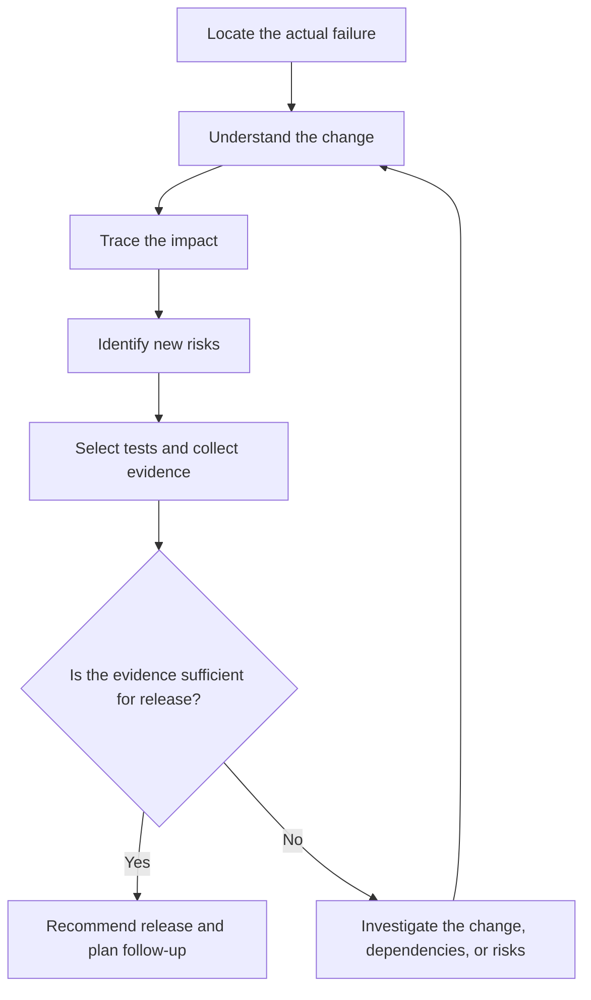
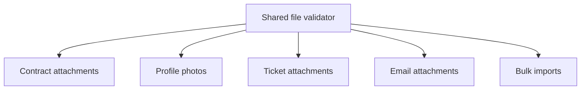
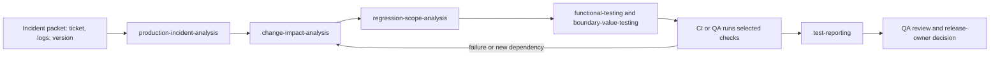

# How Should You Test a Hotfix? From Bug Verification to Risk-Based Release Decisions

> Reading source: Hanisha Arora, “How to test a hotfix,” WonderProxy Blog, November 11, 2026.
>
> WonderProxy Blog: https://wonderproxy.com/blog/how-to-test-a-hotfix/

This article first summarizes the source’s approach to hotfix testing. The file-upload scenario, risk-level table, release-decision template, AI Native QA and Skills workflow, and checklists are practical extensions. The examples illustrate a method; they are not records of tests from a real project and should be adapted to the product’s rules.

## Why Hotfix testing cannot stop at the original bug

Suppose it is 5 p.m. and some users cannot upload contract attachments in production. A developer sends a message: “The hotfix is ready. Could QA verify it quickly?”

One response is to repeat the ticket’s reproduction steps. If the bug does not appear, report “passed.” Another is to run the entire regression suite to be safe. The first can miss side effects from the fix; the second can spend time on paths with no reasonable connection to the change.

The useful questions are different: what changed, where else could it matter, and which checks would provide relevant evidence? Hotfix testing is neither a shortened version of full regression nor a reason to rerun every test indiscriminately. Choose scope around the actual change and its risks, then explain what the evidence supports.

## The six-step hotfix testing loop

Six questions can organize the investigation and testing:

| Question | Work to do |
| --- | --- |
| What is broken? | Separate the user-visible symptom from the system’s actual failure point. |
| What changed? | Identify changes to code, configuration, or behavior. |
| What else does it touch? | Trace callers, business workflows, data, and system dependencies. |
| What could break now? | Turn the change into specific, testable risks. |
| What should I test? | Choose scenarios that provide evidence for those risks, reusing useful tests. |
| Is the evidence sufficient to recommend release? | Summarize passes, failures, unexecuted checks, and residual risk. |



This is not a rigid sequence. A newly discovered dependency or an unexplained result may mean the impact analysis is incomplete. In that case, return to the code, configuration, or business flow instead of mechanically adding more test cases.

## Reproduce the report and locate the real failure

“A user cannot upload a file” describes an observation, not necessarily the defect. The file format may be unsupported, the size may exceed a limit, the user may lack permission, the API may fail, a gateway may reject the request, the frontend may parse the response incorrectly, or the file may be saved while its database record is not. Each cause calls for different checks.

Start by clarifying these conditions:

| Dimension | What to establish |
| --- | --- |
| User | Does this affect everyone or only a particular user type? |
| Data | Which file type, size, or business data triggers it? |
| Environment | Do the browser, device, configuration, or environment matter? |
| Permissions | Do role, resource ownership, or permission state matter? |
| State | Does it happen only in a particular business state? |
| Frequency | Is it consistent or intermittent? |

Locate the actual failure in the request path: did the browser send the request, did a gateway block it, did the backend return an error, or did the frontend mishandle the response? Record a pre-fix baseline so the result can be compared with the same conditions after the change.

| Item | Example record |
| --- | --- |
| Action | Upload a 10 MiB PDF |
| User and state | Standard user editing a contract |
| Actual result | HTTP 413 |
| Expected result | The file uploads if the business rule permits its size |
| Evidence | API response, gateway log, trace ID |
| Reproduction frequency | Every time |

If the problem cannot be reproduced consistently, do not turn “I did not see it again” into “fixed.” Investigate logs, monitoring, timing, user actions, and system state, and record what remains unknown. If evidence points to a gateway or storage layer rather than the application code, revisit the suspected failure point and the proposed fix before signing off. At minimum, establish what the user observed, where the system failed, and what evidence would show that the fix worked.

## Understand what behavior the code change affects

QA does not need to conduct a full code-style review, but should understand what behavior changed. Read the diff, then identify the functions, queries, validations, APIs, permission rules, or configuration it touches.

| Change | Follow-up question |
| --- | --- |
| Shared function | Which modules and business entry points call it? |
| Database query | Which workflows depend on the result? What about empty results, ordering, or old data? |
| Validation rule | Which entry points share it? How are boundaries and invalid inputs handled? |
| API response | Which clients consume its fields and error codes? |
| Permission check | Which roles, resource owners, and permission states are affected? |
| Workflow state | Which entry points can enter or leave that state? |
| Configuration | Could it affect another instance, environment, or service? |

For example, suppose the business limit is 10 MiB. This change adds only one character:

```diff
- return size < 10 * 1024 * 1024;
+ return size <= 10 * 1024 * 1024;
```

The diff is small, but still check whether several entry points share this validator, whether another workflow has a different limit, whether the API or gateway enforces a separate restriction, and whether accepting the exact limit matches the real rule. Understanding the behavior change is what lets you decide what to test.

## Trace the blast radius of the change

The blast radius is the set of callers and business flows a change could reach. Suppose five entry points use the same file-size validator: contract attachments, profile photos, ticket attachments, email attachments, and bulk imports. The ticket may report only contract uploads, but changing the shared function could affect the other four paths too.



Trace impact across four kinds of dependency:

| Dependency | What to inspect |
| --- | --- |
| Code | Function callers, shared-module references, API consumers, and configuration references. |
| Business | User workflows that invoke the changed logic. |
| Data | Fields, historical records, query conditions, and related records. |
| System | Caches, queues, third-party services, gateways, and runtime components. |

For SQL changes, check result sets, ordering, pagination, filtering, and performance where relevant. For validation, check boundaries and invalid input. For permissions, check roles and resource ownership. For APIs, check compatibility and error handling. For shared functions, check the other callers.

Existing checklists can show which paths were checked before, but they cannot replace analysis of this change. The source puts it this way:

> “A checklist tells me what I tested last time. Understanding the change tells me what I should test this time.”

Find the actual callers, select relevant existing tests, and add checks for risks that have no coverage. You do not need full regression for every caller; first determine whether it relies on the behavior that changed.

## Retest the original issue and its trigger conditions

After the fix is deployed to the test environment, rerun the original steps with the same user, data, permissions, state, and environment. If the original scenario still fails, investigate why the fix did not take effect.

Repeating one example is not enough. If the issue occurred at a 10 MiB file boundary, select representative checks around that boundary:

| Scenario | What it verifies |
| --- | --- |
| 10 MiB minus one byte | Behavior immediately below the boundary remains correct. |
| Exactly 10 MiB | The original boundary issue is resolved. |
| 10 MiB plus one byte | Oversized files are still rejected correctly. |
| Different file types | File-type rules have not been bypassed. |
| Different user roles | Permission behavior still matches the business rule. |
| Invalid file contents | The request fails safely without creating a partial or misleading record. |
| Other upload entry points | Their own size limits and handling remain intact. |
| Original trigger absent | Normal behavior is not broken by the fix. |

These scenarios are not a fixed package for every hotfix. Select boundaries, user variations, and business states based on the change. The goal is to verify the condition that caused the defect, not merely to make one original example pass.

## Choose regression checks around the change

Different changes call for different checks:

| Change | Priority checks |
| --- | --- |
| Conditional logic | Behavior when the condition is true, false, and near its boundary. |
| Shared function | Whether other callers still follow their own business rules. |
| Workflow state | Entry from different paths, repeated actions, and invalid states. |
| Database query | Results, historical data, and workflows that depend on the query. |
| Permission logic | Allowed and denied access, role changes, resource ownership, and authorization bypass. |

Questions can expose easily missed risks: do existing affected workflows still work? What changes for another user type? Can historical data still be handled? Are error messages and recovery behavior still reasonable? What happens on the normal path when the original trigger is absent?

These are prompts for analysis, not a requirement to run every check each time. For example, if an upload fix did not touch login logic and no shared dependency was found, there is no reason to retest every login flow merely from general concern. If dependencies remain unclear, record that uncertainty as risk instead of assuming there is no impact.

## How much testing is enough? Let risk set the depth

Testing should be neither limited to the original bug nor expanded without a reason because “anything could break.” At least four factors should shape the effort:

| Risk factor | Question |
| --- | --- |
| User impact | How many people are affected? Is this a critical user journey? |
| Business impact | Does it involve customer data, payments, security, or operations? |
| Change complexity | Does it cross shared functions, APIs, SQL, or multiple workflows? |
| Existing confidence | Do relevant automated tests cover this behavior, and are their results reliable? |

Line count is not a measure of risk. A change to dozens of lines of isolated UI styling may need only a few page and interaction checks. A one-line permission change could let a user access someone else’s resource.

The following low, medium, and high categories are a practical model for team discussion, not a universal scoring system from the source article:

| Factor | Low | Medium | High |
| --- | --- | --- | --- |
| User impact | A small number of users | Some users | Many users or a core journey |
| Business impact | Non-critical display | Routine business operation | Payments, security, or critical data |
| Change complexity | Isolated local change | Multiple modules | Shared capability or cross-service change |
| Test confidence | Relevant evidence is strong | Some evidence is missing | Critical behavior is unverified |

Do not simply add the levels into a release score. Severe authorization, data-integrity, or financial risks need separate mandatory gates; low risk elsewhere cannot cancel them.

Passing automation can increase confidence only when the tests cover the changed behavior, use effective assertions, are sensitive to the behavior change, run repeatably, and produce traceable results. Five hundred passing tests unrelated to a shared function do not show that its boundaries were checked. Test count is not risk coverage.

## How to decide whether a Hotfix is safe to release

A release recommendation should consider four questions: how severe is the original problem? What might the fix affect? What happens if the problem remains unfixed? What happens if the fix fails or introduces another issue? A change to payments, data integrity, security, or a core business path usually needs stronger evidence than a routine UI issue. That may include deeper boundary checks, permission or security verification, data-consistency checks, regression of critical journeys, and necessary performance validation, as well as plans for deployment, rollback, and post-release monitoring.

Finite testing cannot prove that every other part of the system is incapable of failing. A more useful approach is to state the identified risks, evidence, untested areas, and remaining uncertainty, then let an authorized owner decide whether release fits the organization’s risk tolerance.

| Recommendation | When it may fit |
| --- | --- |
| Go | Critical checks pass, evidence covers the identified risks, and residual risk is acceptable. |
| Conditional Go | Known non-blocking risks remain, with explicitly approved mitigations and monitoring. |
| No-Go | A critical check fails, a major risk remains unresolved, or essential evidence is missing. |

These categories are a practical communication template, not a universal release standard.

QA explains the scope, risks, evidence, and gaps and gives a professional recommendation. The release owner, business or technical lead, or the team’s governance process makes the final decision. “Tests passed” does not make risk disappear.

## Complete file-upload Hotfix walkthrough

This hypothetical case connects the method; it is not a record of a real project. Some users in production cannot upload a 10 MiB contract PDF. The developer finds that a shared validator rejects files exactly at the limit.

| Facts to establish | Example record |
| --- | --- |
| User and file | A standard user uploads a contract PDF. |
| Actual result | The request fails in file-size validation. |
| Expected result | The business rule permits files up to 10 MiB. |
| Reproduction evidence | Original action, request response, and relevant logs. |

The diff changes `size < MAX_FILE_SIZE` to `size <= MAX_FILE_SIZE`. Confirm the value and unit of `MAX_FILE_SIZE`, then investigate the five callers and any other limits. An initial impact table might look like this; priority must be adjusted to the real project:

| Entry point | Risk to confirm | Example priority |
| --- | --- | --- |
| Contract attachments | Whether the original issue is fixed and the contract remains accessible. | P0 |
| Profile photos | Whether a separate photo limit still applies. | P1 |
| Ticket attachments | Whether the boundary change matches existing rules. | P1 |
| Email attachments | Whether the application limit conflicts with the mail service. | P1 |
| Bulk imports | How oversized or invalid files are handled. | P1 |

For the original scenario, check more than the page message: the request succeeds, the business record is created, the file is actually saved, the user can access it, and related logs show no errors. Then test below, at, and above the limit; different file types and users; and the other upload entry points. If photos have a separate 2 MiB rule, confirm the shared validator has not bypassed it.

An example evidence summary might look like this. These are illustrative states, not results from a real project:

| Check | Evidence to attach | Example state |
| --- | --- | --- |
| Original upload | Request response, created business record, saved file, and access check | Pass |
| Size boundaries | Run report for one byte below, at, and one byte above the limit | Pass |
| Other callers | Caller-specific rules and relevant run records | Pass, or a documented exclusion with its risk |
| Error handling | Invalid-file response and confirmation that no partial record was created | Pass |
| Release readiness | Build, rollback owner, recovery plan, and monitoring signals | Confirmed |

Suppose the relevant checks pass, automation covers the changed behavior, no critical risk remains unresolved, and rollback has been confirmed. The team could then recommend Go. Those results are hypothetical; a real recommendation must come from actual execution evidence.

After release, monitor upload success rate, HTTP 413s and other error logs, file-processing time, user reports, and critical business success. If indicators are abnormal, use pre-agreed conditions to pause rollout, roll back, or continue remediation. Reverting an application version does not necessarily restore changed data, so data changes may also require a recovery or compensation plan.

## Hotfix testing best practices

### Core hotfix practices

| Practice | Why it helps |
| --- | --- |
| Read the diff and dependencies before choosing tests | Connects test scope to actual behavior changes. |
| Map change, risk, test, and evidence | Explains why each check exists and exposes risks without verification. |
| Reuse relevant automation first | Selects unit, API, integration, and necessary UI/E2E checks by impact. |
| Record what was not tested | Makes the reason, residual risk, monitoring, and follow-up clear. |
| Confirm rollback and recovery | Checks data compatibility, irreversible changes, compensation, and ownership. |
| Improve quality assets after the fix | Adds valuable reproductions to regression and asks why the issue escaped. |

A change map can be small: a file-size condition maps to boundary tests, a shared function to caller regression, and error handling to exception checks and response logs. After a hotfix, teams can also ask why the original issue escaped, whether impact analysis missed a dependency, which shared components repeatedly cause issues, which tests belong in CI, and which monitoring could reveal a similar problem earlier. This explains the test selection and lets a release review trace evidence back to risk.

### Practices for AI-assisted testing

| Practice | How it helps in a hotfix |
| --- | --- |
| Provide a versioned context package | Give the agent the incident, exact diff, confirmed rules, related tests, and target environment; sanitize sensitive data. |
| Use bounded Skills for repeatable work | Define when a Skill applies, its inputs, non-goals, evidence requirements, and stop conditions. |
| Map AI suggestions back to risk and evidence | Keep facts, hypotheses, and proposed checks distinct; explain why each selected test matters. |
| Pair generated scenarios with relevant automation | Reuse unit, API, integration, or UI/E2E checks by impact, then run them against the intended build. |
| Preserve handoffs and review gaps | Record source versions, run links, untested paths, and the owner of the next action. |
| Revisit a Skill after a miss | Use a boundary or failure example to review it after meaningful Skill, model, or tool changes. |

AI can draft a change map quickly: a file-size condition maps to boundary cases, a shared function maps to caller regression, and an error-handling change maps to exception checks and response logs. QA should confirm each connection against the diff and business rules. The team's existing automation and actual run output remain the evidence used for release review.

## How AI Native QA and Skills improve hotfix testing efficiency

Here, AI Native QA means putting AI into a reviewable quality workflow: a model helps analyze current material, Skills encode repeatable tasks and boundaries, test tools run checks and preserve results, QA assesses risk against evidence, and the release owner makes the release decision. The efficiency gain comes from reducing repeated information gathering and hand-built analysis, not from producing a larger pile of test cases.

A useful context package usually includes the incident ticket and reproduction conditions, the before-and-after versions or PR diff, confirmed business rules, relevant callers and data contracts, existing tests and historical defects, the target environment and build, and limits on accounts, data, and time. Sanitize production logs or user data according to team policy. If the material is incomplete, a Skill should surface the gap instead of filling it with an invented conclusion.

Each part of an AI Native QA workflow has a different responsibility:

| Part | Responsibility |
| --- | --- |
| AI agent | Summarize material, compare versions, and propose risk hypotheses and candidate scenarios. |
| Skill | Define when a task applies, the required inputs, analysis steps, output format, and failure boundaries. |
| CI or test runner | Execute checks against a known version and environment and preserve logs and reports. |
| QA and release owner | Verify sources, review scope and gaps, and decide which risks are acceptable. |

A team can split hotfix work into Skills with clear responsibilities and connect them through structured handoffs:



These names illustrate a composable way of working. Whether a Skill can read a repository, call a test tool, or run a script depends on the host tool’s capabilities and permissions. Without an actual run, it can provide analysis or a test proposal only.

| Stage | AI or Skill output | QA review gate |
| --- | --- | --- |
| Incident analysis | A timeline, reproduction conditions, known facts, hypotheses, and missing evidence. | Do logs, requests, and user reports support the summary? Correlation alone is not root cause. |
| Change impact | Behavior changes, callers, data paths, and unresolved dependencies based on an explicit base/head and diff. | Does each impact claim have code or project evidence? If the repository was not available, do not claim callers were checked. |
| Regression scope | Risk-ranked must-run checks, deferrable checks, exclusion reasons, and triggers for expanding scope. | Does every high-risk path have a verification plan? Are exclusions and residual risks explicit? |
| Test design | Boundary, permission, state, or caller scenarios mapped to each risk, with expected results. | Are scenarios grounded in business rules? Have duplicate cases and unsupported assumptions been identified? |
| Execution and reporting | A runner produces results; a report summarizes passes, failures, unexecuted checks, and evidence links. | Do statuses come from actual run records and identify the version, build, and environment? |

A coverage review can compare the risk list with selected cases and run results to find risks with no test, duplicate checks, missing boundaries, or dependencies that still need confirmation.

The efficiency gain comes from fewer repeated steps: incident analysis organizes the trigger conditions and missing facts; impact analysis gathers the changed behavior and callers; scope analysis selects relevant existing tests instead of defaulting to full regression; reporting summarizes run outputs without rebuilding the status by hand. This depends on current project context, accessible source material, and tests that can run in the target environment.

Return to the 10 MiB upload example. An incident-analysis Skill organizes the HTTP 413, user, file size, and request path. An impact-analysis Skill checks the callers of the shared validator. A regression-scope Skill marks contract attachments as required and assesses the photo, ticket, email, and bulk-import paths. A test-design Skill proposes cases just below, at, and just above the limit. CI or QA then runs the selected checks in the target environment. The proposed cases guide the work; runner output, request records, and file-access results show what actually happened.

Each Skill handoff should carry the source version, claim type (fact, hypothesis, or recommendation), evidence location, applicable test status, unknowns, and next owner. If a new failure or dependency appears, return to impact analysis and reconsider the scope. Avoid collapsing every stage into one oversized prompt or losing the location of the original evidence.

Before relying on a Skill in this workflow, confirm that it fits the task and keeps missing facts visible. A boundary case and a missing-context case can expose obvious gaps; record versions when they affect repeatability.

When handoffs are stable, teams can connect selected checks to CI, their automation framework, and PR review. This can shorten repeated checks and report preparation; QA still reviews the scope and evidence, and an authorized owner makes the release decision.

## Reusable Hotfix checklist, FAQs, and takeaways

### Original issue

- Reproduce the report and record how often it occurs.
- Record the user, data, browser, permissions, and business state.
- Separate the observed symptom from the actual failure point.
- Keep necessary requests, logs, and trace evidence.

### Code change

- Read the diff and identify changed functions, queries, validations, APIs, or configuration.
- Find the main callers and dependencies.
- Analyze affected business flows, data, and system components.
- Record dependencies and risks that are not yet confirmed.

### Original issue and boundaries

- Rerun the original reproduction on the fixed version.
- Confirm the fix addresses the trigger condition, not just one example.
- Check boundaries, file types, roles, or state variations as relevant.
- Check normal behavior when the original trigger is absent.

### Related regression

- Verify affected existing workflows and relevant user types.
- Check historical data, error handling, and automation coverage.
- Expand along reasonable impact paths; record uncertainty when dependencies are unknown.

### Risk and release decision

- Assess user impact, business impact, change complexity, and test confidence.
- Consider the cost of leaving the issue unfixed and the consequences of a failed fix or new defect.
- Record residual risks and critical tests that were not executed.
- Decide whether the evidence supports a release recommendation; continue investigating if it does not.

### Release and follow-up

- Confirm release approval, rollback, and data recovery plans.
- Run critical business smoke checks after deployment.
- Review monitoring and logs; observe, expand rollout, roll back, or fix based on results.
- Add valuable reproductions and improvements to the quality assets.

### AI and Skills workflow

- Provide the incident, exact code versions, business rules, relevant tests, and target environment; sanitize sensitive data.
- Confirm the selected Skill applies, and record its version and tool permissions.
- Require each conclusion to be labeled as a fact, hypothesis, or recommendation with a source or evidence location.
- Separate AI suggestions from actual test results and link the release summary to the relevant run output.
- Review excluded paths and residual risks with the release owner; save failures as future product and Skill regression cases.

Use the checklist to guide thinking; it is not a mandate to run every item for every hotfix.

### Common questions

#### What if only fifteen minutes are available?

Assess the severity of the original issue and the change risk. Prioritize the original reproduction, critical boundaries, and the most important affected workflow. If a key risk cannot be checked in time, report the gap and escalate the release decision instead of assuming the fix passed.

#### How can a QA who does not code analyze impact?

Ask the developer which functions, modules, and callers changed. Then use workflow diagrams, API documentation, logs, and existing tests to map possible effects. Learning to read a simple Git diff, SQL query, and API request also helps QA ask more specific questions.

#### Does every hotfix require full regression?

No. Scope depends on impact, business risk, available evidence, and release policy. A shared critical component, infrastructure change, or unclear impact may justify broader regression.

#### Can a one-line change be tested less?

Not based on line count alone. Consider what behavior changed, which workflows call it, and how serious failure would be.

#### Can a release go out when all automated tests pass?

First check that those tests cover risks touched by the change. Also consider unexecuted scenarios, environment differences, deployment risk, and business consequences.

#### What if testing finds a new bug?

Assess its severity, scope, and trigger. A critical risk should block release and prompt further analysis. A non-blocking issue still needs documentation, a clear mitigation, and the required approval.

#### What changes when QA introduces AI and Skills?

AI and Skills can handle repeatable analysis and organize evidence across handoffs. QA spends more effort supplying reliable context, checking sources, evaluating the workflow, and deciding whether the risk evidence is enough. The release decision remains with the authorized owner.

#### Why should the environment stay consistent before and after the fix?

Configuration, data, dependencies, or environment state can all affect the result. If important conditions change, it becomes hard to tell whether the outcome came from the code fix or from the environment.

### Summary and reflection

The most useful takeaway is not a new test technique but a different way to frame the task. Instead of asking only, “Was the bug fixed?”, ask, “What changed, what else could it affect, and what decision does the current evidence support?” AI Native QA shifts effort toward reliable context, well-defined Skills, verifiable handoffs, and evaluating results. AI can generate scenarios and organize logs, but understanding the business, identifying risk, choosing valuable checks, and judging evidence still require quality-engineering skill.

Set scope from the change and its business impact, set depth from risk, and report both evidence and gaps. Testers cannot promise that software is defect-free, but they can help make release decisions with clearer information about risk and evidence.

The next time someone says, “The hotfix is ready; could you verify it quickly?”, start with this question:

**Besides fixing the original bug, what else could this change affect?**

#### References

- Hanisha Arora, “How to test a hotfix,” WonderProxy Blog, November 11, 2026: https://wonderproxy.com/blog/how-to-test-a-hotfix/
- ISTQB Certified Tester Foundation Level (CTFL) v4.0: https://istqb.org/certifications/certified-tester-foundation-level-ctfl-v4-0/
- Google SRE, “Release Engineering”: https://sre.google/sre-book/release-engineering/
- Google SRE, “Monitoring Distributed Systems”: https://sre.google/sre-book/monitoring-distributed-systems/
- Awesome QA Skills: https://github.com/naodeng/awesome-qa-skills
