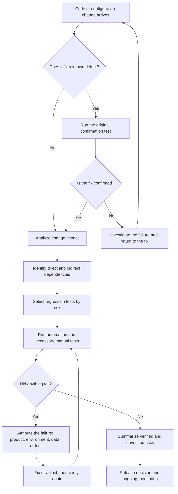
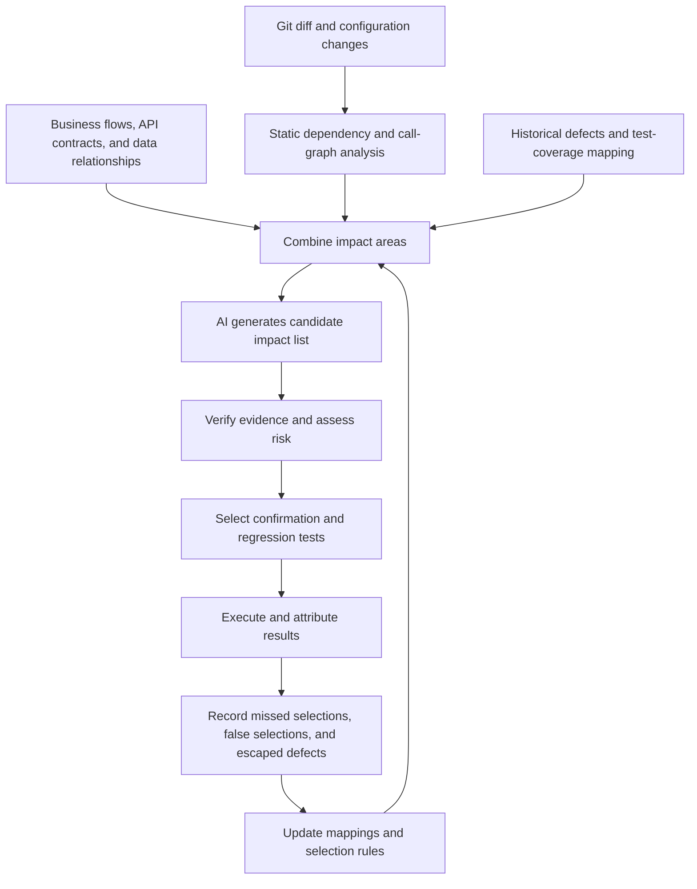

# Regression Testing vs Retesting: Key Differences and Best Practices

**Source:** ACCELQ, “Regression Testing vs Retesting: Key Differences and Best Practices.” **Author:** Prashanth Punnam; reviewed by Geosley Andrades; updated September 16, 2026.

This article follows the source article and the supplied learning notes. It distinguishes the source’s points from the practical material added in the notes. The diagrams are organized from the notes; they are not figures from the source article.

Original article: https://www.accelq.com/blog/regression-testing-and-retesting/

## Core concepts

**Retesting, also called confirmation testing,** reruns a previously failing test after a known defect has been fixed. It checks whether the defect is resolved. Keep the original steps, inputs, configuration, and trigger conditions where possible, and confirm that the fix has been deployed to the test environment.

**Regression testing** checks whether a change to code, configuration, dependencies, or the environment has unexpectedly broken existing functionality. Its scope is usually broader than retesting, but it does not mean rerunning every historical test after every change. Choose the scope based on impact, business risk, and available evidence.

In short: retesting asks, “Was this defect fixed?” Regression testing asks, “Did the fix or change break anything else?”

Retesting confirms whether a fix works, helps prevent premature defect closure, and gives stakeholders a clear “fixed” or “not fixed” result. Regression testing protects existing functionality, supports continuous delivery, and provides evidence before a build moves to staging or production. Keep separate goals and success criteria for the two activities. When they are combined into one undefined test pass, it becomes harder to tell whether a failure belongs to the fix or to another affected workflow.

### How they differ

| Dimension | Regression testing | Retesting |
|---|---|---|
| Goal | Check whether a change affected existing functionality | Confirm that a specific reported defect was fixed |
| Scope | Potentially affected features, dependencies, and workflows | The original failed test and necessary boundaries |
| Test-case sources | Previously passing tests, requirements, and change history | The original defect report and reproduction steps |
| Trigger | Code, feature, refactoring, dependency, or configuration changes | A specific defect is marked as fixed |
| Environment | May cover multiple environments or platforms | Usually starts in the environment where the defect was found |
| Automation | Well suited to repeated automation | Often a manual, one-off check; stable cases can also be automated |
| What a failure means | A side effect may have been introduced; it could also be a pre-existing issue or an unstable test | The fix may be ineffective, or the environment or data may differ |
| Main use | Assess change quality and release risk | Provide evidence for closing a defect |

Usually confirm the original defect is fixed before running broader regression tests; independent checks can run in parallel. A failed regression test should not be labeled a new defect before it has been investigated.

## Six types of regression testing

The source lists six common types. They are not mutually exclusive options in a single classification hierarchy. For example, unit describes a testing level, while selective regression describes a way to choose scope. The use cases and caveats in the table are practical notes added in the learning notes.

| Type | Focus | Common situation | Caveat |
|---|---|---|---|
| Corrective | Whether a small patch affects unchanged functionality | A small fix with no requirement change | Still assess the fix’s impact |
| Progressive | Whether a new feature or major update affects existing workflows | Incremental feature delivery | Check interactions between old and new behavior |
| Retest-All | Validate the application or the full regression suite | Large changes or releases | Costly, and still cannot cover scenarios that were never designed |
| Selective | Run tests for affected modules or workflows | Routine continuous delivery | Depends on accurate impact and test mapping |
| Partial | Check related areas that could be indirectly affected | A shared service or component changes | Account for indirect dependencies |
| Unit | Validate an individual component or code unit after a code-level change | A method or component changes | Does not replace cross-module integration testing |

## E-commerce discount-code example

**The problem:** A discount code is calculated incorrectly during checkout. The team traces the issue to a pricing utility shared by several modules.

**Retesting:** On the version containing the fix, rerun the original failure using the same account, discount code, order, and environment. If the result is correct, that scenario passes retesting; other functionality has not yet been checked.

**Regression testing:** Because the change affected a shared function, also check other discount types, tax, order totals, confirmation emails, and refund calculations. In the source example, regression testing finds a side effect in the interaction between discounts and tax—something the original retest alone would not catch.

**Practical point:** The code location changed by a fix can reveal more about regression scope than the ticket title. A shared function may affect several business areas.

## A change-validation workflow

**Added in the learning notes:** This workflow connects confirmation testing, impact analysis, regression execution, and risk reporting. Independent checks can run in parallel.

The diagram shows the logical relationships; a pipeline does not need to run every step serially. Confirmation testing and independent regression tasks can run in parallel to reduce feedback delays.

## Choosing the test scope

The source recommends retesting every fix and scaling regression scope to what the change actually touched.

| Change | Retest | Suggested regression scope | Source |
|---|---|---|
| Isolated UI defect with no shared code involved | Yes | Assess impact; usually narrow | Source |
| Change to a shared service, utility, or API | Yes | Cover known callers and related dependencies | Source |
| Change affecting authentication, payments, or a core data model | Yes | Expand to critical end-to-end flows, integrations, and security checks | Source |
| Configuration, environment, or dependency upgrade with no specific defect | No defect to retest | Focus on compatibility, startup, integration, and critical flows | Source |
| New feature with no known defect | As applicable | Test the feature and regress related existing functionality | Learning-note extension |
| Database schema migration | If there is a related defect | Check migration, rollback, data integrity, and upstream/downstream compatibility | Learning-note extension |

The hard part is deciding which situation a change belongs to. Developers may not list every shared component touched by a fix, and testers may not have full visibility into code relationships. Scope decisions should not rely only on the feature name in a ticket.

### A risk-scoring example

**Added in the learning notes:** Score a change from 1 to 5 for severity of impact (S), likelihood of occurrence (L), and breadth of impact (B):

`Risk score = S × L × B`

| Example | Severity S | Likelihood L | Breadth B | Score |
|---|---:|---:|---:|---:|
| Change to local copy only | 1 | 1 | 1 | 1 |
| Change to a shared pricing service | 5 | 3 | 4 | 60 |
| Change to authentication-token validation | 5 | 3 | 5 | 75 |

The score helps a team discuss priorities; it is not a universal industry standard. A low score must not automatically waive security, compliance, or mandatory test gates.

## Retesting practices

### Practices from the source

1. **Preserve the original failure evidence:** Record steps, test data, environment, logs, and expected results.
2. **Check boundary conditions:** Test values around the reported value, not only the reported case.
3. **Confirm what actually changed:** A test may pass because the expected result was redefined, not because the code was fixed. Record those cases differently.
4. **Handle intermittent defects carefully:** Do not close timing or concurrency issues after one passing run; repeat the relevant sequence.

### Execution advice added in the learning notes

1. **Confirm the fix is deployed:** Make sure the test environment is running the intended fixed version rather than an older build.
2. **Replay the original trigger conditions:** Pay particular attention to time zones, permissions, data state, and third-party dependencies.
3. **Keep useful tests:** Add stable, valuable defect reproductions to an appropriate regression level.

## Regression-testing practices

### Practices from the source

1. Set scope from the actual diff, call relationships, API contracts, data models, and configuration dependencies—not just the ticket.
2. Prioritize by risk: expand coverage for shared components, critical workflows, and integrations; use a narrower suite for isolated, low-risk changes.
3. Integrate automated regression into CI/CD and run it on every merge.
4. Maintain the suite actively: remove obsolete tests and fix flaky tests before noise causes the team to ignore results.

### Engineering practices added in the learning notes

1. Keep a fixed assurance suite for critical paths and select change-related tests dynamically.
2. Get fast feedback at the unit and API levels, reserving cross-system end-to-end tests for high-value scenarios; layer fast checks, change-related regression, and scheduled deep regression.
3. Deduplicate and retire obsolete tests regularly. Test count alone is not a measure of value.
4. State which impact paths remain untested and what risks remain before release.

### Layered validation in CI/CD

| Trigger | Checks | Use of results |
|---|---|---|
| Commit or pull request | Static checks, unit tests, change-impact analysis, selective API and integration regression, critical business end-to-end tests, and security gates | Produce a release candidate |
| After deploying the release candidate | Smoke tests and synthetic monitoring | Check key behavior after deployment |
| Schedule or major change | Full or deep regression | Feed results back into test-selection rules |

## Attributing test failures

**Added in the learning notes:** Use the clues below to distinguish an ineffective fix, a new regression, a pre-existing issue, an environment or data problem, a flaky test, and a stale expectation.

| Failure type | Clue | Suggested handling |
|---|---|---|
| Fix was ineffective | The original failure still reproduces | Reopen the defect or continue fixing it |
| Newly introduced regression | The old version passes and the new version fails consistently | Link it to the change and find the root cause |
| Pre-existing issue | The old version fails too | Record it as an existing issue and assess risk |
| Test-data or environment issue | Configuration, data, or dependencies are abnormal | Fix the environment and rerun |
| Flaky test | Results vary across runs on the same build | Investigate synchronization, isolation, and dependencies |
| Stale expected result | Product behavior changed with approval | Update the specification and test, keeping a record |

## Metrics and diagnosis

| Metric | Example definition | Interpretation limit |
|---|---|---|
| Defect reopen rate | Reopened defects ÷ closed defects | Also affected by requirement changes, closure process, and measurement definitions |
| Regression escape rate | Regression defects found in production ÷ confirmed regression defects | Requires consistent attribution and an observation window |
| Retest turnaround time | Time from fix availability to a confirmation result | Separate deployment wait time from hands-on verification |
| Regression-suite pass / flake rate | Pass rate, plus the share of tests with inconsistent results under the same conditions | Helps assess suite health and result reliability; do not equate it directly with product defect rate |
| Automation coverage | Target tests run automatically ÷ all target tests | Measures execution method, not test effectiveness |
| Impact-mapping recall (learning-note extension) | Affected tests selected ÷ all tests later confirmed to be affected | Requires later verification or historical baseline data |

**Do not infer a single cause from one metric.** A higher reopen rate may point to weak fix verification, but it may also result from requirement changes, deployment errors, or changes in defect-management rules. A higher regression escape rate may indicate that scope is too narrow; one common clue is that shared-code impact was not traced. Test data, environment differences, or better production monitoring can also affect this metric.

## AI-assisted change-impact analysis

The ACCELQ source describes using AI to map code changes to affected components and test cases, helping teams select relevant regression tests and skip irrelevant ones. It further says the ACCELQ platform analyzes a build once it is ready for testing, identifies whether a change is isolated or shared, recommends retesting alone or a scoped regression run, and keeps the mapping current as the codebase evolves. The author presents this impact-based selection as a way to avoid guessing and rerunning the full suite during short agile cycles, while reducing the manual work of maintaining a growing regression suite. These are the vendor’s descriptions of its own product capabilities and benefits; the source does not provide independent validation. The workflow below keeps reusable engineering ideas separate from those product claims.

**Added in the learning notes:** A general workflow can combine evidence from code dependencies, business processes, API contracts, data relationships, and historical defects. AI can then propose candidate impact areas for the team to verify.

### Evidence to keep with an impact analysis

| Field | Example |
|---|---|
| Changed component | `pricing.calculateTotal()` |
| Affected business flow | Checkout, refund |
| Dependency evidence | Call path, API contract, table references |
| Selected tests | `checkout-discount`, `refund-tax` |
| Reason | Shared pricing logic may affect tax and refunds |
| Confidence and uncertainty | Dependency graph is incomplete; human review is needed |
| Uncovered risk | Refund-notification email has no automated coverage |

**Key principle:** AI can propose an explainable impact hypothesis. Its recommendations do not prove that coverage is complete. Periodically evaluate missed selections using known changes and escaped defects.

## Practical checklists

The learning notes organize these checks to make the goals of the two activities visible in execution records.

### Retesting

- [ ] Confirm the fixed version is deployed to the test environment.
- [ ] Keep the original reproduction steps, data, and trigger conditions traceable.
- [ ] Verify whether the original failing behavior is now correct.
- [ ] Address necessary boundary cases and intermittent behavior.
- [ ] Attach evidence to the defect-closure decision.

### Regression testing

- [ ] Identify direct and indirect dependencies.
- [ ] Cover critical business flows and high-risk interactions.
- [ ] Explain why tests were selected or excluded.
- [ ] Attribute failures to product, test, environment, or data.
- [ ] Record untested areas and remaining release risks.

## Conclusion

1. **Retesting checks whether a fix works; regression testing checks whether a change broke existing behavior.** They have different goals and complement each other; skipping either can leave an unverified fix or an undetected side effect.
2. **Actual impact and risk determine the scope.** Do not run the full suite by default, and do not rely only on the ticket title.
3. **Automation and AI can help select and execute tests.** Evidence, traceability, and monitoring for missed selections still matter.
4. **Passing tests do not reduce risk to zero.** A release decision must also account for untested areas and business consequences.

> **One-line reminder:** Confirm that the original problem is fixed, check that related behavior still works, then use verified and unverified evidence to support the release decision.

## References

ACCELQ, “Regression Testing vs Retesting: Key Differences and Best Practices”: https://www.accelq.com/blog/regression-testing-and-retesting/
