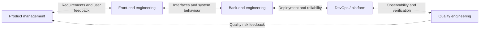
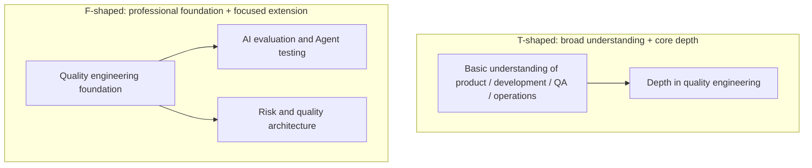
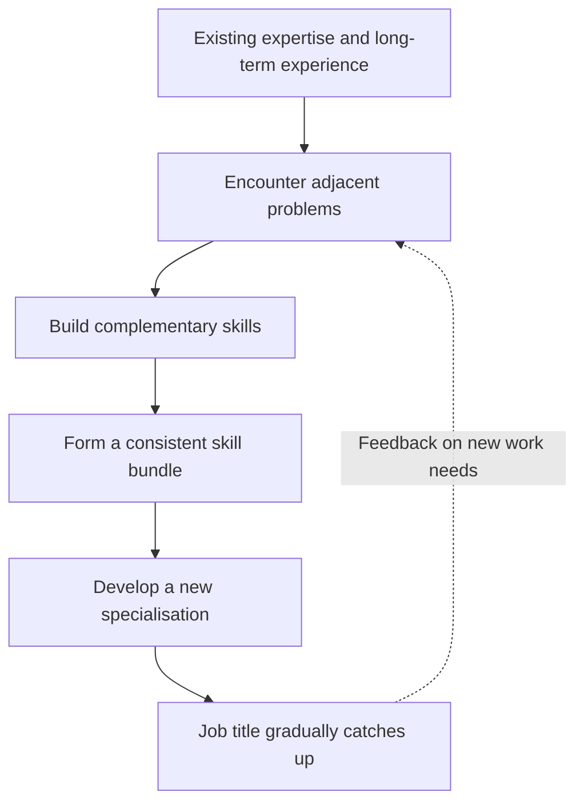
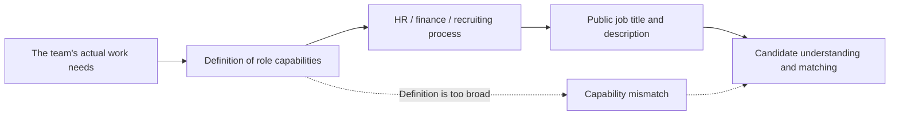
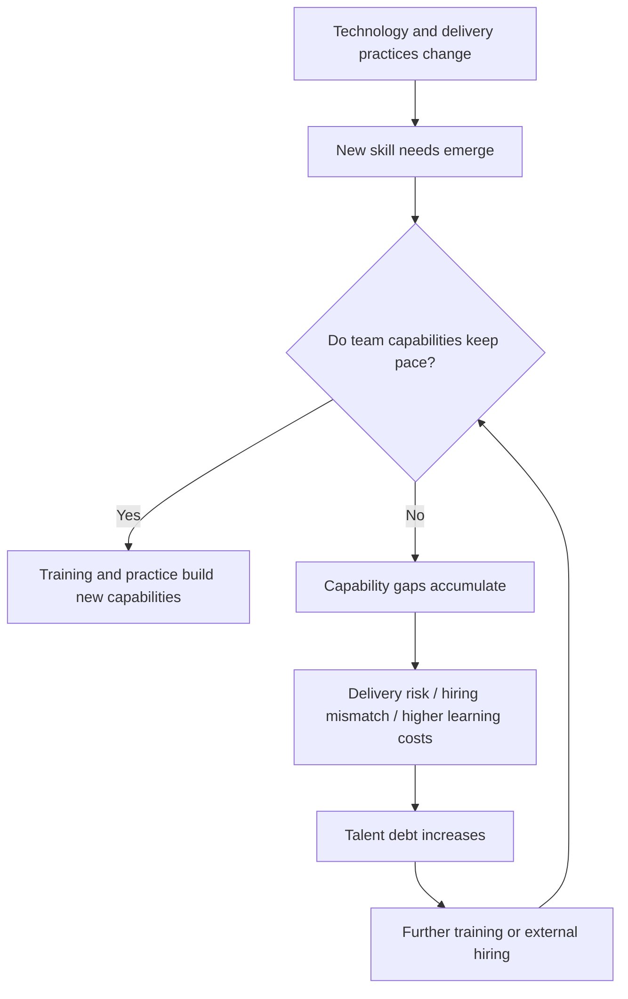
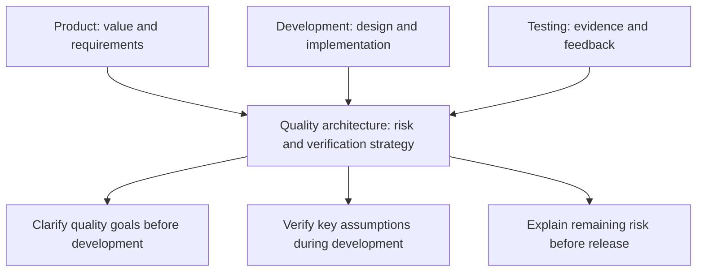
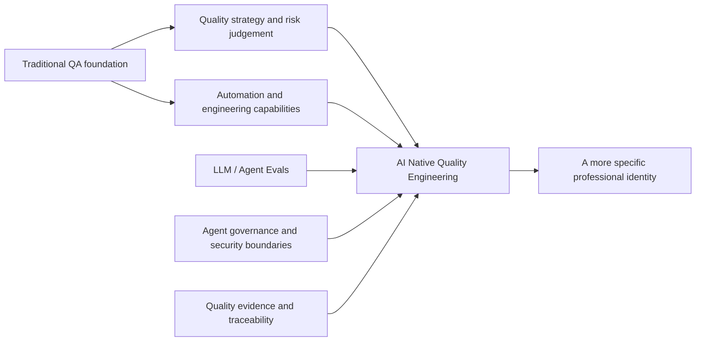

## Core idea: blurred role boundaries do not mean the loss of expertise

A common narrative about AI's effect on technical roles is that everyone must understand product, development, testing, operations, and AI, and that everyone is therefore becoming a generalist. Rosie Sherry offers a different view: **overlap between roles may be creating more specific specialisations**.

This does not mean that one person must master the work of every adjacent role. One possibility is that a person builds on an established area of expertise and extends into a neighbouring field, forming a skill bundle with clear business value.

> **The key distinction:** knowing a little about many fields is different from combining skills from a few adjacent fields into expertise that produces concrete results.

| What we observe | An easy conclusion | A more precise interpretation |
|---|---|---|
| QA takes part in requirements reviews and product discussions | QA must become a product manager | QA may specialise in requirements quality, testability, and risk discovery |
| Developers deploy models and consider operating costs | Developers must take over operations | Roles emerge at the intersection of LLM application engineering, AI platforms, and FinOps |
| Community staff take part in product decisions | Community managers must do everything | Community product operations may become a distinct combined specialisation |
| AI tools lower the barrier to working across fields | Everyone is a full-stack generalist | Cross-disciplinary work becomes more accessible, but professional judgement still takes experience |

## From traditional roles to specialisations at their intersections

The Stack Overflow interview reports that the Andela team analysed **nearly 50,000 job postings** to identify emerging skill bundles that job titles do not yet describe accurately. Cory Hymel said the team observed overlapping skills between adjacent roles along the software development lifecycle, rather than a simple shift towards a “net generalist”.

The interview does not provide the complete dataset, sampling method, or statistical tables. It therefore cannot establish that generalists do not exist in the labour market, or that hiring trends are the same across every industry.

The diagram shows **overlap in capabilities between adjacent roles**. It does not prescribe a one-way sequence for development work. In practice, QA may also work directly with product, architecture, security, and operations.

### Skill bundling

Skill bundling is not a mechanical list of tools. It combines complementary capabilities around a specific problem.

| Direction | Professional foundation | Adjacent capabilities | Value created |
|---|---|---|---|
| Front-end Product Engineer | Front-end engineering | User research, feedback, prioritisation | Deliver product outcomes more directly |
| LLM Application Engineer | Software engineering | Model integration, Agent Harness, Evals, Guardrails | Build AI applications that can be evaluated |
| FinOps Reliability Engineer | Reliability / platform engineering | Cost, models, and token consumption | Balance performance, reliability, and cost |
| Docs-as-Code Engineer | Technical writing / documentation engineering | Specification-driven development, context design | Turn documentation into an input to engineering workflows |
| Security QE | Quality engineering | Threat modelling, security verification | Include security risks in continuous verification |

The first four examples come from Cory Hymel's interview. Security QE is an extension based on a comment on the original article and the QA context.

## T-shaped and F-shaped people: different kinds of breadth and extension

A T-shaped person has depth in one field and a broad understanding of several others. In this discussion, F-shaped is a **visual metaphor** for extending from an existing specialisation toward an adjacent role. It is not a universal or rigorously defined career classification.

| Model | Main feature | Potential advantage | Misconception to avoid |
|---|---|---|---|
| I-shaped | Depth in one field | Strong expertise | Ignoring interfaces for collaboration |
| T-shaped | Depth plus broad understanding | Smoother cross-team collaboration | Mistaking understanding for mastery |
| F-shaped (interview metaphor) | A professional foundation extended toward adjacent capabilities | Can form a differentiated combination | Treating the letter shape as an objective assessment standard |
| Undifferentiated generalist | Participates in many fields without a clear specialisation | May adapt across a wider range | Too many responsibilities and an unclear professional identity |

Hymel also said the comparison between T-shaped people and other “letter-shaped” models had no definitive research conclusion. F-shaped should not be presented as a universal talent model validated by Andela.

## Rosie Sherry's experience: broad experience, focused choices

Rosie looks back on more than two decades across testing, UX, accessibility, quality engineering, entrepreneurship, ethics, community, and systems thinking. Her skill bundle looks broad, but her career choices are specific: work as a founder, put a real community at the centre, use business practices she believes in, and work toward a vision she can support.

Her experience suggests that **breadth on a résumé and a focused professional identity can coexist**.

She sees a similar pattern at MoTaverse. Hiring a “community manager” in the traditional sense may not cover the team's needs, because community work can be closely connected to product discovery, content, and service design. She describes how her colleague Simon naturally moved toward product work while retaining a community-led way of working; his job title has not necessarily changed alongside the work.

This also explains why Rosie says that, if she were looking for another job, she might use a more specific title such as “Technical Community Leader” or “Community Product Leader”. This is her hypothetical description of a professional identity, not an announcement that she is changing roles.

## Why do job titles still matter?

A job title is not the same as a capability, but it is an important interface for hiring, organisational collaboration, and how people describe their careers.

The interview notes that as a team's actual needs pass through HR, finance, procurement, and recruiters, the description may become less precise. An organisation may end up using a broad title such as “AI Engineer”, even though the work required under that title can vary considerably between companies.

A more informative title should describe the **professional foundation, people served, key problems, and boundaries of responsibility**, rather than simply accumulating fashionable technical terms.

For example, “AI Native Quality Engineer” carries more information than “QA” only when it corresponds to defined work such as evaluating AI system quality, verifying Agent behaviour, and handling quality evidence and governance.

## Talent debt: skills change faster than organisations adapt

Hymel compares talent debt to technical debt. A gap can appear between the capabilities of an organisation's existing people and the demands of new work. If the organisation does not update those capabilities over time, the costs of training, hiring, delivery, and adaptation can accumulate.

He also discusses a shortening “skill half-life”. Here, half-life is a metaphor for changes in a skill's relevance to the market; **it does not mean that every skill has a fixed expiry date**.

| Type of skill | How it changes | Implication for individuals |
|---|---|---|
| Tool syntax and framework commands | Often update quickly | Learn to use tools and verify results as they change |
| AI toolchains and Agent interfaces | Evolve rapidly | Continue to experiment, evaluate, and migrate between tools |
| Business-domain knowledge | Changes with the business but often builds over time | Understand real business constraints in depth |
| Risk judgement and systems thinking | Do not become obsolete simply because a tool is updated | Keep developing professional judgement |
| Communication, collaboration, and accountability | Remain useful across tools and organisations | Develop them alongside technical skills |

### How talent debt forms

An organisation can develop its existing people or hire externally. The former retains business and system knowledge; the latter may bring in scarce skills sooner, but introduces onboarding time and role-matching risks. The two approaches can also be combined.

## QA's professional identity: from role names to expertise in quality problems

Rosie suggests that more specific titles such as DevOpsQA, AutomationQA, and Security QA may appear in the future. Her point is not that every one of these titles will become an industry standard. It is that QA can develop new professional identities by combining quality expertise with adjacent capabilities.

| Possible direction | Core QA capabilities | Adjacent field | Main problem addressed |
|---|---|---|---|
| Automation QE | Automation design and verification | Software engineering / CI/CD | Stable, maintainable continuous verification |
| Security QE | Risk-driven testing | Security engineering | Verifying security properties and attack surfaces |
| Reliability / Performance QE | Performance and system testing | SRE / observability | Reliability, capacity, and performance risks |
| Quality Architect | Quality strategy and risk modelling | Product / architecture / development processes | Bring quality mechanisms into design and delivery earlier |
| AI / Agent Quality Engineer | Test design and evidence judgement | LLM Evals / Agents / security governance | Verify the effectiveness, reliability, and boundaries of AI behaviour |

These names illustrate possible career directions. They are not a standard job-level framework.

### Where a Quality Architect works across roles

This aligns with a comment recorded in the original notes: quality work can extend beyond end-stage test execution to risk modelling and quality design across product, development, and testing.

## Additional perspectives from the comments

Comments are useful accounts of practical experience, but they are not equivalent to statistical findings from hiring research.

- **Rahul Parwal:** Hiring and role boundaries are changing, and people can be generalists and specialists in different senses. This adds a useful perspective to the author's argument without wholly dismissing it.
- **Jesper Ottosen:** His description of working as a Security QE among DevOps colleagues illustrates that cross-role specialisations already exist in some teams.
- **Bea Bednarek:** She describes her work with shift-left, quality architecture, heuristics, and risk mapping, and sees her specialisation at the intersection of product, development, and testing. This is an account of personal practice.

## Extending the idea to AI Native Quality Engineering

The following is an independent analysis of QA career development, not a professional framework proposed directly by Rosie or Andela.

AI makes tasks such as generating tests, writing scripts, and calling tools easier. When producing a test becomes less costly, professional value may shift further toward **deciding what is worth verifying, establishing reliable evidence, recognising false confidence, and limiting the risks of autonomous Agents**.

A possible future professional identity could be expressed as:

> **Build on a foundation in quality engineering, extend into AI system evaluation, Agent behaviour verification, and quality governance, and develop a combined specialisation that can design, verify, and explain evidence of AI Native software quality.**

This is more actionable than saying that “QA will have to know everything” and is more consistent with the article's idea of focused specialisation.

### From using AI to taking responsibility for AI quality

| Level | Typical capability | Value provided |
|---|---|---|
| AI-assisted QA | Use AI to generate tests and analyse defects | Improve the efficiency of individual tasks |
| AI-enabled QE | Incorporate AI into testing processes and toolchains | Improve quality engineering efficiency |
| AI Native QE | Design Agent testing, evaluation, and governance systems | Establish verifiable quality capabilities and accountability mechanisms |

This classification is a conceptual framework from the learning notes, not an industry-wide certification standard. Its focus is the change in what people work on, what they are responsible for delivering, and what evidence is required, rather than an upgrade in job title.

## Questions worth reflecting on

- What is my professional foundation? Is it deep enough to support my judgement of AI-generated results?
- Which adjacent field am I extending into? Does that extension address the same kind of real problem?
- What distinctive capability would make others want to work with me, beyond familiarity with a particular tool?
- Which skills are tool operations that may change quickly, and which are forms of judgement that transfer across tools?
- If I add a qualifier to my professional identity, does it describe actual responsibility clearly, or make the title more ambiguous?

## Conclusion

The article challenges an appealing but oversimplified claim: that every technical worker will become an all-purpose generalist in the AI era.

Rosie Sherry offers another interpretation: overlapping skills are creating more specific areas of expertise. The hiring observations in the Andela interview lend perspective to this idea, but should not be read as an absolute conclusion about every labour market.

For QA, the goal is to retain depth in quality engineering and extend into adjacent fields that can increase its value. **A distinctive skill bundle can help QA professionals solve a particular kind of important problem reliably, without endlessly expanding their skill lists or trying to do everything.**

---

**Sources and verification notes**

- Rosie Sherry's article (October 20, 2026): https://www.ministryoftesting.com/moments/bleeding-job-titles-our-roles-are-becoming-more-specialised-not-generalised
- Ryan Donovan's interview with Cory Hymel (October 14, 2026): https://stackoverflow.blog/2026/10/14/your-next-job-doesn-t-have-a-title-yet-emerging-role-skills-q-and-a-with-corey-hymel-of-andela/
- “Nearly 50,000 job postings” is treated as the scope of the research described in the interview; no unpublished percentages or statistical significance have been inferred.
- The T-shaped / F-shaped diagrams, talent debt flow, and AI Native QE capability model are explanatory redrawings. Comments and research findings are presented separately.
