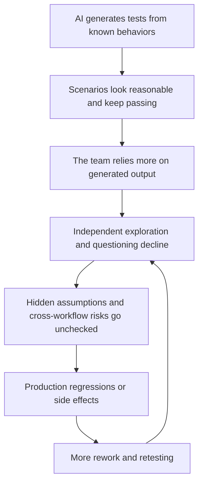
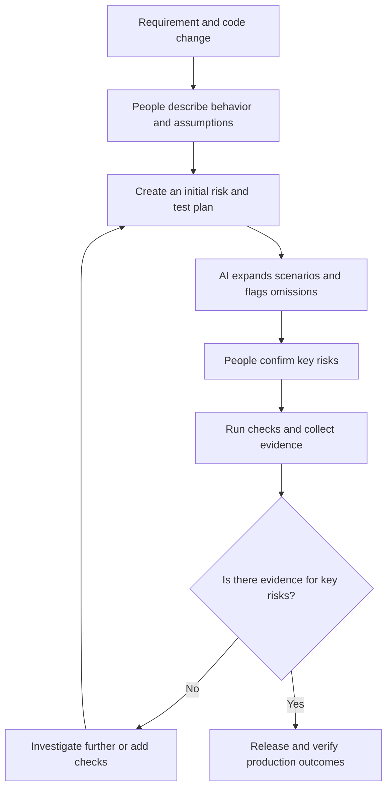

# Why More AI-Generated Tests Can Make Risks Harder to See

> Source: Hanisha Arora, “Why teams miss system signals,” WonderProxy Blog, June 3, 2026. https://wonderproxy.com/blog/why-teams-miss-system-signals/
>
> This article summarizes the original argument and adds practical templates. It is not a line-by-line translation.

## Contents

- [1. Metrics improved, but production still failed](#1-metrics-improved-but-production-still-failed)
- [2. Two defects changed the investigation](#2-two-defects-changed-the-investigation)
- [3. How AI can shape the testing boundary](#3-how-ai-can-shape-the-testing-boundary)
- [4. What speed metrics can hide](#4-what-speed-metrics-can-hide)
- [5. Put human judgment back into the workflow](#5-put-human-judgment-back-into-the-workflow)
- [6. A practical way to work together](#6-a-practical-way-to-work-together)
- [7. Warning signs and FAQs](#7-warning-signs-and-faqs)

## Green pipelines and higher output do not prove system understanding

Passing pipelines, more test cases, and faster PR merges can all represent real progress. On their own, though, they do not show that the team understands the system better. AI can reduce some preparation and execution costs without removing hidden assumptions, cross-workflow effects, or business uncertainty.

## 1. Metrics improved, but production still failed

Hanisha Arora built an AI-assisted testing workflow for her team. An agent helped surface potential blind spots, and existing business cases provided context for tests generated as developers implemented features. At first, delivery moved faster, the number of generated tests grew, and regression cycles looked healthier.

Production still exposed problems the team expected its checks to catch. PRs had merged, pipelines were green, reviews and regression tests had run, and the AI-generated scenarios had passed. The team initially framed the difficulty as “testing is slowing development.” The author later recognized that uncertainty introduced by changes was growing faster than the team’s understanding of the system.

Arora uses *signal ignorance* to describe this state: the system continues to produce signals, but the team gradually stops paying attention to them.

## 2. Two defects changed the investigation

**The first defect involved an unauthenticated flow.** A new feature was expected to work for users who were not logged in, but anonymous access was missing from the AI-generated scenarios and no one independently checked it. The problem was not a failed automated test; an important behavior had never entered the test design.

**The second defect appeared in another production workflow.** The new feature seemed isolated, and both generated tests and regression checks passed. A few days later, an unrelated workflow failed in production. The author traced the issue to an assumption shared by the new and existing workflows that had not been raised during validation. The original article does not disclose a specific field or implementation detail, so the technical cause should not be guessed.

| What the team saw | What was missing | A useful question |
| --- | --- | --- |
| Generated tests all passed | The unauthenticated behavior was not represented | Which identity states still need checking? |
| The new feature passed in isolation | A shared assumption went unchecked | What do the old and new workflows actually share? |
| Regression tests were green | Impact paths covered only known relationships | Which callers or dependencies remain uninvestigated? |

## 3. How AI can shape the testing boundary

This does not mean AI-generated tests are inherently poor. The author kept improving prompts and adding business context, and the output was often reasonable. The risk was that the team’s attention began to follow the generated list: listed scenarios got executed, while people explored beyond that list less often.



With code, search results, and business material as input, AI can help suggest new hypotheses. Generated output cannot prove those hypotheses are correct. Facts that were neither supplied nor independently verified should not be treated as confirmed. AI is better used to expand exploration than to set its limit.

## 4. What speed metrics can hide

The team treated slower testing as an automation problem and added more automation. Routine regression did get faster and fewer straightforward issues escaped, but failures in unrelated workflows and repeated regressions continued.

| What a metric measures | Common examples | What it cannot answer alone |
| --- | --- | --- |
| Activity and throughput | PR count, generated test count, coverage, release speed | Did the team identify important business dependencies? |
| Quality and system understanding | Recurring regressions, cross-module failures, retesting, unresolved assumptions | These require change and business context; they cannot be reduced to one score |

When change volume and rework rise and testers become fatigued, deep exploration can decline. Teams may then rely more heavily on generated output, making hidden risks harder to notice. Testing includes running cases, but it also includes challenging requirements, tracing dependencies, understanding state changes, and raising questions no one explicitly asked to test.

## 5. Put human judgment back into the workflow

The author did not solve the problem by replacing tools. She changed where people had to think in the process.

### Describe behavior before generating tests

Developers first explain the feature’s goal, which business behavior is changing, and which existing workflows may be affected. They then ask AI to generate tests. Making intent explicit can expose gaps in understanding and give generated output a business basis.

### Ask AI to flag gaps before a push

The author added an AI review to the pre-push workflow. It looks for missing tests, mismatches between the context used to generate them and the actual change, untested branches or side effects, and possible effects on existing workflows. The goal is to prompt a pause for judgment, not to let AI approve the change.

Teams can start with this as an advisory mechanism and sample its findings. Only stable, explicit, reviewable rules should be considered for blocking gates.

### Give QA time to explore

Once basic paths have coverage, QA can spend more time on exploration, impact analysis, pattern recognition, and challenging assumptions. The author’s team adopted a rule to create the first test plan with a person before asking AI for help. That was a correction for their overreliance on generated output, not a universal ban on AI during early requirement clarification.

### Track regression signals

Alongside throughput, release speed, and coverage, teams can look at whether bugs return after fixes, whether releases affect unrelated areas, how much retesting each release requires, and whether the same regression categories recur. A release template can also ask developers to explain what they built, why they built it, and how to verify it in production.

## 6. A practical way to work together

### Change understanding card

```markdown
## Change understanding card
- Business goal:
- Behavior before the change:
- Behavior after the change:
- Affected users and states:
- Related workflows or shared components:
- Confirmed facts and their evidence:
- Assumptions still unresolved:
- Most serious business consequence if it fails:
- Test and production verification:
```

### Risk, test, and evidence mapping

| Behavior change | Possible risk | Suggested check | Evidence needed |
| --- | --- | --- | --- |
| Add anonymous access | Login blocks the flow or access is too broad | Anonymous, authenticated, and permission-boundary checks | API or E2E run record |
| Change a shared API | Existing callers become incompatible | Caller regression and contract tests | Call relationships and API results |
| Change a state transition | Historical states fail to process | State transitions and historical data | Test data and logs |

These are generic examples, not technical details of the defects in the original article.

### From understanding to release verification



During a quality review, select a few unusual PRs and production defects. Ask what information was available, what was missed, and which signals failed to get attention. Counting completed templates alone can make documentation look complete while understanding remains weak.

## 7. Warning signs and FAQs

Watch for these signals:

- The same defect or type of regression keeps returning.
- Metrics improve, but confidence in releases does not.
- People can explain what changed in the code but not which business flows might be affected.
- The first response to uncertainty is always another process or tool, not an investigation.
- A failure seems predictable in hindsight, but no one raised the question before release.
- Rework leaves QA with almost no time to explore.

**Should we stop using AI to generate tests?**

No. Clarify the goal, risks, and assumptions first; then use AI to expand scenarios and verify them with execution results and other evidence.

**Does coverage have no value?**

It does, but be clear about what it covers. Code, requirement, and risk coverage answer different questions and cannot replace one another.

**Does every PR need a long report?**

No. A short explanation may be enough for a low-risk change. Shared components, security, data, or complex state changes may need deeper impact analysis. A template should support thought, not take time away from it.

The author’s main adjustment was to bring active questioning back into the workflow. Alongside asking “How many tests did AI generate?”, the team should ask “Do we understand better how this change can affect the system?” AI can help expand and execute checks; people remain responsible for challenge and judgment, and release decisions need traceable evidence.

## References and further reading

- Hanisha Arora, “Why teams miss system signals,” WonderProxy Blog, June 3, 2026: https://wonderproxy.com/blog/why-teams-miss-system-signals/
- Google SRE, “Effective Troubleshooting”: https://sre.google/sre-book/effective-troubleshooting/
- ISTQB, “Certified Tester Foundation Level (CTFL) v4.0”: https://istqb.org/certifications/certified-tester-foundation-level-ctfl-v4-0/

This is the second article in the “Rethinking Software Quality in the AI Era” series. It looks at how AI-assisted testing can affect team attention, risk judgment, and test design.
