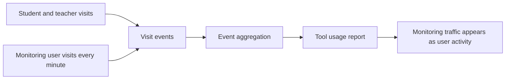
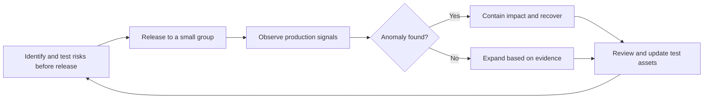

# Why Bugs Still Escape Thorough Testing: Unknown Unknowns and System Resilience

> Source: Tina Fletcher, “The bug that finally convinced me I’d never be able to find all the bugs,” WonderProxy Blog, June 23, 2026. https://wonderproxy.com/blog/the-bug-that-finally-convinced-me-id-never-be-able-to-find-all-the-bugs/
>
> This article summarizes the original argument and adds quality engineering practices. It is not a line-by-line translation.

## Contents

- [A report that had been tested thoroughly](#a-report-that-had-been-tested-thoroughly)
- [What production data revealed](#what-production-data-revealed)
- [The missing piece was system knowledge](#the-missing-piece-was-system-knowledge)
- [Prepare for the unexpected](#prepare-for-the-unexpected)
- [What QA can check](#what-qa-can-check)
- [Frequently asked questions](#frequently-asked-questions)

## Testing reduces known risks, but cannot complete our understanding of a system

Testing can reduce risks a team has identified. It cannot verify production conditions the team has never considered. Pre-release checks therefore need to work alongside production monitoring, impact containment, and recovery capability. The goal is not to test less; it is to prepare for situations that were outside the test design.

## A report that had been tested thoroughly

While working at D2L, Tina Fletcher helped build a tool usage report for school administrators. It showed which learning platform tools students and teachers used most often. Each visit generated an event, and the report aggregated those events into a pie chart.

The team tested much more than whether the chart rendered correctly:

| Test area | What they checked |
| --- | --- |
| Chart presentation | Very small or large numbers of tools, multiple languages and special characters, long and short labels, phones and tablets, browser compatibility, and screen-reader access |
| Event flow | Event delay, heavy load, repeated visits, API access, re-queuing when processing was unavailable, impersonation, and malformed events |
| Data retrieval | Missing or unavailable data, unexpected formats, access permissions, large data sets, concurrent queries, and time zones |

They had tested the event flow, retrieval, and presentation and felt they had covered the report well, especially for a relatively simple chart.

## What production data revealed

Soon after release, customers reported that the chart was wrong. Home Page Config accounted for about 90 percent of the report, leaving very little room for the other tools. The investigation found that each production instance had a dedicated monitoring user. D2L’s network operations team used it to run site stability checks, visiting Home Pages Config once a minute.

The report counted those visits together with actual student and teacher activity. The fix was to exclude this type of user. Event recording and aggregation could work as designed while the metric still failed to answer the business question.

The report was meant to show which tools students and teachers used. In practice, it counted every tool visit the system received. Correct data processing does not guarantee that a metric has the right business meaning.

## The missing piece was system knowledge

The monitoring user did not exist in the test environments, and the test team did not know that production had one. Without that input, the team could not infer from its existing cases that the user would affect the report.

This kind of risk is often called an *unknown unknown*: the answer is not merely unresolved; the team has not yet thought to ask the question.

| Situation | Example | A useful response |
| --- | --- | --- |
| Known and confirmed | Events must be grouped by tool | Design and run the relevant data checks |
| Known but unresolved | Should impersonation activity appear in the report? | Ask product, operations, and data owners to define the rule |
| Known but not shared | Operations knows about the monitoring user, but development and QA do not | Review the runtime environment across teams |
| Not yet considered | Automated checks change a “user activity” metric | Observe production data and review incidents |

The incident also separates technical results from business results. A report needs a definition of its population, denominator, exclusion rules, and metric semantics, in addition to correct queries and aggregation. The same questions apply to analytics, event tracking, recommendation systems, and AI products.

## Prepare for the unexpected

The author shifted more effort toward readiness for failures. Her practices included considering and testing monitoring and alerts for new features; making small, incremental releases; gradually rolling out to selected customers or regions where feasible; writing and regularly exercising playbooks and disaster-recovery procedures; and keeping logs, test environments, test data, and deployment processes useful for diagnosis and repair.

The work can be organized as a loop:

The team can review three capabilities:

| Capability | What QA and the team can check |
| --- | --- |
| Detection | Can business metrics, structured logs, traces, and alerts reveal the issue? Have the alerts themselves been tested? |
| Containment | Can the team release in small steps, pause a rollout, or use a canary, staged rollout, or feature flag where appropriate? |
| Recovery | Are owners, playbooks, recovery exercises, usable test environments and data, and rollback or compensation plans in place? |

This does not mean every feature needs a complex set of controls. The investment should match the business risk. For data changes, distinguish application rollback from data recovery: reverting code does not automatically restore data that has already been written.

## What QA can check

### Before development: identify who produces the data

The following rules are examples for a tool usage report. They are not the rules used by D2L’s original system:

| Event source | Count in the report? | Behavior to establish |
| --- | --- | --- |
| Student visit | Yes | Is a valid visit counted? |
| Teacher visit | Yes | Is it aggregated according to the agreed definition? |
| Operations monitoring user | No | Is the event excluded from business reporting? |
| Automated test account | To be confirmed | How do its label and purpose affect reporting? |
| Administrator acting on a user’s behalf | To be confirmed | Which user owns the event? |
| Automated API call | To be confirmed | Does it qualify under the metric definition? |

Product, operations, and data owners should resolve open rules together. Testers should not fill in those gaps by guessing.

### Before release: compare test and production environments

- [ ] Does production have monitoring users, service accounts, or probe traffic that test environments lack?
- [ ] Are there customer-specific configurations, historical data, or long-running scheduled jobs?
- [ ] Are event processing, filtering, and metric definitions consistent across environments?
- [ ] Can anonymized or synthetic data cover important production characteristics?
- [ ] Can business monitoring detect unusual data distributions, not just API errors?

### After release: verify business outcomes

Alongside HTTP status codes, consider the total event volume, the share of events from non-business accounts, unusual concentration around one tool, processing delay, and error rate. Set thresholds from historical data and business distributions; a single percentage is not a universal failure threshold.

### After an incident: keep recovery evidence

| Question | Evidence to record |
| --- | --- |
| Which customers and business metrics were affected? | Customer scope, time period, metric snapshots |
| When was the issue detected? | Alert and ticket timestamps |
| Can the misleading report be paused or traffic limited? | Mitigation plan and required approval |
| Is a rollback, code fix, or data recomputation needed? | Decision from technical and data owners |
| How will recovery be demonstrated? | Before-and-after comparisons, samples, monitoring records |
| How could the next incident be found sooner? | Updated monitoring, test data, or environment notes |

Quality reviews can also consider mean time to detect (MTTD), recovery time, affected data scope, alert usefulness, and recovery exercise results. Look at trends and actual business impact instead of turning one number into a performance target.

## Frequently asked questions

**If testing cannot cover every situation, should we test less?**

No. Testing still reduces many foreseeable problems. Teams should also reserve effort for detecting and recovering from anomalies; resilience work does not replace basic testing.

**Will copying production data into test solve the environment gap?**

Not necessarily, and it may create privacy or compliance risks. List the important environment differences, cover key characteristics with anonymized or synthetic data, and supplement that with authorized production observation.

**If we add monitoring, do we still need to test business reports?**

Yes. Testing checks the rules; monitoring detects anomalies at runtime. Monitoring and alerts need verification too.

**Can AI find unknown unknowns?**

AI can prompt a team to consider familiar blind spots such as monitoring users and service accounts. Without system facts and context, it cannot guarantee the inference is right. Risks suggested by AI still need investigation.

Test coverage depends on what the team knows about the system, and that understanding can be incomplete. QA can help define business metrics, make production signals visible, and ensure the team practices recovery.

**Quality does not mean promising that failures will never happen.** Teams should work to prevent problems and be ready to detect, contain, and recover from them.

## References and further reading

- Tina Fletcher, “The bug that finally convinced me I’d never be able to find all the bugs,” WonderProxy Blog, June 23, 2026: https://wonderproxy.com/blog/the-bug-that-finally-convinced-me-id-never-be-able-to-find-all-the-bugs/
- Google SRE, “Monitoring Distributed Systems”: https://sre.google/sre-book/monitoring-distributed-systems/
- Google SRE, “Release Engineering”: https://sre.google/sre-book/release-engineering/

This is the first article in the “Rethinking Software Quality in the AI Era” series. It looks at the limits of test coverage and how teams can prepare for unknown production conditions.
