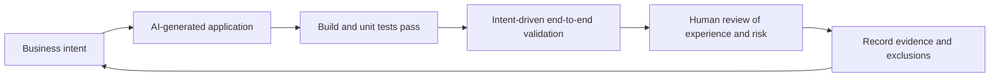
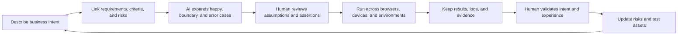
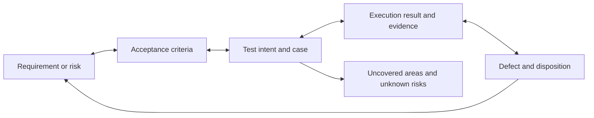
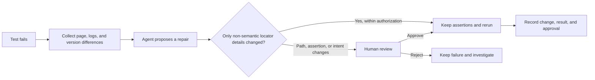
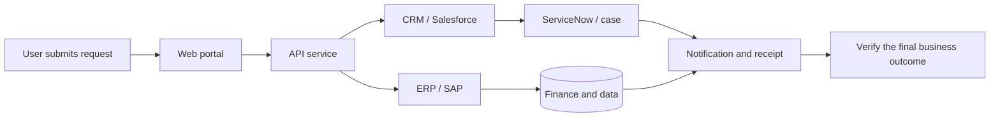
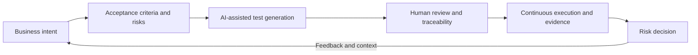

# Vibe Testing: Validate AI-Generated Software Through Test Intent

**Source:** ACCELQ, “What Is Vibe Testing? The Complete AI QA Guide,” with the in-article heading “How Vibe Testing Changes the Way Teams Think About Quality,” published August 25, 2026. The page spells the author’s name differently in different places; this article does not infer additional biographical details from that discrepancy.

This article draws on the source and the complete learning notes. It distinguishes the source’s claims and vendor examples from engineering extensions. ACCELQ sells testing tools, so its product positioning and customer outcome figures should be read as vendor-reported claims.

Original article: https://www.accelq.com/blog/vibe-testing/

## Why AI-generated software needs a different validation lens

Vibe Testing is an AI-assisted quality approach in which testers describe expected behavior in natural language, then use AI to help generate, execute, and maintain tests. It borrows the interaction style of Vibe Coding and moves the input from click-by-click instructions toward business intent.

That does not mean testing no longer needs code, or that natural language removes ambiguity. Vibe Testing is still an evolving practice and market term, without a shared definition, certification, or quality standard. The practical shift is in where the work begins: testers describe the outcome, confirm the acceptance rules, check whether generated tests test the right thing, and judge whether the evidence supports a decision.

Andrej Karpathy introduced the term Vibe Coding in early 2025 for using natural language to guide AI-generated code. Tools such as Replit, Cursor, Bolt, and Lovable make it possible for developers and non-developers to build applications quickly. Faster construction does not remove the need to validate the result. Code can compile and all unit tests can pass while a full business journey or user experience still fails. A mobile checkout button might respond, for example, while the confirmation step silently fails; a login flow can work while unclear errors and redirects leave new users confused.

Vibe Testing aims to close that validation gap. The question expands from “Did it pass?” to “Did the software do what we meant, and can a user complete the task?” Functional correctness and an experience that meets expectations are different things.

## Intent-first, adaptive, and experience-focused

| Characteristic | What it means | Boundary to keep in view |
|---|---|---|
| Intent-first | Describe the outcome instead of specifying every element, selector, and click | “Make checkout work” is still ambiguous; AI may fill in the wrong rules |
| Continuous adaptation | AI attempts to regenerate or self-heal tests when a page or workflow changes | Self-healing can hide a regression or change what the test means |
| Experience validation | Look at whether the complete interaction is coherent, not only whether each control returns the expected value | “Good experience” needs concrete, reviewable evidence; a model’s impression is not enough |

An agent should not decide by itself what counts as correct. A safer approach is to derive tests from confirmed business intent, acceptance criteria, design specifications, and user research. Any assumption it cannot confirm should be made visible for a person to resolve.

## From test intent to quality evidence

The source describes a loop: define intent, expand scenarios, execute automatically, self-heal, and have a person validate the result. An engineering workflow also needs requirement links, explicit acceptance rules, evidence capture, and review of semantic changes.

AI can add happy paths, boundary values, and unusual input combinations, then run tests across browsers, devices, and environments. But a “pass” only means the current checks did not report a failure. It does not prove that the tests covered the important rules, and it is not a release decision. A person still needs to check whether the tests reflect the intent, whether the result is credible, and what remains unknown.

This is the quality loop: record problems, false positives, healing proposals, and human decisions from each run. Turn useful findings into reusable context—business rules, decision criteria, and tool limitations—then use that context in the next run and keep refining. Different models, agent tools, and business situations behave differently, so intent, prompts, permissions, and review points need to be adjusted against real feedback. No configuration is permanently right after one attempt.

| Stage | What to retain |
|---|---|
| Record and test | Requirements, test intent, model and tool versions, results, issues, and human decisions |
| Build context | Confirmed rules, recurring misinterpretations, uncovered risks, healing boundaries, and supported environments |
| Run again | Apply the context to the next cycle, compare outcomes, and revise the tests and working method |

## What Vibe Coding and Vibe Testing each do

| Dimension | Vibe Coding | Vibe Testing |
|---|---|---|
| Lifecycle stage | Build software | Validate software |
| Typical input | “Build a checkout flow with saved cards” | “Verify a returning user can complete checkout smoothly” |
| Typical output | Application code, UI, and features | Executed tests, results, defects, and quality evidence |
| Common participants | Developers and non-technical builders | QA, product managers, designers, and developers |
| Main risk | Code runs but has not been adequately understood or validated | AI infers the wrong scenario or pass criteria |

The source also discusses Vibe Coding QA: testing applications created with Vibe Coding, with attention to behavior omitted from the original prompt, error paths, and side effects across features. Business users and designers may not know how to write scripts, but they can often tell when a journey confuses users. Their participation does not remove the need for QA review.

## How it fits with conventional test automation

| Dimension | Common Vibe Testing approach | Common conventional automation approach | Misconception to avoid |
|---|---|---|---|
| Starting point | Express business intent in natural language | Build scripts from code, test models, or other methods | Conventional tests can also be requirement-driven; they are not limited to recorded steps |
| Core question | Can the user achieve the expected outcome? | Do specific features and assertions meet expectations? | Both need to consider correct behavior and user outcomes |
| Participation | Domain experts can describe expected outcomes | Script creation and maintenance often need engineering skills | Lowering the entry barrier does not remove the need for test design |
| Maintenance | AI attempts to self-heal or regenerate | Teams maintain abstractions, locators, and scripts | Self-healing does not guarantee lower total cost; a bad repair can hide a defect |
| Feedback timing | Can run continuously and report on commits | Can also run continuously in CI/CD | Conventional automation is not limited to sprint-end or release checks |
| Best fit | Frequently changing UI, AI-generated apps, and experience journeys | Deep regression, complex logic, performance, security, and integration testing | The approaches complement each other; neither replaces the other |

The source characterizes conventional automation narrowly. In practice, scripted tests can run on every commit and can verify end-to-end journeys and user experience too. The more specific value of Vibe Testing is that it makes business intent easier to bring into test design and lets AI assist with some scenario expansion, execution, and maintenance.

Performance benchmarks, security validation, complex integrations, and deep functional regression still need deliberate test design and purpose-built evidence. Vibe Testing can add signals to that work; a natural-language description alone cannot replace it.

## Three use cases in the source

**A SaaS team with frequent UI changes.** The source describes a team changing navigation and checkout each week, with Selenium maintenance taking about half of QA capacity. After adopting intent descriptions and AI healing, QA can spend more time on exploratory and boundary testing. That figure is an illustrative source example, not an independent study. Actual value depends on testability, the rate of incorrect healing, and human review cost.

**A new-user onboarding flow.** Feature tests report no errors, but a product manager notices new users repeatedly getting stuck. The team reviews the complete journey—step order, copy, and completion path—and finds friction that checks on individual fields missed. AI can surface clues, but whether users are confused should be checked against funnel data, interviews, usability testing, or other behavioral evidence.

**A designer validating an AI-generated form.** The designer describes that the form should save responses, send a confirmation email, handle long inputs, and work on mobile. AI generates and runs tests from that description. This shows how a non-technical participant can contribute to validation; it does not show that complex products can do without QA.

## Governance: why trust the tests AI generated?

Natural language is ambiguous. “Make sure checkout works” may omit discount combinations, refunds, retry behavior, or data consistency. At scale, teams need to answer three questions: what does each test trace to, why did it pass, and what did the tool not test?

| Governance concern | Question to answer | Evidence to retain |
|---|---|---|
| Traceability | Which requirement, user story, or risk does this test cover? | Requirement or risk ID, acceptance criteria, test intent, and test ID |
| Auditability | Can we reconstruct why the test passed later? | Decision criteria, model and prompt versions, environment, logs, and approvals |
| Coverage confidence | Does the tool say what it did not test? | Coverage map, exclusions, unknowns, and residual risks |

Bidirectional traceability does not mean every exploratory finding must be forced onto an existing ticket. A newly discovered risk or implicit business rule can be recorded first and linked to a test. Do not let AI invent a requirement just to complete a chain.

The source cites the claim that the 2024 CrowdStrike incident occurred despite “94% code coverage.” The learning notes did not independently verify that figure, so this article does not present it as established fact. The general lesson still holds: code coverage shows which code ran; it does not show whether important business rules were validated correctly.

## Self-healing must preserve test intent

When a UI change breaks a test, AI may suggest repairing a locator or regenerating steps. The suggestion should not be accepted just because it turns the test green. The key question is whether the original assertion and business meaning remain intact.

Automatically changing assertions, skipping important steps, lowering thresholds, or replacing “the user cannot complete the task” with “the page did not error” are high-risk changes. A repair should restore valid verification, not erase a failure signal. Keep the original intent, old and new steps, agent proposal, human decision, and execution evidence traceable.

## Enterprise journeys cross system boundaries

Many demonstrations focus on greenfield web applications. Enterprise processes may span web, API, desktop, SAP, Salesforce, ServiceNow, and mainframe systems. An agent that can operate one web page cannot, by itself, prove that a cross-system transaction completed correctly.

Cross-system intent testing also needs to consider identity propagation, asynchronous consistency, API contracts, test-data lifecycle, and observability. The value of intent-first testing depends on how much of the business process a tool can actually reach and verify.

## Tool positioning in the source

The following descriptions come from the ACCELQ article. They are not an independent product review or a complete verification of current market capabilities. Since the author is affiliated with the vendor, validate product claims in a scenario-specific proof of concept.

| Tool | Capability described in the source | Source’s suggested fit | Boundary to check |
|---|---|---|---|
| ACCELQ | Web, API, mobile, desktop, and packaged apps, with healing and traceability | Enterprise teams needing cross-system coverage | Vendor claim; validate scope and cost independently |
| testRigor | Natural-language test creation | Smaller QA teams | Assess semantic stability and review effort |
| Appvance AIQ | Learns an application and generates tests | New SaaS products with little existing coverage | Assess explainability and maintainability |
| LambdaTest KaneAI | Natural-language generation for end-to-end web flows | Mid-market teams already using its execution environment | Verify current integrations and supported scope |
| Testsigma | Test generation from natural language and Jira/Figma | Agile web teams | Verify traceability and execution in practice |

The article also says ACCELQ customers reported “7.5x faster automation development” and “over 72% lower maintenance overhead.” These are vendor-reported customer outcomes, not independent controlled studies, and should not be assumed to apply to another team.

## How to assess whether it is useful

Do not judge the approach only by how quickly it generates a test. Evaluate the full lifecycle. The dimensions below are engineering extensions from the learning notes, not an industry-standard metric set published by the source.

| Dimension | Questions to observe |
|---|---|
| Test effectiveness | How many critical requirements are covered? How many assertions are wrong? |
| Risk discovery | Does it find real defects and important coverage gaps? |
| Maintainability | How much human repair is needed after UI changes? How often does healing make a wrong change? |
| Auditability | Can tests, requirements, evidence, and approvals be traced to each other? |
| Runtime stability | Are flakiness, false positives, and false negatives acceptable? |
| End-to-end reach | Can it cover critical cross-system paths and observe final outcomes? |
| Economics | What is the net value after model, tool, execution, and human review costs? |

## Its relationship with Shift-left and the quality loop

Natural language lowers the barrier to expressing expectations, so product managers, designers, and business analysts can help define user outcomes before implementation is complete. Shift-left means surfacing ambiguous requirements, incorrect assumptions, and quality risks earlier in the lifecycle.

As an engineering extension in the learning notes, we can view Vibe Testing through three connected layers of AI Native Quality Engineering:

| Layer | Question to answer |
|---|---|
| Capability | Can natural-language intent become executable tests, and can those tests adapt when the application changes? |
| Quality Engineering | Are the generated tests accurate, stable, risk-relevant, and capable of validating business intent? |
| Governance | Who approves test intent and high-risk healing? How are decisions and evidence traced? How are agent permissions controlled? |

Greater capability calls for stronger quality evaluation and governance. Natural language can be an entry point; it cannot replace test design, observability, test-data engineering, risk assessment, or release accountability.

The team still owns quality. Vibe Testing changes how people interact with testing and contribute to it; the team remains accountable for risk, test validity, and release decisions. Every new model, prompt, tool version, and business scenario needs to go through the quality loop again.

## Conclusion

Vibe Testing brings business intent more directly into test design, lets AI help expand scenarios, execute checks, and maintain parts of the suite, and moves quality feedback earlier into development. QA still needs to resolve ambiguity in natural language, check AI-inferred expectations, review whether healing hides a defect, and combine evidence to assess user experience and release risk.

For the approach to hold up, teams need intent-first design, evidence, bidirectional traceability, human ownership of critical decisions, and a complementary set of conventional engineering tests. Each cycle should also record issues, turn useful findings into reusable context, and carry that context into the next run. Tools can help teams move faster. The team still has to show that it tested the right thing.

**Further reading**

ACCELQ source: https://www.accelq.com/blog/vibe-testing/
